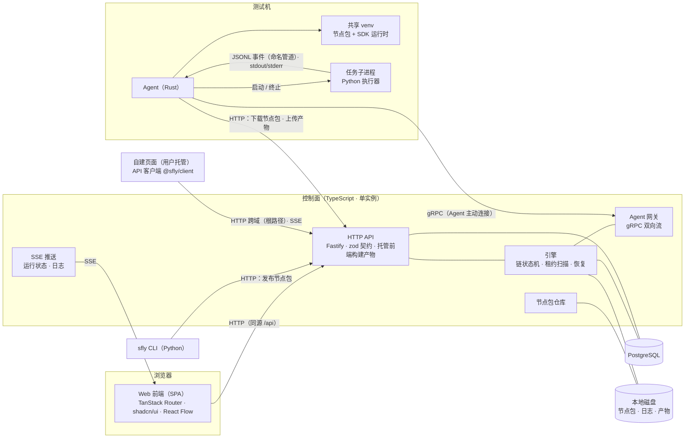
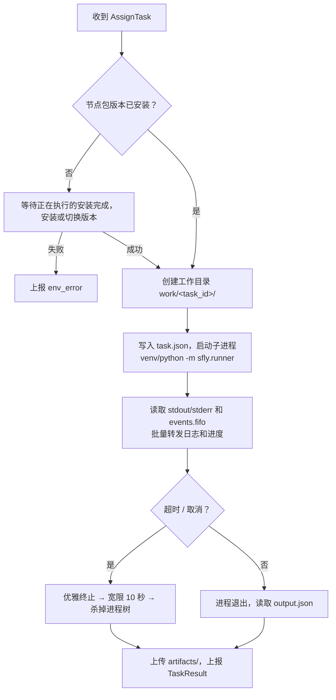

# sfly 架构设计

> 状态：草案 · 2026-11-13（随 #263 更新：开放 HTTP API 和 API 客户端，用户用它开发自建页面）
> 术语见 `GLOSSARY.md`，执行语义见 `docs/SEMANTICS.md`，关键决策见 `docs/adr/`。

---

## 1. 定位与边界

sfly 是内网测试用的自动化任务编排平台：用户在画布上把节点编排成链，平台把节点派发到指定的 Agent 上执行，并展示状态、日志、进度和产物。

**范围内**

- 在编排画布上编排场景，场景版本管理，防止并发修改；场景可以写说明、归档与恢复
- 手动触发运行，执行链和异步子流程
- Python SDK 开发节点包，发布到平台，由 Agent 下载并安装
- 实时日志、进度、节点指标与图表、产物
- 开放现有的 HTTP API，提供 TypeScript 的 API 客户端 `@sfly/client`：用户用它开发自己托管的自建页面（看板、按参数触发场景的页面）和程序（ADR 0022）

**范围外（明确不做）**

- 连接生产环境；平台只用于测试
- 用户登录和权限；只用浏览器昵称做标记
- "测试环境"这类概念；Agent 部署在哪里，任务就在哪里执行
- 条件、循环、foreach、join、try/catch 等控制节点
- Cron 触发、Webhook 触发、周期任务
- 资源锁、Agent 标签匹配和自动选择 Agent
- 密钥服务、自定义指标面板、跨场景复用子流程
- 托管或展示用户的自建页面、进程内插件；为自建页面新增接口（事件推送和对外的 Webhook、跨运行的指标查询、运行列表的时间范围和翻页）

平台与被测系统的业务领域无关。原型中的交易链路节点（Git、柜台、策略、下单等）都属于用户自己用 SDK 开发的节点包。

---

## 2. 总体结构



| 组件 | 技术 | 职责 |
|---|---|---|
| Web 前端 | 纯 SPA：TanStack Router、TanStack Query、shadcn/ui（Base UI）、Tailwind v4、React Flow；构建产物由控制面托管 | 控制台、场景列表、编排画布、版本与冲突处理、运行抽屉、运行监控（时间线、图表、日志）、运行记录、Agent 与节点包管理 |
| 控制面 | Node LTS、TypeScript、Fastify、Drizzle ORM | HTTP API、SSE、前端页面、引擎、Agent 网关、节点包仓库；单进程、单个 HTTP 端口部署，以 Docker 镜像发布（ADR 0010） |
| 数据库 | PostgreSQL | 唯一可信的状态来源 |
| 文件存储 | 控制面本地磁盘 | 节点包文件、任务日志、产物 |
| Agent | Rust、tokio、tonic | 连接控制面、安装节点包、执行任务、转发日志/进度/结果；以 musl 静态二进制发布（ADR 0010） |
| SDK 运行时 | Python，**只用标准库** | 在任务子进程中加载并调用节点函数 |
| SDK CLI | Python | 生成节点元信息、构建并发布节点包、本地开发模式、操作平台（场景等，#238） |
| API 客户端 | TypeScript，ESM 与类型声明，没有运行时依赖 | 自建页面和用户程序调用 HTTP API：带类型的接口调用、断线自动重连的事件流订阅、下载地址的拼接、统一的错误类型；控制台的请求层也建立在它上面（ADR 0022） |

前端只负责页面，不写业务逻辑；引擎需要常驻进程（Agent 长连接、租约扫描、故障恢复），所以控制面独立部署。

---

## 3. 仓库结构

```
apps/web            前端 SPA（vite 构建，Playwright 端到端测试在 apps/web/e2e）
apps/server         控制面（API · 引擎 · Agent 网关 · 节点包仓库）
agent/              Rust Agent（cargo）
sdk/python          Python SDK 运行时 + CLI（uv）
proto/              Agent ↔ 控制面的 protobuf 契约（buf 管理，breaking 检查）
packages/schema     场景文档、节点包元信息与 HTTP 接口契约的 schema（zod，导出 JSON Schema 供 Python CLI 校验）
packages/orchestration  场景文档的纯逻辑（链结构、引用与静态检查、整理布局），前端与控制面共用
packages/client     API 客户端 @sfly/client（ADR 0022）：类型和路由表从 HTTP 契约生成，构建成 ESM 与类型声明，打成控制面提供下载的安装包
docs/               架构、语义规范、ADR；docs/guide 是用户文档（ADR 0013：前端「开发文档」、控制面原文与 /llms.txt、SDK 里的 skill 都出自它）
```

- JS/TS 使用 pnpm workspace；Rust 使用 cargo；Python 使用 uv。
- 文档和代码里的名称不一一对应（GLOSSARY 不写实现，对照在这里）：
  - **场景**在代码里叫 `orchestration`：`orchestrations` 表、`packages/orchestration`、`/orchestrations` 路由、`OrchestrationStore`、`OrchestrationDocument`；前端的页面目录是 `apps/web/src/scenarios/`，接口路径仍是 `/orchestrations`。
  - **子流程**在代码里叫 `chain`（链）：`chain_instances` 表、`chain_id`；主链和子流程都是链，**异步任务节点**到子流程入口节点的连线叫 `dispatch`。
  - **节点包**在代码里叫 `package`（`node_packages` 表、`apps/server/src/packages/`、`PackageNode`），不要和 pnpm workspace 的 `packages/` 目录弄混，后者是 TypeScript 库；标准节点包在 `std/`。
- 三份契约，各有唯一来源：
  - **线上协议**（Agent ↔ 控制面）：`proto/`，生成 TS（protobuf-es）和 Rust（prost/tonic）代码。
  - **文档格式**（场景文档、节点包元信息）：`packages/schema`，前端和控制面直接使用；Python CLI 使用导出的 JSON Schema。
  - **HTTP 接口**（浏览器、CLI、Agent ↔ 控制面）：`packages/schema/src/http`（ADR 0007），见 §7。它同时导出一份路由清单（`sdk/python/src/sfly/schemas/routes.json`，随 SDK 打包，`pnpm gen:check` 保证最新），`sfly api` 用它列出、说明和校验接口（每个接口的说明、只读还是有副作用、作用的资源、响应的 JSON Schema 都在里面）。已移除的节点种类（ADR 0028）也导出一份给命令行读（`removed-node-kinds.json`，同样由 `pnpm gen` 生成），命令行里没有第二份清单。API 客户端的类型和路由表是这份契约的又一份生成物（`packages/client/src/generated/`，见 §7.4）。

---

## 4. 节点包与 SDK

### 4.1 编写节点

```python
from sfly import node, Context

@node(title="HTTP 检查")
def http_check(ctx: Context, url: str, expect: int = 200) -> dict:
    ctx.log.info("checking %s", url)
    ctx.progress(1, 3, "建立连接")
    path = ctx.artifacts.save("response.json", body)
    return {"status": 200, "report": path}
```

- 输入：从函数参数的类型注解生成元信息。
- 节点类型的说明：函数的文档字符串去掉缩进后整段写进元信息里节点类型的可选字段 `description`（最长 4000 个 Unicode 字符，超过时 `sfly build` 报错；没有文档字符串就不写）。「添加节点」菜单和节点包管理页显示第一段，检查器的「说明与指标」页显示全文；节点包列表接口里的节点摘要也带 `description`。节点类型这一层是严格对象，带说明的包发布到旧版本的控制面会被拒绝，所以要先升级控制面；Agent 把元信息当 JSON 原样转发，不受影响。
- 输出：函数的返回值（JSON 对象，上限 1 MB）；返回值的键在装饰器或返回类型注解中声明，用于画布补全和保存时的引用检查。输出 TypedDict 字段注解里的 `Annotated[T, Doc("…")]` 写成这个输出 schema 的 `description`（规则和输入一样，最长 500 个字符），检查器「说明与指标」页的输出表、引用补全、节点包管理页和 `sfly package show` 显示它。
- 指标与图表：`@node(metrics=[Metric("tps", unit="笔/s"), Metric("rejected", kind="counter")], charts=[Chart("TPS", type="line", metrics=["tps"])], primary_metric="tps")`。`Metric` 可以声明标签键（`Metric("conn_tps", labels=["host"])`，#78），每组标签值是一个序列。`sfly build` 校验：每个节点类型最多 50 个指标、20 张图表，指标名不重复，每个指标最多 3 个标签键（命名规则同指标名、不重复），图表引用和主指标必须是已声明的指标；主指标不能带标签键，`stat`、`bar` 图表不能引用带标签的指标（`line`、`area` 可以混用），控制面发布时用 zod 镜像做同样的交叉校验。没被任何图表引用的指标由节点包查询 API 补上默认图表（`default: true`；带标签的指标和 gauge → 折线，不带标签的 counter → 数值卡）。
- 失败：抛出异常。
- `ctx`：日志、进度、指标（`ctx.metric(name, value, labels={...})`：未声明的指标名、非有限数值（NaN、无穷、大到转不成浮点数的整数）、标签键与声明不一致或标签值为空、超过 128 个字符的点被丢弃并写警告日志；每个任务最多 1000 个序列，超出后新序列的点被丢弃，每个指标警告一次）、产物、取消检查（`ctx.cancelled()`）。

### 4.2 节点包格式

一个节点包是一个归档文件（`.sflypkg`，zip 格式）：

```
sfly-package.json     元信息：包名、版本、Python 版本要求、节点列表
                       （每个节点的名称、标题、输入/输出 schema、入口 module:function、
                        指标、图表、主指标）
<name>-<ver>.whl      用户代码的 wheel；依赖写在 wheel 的 Requires-Dist 中
```

- 依赖由用户在 `pyproject.toml` 或 `requirements.txt` 中声明，CLI 构建时写入 wheel 元数据。
- 节点包存在控制面后端，**不上传到 PyPI 镜像**；依赖从内网 PyPI 镜像安装。

### 4.3 发布与开发

| 命令 | 作用 |
|---|---|
| `sfly build` | 扫描 `@node`，生成 `sfly-package.json`（含 `[tool.sfly] requires-sdk` 声明的 SDK 版本，没写时为构建时 SDK 版本的下限；以及 `requires-agent` 声明的 Agent 版本，没写时没有），构建 wheel，打包成 `.sflypkg` |
| `sfly publish` | 上传到控制面；控制面校验元信息，`包名@版本` 已存在时拒绝 |
| `sfly dev <path>` | 让本机 Agent 以可编辑方式安装本地源码目录，注册为 `包名@dev` |
| `sfly debug <节点>` | 本地调试：在当前项目环境里用 Agent 同一个执行器执行节点，不经过控制面和 Agent |

`sfly dev` 通过 Agent 的本地 Unix socket（`--dev-socket`，默认 `$SFLY_HOME/work/agent.sock`，只在本机可访问）通知 Agent；这是 CLI 与本机 Agent 之间的本地接口，不经过控制面。`sfly publish` 的控制面地址按 `--server` > `SFLY_SERVER` > `$SFLY_HOME/agent.env` 的 `SFLY_CONTROL_PLANE_URL` 取值。

**操作平台的命令（#238）**：人和 AI 编程助手用同一套命令，经控制面根路径上的 HTTP 接口（与 `sfly publish` 相同）查看和操作平台。

| 命令 | 作用 |
|---|---|
| `sfly scenario list` | 列出没有归档的场景（名称、id、最新版本号、默认 Agent），可用 `--search` 按名称、说明或引用的 Agent 名搜索、`--agent` 按 Agent 筛选 |
| `sfly scenario show <场景>` | 场景最新版本的默认 Agent 和运行预设，入口参数（含参数说明）、主链和子流程上的节点（显示名称、节点类型、锁定的节点包版本、Agent，节点表下面是这条链的备注），没有连进任何链的节点，最后是注释框（标题、成员、备注） |
| `sfly scenario versions <场景>` | 场景版本：版本号、作者、保存时间，经 AI 编程助手保存的写「经 …」 |
| `sfly scenario pull <场景> [-o 文件] [--version N]` | 把最新版本（或第 N 版）写成 `{"scenario", "base_version", "document"}` 的 JSON 文件；`base_version` 总是最新版本号 |
| `sfly scenario push <文件>` | 先按随 SDK 打包的场景文档 JSON Schema 在本地校验，再带 `base_version` 保存新版本（沿用场景版本的乐观锁，冲突退出码 2，没有强制覆盖）；控制面给没有坐标的节点补坐标；成功后把文件里的 `base_version` 和 `document` 更新为保存的结果 |
| `sfly scenario create --name … [--description …] [--from 文件]` | 新建场景，给了文件就保存第一个版本 |
| `sfly scenario copy <场景> --name …` | 复制场景，源场景最新版本的内容作为副本的第 1 版（联调时改副本） |
| `sfly scenario rename <场景> [--name …] [--description …]` | 修改名称和说明，不产生场景版本 |
| `sfly run start <场景> [--param 名=值]… [--params JSON] [--preset 名称] [--wait] [--timeout …]` | 先预检（有问题时列出并退出码 2，不触发），参数按入口节点声明的类型转换，触发最新版本；给了 `--preset` 时预设参数由控制面填入预设保存的值，`--param`、`--params` 只给其余的参数；`--wait` 订阅运行的 SSE（断线自动重连，以接口返回的最新状态为准）等到结束，stderr 写进度，stdout 输出摘要（状态、耗时、失败节点的错误、每个失败任务的最后 50 行日志） |
| `sfly run wait <运行> [--timeout …]` | 等已有的运行结束；超时（124）和 Ctrl-C（130）只停止等待，不取消运行 |
| `sfly run cancel <运行>` | 取消运行；运行已结束时报 `run_not_running` |
| `sfly run list [--scenario …] [--status …]` / `sfly run show <运行>` | 最近的运行；各链各节点的状态和失败节点每次尝试的错误 |
| `sfly run logs <运行> [--failed] [--node 链:节点] [--level …] [--tail N] [--before/--after 游标] [--all 文件]` | 整次运行按控制面时间合并后的日志，默认最后 200 行，截断时写明用游标继续读；`--all` 下载 JSONL |
| `sfly run artifacts <运行> [--task …] [--download 目录]` | 列出各任务的产物，按 sha256 校验后下载 |
| `sfly agent list` | 在线状态（准备环境中的写明已多久，时长用响应的 `x-sfly-time` 作为「现在」）、版本、是否与控制面一致、运行中的任务数、对外地址、开发包 |
| `sfly package list` / `sfly package show <包>[@版本]` | 节点包的版本；节点类型的标题、输入（类型、默认值、是否必填）和输出 |
| `sfly api <METHOD> <路径> [--query 名=值]… [--body JSON 或 @文件]` / `sfly api --list` / `sfly api --describe <METHOD> <路径>` | 直接调用上面没有覆盖的接口，发请求前按随 SDK 打包的路由清单校验；`--list` 列出路由清单（含只读还是有副作用和一句话说明），`--describe` 说明一个接口（作用、资源、请求与响应的字段） |

`sfly run` 的退出码：0 成功，1 运行失败，3 运行被取消，124 等待超时，130 Ctrl-C，2 命令本身出错（操作平台的其余命令只有 0 和 2，`sfly api` 按 Ctrl-C 停止时也是 130）。旧写法 `sfly run <节点>` 报错并提示改用 `sfly debug`（退出码 2）。

**给 AI 编程助手的 skill**：`sfly init` 把两份 skill 写进项目的 `.agents/skills/`（`.claude/skills/` 下是软链接）：节点开发 `sfly-node-dev`（`reference.md` 是 SDK 参考页），和操作平台 `sfly-platform`（联调闭环的步骤和操作规则，`reference.md` 是「用命令行操作平台」页）。两份的源文件都在 `docs/guide/`（ADR 0013），控制面经 `/docs/skills/<名称>/…` 提供原文并列在 `/llms.txt`，SDK 里 `sfly/cli/skills/` 下是指向源文件的软链接。`sfly skill update` 把两份换成当前 SDK 版本的内容，每份各自做哈希检查，改过的不覆盖（`--force` 才覆盖）。

所有操作平台的命令共用同一套约定，实现在 `sdk/python/src/sfly/cli/` 的小模块里，新命令直接复用，不各写一份：

- **请求（`client.py`）**：只用标准库。控制面地址按 `--server` > `SFLY_SERVER` > `$SFLY_HOME/agent.env` 的 `SFLY_CONTROL_PLANE_URL` > 默认地址取值（`home.control_plane_url`，`sfly publish` 共用）；昵称按 `--nickname` > `SFLY_NICKNAME` > 系统用户名取值，放进 `x-sfly-nickname`（URL 编码，只读请求也带，控制面不依赖它）；每个请求带 `x-sfly-client: sfly-cli/<版本>`，检测到在 AI 编程助手里运行时追加 ` agent/<名称>`（`AI_AGENT` 有值用它；`CLAUDECODE` 是 `claude-code`；`CODEX_` 开头的环境变量是 `codex`），检测结果不改变输出格式。
- **版本告警**：控制面在所有 HTTP 响应（含错误响应和 SSE 流）上带 `x-sfly-version`（`CONTROL_PLANE_VERSION_HEADER`）；与命令行版本不一致时命令行在 stderr 告警一次，写明升级方法（重新运行 `install.sh --dev`，或 `uv add --dev "sfly[cli]==<控制面版本>"`），命令照常执行。
- **输出（`output.py`）**：默认精简文本，`--json` 输出一行精简 JSON（列表是数组、单个对象是对象）。错误写到 stderr，文本是「错误：原因」加可选的「下一步：命令」，`--json` 时是 `{"error": {"code", "message", "next"}}`，`code` 沿用控制面的错误码（命令行自己的错误用 `unreachable`、`scenario_not_found` 这样的短名）；退出码 2。所有命令都不弹交互式确认。
- **列表上限**：列表类命令默认最多输出 50 条（`--limit` 可调），超出时文本的最后一行写明还有多少条、怎么看更多；`--json` 时提示写到 stderr，stdout 保持纯 JSON。
- **指定场景（`scenario_lookup.py`）**：写 id 或准确名称；先按 id 找，找不到再按名称找；名称对应多个场景时报错并列出每个候选的 id 和最新版本号；已归档的场景不参与名称匹配。
- **外壳（`session.py`）**：`common_options()` 给命令加上 `--server`、`--nickname`、`--json`；`command(handler)` 创建请求客户端和输出，把 `CliError` 输出成错误并以退出码 2 结束，handler 可以返回自己的退出码。

开发机上的 `sfly` CLI 从控制面的 sfly 简单索引安装：`GET /simple/`（PEP 503）只有 `sfly` 一个项目，`/simple/sfly/` 只列出与控制面同版本的 SDK wheel（链接带 `#sha256=`），其他项目 404，所以不会从 PyPI 镜像装到同名的其他包。`install.sh --dev` 在安装 Agent 之外用一次性的镜像环境变量装好 uv（没有时），再 `uv tool install --index sfly=<控制面>/simple/ 'sfly[cli]==<控制面版本>'`（其余依赖走 PyPI 镜像）；重新运行即升级到控制面的版本。

### 4.4 Agent 上的安装（共享 venv）

- 每个 Agent 有**一个**共享 venv（与 Agent 自身完全隔离），节点包和 SDK 运行时都装在里面。
- venv 不存在时，Agent 在收到控制面的 Welcome 之后用 `uv venv --python 3.13` 创建，Python 从 Welcome 下发的 GitHub Release 镜像下载（ADR 0012；控制面不可达时不创建）；没有指定 `--uv` 时先准备 `SFLY_HOME/bin/uv`（不存在就用镜像上的 `uv-installer.sh` 安装）；环境准备失败时 Agent 以退出码 78 退出；节点包依赖从 Welcome 下发的 PyPI 镜像安装（本地 `--index-url` 优先）；SDK 运行时由控制面提供（构建时打包 `sdk/python` 的 wheel，`GET /sdk/python/<版本>/<wheel>`），Welcome 给出与 Agent 版本相同的 wheel 地址和 sha256，venv 里的 SDK 版本不一致时 Agent 下载、校验并安装，一致时不重装。
- 任务需要的 `包名@版本` 与已安装的版本不一致时，Agent 用 `uv pip install` 安装或切换版本。
- **安装与启动新任务互斥**：安装期间不启动新任务，已经在运行的任务继续执行。
- 安装失败（包括依赖冲突）时，任务以 `env_error` 失败，不重试，并展示完整的 uv 输出。

---

## 5. Agent

### 5.1 身份与连接

- Agent 配置项：`name`（全局唯一）、控制面地址、可选的共享注册令牌、并发槽位数 `slots`（默认 4）、共享 venv 路径、PyPI 镜像地址。
- Agent 的统一目录 `SFLY_HOME`（默认 `~/.sfly`）：`bin/`、`venv/`（共享 venv 的默认路径）、`work/`（任务工作目录的默认根目录，dev socket 默认是 `work/agent.sock`）、`agent.env`。启动时读取 `agent.env`（每行 `SFLY_*=值`，键与对应参数的环境变量同名），优先级为命令行参数 > 环境变量 > `agent.env` > 默认值；从哪个目录启动都一样。
- 启动顺序：连接控制面、收到 Welcome → 准备环境（准备 uv → 准备共享 venv → 安装 SDK 运行时）→ 立即发一次心跳、开始接任务。每次连上都要准备环境，环境已就绪时只做几项检查。
- 「开始接任务」以 Welcome 之后的第一次心跳为界：控制面收到它才把这条连接记为已准备好，从这时起给它派发；准备环境期间 Agent 不发心跳，算在线，排队的任务留在队列里。已准备好只记在控制面内存里，跟着连接走，断开就没了。
- 启动后主动建立 gRPC 双向流；同名 Agent 重新连接时替换旧连接。
- 供其它 Agent 连接的端口（ADR 0019，`agent/src/peer.rs`）：Agent 在所有网卡上监听 `--listen-port`（默认 50052），提供 gRPC 服务 `AgentPeer`（`proto/sfly/agent/v1/peer.proto` 的 `Describe`：名称、版本、能力）和每项 Agent 能力各自的服务（例如 `files.proto` 的 `AgentFiles`）；没有认证，只应在内网使用。监听不了（端口被占用等）时照常执行任务，原因随 Hello 上报。Hello 带上能力列表（`agent/src/capabilities/`）、端口和安装时显式配置的对外地址 `--public-address`；控制面另记连接来源地址，对外地址取显式配置的，否则取来源地址（`apps/server/src/agents/agent-endpoint.ts`），Agent 页显示。
- 画布上按名称选择 Agent。

### 5.2 协议（`proto/sfly/agent/v1/agent.proto` 草图）

```proto
service AgentGateway {
  // RPC 名用 Session：tonic 生成的客户端已有构造函数 connect()，同名会冲突
  rpc Session(stream AgentMessage) returns (stream ServerMessage);
}

message AgentMessage {
  oneof body {
    Hello         hello      = 1;  // name, token, agent_version, os, arch, slots,
                                   // installed_packages, dev_packages, running_tasks,
                                   // agent_time_unix_ms、monotonic_ms：建立这次连接的「单调时钟读数 → 控制面时间」
                                   // 对应关系并测时钟偏差（ADR 0018）；
                                   // capabilities、peer：Agent 能力及版本，供其它 Agent 连接的端口、显式配置的对外地址、
                                   // 监听失败的原因（ADR 0019）
    Heartbeat     heartbeat  = 2;  // running_tasks：Agent 实际持有的任务，只续约这些；
                                   // update：更新状态（无 / 下载中 / 等待任务结束 / 替换中 / 失败 / 需要手动升级）；
                                   // agent_time_unix_ms、monotonic_ms：更新时钟偏差；
                                   // Welcome 之后的第一次表示 Agent 已准备好环境，控制面从这时起派发
    TaskStarted   started    = 3;  // 执行器子进程真正启动：任务从派发阶段进入 running
    LogBatch      logs       = 4;  // task_id, [seq, ts, stream, level, text]
    Progress      progress   = 5;  // task_id, current, total, message（合并为每秒最多一次）
    TaskResult    result     = 6;  // task_id, attempt, status, outputs_json, error{kind, message}
    InstallStatus install    = 7;
    MetricBatch   metrics    = 8;  // task_id, attempt, [name, 秒, value, min, max, labels], dropped_points
                                   // （按「任务 × 序列（指标名 + 标签）× 单调时钟秒」合并，每秒最多一批；每个点带 Agent 时间和这一秒的单调时钟读数；断线排队有上限，丢弃最早的点）
    Notification  notification = 9;  // task_id, attempt, event_json：ctx.notify 写进事件管道的那一行原文，Agent 不解析；
                                     // 排在之前的日志之后，断线排队与日志相同（ADR 0020）
    ActionSummary action_summary = 10;  // task_id, attempt, event_json：最新一份 action_summary 的原文，Agent 不解析；
                                        // 每个任务每秒最多一份、结果之前发完，断线期间每个任务只排队最新的一份
    ActionBatch   actions    = 11;  // task_id, attempt, [时间, 单调时钟读数, 开始 | 结束 | 标记]：动作和标记的明细，
                                    // 约每 100 毫秒一批、结果之前发完，断线排队与日志相同
  }
}

message ServerMessage {
  oneof body {
    Welcome    welcome = 1;  // 对 running_tasks 的处置：继续 / 放弃；心跳间隔、SDK wheel、PyPI 与 GitHub Release 镜像；
                             // 目标 Agent 版本（控制面版本）与对应架构的 Agent 二进制地址、sha256
    AssignTask assign  = 2;  // TaskSpec：task_id, attempt, package@version, node,
                             //           inputs_json（已解析引用）, timeout, artifact_upload_url
    CancelTask cancel  = 3;  // task_id, force
    Ack        ack     = 4;
    UpdateNow  update_now = 5;  // 立即更新：按取消流程终止手上的任务，然后替换（5.5）
  }
}
```

- 连接由 Agent 主动发起，任务由控制面在流上推送；一个 Agent 同时最多执行 `slots` 个任务。
- 结果上报按 `task_id + attempt` 幂等处理。
- 大文件（节点包下载、产物上传）走 HTTP，不经过 gRPC 流。

### 5.3 任务执行



### 5.4 Agent 与执行器之间的本地协议

执行器在共享 venv 中运行，**SDK 运行时不能引入任何第三方依赖**，以免和用户节点包冲突。因此本地协议只用文件、命名管道和环境变量：

| 环境变量 | 内容 |
|---|---|
| `SFLY_TASK` | `task.json` 路径：节点入口、已解析的输入、超时等 |
| `SFLY_OUTPUT` | 执行器写入返回值 `output.json` 的路径 |
| `SFLY_EVENTS` | 命名管道 `events.fifo` 的路径：SDK 以追加方式打开，逐行写入结构化日志、进度、指标、飞书通知以及动作和标记（JSONL）；Agent 在启动执行器前创建它并打开读端（ADR 0015） |
| `SFLY_ARTIFACTS` | 产物目录，任务结束后由 Agent 上传 |
| `SFLY_ARTIFACTS_URL` | 产物下载地址前缀；`ctx.artifacts.save()` 返回的产物引用 = 前缀 + 按路径段编码的名称；`ctx.artifacts.download()` 按产物引用直接从控制面下载，不经过 Agent |
| `SFLY_DOWNLOADS` | 只有本地调试给了下载内容时设置（`sfly debug --download`、`sfly.testing` 的 `downloads`）：下载内容表 `downloads.json` 的路径（产物引用 → 本地文件路径）；`ctx.artifacts.download()` 遇到表里的引用时直接复制那个文件，不访问网络 |
| `SFLY_CANCEL` | 取消标记文件；出现时 `ctx.cancelled()` 返回 true |
| `SFLY_PROCS` | 这次运行的后台进程目录 `$SFLY_HOME/procs/<运行 ID>/`（`--procs-dir`，不预先创建），即 `ctx.procs_dir`；0.0.4 起设置，旧 Agent 不设置时 SDK 取同样的默认位置 |
| `SFLY_AGENT_SOCKET` | Agent 的本地 socket（与 `sfly dev` 共用，`<work_dir>/agent.sock`）：节点调用 Agent 能力（`ctx.agent()`）时经它交给自己所在的 Agent（`agent/src/calls/`）。本地调试时不设置，改设 `SFLY_LOCAL_AGENTS`（「Agent」类型的输入引用的 Agent → 本地目录的映射表，没有映射的为 null） |

- Agent 能力的调用（ADR 0019）：每次调用一个连接，SDK 发一行 JSON（任务 ID、attempt、目标 Agent、方法、参数、超时），Agent 回复若干行 JSON（流式的项、最后是结果或错误）后关闭连接。Agent 按任务的 `referenced_agents` 检查目标，对自己直接调用本机服务的实现，对另一台 Agent 用 gRPC 客户端连到它的端口（连接复用，调用前用 `Describe` 确认名称和能力）。任务被取消、节点进程退出（连接关闭）时 Agent 放弃调用。协议见 `agent/src/calls/mod.rs`。
- 建立在 Agent 能力之上的标准节点（`std/src/sfly_std/`，下载、删除源文件共用 `_pull.py`）：`pull_files` 列出后逐个下载；`watch_files` 在后台线程里读 `files.watch` 的快照和事件、放进本地队列，主线程逐个下载（节点下载大文件时事件不在 Agent 上堆积溢出）。它按「文件标识 + 大小」去重、每份快照（包括重连后 `missed` 的）为准，「至少 N 秒没有修改」用本机的单调时钟计时、下载前再 `stat` 一次比较，不拿另一台 Agent 的修改时间和本机时间比；监听的连接中断、重连超时后隔一会儿重新开始监听，只有第一次就连不上时失败。

- 事件管道：Agent 先以非阻塞方式打开读端、自己持有一个写端（没有写者时读端读到 EOF），再启动执行器；容量调到 `/proc/sys/fs/pipe-max-size`。数据只在内核缓冲区里，有数据时立即读取；写满时 SDK 的写入阻塞等待，不丢事件。执行器退出后 Agent 关掉自己的写端，把剩余数据读完（后台子进程还持有写端时最多等 2 秒）。本地调试（`sfly debug`、`sfly.testing`）用同样的做法。
- 事件管道里的事件：每行一个 JSON 对象，`type` 是 `log`、`progress`、`metric`、`notify`、`action_start`、`action_end`、`mark`、`action_summary` 之一；Agent 不认识的内容原样记成一行 SDK 日志。动作和标记（`ctx.action`、`ctx.mark`，规格 #345）用后四种，字段和规则以 `sdk/python/src/sfly/context.py` 的模块说明为准，这里只写概要：
  - **`action_start`**：一个动作开始，带 ID、父动作、名称和字段。
  - **`action_end`**：一个动作结束，带结果（成功、失败、未结束）、失败的原因和 `note()` 补充的字段。
  - **`mark`**：一个标记，记一个时刻，没有持续时间，也没有结果，所以没有结束事件。
  - **`action_summary`**：目前为止的汇总：动作和标记的个数、正在做的动作、最近结束和最近失败的动作。有变化时才发，每秒最多一次，节点进程退出时尽力再发一次；明细超过上限以后仍然准确，只有最新一份有用。
  - **上限（SDK 执行）**：每种名称最多上报 5 万个明细，全部名称合计最多 10 万个，动作和标记都算，超过以后只计数；只超过每种名称的上限、之后失败的动作，结束时补发明细，直到合计 10 万个。
  - **Agent**：认得这四种事件，不会当成不认识的内容记成日志。`action_summary` 和进度一样只保留最新一份，每个任务每秒最多以 `ActionSummary` 发一次（那一行原文），任务结束前发完最后一份再发结果；断线期间每个任务只排队最新的一份（断线期间结束的任务，重连后先重发结果，摘要随后到达）。另外三种解析成 `ActionEvent`（开始、结束、标记），和日志一样约每 100 毫秒一批（一批最多 1000 个）以 `ActionBatch` 转发，任务结束前发完再发结果；Agent 时间取 SDK 写的 `ts`，单调时钟读数取 SDK 写的 `mono`，没有时取读到这一块时的读数；字段按 SDK 写的先后转发。背压与日志相同：转发跟不上时暂停读取事件管道，写满后 SDK 的写入等待；断线排队也与日志相同（排队的字节数有上限，超出时丢弃新的批次）。日志有序号，`ActionBatch` 没有，所以断线时丢弃的批次控制面看不出缺口；摘要照常送到，任务结束以后，它的 `reported`（SDK 上报了明细的个数）减去控制面存下的明细条数和兜底丢弃的个数，就是没送到的明细数。断线期间结束的任务除外：它的最后一份摘要和排队的明细都在结果之后才到，按「动作摘要」「动作明细」两行的规则被丢弃，摘要停在断线前的最后一份，`reported` 小于 SDK 最终上报的个数，这时算出来的只是下限（可能是 0，实际有明细没送到）。
  - **一行的长度**：事件管道的一行不限长度，Agent 读到换行为止（标准输出 / 标准错误一行超过 64 KiB 才拆开）。摘要里正在做的、最近结束的、最近失败的都列满，名称、字段、失败原因都取上限时，这几个列表有几百 KiB，也整行转发（`agent/tests/action_summary.rs`）；每种名称的计数不限种类，随名称的种类变长（超过 100 种时 SDK 警告），同样整行转发。
- 任务被终止（取消、超时、被停止子流程节点停止）：Agent 先写取消标记再向进程树发 SIGTERM，执行器（`sdk/python/src/sfly/runner.py`）把它变成节点里的 `Cancelled`。这是正常终止，不是节点出错：`Cancelled` 一直抛到执行器时不往标准错误写堆栈（它是 ERROR 级的日志），改为往事件管道写一行 INFO（和 `ctx.log.info` 一样，来源是 sdk），写明停在哪（`任务被终止（SIGTERM），执行到 模块.函数 第 N 行`，取栈里最里面、不是 `sfly` 包也不是 Python 标准库的一帧：停在 SDK 或标准库里时报调用它的节点代码那一行，停在第三方库（site-packages）里时报库里的位置，整条栈都被跳过时报最里面一帧；取位置出错时只写原因，这条路径上不再抛异常）；`output.json` 照常写 `failed`，Agent 和本地调试按取消、超时处理这些任务时不读它。节点自己抛出的其他异常（包括清理时抛出的）照常把完整堆栈写到标准错误。
- 节点失败（抛出异常，不是被终止、不是输入有问题）：执行器（`runner.py`）把失败写进 `output.json` 的 `error`：`type`、`message`、`traceback`，加上 `location`（出错的位置，节点代码里的那一行，写成 `模块.函数 第 N 行`，取不到时没有这个键）。`traceback` 从节点代码那一帧开始，去掉开头连续的执行器帧（`sfly/runner.py`；导入节点模块时失败的还有导入机制的帧），中间和末尾的 SDK 帧、异常链的每一段照常保留；整段栈都是执行器的帧时（执行器自己出的错）不动。位置取异常经过的栈里最里面的一帧节点自己的代码：不是 SDK、标准库、第三方库；节点包装在共享 venv 的 site-packages 里，所以入口模块所在的顶层包（以及 `task.json` 的 `package` 这个发行版装进来的顶层模块）算节点自己的代码，同在 site-packages 里的其他库不算；异常从第三方库里抛出时报调用它的那一行节点代码（和被终止时不同：终止时停在第三方库里报库里的位置）。没有文件的帧（`<string>`：`exec` 出来的函数、dataclass 生成的方法）排在有文件的节点代码帧之后：先报调用它们的那一行，整条栈都没有文件时才用它们。异常组（`asyncio.TaskGroup` 里的子任务抛出的）取第一个子异常（嵌套的一直往下）里的位置，不取它自己停在 `async with` 的那一行。导入节点模块时语法错误，位置取异常自己带的文件和行，文件写成模块名（`mypkg.nodes 第 2 行`，包的 `__init__.py` 是包名）；判断是不是节点自己的代码按文件所在的路径找顶层包，节点包装在 site-packages 里时也一样（Agent 和本地调试一致）。执行器还往事件管道写一行 ERROR 级的日志 `出错位置：…`（先于堆栈写进标准错误，`sfly run logs --failed` 只看日志也看得到）。Agent 把 `location` 放进 `TaskError.location`（只新增的字段，旧版本的 Agent 或控制面互相兼容，ADR 0014），控制面存进 `tasks.error_location`，运行视图、尝试和控制台「最近结束」的 `error` 里是 `location`（可为 null），运行通知的卡片也写它（`src/runs/run-read.ts` 的 `readNodeError`）。
- 输入里有节点没有声明的名字：执行器在调用节点函数之前，按函数签名（任务上下文不算输入、有 `**kwargs` 的函数不检查）检查派发来的输入，有多出来的名字就不调用节点，写 `output.json`：`{"status": "failed", "error": {"kind": "config_error", "message": "节点 http_load 没有声明输入 duraton，它声明的输入有：url、duration、concurrency"}}`（没有 `type` 和 `traceback`，标准错误里也不写），退出码 1。`error.kind` 是可选的：两个读取端都把 `config_error` 记成配置错误（不按重试次数重试），没有这个键、或是别的值的失败记成 `node_error`，所以旧版 SDK 和旧版 Agent 搭配时只是退回 `node_error`。
- 读取端的一致：事件管道和 `output.json` 有两个读取端，Agent（`agent/src/logs.rs`、`agent/src/executor.rs`）和本地调试（`sdk/python/src/sfly/local.py`），两边各有一份实现，跑同一份用例表 `testdata/local-protocol-cases.json`（Agent 一端是 `agent/src/local_protocol_tests.rs`，本地调试一端是 `sdk/python/tests/test_local_protocol.py`）：事件管道的一行读成什么、退出码和 `output.json` 怎么判成结果、两边各抄一份的常量（标准输出 / 标准错误一行最大 64 KiB、执行器退出后排空等 2 秒、失败时附带的标准错误尾部 8 KiB、终止的宽限期 10 秒）、两端认识的事件类型集合。`NaN`、`Infinity`、`-Infinity` 不是合法的 JSON，两端都当作不是 JSON：事件管道里含它们的一行记成一行 SDK 日志，`output.json` 里有它们按执行器异常退出判（Python 的 `json.loads` 默认接受它们，本地调试一端用 `parse_constant` 拒绝）；执行器自己不会写出它们：`ctx.progress` 丢弃、`ctx.notify` 的消息不发送、返回值里有它们任务失败，都写明原因。已知两端不一致的地方在用例表的 `known_differences` 里逐条写明，哪一端改了它的断言就会红。新增一种事件要同时改 `context.py`（或 `actions.py`）、`logs.rs`、`local.py` 和这份用例表：只改一端，事件类型集合的测试会红。
- 标准输出 / 标准错误：Agent 读出、还没转发的内容也有上限（与事件管道一样最多排 16 块）；转发跟不上时 Agent 暂停读取，管道写满后节点写标准输出 / 标准错误阻塞等待，不丢日志，Agent 内存不随节点的输出量增长。
- 工作目录 `work/<task_id>/` 里还有 `task.json`、`output.json`、`artifacts/`、取消标记，以及 Agent 写的标准输出 / 标准错误副本 `stdout.log` / `stderr.log`：每个文件 8 MiB，超过后改名为 `.1`（覆盖旧的 `.1`）再新建，每个流最多 16 MiB，写失败时忽略。执行器异常退出时，错误摘要附带的标准错误末尾（8 KiB）取自 Agent 内存，不读 `stderr.log`。
- `task.json` 里有 `task_id`、`attempt`、`run_id`、`node_id`，SDK 据此提供 `ctx.task`；本地调试时任务 ID 是 `local`、attempt 是 1。任务通过「Agent」类型的输入引用的 Agent（`AssignTask.referenced_agents`：名称、地址、端口、不能调用的原因）不写进 `task.json`，记在 Agent 的任务台账里（`agent/src/ledger.rs`）。SDK 不读这份名单：节点用 `ctx.agent(名称)` 调用另一台 Agent 时，寻址和名单检查都在 Agent 里（ADR 0019）；本地调试时引用的 Agent 和它们映射到的本地目录在 `SFLY_LOCAL_AGENTS` 里。任务通过「飞书机器人」类型的输入引用的机器人名称随任务下发（`AssignTask.referenced_feishu_bots`，不重复，不检查是否已登记，ADR 0020），供节点发通知时检查。
- 任务目录的保留期：`--task-dir-retention`（`SFLY_TASK_DIR_RETENTION`），默认 `7d`，`0` 表示结果被 Ack 后立即删除。结果被 Ack 时写结束标记 `.finished`；Agent 启动时和之后每小时扫描工作目录，删除超过保留期的任务目录。保留期按真实流逝的时长判断（单调时钟），不看 Agent 时间和文件的修改时间（ADR 0018）：从结果被 Ack 那一刻算起，这个时刻只记在内存里；Agent 或机器重启后，已有的任务目录从启动那一刻重新算起。正在执行或结果未 Ack 的任务、以点开头的目录（`.dev`、`.install`）、`agent.sock`、既没有标记也没有 `task.json` 的子目录不动。
- 后台进程目录（节点启动、节点结束后继续运行的进程的日志，例如 `start_process`）不在任务目录里，任务目录被删除或同一任务重试时不受影响。同一次扫描按同一个保留期删除过期的运行目录：同样按真实流逝的时长判断，从运行在这台 Agent 上的最后一个任务结束（结果被 Ack）那一刻算起，Agent 重启后从启动那一刻重新算起；两次扫描之间目录里有新的写入时从这次扫描重新算起（后台进程还在写日志时不过期）；运行还有任务在手上时不动；以点开头的目录和文件不动。保留期为 0 时，运行的任务都不在手上之后的下一次扫描就删除。

进程树终止方式：Linux 使用进程组（Windows 目前只能结束子进程本身，整棵树靠 Job Object，还没做，#20）。执行器自成进程组，收不到发给 Agent 的 SIGTERM / Ctrl-C；Agent 收到它们时先按取消的方式终止手上任务的进程树（先写取消标记再 SIGTERM，宽限期 `--terminate-grace` 后强制杀掉；宽限期内再收到一次 SIGTERM / Ctrl-C 时立即强制杀掉）再退出，不留孤儿执行器，这些任务由控制面按 `agent_lost` 处理。开始终止之后不再启动新的执行器：还在准备环境的任务按执行器启动失败处理。Agent 被 SIGKILL 时来不及终止它们，由 systemd 按服务的控制组一并结束。

### 5.5 自更新（ADR 0014，`agent/src/update/`）

Agent 的目标版本就是控制面的版本（Welcome 下发，高于或低于都算）；版本不一致时控制面照常连接、续约、收结果，只是不派新任务。

- **能否自更新**：二进制在 `$SFLY_HOME/bin` 下、目录可写、没有指定 `--no-auto-update`；否则在心跳里上报「需要手动升级」及原因。
- **状态**（`Heartbeat.update`）：下载中 → 等待任务结束（剩余任务数）→ 替换中；失败时「更新失败」及原因，继续以旧版本保持连接，下一次 Welcome 重试（下载有连接、读取超时）。
- **排空**：先在后台下载新二进制、校验 sha256、试运行 `--version`；准备好后不再接新任务（派来的任务忽略，控制面按 `agent_lost` 处理），等手上的任务都结束、结果都被 Ack。
- **替换**：持有 `bin/.sfly-agent.lock`（同一 `SFLY_HOME` 下的 Agent 和 install.sh 串行），当前文件已是目标 sha256 时跳过；否则保存为 `sfly-agent.prev`（硬链接）、同目录临时文件 `rename` 覆盖、fsync 目录，写状态文件 `bin/update-state.json`（目标版本、旧版本、新二进制的 sha256、失败次数），以原来的参数 `execve`（附加 `SFLY_UPDATED_FROM`）。开发版本登记在工作目录里，新进程重新读取。
- **试用与回滚**：正在运行的二进制就是状态文件里的新二进制时，进程是试用中的新版本：启动最早期（读取配置、解析参数之前）和每次连接前计一次尝试，握手成功且环境准备完成时健康（删除状态文件）；连不上控制面时撤回这一次。试用中环境准备失败以退出码 1 退出（由 systemd 重启）。连续 3 次失败后恢复 `.prev`、记为坏版本并 `execve` 旧版本；旧版本看到目标仍是坏版本时上报「更新失败」、不再尝试，目标版本变化或回到与自身一致（清除坏版本记录）后重新尝试。`execve` 本身失败时恢复 `.prev`、记为坏版本并以非零码退出。
- **立即更新**：`POST /agents/:name/update-now` 只接受下载中或等待任务结束的 Agent；控制面让它手上的任务以 `agent_lost` 失败（按重试配置重新排队），提交后发 `UpdateNow`；Agent 按取消流程终止任务、结果被 Ack 后立即替换（还在下载时从这时起就不再接任务）。

---

## 6. 控制面

### 6.1 引擎

- **状态全部落库**，引擎是 PostgreSQL 之上的状态机；每次状态迁移在一个事务内完成。
- 推进由事件驱动：任务结果、租约和排队超时到期、Agent 上下线、用户取消。
- 派发阶段：任务推送给 Agent 后先处于 `dispatched`（Agent 在下载、安装节点包或启动执行器），Agent 上报 `TaskStarted` 后才是 `running`；超时和耗时都从 `running` 开始计算，与 Agent 的计时起点一致。
- 租约：心跳携带 Agent 实际持有的任务（`Heartbeat.running_tasks`），控制面只续约这些；控制面认为在这个 Agent 上、但连续两次心跳都没上报的任务以 `agent_lost` 失败。租约过期同样视为 `agent_lost`，按节点的 `retries` 决定是否重新派发。Agent 准备好环境之前不派发，准备环境再久也不会让任务的租约过期。以 `agent_lost` 失败时 Agent 可能其实还连着、还在执行这次尝试（例如派发消息晚到）：控制面先发强制取消，再派发下一次尝试，同一个节点不会在 Agent 上同时跑两份；连接已断开时由重连时的 Welcome 放弃它。租约默认 30 秒，Welcome 告诉 Agent 每 10 秒（租约的三分之一，`Welcome.heartbeat_interval_ms`）心跳一次。
- 重连：Agent 在 Hello 中上报手上的任务（正在执行的，以及结果还没收到 Ack 的；心跳里列的是同一份，由 Agent 的任务台账独占，`agent/src/ledger.rs`），控制面在 Welcome 中逐个答复继续或放弃（放弃的任务被立即杀掉、结果丢弃）；控制面认为在这个 Agent 上运行、但 Hello 里没有的任务立即以 `agent_lost` 失败。
- 单条消息失败：Agent 上报的字符串里的 NUL 在网关入口换成 U+FFFD（数据库存不下，docs/SEMANTICS.md §2.5）。处理一条消息出错（例如写库失败）时记下错误、跳过这一条，不关闭这台 Agent 的流；任务结果写不进数据库时这次尝试以 `node_error` 结束并回 Ack，连这一步也失败（数据库不可用）才关闭流，由 Agent 重连后重发。指标写库连续失败 3 次后丢弃这个任务还没写入的点。
- 重启：运行、链实例、任务都在库里，启动时不重放；只把已经（或即将）到期的租约和排队超时顺延到一个租约之后，给 Agent 重新连接的时间。升级前还在 `waiting` 的任务里，节点是已移除种类的（定时、Sleep 节点，ADR 0028，docs/SEMANTICS.md §5）再没有人会唤醒它，`Engine.recover` 调用 `src/engine/removed-nodes.ts` 的 `failRemovedWaits` 把它们按 `config_error` 失败、让链继续推进；停止子流程节点也是 `waiting`，不动。
- 派发：任务 `queued` 后，目标 Agent 在线并已准备好环境、版本与控制面一致且有空闲槽位时推送；超过 `queue_timeout` 仍未派发则 `env_error`。版本不一致的 Agent 照常连接、续约、上报日志和结果，只是不派新任务（ADR 0014），Agents 页显示它的更新状态。
- 触发准入：`Engine.trigger` 在自己的事务里调用注入的依赖 `admitTrigger`（`control-plane.ts` 用 `src/runs/trigger-admission.ts` 的 `createTriggerAdmission` 造出它），由它回答场景现在能不能触发、用什么参数触发：读场景（加共享锁，与归档互斥）和最新版本，依次过预检、运行预设、入口参数和按参数实际值做的检查，返回拒绝（HTTP 状态码、错误码、原因）或可以（版本、执行计划、入口参数、记在运行上的预设）。它只读不写：创建运行和主链实例并开始推进的仍是 `Engine.trigger`，所以版本和预设是在创建运行的同一个事务里读的（ADR 0024）。
- 派发内容：`Engine.#prepareAssign` 为排队中的任务取出所在的链和作用域，交给注入的依赖 `assignContent`（`control-plane.ts` 用 `src/engine/assign-content.ts` 的 `createAssignContent` 造出它）回答这次尝试派什么：解析输入，检查节点包要求的 SDK 和 Agent 版本，按节点类型的输入 schema 校验，解析「Agent」类型的输入引用的 Agent，收集「飞书机器人」类型的输入引用的机器人。回答是 `AssignTask` 的内容（连同要记在任务上的输入和机器人名单），或失败的类型（`config_error`、`env_error`）和原因，输入已经解析出来时一并给出。它只读不写：把任务记为 `dispatched` 并设租约，失败时先记下输入再 `#failTask`，都在引擎的同一个事务里。
- Welcome 里和调度无关的部分（目标 Agent 版本、SDK 运行时 wheel、PyPI 和 GitHub Release 镜像、Agent 二进制）由 `src/agents/agent-environment.ts` 的 `createAgentEnvironment` 回答，引擎在 `onOnline` 里把它并进 Welcome，配上自己负责的对重连前任务的处置和心跳间隔。Agent 上报的安装状态（`InstallStatus`）和更新状态（`Heartbeat.update`）只改 Agent 的注册信息：`AgentHub.recordInstall`、`recordUpdate` 收 proto 消息并转成存储形式，安装状态由控制面的消息分派直接交给它、不经过引擎，更新状态随心跳由引擎转交。
- 飞书发送队列与投递（ADR 0020）：`ctx.notify` 和运行通知的消息都先写进 `feishu_messages`（发送队列，`feishu-queue.ts` 的 `enqueueFeishuMessage`，必须在调用方的事务里）：`ctx.notify` 的在 `TaskNotifications` 里入队，运行通知的在运行失败或被取消的事务里入队（见下面两条）；入队后唤醒投递（`FeishuDelivery`）。投递每个机器人一个循环，按入队顺序串行发送，最终的结果写成这个任务的一条日志（控制面自己写的行，source `system`），不经过引擎、不改变任何状态；控制面启动和周期扫描时也会唤醒它，重启前入队的消息接着投递（ADR 0020）。可靠性的规则都在投递这一层，没有定时器：可重试的失败把下一次尝试的时间（控制面时间）记在消息上（`next_attempt_at`），队首没到点就结束这一轮，周期扫描唤醒时再看；限速（每个机器人每秒 5、每分钟 100 个请求，`SendRateLimiter`）按内存里每个请求有了结果（响应回来、失败或超时）的时刻判断：飞书按收到请求的时刻数，那一刻落在发出和响应回来之间，同一个机器人的请求一个接一个地发，按结束的时刻记才能保证两次收到之间不少于一个窗口，重启后从头算；积压超过 1000 条时在每一轮开头丢弃最旧的；退避间隔、期限、限速和积压上限的取值在 `feishu/delivery-policy.ts`，文本消息超过 20 KB 的截断在组装请求体时（`feishu/messages.ts` 的 `textMessage`，文本格式的消息都经过它；原始消息不截断）。每发一次请求，结果同事务记在机器人上（`last_delivery_*`），管理页显示它和积压条数。请求体由 `src/feishu/messages.ts` 组装：文本消息经 `textMessage`，原始消息经 `rawMessage` 校验后原样入队；Markdown 卡片由 SDK 的 `sfly.feishu.card` 组装、按原始消息投递，控制面不再组装一遍；运行通知的卡片由 `run-notification.ts` 用 `interactiveCard` 和 `fitCard` 组装。文本、卡片、原始消息的规则与 SDK 共用 `testdata/feishu-*-cases.json` 里的用例。
- 运行通知：`Engine.#finishChain` 在第一次把运行记为结束的事务里（`update runs … where status = 'running'`，所以只发生一次）调用 `src/feishu/engine-notifications.ts` 的 `EngineNotifications.runFinished`，它再调用 `src/feishu/run-notification.ts` 的 `enqueueRunNotification`：读场景当前的设置，运行失败或被取消、而且满足触发条件的（`SENDS_ON`：`failed` 只发失败，`failed_or_cancelled` 发失败和取消；成功的运行从不发，触发条件里没有 `always`）组装卡片（用 `messages.ts` 的 `interactiveCard` 和 `fitCard`）写进发送队列，并在运行上记下机器人；机器人已不存在时不入队，在运行上记下未发送的原因。卡片只写第一个失败的节点、失败原因和出错位置：第一个失败的节点是 `readRuns`（轻量的 `board`，不读输入和输出）的 `failures[0]`，和控制台、运行监控、运行记录是同一个；失败原因和出错位置只读这个节点的任务行（`run-read.ts` 的 `readNodeError`，打码用的密值和 `readRuns` 是同一份），失败原因用 `@sfly/schema` 的 `errorHeadline` 取一行、最长 300 个字符，出错位置是 `error.location`（标签 `ERROR_LOCATION_LABEL` 也定义在 `@sfly/schema`，和画布检查器、运行监控共用）。运行结束的事务里读的只有这些，不读关注项的读数，所以 `EngineNotifications` 不依赖指标查询（#446 去掉了 `focusDeps`）。卡片的「查看运行」链接只在配置了 `SFLY_PUBLIC_URL` 时给（`EngineNotifications` 的依赖 `runUrl`，在 `control-plane.ts` 里组装）。运行详情的 `run_notification` 由运行的读取（`src/runs/run-read.ts`，`full`）读队列里这个运行的消息得出，没有任务的运行通知不写日志。触发条件和机器人、标题、附加说明一样存在 `orchestrations` 的列里（不属于场景版本）：`always` 在 #446 去掉了，迁移 `0033_run_notify_always_to_failed_or_cancelled` 把存量的 `always` 一次性改成 `failed_or_cancelled`；保存设置时还写 `always` 的请求在 `orchestrations.update` 的 `requestError` 里被拒绝（400 `invalid_request`，消息是 `@sfly/schema` 的 `runNotificationTriggerRemovedMessage`）。
- 运行预设（ADR 0024，`src/presets/`）：触发准入（`createTriggerAdmission`）在触发的事务里读取请求里的预设（`findPreset`，必须属于这个场景），用 `engine/params.ts` 的 `withPresetValues` 填入预设参数（对 secret 预设参数传了任何值、对其他预设参数传了不同的值返回 `preset_param_locked`，是不是 secret 取入口节点的声明），再照常 `fillParams`；运行上记下预设的 ID、名称和预设参数的名单（`presetParamNames`，按入口参数的声明顺序）。预设是否可用由 `preset-validity.ts` 的 `presetProblems` 判断（参数已声明、值符合类型，和 `fillParams` 共用 `matchesParamType`；按参数名称排序返回 `missing` / `type_mismatch` 的问题清单），预设的视图（`status`、`problems`）、触发准入（失效时在 `findPreset` 之后返回 409 `preset_invalid`，不产生运行）、新建和修改时的检查（`preset-input.ts` 的 `checkPresetParams`）和保存版本时的警告都用它，不各写一套；`checkPresetParams` 对 secret 参数和其他参数一样检查，`{name, keep: true}` 沿用预设现在保存的 secret 值（只能用在声明为 secret、预设里已有值的参数上，沿用的值也照常检查类型）；预设的视图只由 `preset-view.ts` 的 `toPresetView` 生成，预设列表、预检和新建、修改、复制的响应都经过它，它的 `paramView` 把 secret 参数（以最新版本的声明为准，已不在声明里的参数也算）的值换成 `SECRET_MASK`，任何接口都不返回 secret 的原值。保存或恢复场景版本后，`orchestration-routes.ts` 在警告里追加 `preset-invalidation.ts` 的 `presetInvalidatedWarnings`：对照新版本的上一个版本，原来可用、现在失效的预设各一条 `preset_invalidated`（原来就已失效的不重复；文字说明由 `preset-validity.ts` 的 `describePresetProblem` 生成，预设视图里每个问题的 `message`、409 的消息都用它，控制台和命令行显示这个 `message`，不自己拼）。运行上记下的预设由 `run-preset.ts` 读出：`runPresetView`（运行详情的 `preset`，带预设参数的名单）和 `runListPreset`（两个运行列表接口的 `preset`，只有 ID 和名称），都只读运行上的列，不回头读预设表，所以预设之后改名、删除都不影响。维护都在 `preset-store.ts` 的 `PresetStore`：`update`（没有 `params` 只改名称和说明，给了就按新建的规则对照最新版本检查；先给预设行加排他锁，同时修改依次执行，后保存的覆盖先保存的）、`copy`、`remove`，名称重复时 `update` 靠 `run_presets_name` 唯一约束、新建和复制靠 `ON CONFLICT DO NOTHING` 返回 `preset_name_taken`；写预设时给场景行加共享锁，与保存版本互斥。`OrchestrationStore.copy` 在复制场景的同一个事务里调用 `copyPresets` 复制全部预设（包括 secret 的值）。归档不限制预设的写入。
- 关注项（`src/focus/`，GLOSSARY「关注项」）：场景的设置，不属于版本，存在 `orchestrations.focus_items`（有序列表 `{node_id, chart, title?}`，`chart` 是图表标题）和 `focus_edit`（最后一次修改）。`PATCH /orchestrations/:id` 的 `focus_items` 整份替换：`OrchestrationStore.update` 给场景行加排他锁后读出旧列表，交给 `focus-settings.ts` 的 `replaceFocusItems`：`focus-list.ts` 的 `checkFocusList` 检查数量（最多 8 项，失效的项也算）和重复，新加入的项（旧列表里没有的）再用 `focus-views.ts` 的 `focusItemViews` 对照最新版本，状态不是 `ok` 就返回 `focus_item_unknown_chart`，已经在列表里的失效项原样保留，写回 `focus_edit.before`（撤销）时整份不再检查，所以移除一个已经失效的项之后也能撤销；和旧列表一样的写入不算修改。事务里读状态（`replaceFocusItems`、`focusFields`）传 `tx`，不用连接池的 `db`（`OrchestrationStore.#view` 的 `db` 没有默认值，每个调用处都要明写传 `tx` 还是 `this.deps.db`，免得在事务里忘了）：事务已经占着一个连接，连接池只有 10 个，再另取一个会让十个并发的写入互相等死（`归档` 同理；规则见 CODING_STANDARDS「数据库」）。场景视图的 `focus_items` 每次读取时对照最新版本得出状态（`ok`，带图表声明的类型 `chart_type`（只有这一种状态有），场景设置的「关注项」页用它标出数值还是图表；`node_missing`，`last_version` 是 jsonb 包含查询找到的、包含这个节点的最后一个版本；`chart_missing`），不存状态；图表来自 `declaredCharts`（节点锁定的节点包版本的声明，加上默认生成的图表，开发版本取节点所在 Agent 加载的源码，和指标目录用同一套 `nodeTypeOf`、`withDefaultCharts`）。`focus_edit` 的「改了什么」由 `describeFocusChange` 比较新旧列表生成（添加、移除、移动、改名）；`focus_edit.before` 存修改之前的列表，下一次写入恰好把它写回去时由 `describeFocusUndo` 记为「撤销」，撤销之后没有可以再撤销的列表。`OrchestrationStore.copy` 在同一个事务里用 `copiedFocus` 复制列表（包括失效的项），最后修改记为复制的人。场景列表（`OrchestrationSummary`）只有 `OrchestrationBase`，不带关注项，免得每个场景都对照一遍最新版本。
- 场景版本里 secret 参数的默认值（`src/orchestrations/secret-defaults.ts`，#467）：库里是明文，场景版本离开存储层的那一处 `orchestration-store.ts` 的 `toVersionView` 经 `maskSecretDefaults` 换成 `SECRET_MASK`（和运行、运行预设同一个掩码，定义在 `@sfly/schema`），编辑起点、某个版本、保存和恢复版本的响应、触发前预检里入口参数的声明都从它出去，所以新增的出口默认就是打码的；`test/scenario-secret-defaults.test.ts` 还对契约里的每个 GET 接口读一遍，响应里出现原值就失败。需要原值的地方不经过它：引擎（`#document`）、触发准入、运行读取各自在自己的事务里读 `orchestration_versions`，复制场景和恢复历史版本在存储层内部原样复制。保存版本（`OrchestrationStore.saveVersion`）在 `base_version` 的冲突检查之后、同一个行锁内读出上一个版本，`restoreSecretDefaults` 把文档里 secret 参数的占位符换回上一个版本里同名参数（入口节点 ID + 参数名）的默认值，沿用不了（没有上一个版本、没有同名参数或默认值、类型变了、参数不再是 secret）时返回 `secret_default_unresolved`，路由给 400 `secret_default_placeholder`，什么都不保存；`secretDefaultWarnings` 给每个写了默认值的 secret 参数一条 `secret_param_default` 提醒（保存和恢复的 `warnings`，不阻断）。secret 参数的默认值因此写不成 `******` 本身。画布（`ParamsEditor`）把占位符显示成「已设置」，点「替换」才重新输入。触发时（`engine/params.ts` 的 `placeholderParams`，`trigger-admission.ts`）请求里 secret 参数的值是 `******` 时拒绝（`preset-input.ts` 对预设同理）；触发时的检查（`runs/preflight.ts` 的 `createParamsCheck`）在问题的说明里写出的值，按 `runs/known-params.ts` 的 `secretTexts` 打码（`BotToCheck.shown`、`AgentReference.shown`；`param-input-type.ts` 用同一份），触发时的报错不回显 secret 的值。前端触发表单（`run-drawer/trigger-form.ts`）读不到 secret 的默认值，没动过的 secret 参数不放进触发的参数，布尔参数用「使用默认值 / true / false」的下拉区分「没选」和「选了关」。路由层不能拿到未打码的版本文档：`biome-plugins/raw-version-document.grit` 拦下 `http/` 里直接读 `orchestrationVersions`、取 `readRuns` 结果的 `version.document`，`OrchestrationStore.rawHeadDocuments()` 的名字里写着 raw；`test/scenario-secret-defaults.test.ts` 按契约声明的 `effect` 遍历接口读一遍，并要求每个写接口被请求过，响应里出现 secret 原值就失败。
- 运行的读取（`src/runs/run-read.ts` 的 `readRuns(db, runIds, detail)`）：控制面里读运行的链实例、节点状态和尝试只有这一个入口，运行视图、运行列表、控制台、关注项读数和运行通知都从它取，不各自查链实例和任务。一批运行一次读出（查询次数与运行数无关，同一场景版本只规划一次）；节点状态取最后一行任务（含跳过等占位），尝试不含占位；最后一行是没开始就被取消或停止的占位（第一次尝试，或重试在排队时被取消、被停止）时，读取结果的 `closedWhileQueued` 带着那一行的结束时间，运行状态的投影据此给起止时间：没开始（`started_at` 为空）、结束是取消或停止的时间，不能还是上一次真正执行过的尝试的时间；最终失败的节点按失败的先后排好（第一项是「第一个失败的节点」），进行中的节点也一并算好。返回的用户内容（参数、输入、输出、错误信息、进度消息、正在做的动作）都已按这次运行此刻的 secret 值打码，读取方拿不到原文；引擎要原文时在自己的事务里读。`detail` 为 `board` 时只读状态和时间，`full` 再读输入、输出、错误信息和运行通知的状态。`db` 可以是事务（运行通知在运行结束的事务里读 `board`，失败原因另用 `readNodeError` 只读第一个失败的节点的任务行）。
- 运行摘要（`GET /runs/:id/summary`，`src/runs/run-summary.ts` 的 `buildRunReport(deps, runId)`，契约 `RunReport` 在 `@sfly/schema` 的 `http/run-summary.ts`）：给人和 AI 编程助手读运行结果的唯一入口，命令行运行结束时的摘要（`run start --wait`、`run wait`、`run show` 的两段新内容）读它，不再在客户端拼。响应是运行状态（`RunState`）加上只有接口给得起的内容。运行状态由 `@sfly/schema` 的纯函数 `projectRunState`（`run-state.ts`）从运行的读取结果投影出来：`runStateSource` 把 `readRuns(db, [id], "full")` 的结果换成投影的输入（普通 JSON），摘要接口和节点的输入（#452）共用这一个函数和 `testdata/run-state-cases.json` 这张用例表（现在只有 TS 的投影函数对着它测；Python SDK 的 `sfly.RunState` 类型和 `sfly.testing.run_state` 对着它测是 #452 的事，还没有做）；错误信息拆成异常信息和堆栈（`splitErrorText`：存下的错误信息是「异常信息 + 空行 + Python 堆栈」，从第一个独占一行、顶格的 `Traceback (most recent call last):`（或异常组的 `  + Exception Group Traceback (most recent call last):`）处拆开，之前的是异常信息（去掉末尾的空白），没有堆栈时整段是异常信息；执行器异常退出、没有写出结果时 Agent 写的是「执行器异常退出（状态），没有写出结果」加标准错误的尾部，标准错误里堆栈前面的行留在异常信息里），失败原因一行同运行监控页头（`errorHeadline`），节点里的错误不限长度（节点的输入里才有长度和大小的限制，`RUN_STATE_LIMITS`）。额外的内容：失败的任务（每个节点上失败的尝试，按链、节点、尝试的顺序，最多 20 个，总数在 `failed_tasks_total`；每项带完整的错误信息和最后 50 行日志，日志读日志文件的尾部，`TaskLogs.describeRun` 一次查询取出全运行的文件概况，运行过了保留期时 `expired`，控制面记着写过日志而文件里读不出行时 `missing`；尾部的每一行读取时再按这次运行此刻的保密参数打一遍码，`RunRead.maskText`）、失败的动作（一次查询取 `task_action_summaries.summary -> 'recent_failed'`，全运行合并后按结束时间取最近 10 个，名称、字段、原因按这次运行此刻的保密参数的值再打一遍码，`RunRead.maskText`）、有异常的关注项（只在场景设了关注项时用 `resolveRunFocus`（`points=0`）取，只留有异常的项；日志类异常的说明读取时同样再打一遍码）。查询次数与节点数无关：运行的读取、日志文件概况、动作摘要各一次，关注项读数最多 8 项；`test/run-summary-queries.test.ts` 用只有一个连接的数据库数查询次数。出错的位置（`error.location`）取读取结果里尝试的 `error.location`（执行器算出、存在任务上的 `tasks.error_location`，#471，读取时和失败原因一起打码），没有位置时是 null。任务的凭据读不了运行（ADR 0029），这个接口只给人和 AI 编程助手用。
- 运行里的关注项读数（`GET /runs/:id/focus?points=N`，`src/focus/run-focus.ts` 的 `resolveRunFocus(deps, read, options)`，`read` 是这次运行的 `full` 读取，`deps` 是 `{ db, clock, queries }`，`queries` 是 `MetricQueries`）：控制面里读一次运行的关注项读数只有这一个入口（不要自己拼指标查询），调用它的是 HTTP 接口和控制台接口；控制台接口（`GET /dashboard`）里失败的最近结束的运行整批读取一次，再逐个顺序解析关注项，`points` 为 0，只取关注项模式的前 4 项，不并发、不放进事务；`deps.db` 可以是事务，所以这条路径上的查询都走 `deps.db`、一个接一个地读（`readSeries` 逐个节点读，`MetricQueries.taskSeries` 先分桶再取最近的点，第三个参数是数据库，默认连接池），不另从连接池取连接、不在同一个连接上并发：事务锁着运行行，连接池其余连接可能正等着这一行的锁（例如指标写入的 `for share`），另取连接会互相等死（CODING_STANDARDS「数据库」）；`TaskMetrics.unwritten` 只取已经加载好的内存状态，还在加载的当作内存里没有点，不等它。列表取场景现在的关注项，一项也没有时 `mode` 是 `primary`，改读准备中、执行中节点的主指标（节点类型声明了主指标的、状态是准备中或执行中的包节点，按节点在运行里的顺序，`chart` 与 `title` 是指标名，按数值卡读）。节点在这次运行里的位置和状态取自运行的读取（`read.chains`）：运行绑定的版本里没有这个节点的项不返回（`position` 仍是它在作者列表里的位置）；节点在版本里、但所在的子流程还没触发（还没有链实例）时照样返回，状态是 `pending`、`source.chain_instance_id` 为 null、没有数据；每项带来源节点的显示名称 `display_name`（取自运行绑定的版本，界面写成「显示名称（节点 ID）」）。来源的链实例、状态和最新一次尝试（不含跳过、没开始就取消或停止的占位，`src/runs/run-read.ts` 的 `isPlaceholderAttempt`，运行视图、指标目录用同一个判定）都取运行读取里同一个链实例：第一个有这个节点的链实例（按层级、开始时间、ID 排；一个子流程在一次运行里最多一个实例，所以节点至多在一个链实例上，这条规则只让结果确定），`task_id`、`chain_instance_id`、`status` 不分开取；图表定义从这次运行绑定的版本锁定的节点包版本读（`src/metrics/node-types.ts` 的 `declaredNodeType`，`focus-views.ts` 也用它；开发版本取任务所在 Agent 当前加载的源码，不一定是运行当时的定义），版本里没有这张图表的项 `unavailable` 是 `chart_missing`。同一个节点的几个项合并成一次序列读取（`MetricQueries.taskSeries`，指标序列查询 `series` 共用它）：时间范围取这些指标已有数据的首尾，按 `points` 降采样（`points=0` 只要最新值，不返回序列）；除了降采样的桶，每个序列另给最后一个点的精确控制面时间和值，`latest` 取最近更新的序列的最后一个点（同一时刻取靠前的，`@sfly/schema` 的 `latestSeries`；指标序列查询每个序列也带最后一个点的精确时间 `last_at`，画布检查器给不是关注项的图表取最新值用同一个函数，不按桶的时间比）并带上它的指标名和标签，数值卡只画图表引用的第一个指标；每项的 `metrics` 是它读的指标（数值卡只有第一个）和声明的标签键，每个桶除了 `min`、`max`、`last` 还有 `avg` 和 `points`——概览给序列起名（`@sfly/schema` 的 `series.ts` 的 `seriesName`，标签值按声明的标签键排）和挑哪些序列画（`defaultShown`，平均值按桶的点数加权）用的是和详情的图表同一套函数，需要的数据都在这份读数里，不另读指标目录。`final` 是来源节点成功、已停止或已取消。每项的异常只在控制面判断（`focus-anomaly.ts` 的 `focusAnomaly`，页面只显示这份结果，不自己判断），按读数生成的时刻（控制面时间，ADR 0018）算：`failed` 是来源节点失败；`log` 是来源任务最近一条 WARN / ERROR（`tasks.log_issues`）在 10 分钟以内，原因写它的级别、时间、正文和这次尝试的总条数；`retry` 是最新一次尝试的号大于 1、10 分钟以内开始（还没开始执行时按进入排队的时间），原因是上一次尝试错误信息的第一行（`failed`、`retry` 的错误信息和运行视图一样在读取时按运行此刻的 secret 值打码，由运行的读取统一完成，所以各页面拿到的原因都已打码）；`stale` 是来源节点准备中或执行中（与主指标同一个口径），距离最后一个点超过 max(30 秒, 6 × 采样间隔)，一个点都没有时从这次尝试开始执行算起（准备中还没开始执行的不判断），图表在节点包版本里不存在的项不判断。规则排成一张表，同时满足几种时按 failed、log、retry、stale 的顺序只报一种；`final` 的项不判断。采样间隔 `sample_interval_ms` 是最近更新的那个序列最近 10 个点之间间隔的中位数（点不够两个时为 null，至少 1 秒）：`taskSeries` 带 `recent` 时每个序列另给最近这些点的控制面时间，内存里的点（含当前段已写过库的）不够时，用一条查询对每个序列（`metric_series` 的一行）横向取 `metric_segments` 里按起始时间倒数的至多 10 段，在子查询里累加点数，只解出凑够 10 个点要用的那几段的时间偏移，再和内存里的点按时间去重。`items` 里有异常的项在前、其余在后，两部分各自按作者设定的顺序（没设关注项时按准备中、执行中节点在运行里的顺序）。运行的指标已过保留期时 `expired` 为 true，每一项都没有数据。
- `ctx.notify`：Agent 把节点写进事件管道的通知原样放进 `Notification` 转来，控制面不经过引擎处理（`TaskNotifications`）：只接受任务所在 Agent 发来的；机器人在派发时记在任务上的名单里（`tasks.referenced_feishu_bots`，与 `AssignTask.referenced_feishu_bots` 相同）并且已登记时，写进发送队列、唤醒投递，投递结果同样写进这个任务的日志。请求体按事件里的内容组装：带 `text`（和 `at_all`）的按文本格式（`textMessage`）；带 `message` 的是原始消息（`sfly.feishu.card` 组装的卡片也走这一种），经 `rawMessage` 校验（对象、`msg_type`、不超过 20 KB，不截断）后原样入队；`text` 和 `message` 恰好有一个，其余内容不完整。不能发送的（机器人不在名单里或没登记、原始消息不合格、内容不完整）在这个任务的日志里写一条 warning，不发送。
- ID 确定性生成：子流程实例 ID 和任务 ID 都由运行、链实例、节点、attempt 推导，崩溃恢复时不会重复创建。

### 6.2 数据模型

| 表 | 主要字段 |
|---|---|
| `orchestrations` | id, project_id（所属项目，外键；`(id, project_id)` 唯一，给 `runs` 的组合外键引用）, name, description, head_version, created_at, archived_at, run_notify_bot / run_notify_trigger（`failed` 或 `failed_or_cancelled`，没有 `always`，默认 `failed`）/ run_notify_title / run_notify_note（运行通知的设置，bot 不是外键）, focus_items（JSONB：关注项的有序列表）, focus_edit（JSONB，可空：关注项最后一次修改的昵称、用户 ID、时间、说明和修改之前的列表）；名称、说明、运行通知设置和关注项不属于版本内容；归档后不出现在默认列表、不能触发，不物理删除 |
| `run_presets` | id, orchestration_id, name（场景内唯一，区分大小写）, description, values（JSONB：参数名 → 值，键就是预设参数的名单）, created_at, updated_at, updated_by（最后修改人的昵称）, updated_by_user_id（用户 ID，可空，升级之前的为空）；运行预设，场景的设置，不属于版本内容（ADR 0024） |
| `orchestration_versions` | id, orchestration_id, number, document（JSONB：节点、连线、参数、布局、锁定的包版本）, author, author_user_id（保存人的用户 ID，可空）, author_via（经哪个 AI 编程助手保存，可空）, author_token（经哪个令牌保存：令牌的名称，可空）, created_at；`unique(orchestration_id, number)` |
| `node_packages` | name, version, project_id（所属项目，外键；标准节点包 `sfly-std` 的版本属于公共项目）, metadata（JSONB）, file_path, sha256, published_at, published_by / published_by_user_id / published_token（发布人：显示名、用户 ID、经哪个令牌，升级之前发布的为空）；`unique(name, version)`：`名字@版本` 仍然全局唯一，同一个名字的不同版本可以分属两个项目（ADR 0029 的第二步改成项目内唯一，#502） |
| `agents` | name, project_id（所属项目，外键）, info（JSONB）, status, last_seen_at, disabled_at（停用的时间，可空）, last_auth_kind（最近一次连接用的凭据：none 没带凭据 / shared 共享令牌 / agent 按台签发的 Agent 凭据，库里有约束；可空：记下之前连接的 Agent）；名字仍然全局唯一 |
| `feishu_bots` | name（主键，全局唯一、不能修改）, project_id（所属项目，外键）, webhook_url（明文，接口和日志里打码）, created_at, last_delivery_at / last_delivery_ok / last_delivery_error（最近一次投递：每发一次请求记一次，丢弃不算；管理页显示）（ADR 0020） |
| `feishu_messages` | seq（主键，入队顺序）, bot_name, source, run_id, task_id, body（飞书请求体）, enqueued_at, status（queued / delivered / failed / discarded）, attempts, next_attempt_at（可重试的失败之后最早的下一次尝试）, last_error, finished_at；飞书发送队列，投递结果不改变任何节点、任务、链或运行的状态，记录跟随所属运行的保留期（ADR 0020） |
| `runs` | id, orchestration_version_id, project_id（所属项目：冗余一列，按项目的列表和统计不用联表；索引 `(project_id, started_at, id)`；`(orchestration_id, project_id)` 是指向 `orchestrations (id, project_id)` 的组合外键（NO ACTION），运行的项目恒等于场景的项目，由数据库约束保证；场景不能换项目：有运行的场景改项目会被拒绝）, triggered_by, triggered_by_user_id（可空）, triggered_via（经哪个 AI 编程助手触发，可空）, triggered_token（经哪个令牌触发：令牌的名称，可空）, cancel_requested_via（第一次取消经哪个 AI 编程助手，可空）, cancel_requested_by_user_id / cancel_requested_token（可空）, params, preset_id / preset_name / preset_params（触发时选用的运行预设：ID 不是外键，名称是触发时的，预设参数的名单；不用预设时为空）, status, started_at, ended_at, notification_bot / notification_not_sent（运行通知发给哪个机器人；没进队列时的原因；消息在 `feishu_messages`，source `run_notification`） |
| `chain_instances` | id, run_id, chain_id, parent_chain_instance_id, async_node_id, depth, params, status |
| `tasks` | id, chain_instance_id, node_id, attempt, agent_name, status, inputs, referenced_feishu_bots, outputs, error_kind, error_message, progress, lease_expires_at, log_path, log_seq, log_agent_seq, log_issues（JSONB，可空：日志里 WARN / ERROR 的条数和最近一条）, started_at, ended_at, start_clock_offset_ms, start_clock_offset_measured_at, end_clock_offset_ms, end_clock_offset_measured_at, action_details（已存的动作明细条数）, action_rev（明细的修订号）, action_capped（控制面兜底丢弃过明细、警告已写） |
| `task_action_summaries` | task_id（主键）, summary（JSON：最新一份动作摘要，时间已折算成两种、secret 值已打码；不用 JSONB，保留字段的先后）, current_action（JSONB，可空：从摘要里选出的最外层、开始得最早的正在做的动作）；和任务行分开存，读任务行时不读出它（规格 #345） |
| `task_actions` | (task_id, id) 主键, kind（action / mark）, parent, depth, name, fields（JSON，保留写入的先后）, noted（JSON：结束时补充的字段，读取时覆盖到 fields 上）, started_at, agent_started_at, start_mono, ended_at, agent_ended_at, duration_ms, result（还在做时为空）, reason, rev（最后写入这一行的那一批的修订号）；索引：(task_id, started_at, id)、(task_id, name, started_at, id)、只含失败的 (task_id, started_at, id)、(task_id, rev, id)（实时推送补发）；没有指向任务的外键（写入路径上逐行检查，与 `metric_segments` 一样）（规格 #345） |
| `task_action_names` | (task_id, name) 主键, stored（存下的明细个数，不含补发的失败动作）, dropped（控制面兜底丢弃的个数）, dropped_from / agent_dropped_from（被丢弃的明细里最早的开始） |
| `artifacts` | id, task_id, name, path, size, sha256, created_at（上传时间，控制面时间）, agent_modified_at（文件在 Agent 上的修改时间，Agent 时间，可为空） |

用户与项目（ADR 0029）。第一次迁移（`0032_users_and_projects`）只建表和回填，不改变任何接口的行为；登录、令牌、鉴权在后面的任务里往这些表里写数据：

| 表 | 主要字段 |
|---|---|
| `projects` | id（主键，就是项目的标识：小写字母、数字、连字符，不以连字符开头，最长 63 个字符，创建后不变）, display_name, created_at；迁移时建默认项目 `default` 和公共项目 `public` |
| `users` | id, login_name（唯一，小写字母、数字、下划线，长度 1–32，不含连字符：库里有约束）, display_name, password_hash（`scrypt` 存储串，只靠外部身份登录的用户为空）, disabled_at, is_platform_admin, external_identity（留给反向代理头或 OIDC，唯一）, created_at；密码哈希和外部身份至少有一个 |
| `project_members` | (project_id, user_id) 主键, role（read_only / editor / project_admin）, created_at |
| `api_tokens` | id, kind（personal / project / session / task：会话令牌和任务凭据的种类先留出来）, name, prefix（展示用的前缀）, token_hash（SHA-256，唯一，原值只在签发时显示一次）, user_id（个人令牌的所属用户、会话令牌的发起人）, project_id（项目令牌的所属项目；会话令牌、任务凭据、可选的个人令牌限定的项目）, session_id（会话由骨架建，先不加外键）, task_id（`tasks.id`：任务凭据属于一次尝试）, scopes（范围的名字数组，库里不约束）, created_at, expires_at, revoked_at, last_used_at；每种令牌用哪几列由约束保证；只吊销、不删除 |
| `logins` | id, user_id, cookie_hash（唯一）, created_at, last_used_at, idle_expires_at（空闲期限）, revoked_at；控制台的登录 Cookie |
| `agent_credentials` | id, kind（agent：按台签发 / shared：旧式共享令牌）, project_id, agent_name（按台签发的有，共享令牌为空）, prefix, token_hash（SHA-256，唯一）, user_id（开发 Agent 的凭据记在签发它的编辑者名下，项目管理员签发的为空）, created_at, revoked_at, last_used_at；控制面启动时配了 `SFLY_AGENT_TOKEN` 就登记它的哈希为默认项目的共享令牌（换了新值，旧的那条随之删除） |

场景、Agent、节点包、飞书机器人和运行都属于一个项目（`project_id`）。存储层的列表、按名字取和新建都要传项目（类型上必填，`apps/server/src/projects/project-id.ts` 的 `ProjectId`）：
别的项目的资源和不存在一样；按场景或运行的 ID 取、再确认它在某个项目里用 `getInProject`、`getRunViewInProject`。节点包例外地多读公共项目：任何项目都读得到公共项目里的包（`readableProjects`），
升级后标准节点包 `sfly-std` 在公共项目里，接口和 Agent 下载归档仍然找得到它。接口的路径还不带项目，调用点先传 `DEFAULT_PROJECT`（#488 起从路径取）。

运行的项目恒等于它的场景的项目，由数据库约束保证（`runs_orchestration_project_fk`，组合外键 `(orchestration_id, project_id)` 引用 `orchestrations (id, project_id)`，更新和删除都不级联）：直接写入项目不一致的运行会被拒绝，有运行的场景也不能改项目。场景不能换项目；ADR 0029 和现有任务都没有「搬场景」的功能，以后要做时另行设计：把这条约束改成 `DEFERRABLE`（改约束的属性不用重扫 `runs`），在同一个事务里显式地改场景和运行，并处理任务凭据、项目密钥这些带着自己 `project_id` 的相关行。
### 6.3 日志、进度与产物

| 数据 | 存储 | 读取 |
|---|---|---|
| 日志 | 每个任务一个文件（磁盘），元数据在 PG；单个任务上限 200 MB，超出后截断并写入截断标记（来源 `system`）；写入时给任务记下 WARN / ERROR 的条数和最近一条（`tasks.log_issues`：级别、控制面时间、打码之后截到 500 个字符的正文，和字节数、序号在同一次更新里写库；截断标记是一行 WARN，算一条，之后的行不再写入，也不再计数），关注项判断「最近 10 分钟内有 WARN / ERROR」只读它，不扫日志文件；任务执行中途 Agent 时间跳变超过 2 秒时，Agent 自己往日志里写一行提示（来源 `agent`，ADR 0018）。每行带两种时间：`time` 是控制面时间（Agent 读到这一行时打单调时钟读数，控制面按连接的对应关系折算；旧版本 Agent 没有读数时取收到的时刻），`agent_time` 是 Agent 时间，原样保存；同一任务内折算出的 `time` 比上一行早不到 2 秒（ADR 0018 的一致性阈值；重连后重新建立对应关系等，量级是一次网络往返）时记成上一行的时间，早得更多时保留折算出的时间（说明折算出了错，例如上一行偏到了未来；一律记成上一行的时间的话，之后的行会全部停在那个时刻），所以同一任务内 `time` 通常随序号不减，个别任务会有超过 2 秒的倒挂；顺序和去重只按序号。序号由控制面分配，逐行递增：Agent 上报的行按 Agent 自己的序号去重（`tasks.log_agent_seq`），比上一行多出的部分等于 Agent 序号多出的部分，断线时丢弃的行仍显示为缺口；控制面自己写的行（source `system`：截断标记、飞书通知的告警和投递结果）接在最后一行后面，不占用 Agent 的序号，控制面时间取写入的时刻，同样按上面的 2 秒规则记，也和 Agent 上报的行一样按运行发布，出现在按运行读取、实时推送和下载里。升级之前写入的行只有 Agent 时间，读出时控制面时间为空 | 按偏移量分页读取 + 下载日志文件（每行都带两种时间）；SSE 推送新增行（`after_seq` 从分页读到的位置接上）；前端先加载历史再接实时流，按 `seq` 去重；时间列默认显示 Agent 时间，可以切换成控制面时间（选择存在浏览器本地），点一行在时间线上定位、按时间范围过滤只用控制面时间，没有控制面时间的旧行不能定位；实时流与历史之间有缺口时从实时流处往前翻页；浏览器最多保留 5000 行，更早的向上滚动重新加载。按时刻定位（#347）：`GET /tasks/:id/logs?at=<控制面时间>` 在日志文件里按控制面时间二分找到那一刻的位置（旧行没有控制面时间，是文件开头连续的一段，算在那一刻之前），返回包含它的一页：前后各取一半，靠近开头或末尾时不足的一侧由另一侧补满，所以早于第一行是第一页、晚于最后一行是最后一页；响应的 `locate` 写明那一刻的位置 `at_offset`（这个字节偏移之前的行控制面时间都早于那一刻，晚于最后一行时是文件大小）和 `exact_seq`（控制面时间与那一刻相差不超过 50 毫秒、并且这个范围里只有它的那一行，`log-pages.ts` 的 `EXACT_WITHIN_MS`；没有这样的行、或者不止一行时为 null：日志和动作都按 Agent 的单调时钟换算成控制面时间（ADR 0018），时间是准的，范围放宽或者几行里挑最近的，高频时会挑中别的订单的那一行）；可以和 `level`、`source` 一起用（只在筛出的行里定位，正好对应的行也必须符合筛选），不能与 `before`、`after` 同时给，没带 `at` 时 `locate` 为 null。从这一页用 `before=start`、`after=end` 接着翻页，和最新一页的翻页相同；前端的任务日志读取器（`monitor/task-log-reader.ts`，`useTaskLogs` 把它接到组件上）在这一页之后还有行（`end` 小于 `size`）时先用 `after=end` 向下滚动翻到文件末尾，之后才连实时流，不然实时流推来的行与已加载的行之间会有缺口。按运行读取（#220，没选中节点时的日志视图）：`GET /runs/:id/logs` 把一次运行全部任务的日志合并分页读取，每行是任务日志的一行加上来源（`task_id`、链路实例 ID、子流程名、`node_id`、`attempt`）。排序键（`@sfly/schema` 的 `run-log-order.ts`，分页、实时推送、下载和前端插入实时行共用同一个比较函数）：先按排序时间，即控制面时间，没有控制面时间的旧行用任务开始时间（旧行是升级之前写入的，升级之后追加的行都带控制面时间，而日志文件只追加，所以旧行一定是文件开头连续的一段；因此「任务的第一行用任务开始时间、之后的旧行沿用上一行的排序时间」与「每个旧行都用任务开始时间」结果相同，后者不必往前找上一行）；相同时按链（层级、链开始时间、链路实例 ID）、节点在场景版本这条链上的位置、尝试序号，这些都不随运行的推进而改变（之后才出现的尝试和子流程实例不影响已有的行之间的先后）；再按 `seq`。每行都带着排序键里行本身没有的部分（`chain_depth`、`chain_started_at`、`node_index`、`task_started_at`），只凭行就能比较先后，不必查运行视图。每个任务的文件是一条按 `seq` 排好的流，不同任务之间按排序键多路归并，同一任务内永远按 `seq`，单个文件沿用按偏移量的分页读取：任务的排序键随 `seq` 不减时，从尾部往前和从头部往后归并得到同一个顺序；有超过 2 秒倒挂的任务（以及 2 秒规则之前写入的文件里残留的毫秒级倒挂），在倒挂附近与别的任务交错的位置可能随读取方向不同，翻页时每行仍恰好出现一次。分页游标（#223）是不透明字符串，内容是每个任务在自己文件里读到的字节偏移组成的向量（任务用创建顺序 `tasks.seq` 代替 ID，偏移为 0 的不写，每个任务十来个字符，几百个任务时几 KB；游标放在查询参数里，而控制面的请求头上限是 Node.js 默认的 16 KB（URL 也算在内），游标里的任务上到一千多个时请求会被拒绝（431），所以按几百个任务以内设计）：不给游标时读最新的 `limit` 行，`before` 从每个任务的位置各往前读、归并后取最后 `limit` 行，`after` 从每个任务的位置各往后读、取最前 `limit` 行；每页返回新的 `before`、`after`、`reached_start`（`before` 之前已经没有任何行）和 `reached_end`（读取的那一刻 `after` 之后已经没有任何行）。每个任务只读到列出任务那一刻已写入的字节数，读取期间写入的行留给下一次请求（不然一页里只有部分任务带上新行，与别的任务的相对位置会错）。拿到游标之后才开始的任务不在游标里，往前翻页时视为之前没有内容，往后接续时从头读；文件只追加，同一个游标什么时候用都读出同样的行，翻页期间写入的行（包括晚到的行）只出现在 `after` 之后。单次请求的扫描量有上限（默认 8 MB）：第一轮每个要读的任务读一小段（4 KB，任务很多时按上限平分）；某个任务读到的行都取完了、文件那一侧还有没读的内容时，归并不能接着往下取（它没读的下一行可能排在前面），剩下的扫描量就集中给这些任务补读，直到取满一页或扫描量用完。用完时这一页就停下，不会漏掉夹在中间的行，所以一页可能不满 `limit` 行，这不表示读到了开头或末尾。每次读取至少读完一行，可能比分到的量多出一行，所以实际扫描量不超过「上限 + 要读的任务数 × 一行」：任务很多或单行很长时，实际上限是设定值与「任务数 × 一行」中较大者的量级。范围与级别（#224）：分页、实时推送和下载共用同一个范围参数 `nodes`（`@sfly/schema` 的 `run-log-scope.ts`：一组「链路实例 ID + 节点 ID」，范围内每个节点的每次尝试都算；同一条链的节点合成一组写进查询参数，几百个节点也放得进 URL；不给是全部节点，给空字符串是没有节点），分页另有 `level`（逗号分隔；下载不受级别影响）。两者都在服务端执行：范围外的任务不参与归并，游标、截断列表和 `reached_start` 都只看范围内的任务；级别在读每个文件时筛选，翻页时跳过不匹配的行。游标只对读它时的范围和级别有效，换了范围或级别要从最新一页重新读（新纳入范围的任务不在游标里，往前翻会漏掉它们）。带级别筛选时，某个任务在分到的扫描量里一行都没有匹配、文件那一侧还有内容，这一页是空的但 `reached_start`（往后接续时是 `reached_end`）为 false（游标照常往前走）：前端在已加载的页都没有行时自动接着往前读，直到读到匹配的行或读到开头，不会显示成没有日志。前端合并视图向上滚动时用 `before` 往前翻页。实时推送（#225）：`GET /runs/:id/logs/events` 与分页用同一组 `nodes`、`level`，推送范围内全部任务新写入的行（格式与分页相同），包括订阅之后才开始的任务和尝试（`TaskLogs` 写入后除了按任务，也按运行发布；推送方第一次见到某个任务时查一次运行视图，取它的来源和排序信息）。每页另返回 `live_after`（实时流起点：读这一页那一刻范围内每个任务已写入的最大 `seq`），前端读完最新一页后从它接上。推送到的位置按任务记序号，写法与分页游标相同（任务的创建顺序加数，几百个任务时几 KB），开头的标记不同，两种游标不能混用；每个事件的 ID 就是推送到的位置：前端（API 客户端的订阅）断线重连时经 `Last-Event-ID` 带回，控制面对每个任务取它与 URL 里 `after` 的较大者，先补发之后已经写入的行，再推送新写入的，按 `seq` 去重，与历史合起来不重复也不遗漏；级别不符的行不推送，但位置照样前进。连上时要补发的行（按序号估算）超过 5000 行（浏览器保留的上限）时不逐行补发（SSE 没有背压），推送 `reload`，前端从最新一页重新读再接上。前端合并视图的缓冲区始终按排序键排列：往前翻的页和推送的行都按排序键插到对应位置，按「`task_id` + `seq`」去重；同一任务内插入位置夹在序号更小和更大的行之间，所以有倒挂的任务也保持 `seq` 顺序。晚到的行比已加载的最早一行还早时同样加入，成为第一行，之后往前翻到的页插到它前后。超过 5000 行时整页丢掉最早的历史页（每页记下自己加入的行，丢掉的行用剩下最早那一页的 `before` 读回）；推送的行往前翻页读不回来，所以不丢，它们多到只剩最新一页也超过上限时，断开推送、重新读最新一页再接上（推送过的行都已写进日志文件，在新的一页里，或往前翻得到）。按运行下载（#226）：`GET /runs/:id/logs/download` 把范围内的整次运行日志流式输出成 JSONL，用同一个范围参数 `nodes`、不带 `level`（不受级别筛选影响）；每行是 `{seq, time, agent_time, source, level, text, task_id, subflow, node_id, attempt}`（两种时间都有，升级之前写入的行补齐；不带排序用的字段，顺序已经体现在行的先后上），文件名 `run-<运行 ID>.log.jsonl`；运行已过保留期时 410 `expired`，运行不存在时 404。顺序与合并视图相同：从每个任务的开头往后读，用与分页同一套取行、补读（同一个排序键和比较函数，不另写一套归并），所以与往后接续（`after`）读到的顺序一致；与往前翻页读到的顺序之间的差别同上（有超过 2 秒倒挂的任务，倒挂附近与别的任务交错的位置可能不同）。只包含请求那一刻已写入的内容：请求开始时取一次每个任务已写入的字节数，整个下载都只读到这里，下载期间写入的行不在文件里（分页每次请求各取一次，下载不能这样，否则后面的批会带上下载开始之后写入的行）。下载不用游标逐页重读：每个任务读到手里还没取走的行不超过单次请求扫描量上限（默认 8 MB）按任务数平分的一份，每批最多取 1000 行，取走的行随批丢掉，所以内存只和任务数、批量有关，和日志总量无关（单个任务最多 200 MB、任务可以有几百个，也不会随之增长）。前端合并视图的下载按钮下载这个文件，范围与合并视图相同 |
| 进度 | `tasks.progress` 只保留最新值，同样带控制面时间和 Agent 时间 | 通过 SSE 推送，显示在节点卡片上 |
| 动作摘要 | `task_action_summaries` 每个任务只保留最新一份；控制面时间由摘要里 SDK 写的单调时钟读数按连接的对应关系折算，耗时取读数之差，Agent 时间原样保存；名称、字段（键和值）、失败原因里的 secret 值打码，再按 SDK 同一组上限截断（名称 64、字段值 256、原因 4096 个字符、字段最多 8 个，字段的键 SDK 不限、控制面按 64 个字符兜底，`actions/action-text.ts`），名称最多列 1000 种（SDK 不限种类），被改过的 SDK 也写不出更大的摘要。任务结束（成功、失败、取消、`agent_lost`）以后，读取时正在做的动作为空，之后才到的摘要（断线补发）不再收（和明细一样在事务里锁住任务行确认还在执行），摘要停在任务结束前的最后一份。控制面有没有兜底丢弃过明细记在任务上（`tasks.action_capped`），读取摘要时合成 `control_plane_capped`（存下的摘要只有 SDK 写的那一份），第一次丢弃时实时推送一份新摘要，检查器的上限说明看它 | `GET /tasks/:id/actions/summary`；运行视图的尝试和 Agent 列表的 `running_tasks` 带 `current_action`（最外层、开始得最早的正在做的动作），它变了时运行的 SSE 重新推送运行视图；Agent 列表的 `running_tasks` 还带 `progress`（和运行视图里同一次尝试的进度相同）；进度说明和 `current_action` 的名称写入时按那一刻已知的 secret 值打码，运行视图和 Agent 列表读取时都按运行此刻的 secret 值再打一遍（`taskProgressView`、`currentActionOfTask` 都要传 secret 值），之后才创建的子流程带来的 secret 也算，两处口径一样；执行中的节点卡片和 Agent 管理页的槽位格写出它和已持续多久，没有动作时写进度的说明 |
| 动作明细 | `task_actions` 每个动作、标记一行：任务、动作 ID、父动作 ID、层级、名称、字段、开始与结束的控制面时间和 Agent 时间、开始的单调时钟读数、耗时、结果、失败原因、修订号。控制面时间由 SDK 写的单调时钟读数按这次连接的对应关系折算，耗时取结束与开始两个读数之差（Agent 的系统时间被改动不影响）；字段用 `json` 存，保留写入的先后；名称、字段（键和值）、失败原因里的 secret 值打码，再按 SDK 同一组上限截断（名称 64、字段值 256、原因 4096 个字符，字段的键按 64 个字符兜底，`actions/action-text.ts`，和摘要共用）。控制面兜底的上限：每个任务最多 10 万条，每种名称最多 5 万条（补发的失败动作只算进合计），超出的丢弃，按名称记下丢弃的个数和其中最早的开始时间（`task_action_names`），并在任务日志里写一行 system 级别的警告，每个任务只写一次（`tasks.action_capped`）。任务结束（成功、失败、取消、`agent_lost`）以后还没结束的动作，读取时记为未结束，结束时间取任务的结束时间；之后才到的明细（结束和新开始的，Agent 在结果之前就发完了明细（ADR 0015），之后才到的只可能是断线补发）整批丢弃：写入前在事务里锁住任务行、确认还在执行，所以未结束定格在任务结束的那一刻，时间线上的动作条不会超出尝试的结束。库里已有的动作在同一批里重复开始又结束时，重复的开始被忽略、结束照样补到已有的行上 | `GET /tasks/:id/actions`：按开始时间从新到旧分页（游标不透明），可以按名称、只看失败筛选，同时返回起点落在这一页范围里的只计数的段（见下）；`GET /tasks/:id/actions/events`：SSE，推送摘要和新写入、刚结束的明细，事件 ID 是修订号（`tasks.action_rev`，每写入一批加一），断线后按 `Last-Event-ID` 接上；任务结束时推送一份正在做的为空的摘要和记为未结束的明细 |
| 指标 | PG 按天分区的分段表 `metric_segments`（ADR 0009；一段最多 120 点、行内压缩，当前段约每 10 秒重写一次，任务结束立即写入）+ 摘要表 `metric_series`，两者都以「任务 × 指标名 × 标签（`labels` jsonb，不带标签为 `{}`）」区分序列；点按控制面时间（Agent 的单调时钟读数按连接的对应关系折算，ADR 0018）排序、去重和分区，每个点另存 Agent 时间（段里的 `agent_offsets`：每点「Agent 时间 − 控制面时间」，全段相同时只存一个元素），对 Agent 时间不做范围检查；标签键与节点类型声明不一致的点被丢弃并计入任务的丢弃数；单个任务上限约 50 MB（所有序列合计）（`SFLY_METRIC_LIMIT_MB`，按每点 28 字节折算），超出后截断；单个任务最多 1000 个序列（固定，不带标签的指标各算 1 个并预留名额），SDK 先执行一次（新序列的点丢弃，每个指标写一次警告），控制面兜底：新序列的点丢弃并计入丢弃数、任务记「序列超限」标记（`tasks.metric_series_capped`），已有序列照常写入，与 50 MB 上限互不影响 | `GET /runs/:id/metrics/summary`：每个任务每个序列（带 `labels`）的点数、最小、最大、平均、最新值、首尾的控制面时间与 Agent 时间，以及截断标记 `truncated` 和序列超限标记 `series_capped`；`GET /runs/:id/metrics`：运行的指标目录（每个包节点的指标声明、含默认图表的图表定义、主指标，每次尝试的摘要、截断标记和序列超限标记；图表定义来自锁定的节点包版本，dev 版本取任务所在 Agent 当前加载的声明）；`GET /runs/:id/metrics/series`：一个节点（默认最新一次尝试）按时间范围（控制面时间）和目标点数降采样的序列（带 `truncated`、`series_capped`；每项 `{name, labels, buckets}`，每个序列分别降采样，按指标名查询时返回这个指标的全部序列），每个桶给出起始的控制面时间 `time`、桶里最后一个点的 Agent 时间 `agent_time`、最小、最大（尖峰可见）、平均、最新值（升级之前存下的数据没有控制面时间，`time` 为 null），整段落在一个桶内时直接用段摘要，内存中尚未写库的点也包括在内；运行事件流的 `metrics` 事件推送执行中任务新收到的点（每个点带 `labels`、控制面时间 `time` 和 Agent 时间 `agent_time`），断线后用序列接口补齐；`GET /runs/:id/metrics/platform`：平台自带图表（节点耗时、重试次数、排队与等待时长，并发任务数与 Agent 槽位占用），全部由任务记录推导，不另存数据；运行结束超过指标保留期后摘要、目录与序列接口返回 `expired: true`（不含数据），平台自带图表不受影响 |
| 产物 | 磁盘；单个任务的产物总大小默认上限 1 GB（`SFLY_ARTIFACT_LIMIT_MB`），超出时上传返回 413 | 通过输出中的引用下载（运行视图里显示为下载链接） |

只计数的段（`CountOnlyPeriod`）告诉看明细的人哪段时间、哪种名称有多少个动作或标记没有明细、为什么：

- **SDK 的上限**：摘要里每种名称的 `capped_at` 是这个名称第一个没有明细的动作或标记的开始时刻，这个名称没有明细的 `total − reported` 个都不早于它。所以每种名称一段：从 `capped_at` 起，到任务结束（还在执行时至今），个数是 `total − reported`。原因按这个名称先碰到的上限：合计还没满，或者 `capped_at` 早于摘要的合计 `capped_at`，是「每种名称超过 5 万个」（`name_limit`，这个名称失败的动作仍有明细），否则是「合计超过 10 万个」（`total_limit`）。合计的 `capped_at` 只是第一次因为合计已满而丢弃明细的时刻，不是明细的终点（之后仍可能有补发的失败动作），这里只用它判断原因。
- **控制面兜底**：每种名称被丢弃的明细一段（`control_plane`），从被丢弃的明细里最早的开始时刻起（补发的失败动作开始得比之前的明细早），个数是丢弃的个数。
- **分页**：一页的范围是「这一页最早一条的开始时间」到「游标的开始时间」（含下界、不含上界；最新一页没有上界，最早一页没有下界），返回起点落在这个范围里的段，一直往前翻，每一段正好出现一次。按名称筛选时只返回这个名称的段；只看失败时，`name_limit` 的段只在合计也满了时返回（之前失败的动作都有明细）。
- **界面**：SDK 上限的两种段完全由摘要算出（`@sfly/schema` 的 `sdkCountOnlyPeriods`，控制面分页用的是同一份），web 用最新的摘要（推送来的）算，不从分页取：执行中才开始只计数的名称，它的起点可能落在已经读过的页里，高频时重读最新一页也到不了那么早。还有更早的页没读时只显示起点不早于已读到的最早一条明细的，读到最早一页以后全部显示；控制面兜底的段摘要里没有，照旧从分页取；所以画布检查器（只读摘要）看不到它们，上限说明只写「控制面收到的明细超过上限时，超出的会丢弃」并指到「动作」页签，「动作」页签「最近 20 个」的说明和只看失败时第三组的说明认读到的控制面兜底的段（更早的页没读完时按「可能有」写）。只看失败时：只计数的段里没有明细的动作可能有失败的，个数却包括成功的，所以界面写明这一段里失败的个数不知道，并写出这个名称一共失败多少个（摘要里的 `failed`，不论有没有明细）；这个名称一个都没有失败过的段不显示。显示 Agent 时间时，只计数的段只有起点的 Agent 时间（`agent_from`），结束只有控制面时间，所以写「起」不写结束。

时间线上的动作轨道（运行监控「详情」，#359；`monitor/use-action-tracks.ts` 读数据，`monitor/action-tracks.ts` 是合并、排版的纯函数）：

- **哪些节点有轨道**：展开的链上每个开始执行过的包节点，每次尝试读一份摘要（和底部面板共用缓存，执行中每 5 秒重读，结束时再读一次）；有动作或标记的节点下面画「动作」（第 0 层）和「子动作」（第 1 层起）两条轨道，链收起、汇总模式时一起收起。一个节点的几次尝试画在同一对轨道上（时间不重叠）。
- **读哪些明细**：不连明细的推送（每个有动作的节点一条 SSE 会用完浏览器对同源的连接数），每次尝试读最新一页（500 条；明细不多时就是全部）；最新一页不是全部时，再读失败的一页（500 条）和少见名称的各一页（个数最少的 10 种，每种 50 条）。摘要里和一页相关的计数变了才重读那一页，所以执行中、动作很多的节点约每 5 秒重读一次最新一页。时间线不往前翻页：一个节点最多 10 万条明细。底部「动作」页签滚动读到的更早明细是另一份，不进时间线。
- **全程的密度能不能只用读到的明细和摘要的计数画**：只计数的段（摘要算出、分页里控制面兜底的）、失败的、少见名称的、标记、正在做的和最近结束的都画在准确的位置上，它们要么在摘要里，要么在读到的那几页里。常见名称的明细只读到最新一页，更早的只知道个数（这个名称的 `reported` 减去读到的条数）：平均分在尝试开始到最新一页最早一条之间（这个名称只计数以后的不算，那时只有失败的有明细，已经读到），并进密度带。带的范围和总个数是对的，形状是平均的；放大到这一段里看到的也是平均的带，不是一个个动作（悬停提示写明，逐个查看用「动作」页签）。要画出准确的形状，需要控制面按时间分桶返回个数，现在没有这个接口。
- **怎么画**：画出来的元素只和像素宽度有关。够长的动作（16px 以上）一条条画，最多 200 条；其余的按覆盖的像素每 2px 分一桶，桶里只有它一个就单独画成短线，和别的挤在一桶里就进密度带，带按每桶的个数分三档（2、8、32 个起）。密度带上失败的画红色短线，少见名称的子动作画白色短线（够长、一条条画出来的少见子动作在开头也标一条），每桶每种至多一个；标记画小旗，少见名称的每桶一面，常见名称的挤在一起时隔开 12px（一面旗的宽度）才再画一面。完全在看的范围外的不画，跨过边缘的裁到范围里。
- **少见的名称**（`rareNames`）：个数不到最常见那种名称的 1%，并且不超过 50 个。原型里「重连撮合网关」（1 个，「下单」有 128 万个）是少见的，「下单」不是；名称都不多时没有少见的，能分开时本来就一个个画出来。只在子动作这条突出：最外层的动作多半只有几个、每个持续很久（「预热」「保持 4 小时」），本来就一条条画出来。
- **范围里的节点**：底部面板看的节点用 `selected-row`（白色短条）标出。打开页面（地址里的 `node`）、换范围（换节点、切尝试）时滚到它，之后版面变了（轨道读到以后多出两行、图表和底部面板加载、窗口或时间线调高）再对准一次，直到用户自己滚动时间线；没选中节点时是第一个正在执行或失败的节点，用户滚动过以后不再跟着跳。

日志、产物和动作（明细、每种名称的计数、摘要）默认保留 30 天，可以配置：运行结束超过保留期后一起删除、标记 `runs.purged_at`，接口返回「已过保留期」，之后迟到的动作摘要和明细不再写回。指标的保留期单独配置（`SFLY_METRIC_RETENTION_DAYS`，默认 30 天）：与日志、产物共用保留期扫描，提前创建今天和之后两天的分区，删除整天都超过保留期的分区；运行结束超过保留期后删除它的指标摘要、标记 `runs.metrics_purged_at`，接口返回"已过保留期"，之后迟到的点直接丢弃、不再写回；删除分区时，在其中有数据的运行（例如跨天运行的开头几天）同样标记为已过保留期，内存里尚未写库、落在已整天过期日期的点不再重建分区。分区、过期和可接收范围都按点的控制面时间判断（ADR 0018），Agent 时间不参与：只接受控制面时间在「现在 − 保留期」到最后一个提前创建的分区结束之间的点（例如排队太久、已过保留期的点被丢弃），Agent 时间是多少都不影响。旧版本 Agent 的点不带单调时钟读数，控制面时间取收到的时刻。

### 6.4 场景编辑、版本与并发

1. 编辑中的内容是浏览器本地草稿（localStorage），刷新不丢失。同一浏览器的多个标签页共用一份草稿：另一个标签页改写了草稿时，当前标签页停止写草稿并提示，由用户选择载入那份草稿或直接保存。
2. 点击"保存"时提交 `base_version`；如果服务器上的最新版本已经不同，返回 **409**。
3. 发生冲突时可以：查看差异（节点、参数、连线）、放弃本地修改并载入最新版本、另存为新场景。不做自动合并。
4. 布局属于版本内容；只有点击保存才生成新版本。命令行（`sfly scenario push`）和 API 上传的文档里，没有 `position` 的节点由控制面在保存时用「整理布局」同一套算法补上坐标，已有坐标的节点不动；补的位置压住已有节点时，用画布「添加节点」找空位的同一套逻辑挪到附近的空位（浏览器保存的节点都有坐标，不受影响）。`sfly scenario push` 成功后把控制面实际保存的文档（含补好的坐标）写回文件，再 push 同一个文件不会重新补坐标。校验错误不阻止保存，只显示警告；触发运行时必须全部通过。
5. 历史版本只读，可以查看和对比；"恢复"会用旧内容生成一个新版本。
6. 身份：首次打开页面时填写昵称，保存在浏览器中，每个请求通过请求头携带；只用于显示，不做鉴权。命令行（`sfly`）的请求另带 `x-sfly-client: sfly-cli/<版本> agent/<AI 编程助手名称>`，`agent/` 部分只在命令行检测到自己运行在 AI 编程助手里时才有。控制面把 `agent/` 后面的名称记在这个请求触发的运行（`runs.triggered_via`）、第一次取消请求（`runs.cancel_requested_via`）和保存的场景版本（`orchestration_versions.author_via`）上，只保存名称、不保存命令行版本号；接口返回 `triggered_via`、`cancel.requested_via`、`author_via`，界面在触发人、版本作者旁显示「经 Claude Code」（`claude-code` 显示为 Claude Code，`codex` 显示为 Codex，其他名称原样显示）。没有这个请求头、或没有 `agent/` 部分（浏览器的请求就是这样）时为空。**这只是标注，不是鉴权**：和昵称一样不做校验，任何人都能伪造请求头，它只帮人回溯一次操作经过了哪个 AI 编程助手，不能当作权限依据（ADR 0004 的昵称同理）。

### 6.5 开放的 HTTP API 与 API 客户端（ADR 0022）

平台的扩展方式是开放现有的 HTTP API：用户用 API 客户端 `@sfly/client` 写自建页面，自己托管。平台不为自建页面新增接口，也不托管、不展示它们。用户文档是「用 API 客户端做自己的页面」（`docs/guide/api-client.md`）。

- **哪些接口进入 API 客户端**由契约里每个接口的 `client` 标记决定（见 §7.4）：场景、运行预设、预检、运行、日志、指标、产物、动作、Agent、节点包、飞书机器人、控制台统计、健康检查。给 Agent 和安装脚本用的接口、上传、项目设置、用户文档原文和安装包下载不进入。
- **API 客户端**：`createClient({ baseUrl, nickname, fetch, onVersionMismatch, onControlPlaneTime })`。按领域分组的方法从生成的路由表绑定，领域名和方法名沿用契约；底层的 `request` / `url` / `subscribe` 接受任何 `{ method, path, kind }` 形状的路由，控制台用契约里的 zod 定义调用它们。只有 `exchange.ts` 调用 `fetch`：拼地址和请求头（`x-sfly-client: sfly-client/<版本>`；昵称在创建时可以不给，但每个非 GET 请求都要，包括控制面本身不检查昵称的 `agents.updateNow`，没有时在发请求之前抛出 `nickname_required`。ADR 0022 写的「初始化时要求填昵称」按规格改成了这条规则），响应头里的控制面时间交给 `onControlPlaneTime`，版本和自己不一致时每个客户端警告一次。事件流用 `fetch` 读流（浏览器和 Node.js 相同，不用 EventSource）：断线、连不上和 5xx 时带着最后一条消息的 id 重连，4xx 时停止。所有失败抛出 `ApiError`，连不上时错误码 `network_error`。不校验响应、不重试 JSON 调用、不缓存。
- **安装包**：`pnpm --filter @sfly/client run tarball <目录>` 构建并打成 `sfly-client-<版本>.tgz`（`packages/client/scripts/check-dist.mjs` 检查发布物没有运行时依赖）。`pnpm --filter @sfly/server build` 把它放进 `apps/server/dist/client`，打包控制面时随之进入产物和 Docker 镜像（ADR 0010）。控制面从 `SFLY_CLIENT_DIR`（默认就是这个目录，打包后是 `main.mjs` 旁边的 `client/`）提供 `GET /client`（列出可下载的版本）和 `GET /client/<版本>/<文件名>`，和 SDK wheel 的两个接口对称；目录不存在时列表为空，控制面照常启动。用户用包管理器直接从下载地址安装。
- **版本**：API 客户端和控制面同一个版本号，由 `pnpm release:version` 统一管理和检查（`packages/client/package.json` 与 `src/version.ts`）。1.0 之前不保证跨版本兼容；让生成的类型出现不兼容变化的 PR 加标签 `breaking-change` 并在描述里写明，Release 说明把它们单独列出（`docs/agents/branching-and-release.md`）。
- **跨域**（`src/http/cors.ts`）：所有 API 路由（根路径和 `/api` 前缀）回应跨域请求和预检，托管控制台静态文件的路径不带跨域头。默认允许所有来源（`Access-Control-Allow-Origin: *`），不带凭据；环境变量 `SFLY_CORS_ORIGINS`（逗号分隔的来源）设置后只对名单里的来源回应允许，并带 `Vary: Origin`，名单里有一项不是来源时启动失败。允许的请求头是 `content-type`、`x-sfly-nickname`、`x-sfly-client`、`last-event-id`，对页面暴露 `x-sfly-version`、`x-sfly-time`；每个请求都带 `x-sfly-client`，都要预检，所以预检结果让浏览器缓存 600 秒。预检在 `onRequest` 钩子里答复；事件流的响应绕过 `onSend`，在打开事件流时把已经设置的跨域头一并写进响应头。没有登录时，「允许所有来源」意味着内网用户打开的任何网页都能调用他访问得到的控制面。
- **公网页面访问内网的控制面**：Chrome 142 起的「本地网络访问」要求公网页面是 HTTPS，并在第一次访问内网地址时请用户授权；控制面不需要 `Access-Control-Allow-Private-Network`（2026-11 在 Chrome 157 上核实，结论和应对办法写在用户文档里）。
- 控制面的其余环境变量见 `apps/server/src/main.ts` 顶部注释。

---

## 7. 前端

### 7.1 部署与路径（ADR 0006）

- 纯 SPA：TanStack Router + TanStack Query，vite 构建，不用 SSR，生产包不含开发工具。构建产物由控制面在 HTTP 端口上托管，与 API、SSE 同源同端口，不需要额外的 Web 服务器或代理。
- 路径区分：浏览器经 `/api/*` 调用 API 与 SSE（控制面去掉前缀后按原路由处理，`/api` 下未知路由返回 JSON 404）；根路径上的 API 保留给 Agent、CLI 等非浏览器客户端；其余 GET 请求命中构建产物文件就返回文件，浏览器导航（`Accept` 含 `text/html`）回退到入口页 `index.html`，因此前端路由可以与根路径 API 同名。例外是契约里标了 `raw` 的原文路由（用户文档原文 `/docs/<页>.md` 与 skill 文件、`/llms.txt`、`/install.sh`、Agent 下载 `/agent/binaries`、sfly 简单索引 `/simple/`）：浏览器导航时也直接返回原文，不回退到入口页。开发时 vite 开发服务器把 `/api/*` 原样代理到控制面。
- 字体（IBM Plex Sans、JetBrains Mono）打包进前端，离线内网也能正确显示；数字一律等宽。

### 7.2 页面

| 路由 | 页面 | 外壳 |
|---|---|---|
| `/` | 控制台（实况墙）：页头一行计数；左栏是正在运行的运行块（线路、关注项读数（没设关注项时是执行中节点的主指标）、进行中的节点）和最近 24 小时结束的运行（失败的带关注项的最终值），右栏是 Agent 的槽位格（读 `GET /agents`，与 Agent 管理页共用缓存）和场景；运行、长链、Agent 多时的退化规则在 `apps/web/src/dashboard/wall-rules.ts` 和 `components/run-lines.tsx`；环境里还没有运行过任何场景时只显示「开始使用」四步（接入一台 Agent、发布节点包、新建场景并编排、触发第一次运行），完成情况取自 `GET /dashboard` 的 `setup`（`apps/server/src/dashboard/setup-summary.ts`，四步各自从 Agent、节点包、场景、运行表判断，互不依赖），白色按钮属于第一个没完成的步骤，出现第一个运行后面板不再出现 | 侧边栏 + 顶栏 |
| `/orchestrations` | 场景编排：场景卡片 / 表格（缩略图、说明、Agent、最近运行），新建、复制、编辑名称和说明、设置运行通知、运行预设（列出、新建、编辑、复制、删除，列表写着最后修改人和时间，secret 参数也能设为预设参数（值打码，编辑时显示「已填写」，点「替换」才重新输入），失效的预设标出「已失效」和原因，编辑表单里已不存在的参数单独列出、可以取消勾选，类型不对的值要求重新填写；已归档的场景卡片和表格行也有「更多」菜单，里面只有「运行预设…」）、归档与恢复；「运行」打开运行抽屉（运行预设选择框：入口节点声明了参数的场景都有，「不使用预设」、各个预设、最后一项「管理预设…」打开管理对话框，关掉以后选择框随之刷新；失效的预设能看到但不能选、名称后写明原因；打开时默认选中这个场景在这个浏览器里最近一次触发用的预设（记在 localStorage 的 `sfly.run-preset.<场景 ID>`；最近一次触发没用预设就清掉这条记录），没有记录、预设已删除或失效时是「不使用预设」；不使用预设时有「存为预设」，打开管理对话框的新建表单，带上填了值的参数，secret 参数要重新输入；入口参数，选中预设时预设参数只读，换预设时前后都能编辑的字段保留已填的值、原来锁定的字段回到默认值；触发前检查、运行摘要，运行结束后有运行通知的状态） | 侧边栏 + 顶栏 |
| `/orchestrations/:id/versions` | 版本历史：任选两个版本对比、恢复旧版本 | 侧边栏 + 顶栏 |
| `/orchestrations/:id` | 编排画布（全屏）：编辑模式（检查器（包节点的「说明与指标」里每张图表带「关注」开关，设为关注项，写着本场景的名额；不选节点时是「场景设置」，分「概况」和「关注项」两页，「关注项」页排序、改名、移除后撤销，选中节点再回来时停在原来的那一页）、撤销重做、整理布局、本地草稿与显式保存，保存时会让运行预设失效的改动用一条通知列出预设和原因）；运行状态模式（节点叠加最近一次运行或 `?run=<id>` 指定运行的状态与主指标，执行中的节点卡片多一行此刻在做的动作和已持续多久、没有动作时是进度的说明；场景设了关注项时，节点卡片左上角写属于它的关注项个数，节点开始执行以后卡片底部换成前两项（有异常的排前、带琥珀三角，用图表自己的标题，多出的写「还有 N 个关注项」，来源节点成功、已停止或已取消后只剩最终值），卡片的可访问名称带上个数和「N 项需要注意」，数据是 `GET /runs/:id/focus` 的最新值；检查器不选节点时是运行概况和全部关注项（顺序与概览相同，点一项选中它所在的节点），选中节点时在摘要下面从上到下是：记录过动作的节点先写「正在做」（按层级缩进），再是节点声明的图表（有异常的关注项、其余关注项、其他图表，各带「关注」开关，立即生效；图固定显示最新一次尝试的全程，序列与运行监控详情的图表是同一个查询），再是「动作」区（每种名称的总数和失败数、上限说明、最近的失败），没有动作记录的节点只在摘要里写进度的说明；底部是「在运行监控详情里打开」（地址带 `view=detail` 和 `node`），要缩放、看日志和每次尝试的详情就点它，有动作记录的节点多一个「打开动作明细」，打开运行监控详情的「动作」页签（`tab=actions`，链接由 `runMonitorLink` 生成））；地址带 `settings=focus` 且没选中节点时，场景设置停在「关注项」页（运行监控概览的「设置关注项」「调整关注项」入口用它，不合法的值当作没给） | 无 |
| `/runs` | 运行记录：进行中的运行是卡片，历史运行是表格，可按状态、场景、编号或触发人筛选；用了运行预设的运行在场景名旁边用次要文字显示「预设：<触发时的名称>」，不能按预设筛选 | 侧边栏 + 顶栏 |
| `/runs/:id` | 运行监控（全屏），有概览和详情两个视图：页头的「概览 / 详情」标签页（tablist，方向键、Home、End 切换）切换，当前视图写在地址的 `view` 参数（`overview`、`detail`）里。打开时的视图按 `monitor/monitor-view.ts` 的 `initialView` 决定：地址里写明的 `view`；其次地址里给了 `node`、`tab` 或 `at` 就是详情（写了 `view=overview` 时 `node` 用来在概览里标出属于这个节点的关注项，即 `Overview` 的 `located`，`tab`、`at` 只在详情里有效）；其次失败和取消的运行总是详情（有失败的节点时选中第一个）；其次浏览器记住的上次视图（localStorage 的 `sfly.monitor.view`，只在用户点标签页时更新，自动打开的详情不算）；都没有是概览。决定之后写进地址（替换当前这条历史），所以刷新和发给同事的链接停在同一个视图；概览或详情只在第一次拿到运行的数据时决定，运行失败了也不把正在看概览的人拉走。概览（`monitor/Overview.tsx`）从上到下是链路（各链一行进度条，下面一行写准备中、执行中的节点，各带 Agent、尝试号和时长：从开始执行算起，准备中的从排队算起；执行中的节点后面写「正在 <动作名称>」，没有动作时写进度的说明）、「需要注意」（`monitor/Attention.tsx`，只在有异常的关注项时出现，每项一行写清是哪个节点、为什么，右侧的直达按钮进详情：WARN / ERROR 带 `node`、`tab=logs`、`at` 定位到那一行，没有新数据看那个节点的日志，失败和重试看它的尝试；节点有链实例时页面直接向范围状态机报告 `overview` 事件定位，并把这个地址记为已应用，同一个地址再点一次也会重新定位）、关注项（数据是 `GET /runs/:id/focus`，运行中每 `LIVE_POLL_MS` 重新读取，结束时再读一次拿最终值：数值类排成一条读数，图表类两列排开，图表按容器的实际尺寸画、纵轴从 0 起；场景没设关注项时是准备中、执行中节点的主指标，并给出「设置关注项」入口，设了关注项时入口叫「调整关注项」，都打开编排画布并让场景设置停在「关注项」页，地址带 `settings=focus`），点任何一项进入详情并选中它的来源节点；有异常的读数和图表卡片把「来源节点 · 多久前」换成琥珀三角和原因，没有新数据的图表曲线停在最后一个点、之后到现在画斜线；最后是「其他警告与错误」（运行日志接口按级别读 WARN / ERROR 并接上实时推送，去掉已经在「需要注意」里的那几条，点一行进详情定位到它）；概览的页头写「数据更新于 HH:MM:SS」（关注项读数的 `generated_at`）；详情就是下面这些原来的内容，概览不用详情里的指标目录和快捷键。顶栏在运行状态旁显示运行用的运行预设「预设：<触发时的名称>」（没用预设时没有），悬停或点击展开预设参数的名单；已结束的运行顶栏有「再次运行」，打开运行抽屉，入口参数用这个运行的值预填（secret 参数不带）：运行用了预设且预设可用时默认选中同一个预设（按预设 ID 对上，优先于记住的预设，锁定的值取预设现在的值），预设已删除或已失效时回到「不使用预设」并在表单上方写明原因，没用预设时不使用预设（记住的预设不套用）；链路时间线、按节点分组的图表工作区、底部面板（日志 / 动作 / 尝试 / 输入输出 / 产物，「动作」页签见 §6.3「动作明细」），三者共用一条时间轴；详情分成固定的几段：时间线的主体最高占视口的 30%（至少 150px、最多 420px，行少时按内容的高度），可以收起，刻度吸在主体顶端，图表工作区按内容取高度，底部面板占满剩下的高度并自己滚动，拖高底部面板、窗口变矮时图表工作区先让出高度（最少留下工具栏），底部面板不被挤出窗口，1280×800 下首屏就能看到「动作」页签的表格；有动作的节点在时间线上多两条轨道（§6.3「时间线上的动作轨道」）；底部面板的范围是选中的节点（范围显示成带 × 的标签，点 × 或按 Esc 取消选中），没选中时跟随图表工作区的节点筛选，两者都没有时是全部节点；打开页面时只默认选中地址里 `node` 指定的节点或第一个失败的节点，执行中的节点不默认选中；地址还可以带 `tab`（底部页签 `logs`、`actions`、`attempts`、`io`、`artifacts`，打开时切到它并展开面板）和 `at`（日志要定位的时刻，控制面时间，UTC 的 ISO 8601，如 `2026-01-01T00:00:06.250Z`，只在同时带 `node` 时有效，没给 `tab` 时打开日志页签）：日志定位到包含那一刻的一页，那一刻正好有一行（相差 50 毫秒以内、并且只有这一行）就高亮它（中性的白色短条），没有就在那一刻的位置插一条「这一刻」，前后的日志照常向上、向下翻页，翻到末尾后接上实时流；那一刻落在节点的哪一次尝试里（开始时间不晚于它的最后一次）就打开哪一次，手动切到别的尝试后不再定位；不合法的 `tab`、`at` 当作没给；页面打开之后地址变了会再应用一次，页面里自己的操作（点节点、切页签）不写回地址（概览里点一项进入详情、顶栏的失败摘要切到详情是例外：前者把 `view=detail` 和 `node` 写进地址，让地址和看到的一致；后者不改地址里的节点，也不改浏览器记住的视图）；前端用 `runMonitorLink`（`monitor/run-link.ts`）生成这样的链接；时间线节点行在耗时旁显示这个节点最新一次尝试的进度（`current/total`，没有进度的节点不显示）；已结束的运行时间轴按实际时长定轴并在末端留 8% 空白，运行中至少显示 10 秒；没有任何节点上报指标时图表工作区收成一行说明和折叠的平台自带图表，剩下的高度给底部面板；没选中节点时日志页签把范围内节点的日志按控制面时间合并显示，每行标出来源节点，可以按级别筛选（服务端执行），点来源节点名（或行上的右键菜单）选中这个节点并切到它的单节点日志（看的是这一行所在的那次尝试），向上滚动一直加载到运行开始；运行执行中时实时显示新输出（包括之后才开始的节点），断线后补发的行按控制面时间插到对应的位置；日志页签的下载按钮：没选中节点时下载范围内整次运行合并后的日志（JSONL，跟随节点筛选，不受级别筛选影响），选中节点时下载这次尝试的原始日志 | 无 |
| `/agents`、`/packages` | Agent 管理（每台 Agent 是一个机架面板：头部一行是状态、名称、版本、系统、对外地址、最后在线和被引用的场景数，状态后面跟着更新、时钟偏差、能力不可调用、节点包安装失败这些告警，「立即更新」在头部右侧；主体是槽位格（每个占用的槽位一格），写节点、场景、运行、所在链、尝试号、节点类型和已执行时长，再加一行正在做的动作（没有动作时是进度的说明）和这个任务的前两个关注项（场景没设关注项时是主指标，写明原因）；连续的空闲槽合并成一行矮条；离线的 Agent 不画空闲矮条，也不写占用数；排队等这台 Agent 的任务列在槽位格下面，写排队了多久、多久后排队超时；底部是节点包与能力）、节点包管理（列表 + 详情，含节点类型的指标与图表声明） | 侧边栏 + 顶栏 |
| `/feishu-bots` | 飞书机器人管理：登记、替换 Webhook 地址（只显示打码的地址）、删除、发送测试消息（ADR 0020） | 侧边栏 + 顶栏 |
| `/docs`、`/docs/:page` | 开发文档：渲染 `docs/guide` 的用户文档（ADR 0013），代码块带复制按钮；`/docs` 显示第一页 | 侧边栏 + 顶栏 |

命令面板（Ctrl K）、快捷键面板（?）、昵称弹窗与通知是全局浮层；快捷键来自统一的注册表（`src/lib/shortcuts.ts`），快捷键面板由它生成。

### 7.3 代码结构（`apps/web/src`）

- `components/ui/`：shadcn/ui 组件（Base UI 原语，ADR 0008），从官方注册表拉取后由仓库自己维护；`components/app-shell/` 外壳与全局浮层；`components/canvas/` 唯一的画布组件（`FlowCanvas`，编辑、运行状态、版本对比共用，几何常量只在 `geometry.ts`；运行状态的「跟随执行」由 `FlowCanvas` 的 `follow` 打开，镜头框选是 `follow.ts` 的纯函数 `followViewport`（卡片按 React Flow 量出来的高度算：运行状态下卡片显示关注项、正在做的事时会长高，`flow.ts` 的 `layoutOf` 把高度带进布局，子流程区域、注释框、适配视图也按它算），什么时候框（打开时马上框、前沿变化后停留 2 秒）是同文件的 `createFrameScheduler`，用户的选择（按钮和 F 的切换）记在 `lib/follow-execution.ts`，拖动、缩放、键盘选到视野外造成的停止只在当前页面有效（`use-run-motion.ts`，不写进浏览器）；刚变成执行中的连线才流动，由 `editor/run-state/run-overlay.ts` 的 `nextEdgeFlow` 判断，`editor/run-state/use-run-motion.ts` 把连线流动和跟随执行接到画布）；`components/feedback/` 空 / 加载 / 错误状态与通知。
- 按页面的功能模块：`dashboard/`、`scenarios/`、`run-drawer/`、`editor/`（编排画布与检查器）、`versions/`（本地草稿、保存冲突、版本对比）、`monitor/`（运行监控；日志有两个读取器：按任务的 `task-log-reader.ts` 和按运行合并的 `run-log-reader.ts`，都是不依赖 React 的普通模块，合并规则和读取时序（先读最后一页、什么时候接实时流、哪些在途的结果作废、什么时候自动续读或重读）在一处，向下只依赖「读一页」「订阅实时」两个口，生产里是契约调用和事件流订阅，单测用内存里的假日志 `fake-task-log.ts`、`fake-run-log.ts`；`use-task-logs.ts`、`use-run-logs.ts` 只在读取条件变化时换一个读取器（任务、运行、范围、级别，按任务的还有定位的时刻），并把它的状态接到组件上，换读取器的写法在 `lib/reader.ts`）；运行监控详情里「看的范围」——选中的节点、看它的哪一次尝试、底部面板的页签与展开、日志定位到哪一刻——的规则在 `monitor/monitor-scope.ts`，是不依赖 React 的状态机：调用方用 `actions.report` 报告发生了什么（`address` 地址来了、`overview` 概览直达、`select` 选节点、`origin` 点日志的来源节点、`attempt` 切尝试、`locate` 定位日志、`failure` 看失败的节点、`tab` 切页签、`panel` 展开或收起、`view` 视图换了：离开详情就丢掉手动选的尝试，回到详情看的是默认的那一次，选中的节点、页签和展开不丢），`reduceScope` 改状态、`resolveScope` 对着运行视图算出现在的范围（运行中重试出了新的一次，没指定过尝试时看的跟着换），`panelOpen` 在用户没选过时按日志有没有内容决定面板展开与否，规则的单测在 `monitor-scope.test.ts`；`monitor-state.tsx` 持有这份状态，加上时间轴（悬停、缩放、日志标记）和图表工作区的节点筛选，组件用 `useScope(run)` 读算好的范围（只要选中的节点时直接读 `s.scope.selected`），不再各自用本地状态、ref 和 effect 拼；`MonitorPage` 在拿到运行视图时用地址创建共享状态，之后把地址报告给它；底部面板自己读日志（`useTaskLogs` / `useRunLogs`，不在日志页签、或用户收起了面板时不读），读完是空的就自动收起，收起时不挂内容；节点标识 `NodeRef`、`sameNode`、`nodeKey` 在 `node-ref.ts`）、`run-records/`、`metrics/`（主指标与指标声明）、`focus/`（关注项：`use-focus-items.ts` 是读写场景关注项的唯一入口，点击后先显示新列表、写入按先后顺序依次发出，失败时以控制面的列表为准；「关注」开关和名额；`FocusList.tsx` 是场景设置的「关注项」页，排序、改名、移除都是对列表的整份替换，`focus-list-edit.ts` 是这些修改的纯函数；关注项的身份 `focusKey`、显示名 `focusName` 和列表比较 `sameFocusList` 在 `@sfly/schema` 的 `focus-list.ts`，控制面写入时和 web 用同一份，撤销就是把移除之前的列表再写回去，控制面认出它写的是 `focus_edit.before` 才记为撤销；`use-run-focus.ts` 是读一次运行的关注项读数的唯一入口（运行监控的概览和页头的「数据更新于」共用一个查询，编排画布的运行状态只读最新值；`runFocusQuery` 是它的查询，一页里要读好几个运行的地方用 `useQueries` 配它，Agent 管理页的 `agents/use-slot-focus.ts` 就是这样每个运行只读一次、`points=0`、和 Agent 列表一起每 `STATUS_POLL_MS` 读，再分给各个槽位）；只放得下几项的地方显示哪几项是 `focus-preview.ts` 的 `focusPreview`（按控制面排好的顺序取前几项，其余只计数；画布的节点卡片和 Agent 管理页的槽位格用它）和 `nodeFocusItems`（属于一个节点的那些）；`FocusReadout` 是一格读数、`FocusChart` 是概览里图表类关注项的卡片，它和画布运行状态检查器里的图表都用 `FocusPlot` 画，`AnomalyNote` / `AnomalyMark` 是异常的琥珀三角（和原因），文字的格式化（含异常原因的短句 `anomalyText`）在 `focus-format.ts`（值、序列名和「这个版本的节点没有图表 X」的写法来自 `@sfly/schema` 的 `focus-reading.ts`），图表的几何（含没有新数据的那一段）在 `focus-chart.ts`）、`actions/`（动作：`current-activity.ts` 是「此刻在做什么」的唯一取法，有动作时取 `current_action`，没有时取进度的说明；`use-task-actions.ts` 是读一个任务的动作的唯一入口：`useActionSummary` 是摘要（缓存只有一份，明细的推送连着时由推送更新，没连着、任务还在执行时按调用方给的间隔定时重读：画布检查器每 `ACTIONS_POLL_MS`，运行监控的页签个数每 `STATUS_POLL_MS`），`useTaskActions` 是明细，只在任务或筛选条件（名称、只看失败）变化时换一个读取器 `task-action-reader.ts`，并把它的状态接到组件上；读取器是不依赖 React 的普通模块，合并规则和读取时序（先读最新一页、用它的修订号接上推送、往前翻页、第一页读失败时重读、换任务或筛选之后在途的结果作废）在一处，向下只依赖「读一页」「订阅实时」两个口，单测用内存里假的明细 `fake-task-actions.ts`；明细的筛选条件和顺序（`ActionFilter`、`matchesFilter`、`byNewest`）在 `action-details.ts`，把摘要、明细、只计数的段整理成「正在做」「最近 20 个」「更早的明细」三组行在 `action-table.ts`，都是纯函数；`ActionTable.tsx` 是虚拟滚动的表格，运行监控底部面板的「动作」页签 `monitor/ActionsTab.tsx` 用它；`InspectorActions.tsx` 是画布检查器的「正在做」和「动作」区，`summary-model.ts` 是它们的纯逻辑：正在做的动作排成树、失败的个数、动作属于节点的哪一次尝试；只计数的名称用 `@sfly/schema` 的 `sdkCountOnlyPeriods`，和「动作」页签同一份；时间线上的动作轨道读数据在 `monitor/use-action-tracks.ts`，合并、分桶、少见名称的判定在 `monitor/action-tracks.ts`，画在 `monitor/ActionTracks.tsx`）、`agents/`（`AgentRack` 机架面板；槽位格是 `components/slot-cell.tsx`，`TaskSlot` 在它里面加正在做的动作和关注项，内容由 `slot-content.ts` 的 `slotContent` 算出（来源是这个任务的关注项、前两项、可访问名称里的说明）；`queue-timing.ts` 算排队了多久、多久后排队超时；「立即更新」按钮与确认框）、`feishu-bots/`（飞书机器人的弹窗和测试消息结果）、`presets/`（运行预设的弹窗与编辑表单；参数字段 `ParamField` 和运行抽屉共用，在 `run-drawer/`；运行抽屉里预设怎么选、换预设时字段怎么变都是 `presets/preset-selection.ts` 的纯逻辑：`usablePreset`、`initialPresetId`（直接运行看记住的预设，再次运行看原来的预设）、`switchPreset`；再次运行时原来的预设用不了的提示是 `presets/invalid-preset.ts` 的 `unusablePresetNotice`）、`docs/`（开发文档页与 Markdown 渲染）。
- `lib/`：`api.ts`（按契约调用，建立在 API 客户端 `@sfly/client` 之上）、`sse.ts`（契约里的 SSE 推送，用 API 客户端的事件流订阅）、`reader.ts`（读取器：不依赖 React 的普通对象，持有读到的状态和读取时序，向下只依赖各自声明的「读一页」「订阅实时」两个口；`useReader` 在读取条件变化时换一个新的读取器、作废旧的在途读取（`make` 返回 null 表示这组条件下不读；新的读取器建好之前是空状态，不显示上一个读取器的状态），日志和动作明细的读取器都用它；读取器单测用的假口在 `fake-ports.ts`）、`control-plane-time.ts` 与 `use-now.ts`（页面上的"现在"是控制面时间，ADR 0018：控制面在每个响应的 `x-sfly-time` 响应头和每条 SSE 流的 `time` 心跳事件里带上自己的当前时间，页面记下它与浏览器时间的差值；需要"现在"的地方用 `controlPlaneNow()` / `useNow()`，不直接用 `Date.now()`）、`shortcuts.ts`、`nickname.ts`、`format.ts`、`node-status.ts`（节点状态的显示规则表，徽标、画布、缩略图、进度条、时间线都从这里读；每列的取值类型由对应组件定义并在组件里配样式，这里只 `import type`，组件再引入这张表，所以只有类型层面的双向引用）。
- 样式：Tailwind v4 + CSS 变量，三层设计 token（基础色阶 / 语义 / 画布专用），所有样式都在明确的 CSS layer 里，没有按页面手写的全局样式文件；token、配色规则、字号、组件清单与各状态样式见 `docs/DESIGN-SYSTEM.md`。

### 7.4 HTTP 契约（ADR 0007）

- 接口的请求与响应 schema 在 `@sfly/schema` 的 `http/` 模块中用 zod 定义：JSON 接口用 `endpoint`，SSE 用 `stream`（事件名 → data 的 schema），字节流下载用 `download`，请求体是原始字节的上传写成 `endpoint` 加 `upload: true`（路由清单里的种类是 `upload`，`sfly api` 不能直接调用）；`httpContract` 列出全部接口。
- 每个接口都要声明三件关于它自己的事，类型上必填、没有默认值：`summary`（一句话说明）、`effect`（`read` 只读 / `write` 有副作用，与 HTTP 方法无关，看它实际做了什么）、`resource`（作用在哪类资源上：场景、运行、任务、节点包、Agent、飞书机器人、系统；以及用路径参数或请求里的哪个字段定位到具体的那一个，列表和新建没有具体的那一个，上传的接口要从上传的内容里才知道）。资源类别的枚举 `RESOURCE_KINDS` 在 `http/contract.ts`，用 GLOSSARY 的词：任务的日志、动作和产物用任务 id 定位，所以任务单独是一类；场景版本、运行预设归场景，节点包的版本和节点类型归节点包，与具体场景、运行都无关的平台自身的东西（健康检查、用户文档、SDK 与 Agent 的安装包、安装脚本、API 客户端安装包）归系统。写接口再按需声明 `creates`（新建的是哪类资源：声明了它，`resource` 定位到的资源只被读、写落在新建出来的资源上，例如触发运行 `creates: "run"`、复制场景 `creates: "scenario"`；没有它的写接口写的就是 `resource` 定位到的资源本身，新建场景这类没有定位到已有资源的 `target: "collection"` 也不需要它）和 `removes: true`（让资源或它的一部分不再可用：删除、归档，恢复不算）。`effect: "read"` 的含义是不改变任何资源的内容、也没有平台之外的副作用，只写访问日志这类不影响资源内容的痕迹也算，但要登记在 `READS_WITH_TRACES`（`http/declarations.ts`）。`checkRouteDeclarations`（同一文件）检查写出来的声明站得住（说明不为空、定位用的字段真的在请求里、`creates` 与 `removes` 只在写接口上且不同时出现），并守着下游的前提：GET 一定是只读、DELETE 一定声明 `removes`、非 GET 的只读接口一定登记在 `READS_WITH_TRACES`、`{ params }` 用路径里的第一个参数，以及接口的路径前缀和 `resource.kind` 一定对得上 `PATH_KINDS`（路径前缀 → 资源类别和理由的一张表，`system` 就是表里的 `system` 项，每条路径单独列出（`exact: true`）：按鉴权的设想不带项目、不需要凭据，所以新增一个 `system` 接口、新增路径前缀或加一个资源类别都要改这张表，审查时看得见）；契约测试和路由清单的导出都运行它。声明为 `read` 的接口不写库，由 `apps/server/test/read-only-routes.test.ts` 用真实的请求核对（请求前后比较每张表每行连同 `xmin`、序列和数据目录里的文件；响应之后才发生的写记到真正写的那个接口上；响应 schema 里的数组字段要在测试数据里至少非空一次，做不到的写进该文件的 `UNVERIFIED_ARRAYS` 并写明原因）。字段上的注释（和 API 客户端类型的注释是同一份）进路由清单的 `description`，请求的字段到第三层、响应只到顶层字段，`sfly api --describe` 显示它；接口的 `summary` 是一句话说明，也是 `sfly api --list <关键字>` 匹配的文字，写的时候用没见过这个平台的人会用的词（输出、日志、产物、指标、关注项、预设、取消、失败原因……）。鉴权（以后）也在契约路由一处按这三项判断请求，不靠各个接口自己记。
- 每个接口都要写 `client`（是否进入 API 客户端，ADR 0022）。`pnpm gen` 从契约生成 API 客户端的类型和路由表（`packages/client/src/generated/`：请求类型按输入方向，有默认值的字段可以省略；响应类型按输出方向；契约里的说明随之进入类型声明），以及按 `z.input` / `z.output` 检查生成的类型的 `packages/client/test/contract-parity.ts`（`pnpm typecheck` 运行）。生成物提交进仓库，接口的每次变化都出现在 PR 的 diff 里，`pnpm gen:check` 保证它们是最新的。
- 控制面用 `contractRoute` / `contractStream` / `contractDownload` 注册路由，按契约校验请求（不符合时 400 `invalid_request`，个别接口用更具体的错误码，例如保存版本的 `base_version_required` / `invalid_document`），响应在类型上受契约约束；启动时检查注册的路由与 `httpContract` 一一对应，控制面没有契约以外的 HTTP 接口。
- 前端的类型全部由契约推导（没有手写的接口类型副本），请求用 `callApi` / `apiQuery`，SSE 用 `openEventSource(def, input, handlers, onOpen)`（`lib/sse.ts`，返回关闭函数；运行的实时状态不要自己开连接，用 `monitor/live-run.ts` 的共享连接，同一次运行只开一条；日志和动作明细的读取器在 `use-run-logs.ts`、`use-task-logs.ts`、`use-task-actions.ts` 里各自打开）；query key 一律由 `queryKey()` 生成，失效按领域前缀（`domainKey()`）；开发环境下校验响应与 SSE 事件。

### 7.5 测试（ADR 0005）

- 主切入点是 `apps/web/e2e` 的 Playwright 端到端测试：浏览器访问由真实控制面托管的构建产物，背后是假 Agent（真实 gRPC）、每个测试独立的 PostgreSQL 数据库和手动时钟，沿用控制面测试基建（`apps/server/test/support`）。
- 视觉回归：关键页面固定状态的截图基线（`e2e/__screenshots__`），只在 Playwright 官方镜像里生成和比对（`pnpm test:e2e:docker`，CI 的 e2e job 用同一镜像）。
- 单测只覆盖纯逻辑模块（vitest）：整理布局、时间线区段与刻度、图表的时间范围与列数、引用补全、日志分页与实时接续、快捷键注册表等。不为展示型组件写快照或单测。

### 7.6 性能测试

针对 sfly 本身（SDK → Agent → 控制面 → PostgreSQL）的性能，分三类，都只在本地开发环境运行，不进 CI：

- **基准测试**：单独测一段代码的耗时和吞吐，只有三处：SDK 单次 `ctx.metric()` 和单次 `ctx.action()`（标准库 `timeit`）、Agent 的指标合并与按行切分（criterion，只作开发依赖）、控制面的指标分段写入与降采样查询（`vitest bench`）。指标相关的每一项都另有一个带标签的变体：4 个带标签（`pid`、`name`）的指标 × 50 个进程，共 200 个序列（相当于标准节点 `process_monitor` 按进程上报），与不带标签的数值并列写进报告；降采样查询另按运行监控页的用法（每张图表只查它引用的指标）测一张图表引用 1 个、2 个带标签指标（50、100 个序列）的耗时，对照下表「运行监控页的图表」。可以单独运行：`uv run --locked python sdk/python/benchmarks/metric.py`、`cargo bench -p sfly-agent --bench telemetry`、`pnpm --filter @sfly/server exec vitest bench --run perf/benchmarks/control-plane.bench.ts`；`cargo test`、pytest 与 `vitest run` 都不会运行它们。
- **负载测试**：用 release 构建的 Agent、打包后的控制面和本机 PostgreSQL，在指定负载下验证资源有上限、数据正确、端到端延迟达标；「单个任务 SDK → Agent」除了 `ctx.metric()`，还用 `ctx.action()` 按同样每秒 1 万次事件记录 30 秒（`single-task-actions`），核对控制面存下的明细正好是 SDK 上报了明细的那些。`pnpm perf` 约 10 分钟，顺带运行基准测试。发版前必跑：`pnpm perf --release` 通过后把报告存进仓库的 `docs/perf/<版本>/`，随发版 PR 提交；改动关键路径——Agent 日志转发、事件通道（SDK → Agent）、动作摘要与明细的转发、指标合并、控制面指标写入与查询、动作明细的写入——的 PR 在描述里贴结果（发版步骤与关键路径对应的代码位置见 `docs/agents/branching-and-release.md`）。
- **长时负载测试**：`pnpm perf:soak`，默认 1 小时（`--duration` 指定，如 `30m`、`2h`），只在维护者要求时运行。同一个控制面上同时施加「控制面接收指标」的负载（跑满时长，即下表的 1 小时目标）和真实 Agent 的持续负载（一个任务全程每秒 1 万次事件，其余槽位不停执行定速输出 stdout 与短时上报指标的任务），报告里有 Agent 与控制面内存、Agent 工作目录占用、控制面数据目录与数据库大小、指标点数随时间变化的数据，用来发现缓慢泄漏（#69 那样）。中途按 Ctrl-C 会停止负载，已采集的数据照常写进报告并标为被中断。结果写到本机结果目录下的 `soak/<时间>/`，只与长时负载测试对比（发版基线是 `docs/perf/<版本>/soak.json`）；发版时跑了的，同样用 `--release` 存进 `docs/perf/<版本>/`。

**报告放在哪里、与什么对比**：

- 本机结果目录：`$SFLY_PERF_DIR`，没设时 `${XDG_DATA_HOME:-~/.local/share}/sfly/perf/`（`--out-dir` 优先）。在仓库之外、各 worktree 共用，每次运行写一个 `<时间>/report.{json,md}`，worktree 删掉后结果还在，报告里写明结果目录。
- 每份报告与两份基准对比，各占一列、各自列出变化超过 20% 的数值：**本机上一次**（本机结果目录里同一台机器、没有被中断的最近一次，在哪个 worktree 里跑的都算）；**发版基线**（仓库里 `docs/perf/` 下版本号不高于当前版本的最近一个版本的报告，`--release` 时不含当前版本本身），它不是同一台机器跑的就不对比并在报告里说明，不往更早的版本找。机器标识取 `/etc/machine-id` 的摘要。
- 发版报告（`docs/perf/<版本>/report.{json,md}`，长时负载测试为 `soak.{json,md}`）只由 `--release` 写入，且只收完整运行（不能用 `--only`、`--no-build`）、没有被中断、结论通过、运行时没有未提交改动（`docs/perf/` 本身除外）的结果；不满足时本机报告照常写出，命令以退出码 1 结束并列出原因。
- 为做决定而做的专项测量不放这里，随对应的 issue 或 PR 留存（`docs/agents/branching-and-release.md`「专项测量」）。

资源有上限、数据正确类的检查是硬性断言，失败即 bug；吞吐、延迟、CPU 只记录并与宽松阈值比较（低于目标一半才提示）。几秒内结束、结果确定的有界检查（如 `agent/tests/work_dir.rs`）算普通测试，留在 CI。

代码在 `apps/server/perf/`：每项（负载测试或基准测试）一个文件放在 `perf/items/`，自动注册；长时负载测试在 `perf/soak.ts`（不在 `perf/items/` 下，`pnpm perf` 不运行它）；报告里的目标从下表读取；判定、选基准、对比、发版报告的把关与报告生成的纯逻辑有单测（`apps/server/test/perf-*.test.ts`，随控制面测试进 CI）。临时文件放在 `--tmp-dir`（默认仓库里的 `out/perf/tmp`，每项结束即删，不需要留存），不用 `/tmp`。`pnpm perf` 里有两项缩短了时长，可以用环境变量调整（秒数）：`SFLY_PERF_CONTROL_PLANE_SECONDS`（控制面接收指标，默认 60；1 小时由长时负载测试覆盖）、`SFLY_PERF_DISCONNECT_SECONDS`（Agent 断线，默认 45、至少 30，设成 300 即下表的断线 5 分钟）。

目标（release 构建）：

| 范围 | 目标 |
|---|---|
| 单个任务 SDK → Agent | 持续每秒 1 万次事件不阻塞节点 |
| 单个 Agent | 4 个槽位同时以上述速率上报：内存增量 ≤ 100 MB，工作目录占用不增长 |
| 节点大量输出 stdout | 每秒 10 MB 时 Agent 内存有上限，`stdout.log` 最多 16 MiB |
| 控制面接收指标 | 持续每秒 1 万点 1 小时不积压；1 小时范围的指标查询 p95 < 500 ms |
| 运行监控页的图表 | 1 小时范围、一张图表最多 100 个序列时，降采样查询 p95 < 500 ms |
| 端到端延迟 | `ctx.metric()` 后运行页面 3 秒内收到 SSE 推送 |
| Agent 断线 | 断线 5 分钟内存不超过排队上限，重连后补发 |
| 短节点链路 | 30 个节点的单链里，sfly-std 的短节点（`http_request`）每节点端到端 ≤ 120 ms |
| 两台 Agent 之间传输大文件 | 只记录吞吐（ADR 0019，作为以后的对照基线），不设目标；内容必须与源文件一致 |

负载测试测不到的地方（报告里对应项的说明也写明）：

- 节点大量输出 stdout：本机上 Agent 的日志转发跟得上读管道（每秒 10 MiB 的长行、每秒约 10 万行的短行都是），端到端的速率达不到让 #75 的无界通道积压的程度，这一项区分不出 #75 修复前后，只是「日志完整、副本有上限、内存有上限」的回归检查。#75 的回归测试应放在 Agent 的单测里，人为拖慢转发环节。
- 两台 Agent 之间传输大文件：两台 Agent 在同一台机器上，经回环网卡传输、源文件多半在页缓存里，测的是 Agent 之间的传输与下载方写盘的开销，不含真实网络的带宽与延迟。可以单独运行：`pnpm perf --only agent-file-transfer`（第一次要构建 release Agent 与打包控制面；之后加 `--no-build`）。
- Agent 断线：一个任务每个指标每秒只合并出 1 个点，断线 5 分钟也远到不了默认的 50 万点指标排队上限，所以这一项把上限调成 10 个点来验证丢弃与计数；50 万点排满时的内存没有测到（日志排队的 64 MiB 是排满了测的）。

## 8. 分阶段计划

| 阶段 | 内容 | 验收 |
|---|---|---|
| P0 契约 | `proto/`、`packages/schema`、语义规范定稿；手写 S1–S3 的场景文档 | 契约评审通过 |
| P1 最小闭环 | 引擎（单链、包节点、取消、超时、重试）；Rust Agent；SDK 运行时 + CLI（build/publish）；最简画布；实时日志 | S1 跑通 |
| P2 完整语义 | 异步任务节点和子流程嵌套；定时节点、Sleep 节点；always；控制面重启恢复；Agent 断线处理 | S2、S3 跑通 |
| P3 编辑体验 | 场景版本、409 冲突处理、在线编辑者提示；版本对比；日志分页和下载；产物；`sfly dev` | 两人同时编辑同一个场景时能正确提示 |
| P4 完善 | 日志和产物保留清理；Agent 自动升级；Windows Agent | 可推广 |
