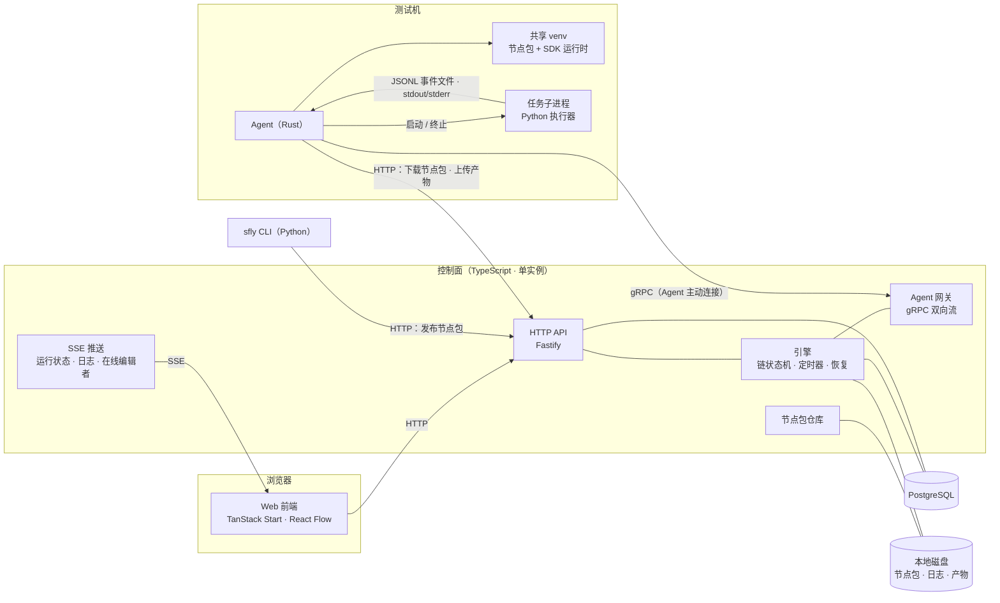
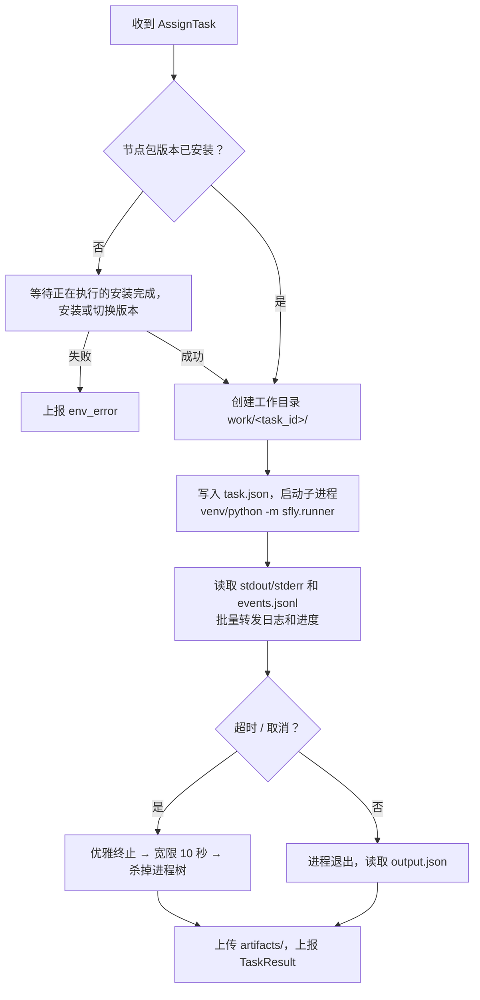

# sfly 架构设计

> 状态：草案 · 2026-11-04
> 术语见 `GLOSSARY.md`，执行语义见 `docs/SEMANTICS.md`，关键决策见 `docs/adr/`。

---

## 1. 定位与边界

sfly 是内网测试用的自动化任务编排平台：用户在画布上把节点编排成链，平台把节点派发到指定的 Agent 上执行，并展示状态、日志、进度和产物。

**范围内**

- 画布编辑编排，编排版本管理，防止并发修改
- 手动触发运行，执行链和异步子流程，定时节点和 Sleep 节点
- Python SDK 开发节点包，发布到平台，由 Agent 下载并安装
- 实时日志、进度、产物

**范围外（明确不做）**

- 连接生产环境；平台只用于测试
- 用户登录和权限；只用浏览器昵称做标记
- "测试环境"这类概念；Agent 部署在哪里，任务就在哪里执行
- 条件、循环、foreach、join、try/catch 等控制节点
- Cron 触发、Webhook 触发、周期任务
- 资源锁、Agent 标签匹配和自动选择 Agent
- 密钥服务、自定义指标面板、跨编排复用子流程

平台与被测系统的业务领域无关。原型中的交易链路节点（Git、柜台、策略、下单等）都属于用户自己用 SDK 开发的节点包。

---

## 2. 总体结构



| 组件 | 技术 | 职责 |
|---|---|---|
| Web 前端 | TanStack Start（`npx @tanstack/cli create`）、TanStack Query、React Flow | 画布编辑、版本与冲突处理、触发运行、运行详情、日志查看 |
| 控制面 | Node LTS、TypeScript、Fastify、Drizzle ORM | HTTP API、SSE、引擎、Agent 网关、节点包仓库；单进程部署 |
| 数据库 | PostgreSQL | 唯一可信的状态来源 |
| 文件存储 | 控制面本地磁盘 | 节点包文件、任务日志、产物 |
| Agent | Rust、tokio、tonic | 连接控制面、安装节点包、执行任务、转发日志/进度/结果 |
| SDK 运行时 | Python，**只用标准库** | 在任务子进程中加载并调用节点函数 |
| SDK CLI | Python | 生成节点元信息、构建并发布节点包、本地开发模式 |

前端只负责页面，不写业务逻辑；引擎需要常驻进程（Agent 长连接、定时器、故障恢复），所以控制面独立部署。

---

## 3. 仓库结构

```
apps/web            TanStack Start 前端
apps/server         控制面（API · 引擎 · Agent 网关 · 节点包仓库）
agent/              Rust Agent（cargo）
sdk/python          Python SDK 运行时 + CLI（uv）
proto/              Agent ↔ 控制面的 protobuf 契约（buf 管理，breaking 检查）
packages/schema     编排文档、节点包元信息的 schema（zod，导出 JSON Schema 供 Python CLI 校验）
docs/               架构、语义规范、ADR
```

- JS/TS 使用 pnpm workspace；Rust 使用 cargo；Python 使用 uv。
- 两份契约，各有唯一来源：
  - **线上协议**（Agent ↔ 控制面）：`proto/`，生成 TS（protobuf-es）和 Rust（prost/tonic）代码。
  - **文档格式**（编排文档、节点包元信息）：`packages/schema`，前端和控制面直接使用；Python CLI 使用导出的 JSON Schema。

---

## 4. 节点包与 SDK

### 4.1 编写节点

```python
from sfly import node, Context

@node(title="HTTP 检查")
def http_check(ctx: Context, url: str, expect: int = 200) -> dict:
    ctx.log.info("checking %s", url)
    ctx.progress(1, 3, "建立连接")
    path = ctx.artifacts.save("response.json", body)
    return {"status": 200, "report": path}
```

- 输入：从函数参数的类型注解生成元信息。
- 输出：函数的返回值（JSON 对象，上限 1 MB）；返回值的键在装饰器或返回类型注解中声明，用于画布补全和保存时的引用检查。
- 失败：抛出异常。
- `ctx`：日志、进度、产物、取消检查（`ctx.cancelled()`）。

### 4.2 节点包格式

一个节点包是一个归档文件（`.sflypkg`，zip 格式）：

```
sfly-package.json     元信息：包名、版本、Python 版本要求、节点列表
                       （每个节点的名称、标题、输入/输出 schema、入口 module:function）
<name>-<ver>.whl      用户代码的 wheel；依赖写在 wheel 的 Requires-Dist 中
```

- 依赖由用户在 `pyproject.toml` 或 `requirements.txt` 中声明，CLI 构建时写入 wheel 元数据。
- 节点包存在控制面后端，**不上传到 PyPI 镜像**；依赖从内网 PyPI 镜像安装。

### 4.3 发布与开发

| 命令 | 作用 |
|---|---|
| `sfly build` | 扫描 `@node`，生成 `sfly-package.json`，构建 wheel，打包成 `.sflypkg` |
| `sfly publish` | 上传到控制面；控制面校验元信息，`包名@版本` 已存在时拒绝 |
| `sfly dev <path>` | 让本机 Agent 以可编辑方式安装本地源码目录，注册为 `包名@dev` |

### 4.4 Agent 上的安装（共享 venv）

- 每个 Agent 有**一个**共享 venv（与 Agent 自身完全隔离），节点包和 SDK 运行时都装在里面。
- 任务需要的 `包名@版本` 与已安装的版本不一致时，Agent 用 `uv pip install` 安装或切换版本。
- **安装与启动新任务互斥**：安装期间不启动新任务，已经在运行的任务继续执行。
- 安装失败（包括依赖冲突）时，任务以 `env_error` 失败，不重试，并展示完整的 uv 输出。

---

## 5. Agent

### 5.1 身份与连接

- Agent 配置项：`name`（全局唯一）、控制面地址、可选的共享注册令牌、并发槽位数 `slots`（默认 4）、共享 venv 路径、PyPI 镜像地址。
- 启动后主动建立 gRPC 双向流；同名 Agent 重新连接时替换旧连接。
- 画布上按名称选择 Agent。

### 5.2 协议（`proto/agent.proto` 草图）

```proto
service AgentGateway {
  rpc Connect(stream AgentMessage) returns (stream ServerMessage);
}

message AgentMessage {
  oneof body {
    Hello         hello      = 1;  // name, token, agent_version, os, arch, slots,
                                   // installed_packages, dev_packages, running_tasks
    Heartbeat     heartbeat  = 2;  // 续约全部 running 任务的租约
    TaskStarted   started    = 3;
    LogBatch      logs       = 4;  // task_id, [seq, ts, stream, level, text]
    Progress      progress   = 5;  // task_id, current, total, message（合并为每秒最多一次）
    TaskResult    result     = 6;  // task_id, attempt, status, outputs_json, error{kind, message}
    InstallStatus install    = 7;
  }
}

message ServerMessage {
  oneof body {
    Welcome    welcome = 1;  // 对 running_tasks 的处置：继续 / 放弃
    AssignTask assign  = 2;  // TaskSpec：task_id, attempt, package@version, node,
                             //           inputs_json（已解析引用）, timeout, artifact_upload_url
    CancelTask cancel  = 3;  // task_id, force
    Ack        ack     = 4;
  }
}
```

- 连接由 Agent 主动发起，任务由控制面在流上推送；一个 Agent 同时最多执行 `slots` 个任务。
- 结果上报按 `task_id + attempt` 幂等处理。
- 大文件（节点包下载、产物上传）走 HTTP，不经过 gRPC 流。

### 5.3 任务执行



### 5.4 Agent 与执行器之间的本地协议

执行器在共享 venv 中运行，**SDK 运行时不能引入任何第三方依赖**，以免和用户节点包冲突。因此本地协议只用文件和环境变量：

| 环境变量 | 内容 |
|---|---|
| `SFLY_TASK` | `task.json` 路径：节点入口、已解析的输入、超时等 |
| `SFLY_OUTPUT` | 执行器写入返回值 `output.json` 的路径 |
| `SFLY_EVENTS` | SDK 追加写入结构化日志和进度的 JSONL 文件；Agent 持续读取新增内容 |
| `SFLY_ARTIFACTS` | 产物目录，任务结束后由 Agent 上传 |
| `SFLY_CANCEL` | 取消标记文件；出现时 `ctx.cancelled()` 返回 true |

进程树终止方式：Linux 使用进程组，Windows 使用 Job Object。

---

## 6. 控制面

### 6.1 引擎

- **状态全部落库**，引擎是 PostgreSQL 之上的状态机；每次状态迁移在一个事务内完成。
- 推进由事件驱动：任务结果、定时器到期、Agent 上下线、用户取消。
- 定时器：等待中节点的到期时间存在库里，按秒扫描；控制面重启后从库中恢复。
- 租约：Agent 心跳续约正在运行的任务；租约过期视为 `agent_lost`，按节点的 `retries` 决定是否重新派发。
- 派发：任务 `queued` 后，目标 Agent 在线且有空闲槽位时推送；超过 `queue_timeout` 仍未派发则 `env_error`。
- ID 确定性生成：子流程实例 ID 和任务 ID 都由运行、链实例、节点、attempt 推导，崩溃恢复时不会重复创建。

### 6.2 数据模型

| 表 | 主要字段 |
|---|---|
| `orchestrations` | id, name, head_version, created_at |
| `orchestration_versions` | id, orchestration_id, number, document（JSONB：节点、连线、参数、布局、锁定的包版本）, author, created_at；`unique(orchestration_id, number)` |
| `node_packages` | name, version, metadata（JSONB）, file_path, sha256, published_at；`unique(name, version)` |
| `agents` | name, info（JSONB）, status, last_seen_at |
| `runs` | id, orchestration_version_id, triggered_by, params, status, started_at, ended_at |
| `chain_instances` | id, run_id, chain_id, parent_chain_instance_id, async_node_id, depth, params, status |
| `tasks` | id, chain_instance_id, node_id, attempt, agent_name, status, inputs, outputs, error_kind, error_message, progress, lease_expires_at, wake_at, log_path, started_at, ended_at |
| `artifacts` | id, task_id, name, path, size, sha256 |

在线编辑者信息只保存在控制面内存中，不落库。

### 6.3 日志、进度与产物

| 数据 | 存储 | 读取 |
|---|---|---|
| 日志 | 每个任务一个文件（磁盘），元数据在 PG；单个任务上限 200 MB，超出后截断并写入截断标记 | 按偏移量分页读取 + 下载原始文件；SSE 推送新增行；前端先加载历史再接实时流，按 `seq` 去重 |
| 进度 | `tasks.progress` 只保留最新值 | 通过 SSE 推送，显示在节点卡片上 |
| 产物 | 磁盘 | 通过输出中的引用下载 |

日志和产物默认保留 30 天，可以配置。

### 6.4 编排编辑、版本与并发

1. 编辑中的内容是浏览器本地草稿（localStorage），刷新不丢失。
2. 点击"保存"时提交 `base_version`；如果服务器上的最新版本已经不同，返回 **409**。
3. 发生冲突时可以：查看差异（节点、参数、连线）、放弃本地修改并载入最新版本、另存为新编排。不做自动合并。
4. 布局属于版本内容；只有点击保存才生成新版本。校验错误不阻止保存，只显示警告；触发运行时必须全部通过。
5. 历史版本只读，可以查看和对比；"恢复"会用旧内容生成一个新版本。
6. **在线编辑者提示**：打开编辑页面的浏览器每 10 秒发送一次心跳（带昵称），控制面在内存中维护每份编排的在线编辑者（30 秒无心跳即移除），通过 SSE 推送；画布上显示"Bob 正在编辑"。
7. 身份：首次打开页面时填写昵称，保存在浏览器中，每个请求通过请求头携带；只用于显示，不做鉴权。

---

## 7. 前端

- 使用 `npx @tanstack/cli create` 创建 TanStack Start 项目；数据请求使用 TanStack Query 调用控制面 API。
- 画布使用 React Flow（`@xyflow/react`）重写；保留原型的视觉规范（`tokens.css` 配色、语义缩放、端口规则、调度连线的样式）。
- 主要页面：编排列表、画布编辑（参数面板由节点元信息的 schema 生成）、版本历史与对比、运行列表、运行详情（链状态、日志、进度、产物）、Agent 列表、节点包列表。

---

## 8. 分阶段计划

| 阶段 | 内容 | 验收 |
|---|---|---|
| P0 契约 | `proto/`、`packages/schema`、语义规范定稿；手写 S1–S3 的编排文档 | 契约评审通过 |
| P1 最小闭环 | 引擎（单链、包节点、取消、超时、重试）；Rust Agent；SDK 运行时 + CLI（build/publish）；最简画布；实时日志 | S1 跑通 |
| P2 完整语义 | 异步任务节点和子流程嵌套；定时节点、Sleep 节点；always；控制面重启恢复；Agent 断线处理 | S2、S3 跑通 |
| P3 编辑体验 | 编排版本、409 冲突处理、在线编辑者提示；版本对比；日志分页和下载；产物；`sfly dev` | 两人同时编辑同一份编排时能正确提示 |
| P4 完善 | 日志和产物保留清理；Agent 自动升级；Windows Agent | 可推广 |
