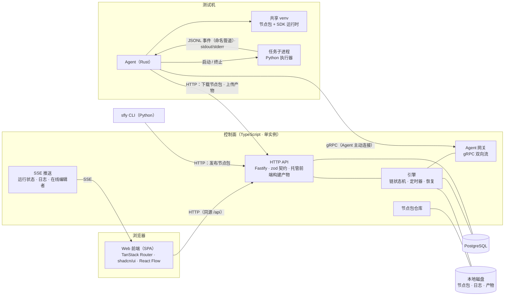

# sfly 架构设计

> 状态：草案 · 2026-11-04（随 #25 更新：「编排」作名词改为「场景」，前端改为由控制面托管的 SPA）
> 术语见 `GLOSSARY.md`，执行语义见 `docs/SEMANTICS.md`，关键决策见 `docs/adr/`。

---

## 1. 定位与边界

sfly 是内网测试用的自动化任务编排平台：用户在画布上把节点编排成链，平台把节点派发到指定的 Agent 上执行，并展示状态、日志、进度和产物。

**范围内**

- 在编排画布上编排场景，场景版本管理，防止并发修改；场景可以写说明、归档与恢复
- 手动触发运行，执行链和异步子流程，定时节点和 Sleep 节点
- Python SDK 开发节点包，发布到平台，由 Agent 下载并安装
- 实时日志、进度、节点指标与图表、产物

**范围外（明确不做）**

- 连接生产环境；平台只用于测试
- 用户登录和权限；只用浏览器昵称做标记
- "测试环境"这类概念；Agent 部署在哪里，任务就在哪里执行
- 条件、循环、foreach、join、try/catch 等控制节点
- Cron 触发、Webhook 触发、周期任务
- 资源锁、Agent 标签匹配和自动选择 Agent
- 密钥服务、自定义指标面板、跨场景复用子流程

平台与被测系统的业务领域无关。原型中的交易链路节点（Git、柜台、策略、下单等）都属于用户自己用 SDK 开发的节点包。

---

## 2. 总体结构



| 组件 | 技术 | 职责 |
|---|---|---|
| Web 前端 | 纯 SPA：TanStack Router、TanStack Query、shadcn/ui（Base UI）、Tailwind v4、React Flow；构建产物由控制面托管 | 控制台、场景列表、编排画布、版本与冲突处理、运行抽屉、运行监控（时间线、图表、日志）、运行记录、Agent 与节点包管理 |
| 控制面 | Node LTS、TypeScript、Fastify、Drizzle ORM | HTTP API、SSE、前端页面、引擎、Agent 网关、节点包仓库；单进程、单个 HTTP 端口部署，以 Docker 镜像发布（ADR 0010） |
| 数据库 | PostgreSQL | 唯一可信的状态来源 |
| 文件存储 | 控制面本地磁盘 | 节点包文件、任务日志、产物 |
| Agent | Rust、tokio、tonic | 连接控制面、安装节点包、执行任务、转发日志/进度/结果；以 musl 静态二进制发布（ADR 0010） |
| SDK 运行时 | Python，**只用标准库** | 在任务子进程中加载并调用节点函数 |
| SDK CLI | Python | 生成节点元信息、构建并发布节点包、本地开发模式 |

前端只负责页面，不写业务逻辑；引擎需要常驻进程（Agent 长连接、定时器、故障恢复），所以控制面独立部署。

---

## 3. 仓库结构

```
apps/web            前端 SPA（vite 构建，Playwright 端到端测试在 apps/web/e2e）
apps/server         控制面（API · 引擎 · Agent 网关 · 节点包仓库）
agent/              Rust Agent（cargo）
sdk/python          Python SDK 运行时 + CLI（uv）
proto/              Agent ↔ 控制面的 protobuf 契约（buf 管理，breaking 检查）
packages/schema     场景文档、节点包元信息与 HTTP 接口契约的 schema（zod，导出 JSON Schema 供 Python CLI 校验）
packages/orchestration  场景文档的纯逻辑（链结构、引用与静态检查、整理布局），前端与控制面共用
docs/               架构、语义规范、ADR；docs/guide 是用户文档（ADR 0013：前端「开发文档」、控制面原文与 /llms.txt、SDK 里的 skill 都出自它）
```

- JS/TS 使用 pnpm workspace；Rust 使用 cargo；Python 使用 uv。
- 三份契约，各有唯一来源：
  - **线上协议**（Agent ↔ 控制面）：`proto/`，生成 TS（protobuf-es）和 Rust（prost/tonic）代码。
  - **文档格式**（场景文档、节点包元信息）：`packages/schema`，前端和控制面直接使用；Python CLI 使用导出的 JSON Schema。
  - **HTTP 接口**（浏览器、CLI、Agent ↔ 控制面）：`packages/schema/src/http`（ADR 0007），见第 7 节。

---

## 4. 节点包与 SDK

### 4.1 编写节点

```python
from sfly import node, Context

@node(title="HTTP 检查")
def http_check(ctx: Context, url: str, expect: int = 200) -> dict:
    ctx.log.info("checking %s", url)
    ctx.progress(1, 3, "建立连接")
    path = ctx.artifacts.save("response.json", body)
    return {"status": 200, "report": path}
```

- 输入：从函数参数的类型注解生成元信息。
- 输出：函数的返回值（JSON 对象，上限 1 MB）；返回值的键在装饰器或返回类型注解中声明，用于画布补全和保存时的引用检查。
- 指标与图表：`@node(metrics=[Metric("tps", unit="笔/s"), Metric("rejected", kind="counter")], charts=[Chart("TPS", type="line", metrics=["tps"])], primary_metric="tps")`。`Metric` 可以声明标签键（`Metric("conn_tps", labels=["host"])`，#78），每组标签值是一个序列。`sfly build` 校验：每个节点类型最多 50 个指标、20 张图表，指标名不重复，每个指标最多 3 个标签键（命名规则同指标名、不重复），图表引用和主指标必须是已声明的指标；主指标不能带标签键，`stat`、`bar` 图表不能引用带标签的指标（`line`、`area` 可以混用），控制面发布时用 zod 镜像做同样的交叉校验。没被任何图表引用的指标由节点包查询 API 补上默认图表（`default: true`；带标签的指标和 gauge → 折线，不带标签的 counter → 数值卡）。
- 失败：抛出异常。
- `ctx`：日志、进度、指标（`ctx.metric(name, value, labels={...})`：未声明的指标名、非有限数值、标签键与声明不一致或标签值为空、超过 128 个字符的点被丢弃并写警告日志；每个任务最多 1000 个序列，超出后新序列的点被丢弃，每个指标警告一次）、产物、取消检查（`ctx.cancelled()`）。

### 4.2 节点包格式

一个节点包是一个归档文件（`.sflypkg`，zip 格式）：

```
sfly-package.json     元信息：包名、版本、Python 版本要求、节点列表
                       （每个节点的名称、标题、输入/输出 schema、入口 module:function、
                        指标、图表、主指标）
<name>-<ver>.whl      用户代码的 wheel；依赖写在 wheel 的 Requires-Dist 中
```

- 依赖由用户在 `pyproject.toml` 或 `requirements.txt` 中声明，CLI 构建时写入 wheel 元数据。
- 节点包存在控制面后端，**不上传到 PyPI 镜像**；依赖从内网 PyPI 镜像安装。

### 4.3 发布与开发

| 命令 | 作用 |
|---|---|
| `sfly build` | 扫描 `@node`，生成 `sfly-package.json`（含 `[tool.sfly] requires-sdk` 声明的 SDK 版本，没写时为构建时 SDK 版本的下限），构建 wheel，打包成 `.sflypkg` |
| `sfly publish` | 上传到控制面；控制面校验元信息，`包名@版本` 已存在时拒绝 |
| `sfly dev <path>` | 让本机 Agent 以可编辑方式安装本地源码目录，注册为 `包名@dev` |

`sfly dev` 通过 Agent 的本地 Unix socket（`--dev-socket`，默认 `$SFLY_HOME/work/agent.sock`，只在本机可访问）通知 Agent；这是 CLI 与本机 Agent 之间的本地接口，不经过控制面。`sfly publish` 的控制面地址按 `--server` > `SFLY_SERVER` > `$SFLY_HOME/agent.env` 的 `SFLY_CONTROL_PLANE_URL` 取值。

开发机上的 `sfly` CLI 从控制面的 sfly 简单索引安装：`GET /simple/`（PEP 503）只有 `sfly` 一个项目，`/simple/sfly/` 只列出与控制面同版本的 SDK wheel（链接带 `#sha256=`），其他项目 404，所以不会从 PyPI 镜像装到同名的其他包。`install.sh --dev` 在安装 Agent 之外用一次性的镜像环境变量装好 uv（没有时），再 `uv tool install --index sfly=<控制面>/simple/ 'sfly[cli]==<控制面版本>'`（其余依赖走 PyPI 镜像）；重新运行即升级到控制面的版本。

### 4.4 Agent 上的安装（共享 venv）

- 每个 Agent 有**一个**共享 venv（与 Agent 自身完全隔离），节点包和 SDK 运行时都装在里面。
- venv 不存在时，Agent 在收到控制面的 Welcome 之后用 `uv venv --python 3.13` 创建，Python 从 Welcome 下发的 GitHub Release 镜像下载（ADR 0012；控制面不可达时不创建）；没有指定 `--uv` 时先准备 `SFLY_HOME/bin/uv`（不存在就用镜像上的 `uv-installer.sh` 安装）；环境准备失败时 Agent 以退出码 78 退出；节点包依赖从 Welcome 下发的 PyPI 镜像安装（本地 `--index-url` 优先）；SDK 运行时由控制面提供（构建时打包 `sdk/python` 的 wheel，`GET /sdk/python/<版本>/<wheel>`），Welcome 给出与 Agent 版本相同的 wheel 地址和 sha256，venv 里的 SDK 版本不一致时 Agent 下载、校验并安装，一致时不重装。
- 任务需要的 `包名@版本` 与已安装的版本不一致时，Agent 用 `uv pip install` 安装或切换版本。
- **安装与启动新任务互斥**：安装期间不启动新任务，已经在运行的任务继续执行。
- 安装失败（包括依赖冲突）时，任务以 `env_error` 失败，不重试，并展示完整的 uv 输出。

---

## 5. Agent

### 5.1 身份与连接

- Agent 配置项：`name`（全局唯一）、控制面地址、可选的共享注册令牌、并发槽位数 `slots`（默认 4）、共享 venv 路径、PyPI 镜像地址。
- Agent 的统一目录 `SFLY_HOME`（默认 `~/.sfly`）：`bin/`、`venv/`（共享 venv 的默认路径）、`work/`（任务工作目录的默认根目录，dev socket 默认是 `work/agent.sock`）、`agent.env`。启动时读取 `agent.env`（每行 `SFLY_*=值`，键与对应参数的环境变量同名），优先级为命令行参数 > 环境变量 > `agent.env` > 默认值；从哪个目录启动都一样。
- 启动顺序：连接控制面、收到 Welcome → 准备 uv → 准备共享 venv → 安装 SDK 运行时 → 开始接任务。
- 启动后主动建立 gRPC 双向流；同名 Agent 重新连接时替换旧连接。
- 画布上按名称选择 Agent。

### 5.2 协议（`proto/sfly/agent/v1/agent.proto` 草图）

```proto
service AgentGateway {
  // RPC 名用 Session：tonic 生成的客户端已有构造函数 connect()，同名会冲突
  rpc Session(stream AgentMessage) returns (stream ServerMessage);
}

message AgentMessage {
  oneof body {
    Hello         hello      = 1;  // name, token, agent_version, os, arch, slots,
                                   // installed_packages, dev_packages, running_tasks
    Heartbeat     heartbeat  = 2;  // running_tasks：Agent 实际持有的任务，只续约这些；
                                   // update：更新状态（无 / 下载中 / 等待任务结束 / 替换中 / 失败 / 需要手动升级）
    TaskStarted   started    = 3;  // 执行器子进程真正启动：任务从派发阶段进入 running
    LogBatch      logs       = 4;  // task_id, [seq, ts, stream, level, text]
    Progress      progress   = 5;  // task_id, current, total, message（合并为每秒最多一次）
    TaskResult    result     = 6;  // task_id, attempt, status, outputs_json, error{kind, message}
    InstallStatus install    = 7;
    MetricBatch   metrics    = 8;  // task_id, attempt, [name, 秒, value, min, max, labels], dropped_points
                                   // （按「任务 × 序列（指标名 + 标签）× 秒」合并，每秒最多一批；断线排队有上限，丢弃最早的点）
  }
}

message ServerMessage {
  oneof body {
    Welcome    welcome = 1;  // 对 running_tasks 的处置：继续 / 放弃；心跳间隔、SDK wheel、PyPI 与 GitHub Release 镜像；
                             // 目标 Agent 版本（控制面版本）与对应架构的 Agent 二进制地址、sha256
    AssignTask assign  = 2;  // TaskSpec：task_id, attempt, package@version, node,
                             //           inputs_json（已解析引用）, timeout, artifact_upload_url
    CancelTask cancel  = 3;  // task_id, force
    Ack        ack     = 4;
    UpdateNow  update_now = 5;  // 立即更新：按取消流程终止手上的任务，然后替换（5.5）
  }
}
```

- 连接由 Agent 主动发起，任务由控制面在流上推送；一个 Agent 同时最多执行 `slots` 个任务。
- 结果上报按 `task_id + attempt` 幂等处理。
- 大文件（节点包下载、产物上传）走 HTTP，不经过 gRPC 流。

### 5.3 任务执行


### 5.4 Agent 与执行器之间的本地协议

执行器在共享 venv 中运行，**SDK 运行时不能引入任何第三方依赖**，以免和用户节点包冲突。因此本地协议只用文件、命名管道和环境变量：

| 环境变量 | 内容 |
|---|---|
| `SFLY_TASK` | `task.json` 路径：节点入口、已解析的输入、超时等 |
| `SFLY_OUTPUT` | 执行器写入返回值 `output.json` 的路径 |
| `SFLY_EVENTS` | 命名管道 `events.fifo` 的路径：SDK 以追加方式打开，逐行写入结构化日志、进度和指标（JSONL）；Agent 在启动执行器前创建它并打开读端（ADR 0015） |
| `SFLY_ARTIFACTS` | 产物目录，任务结束后由 Agent 上传 |
| `SFLY_ARTIFACTS_URL` | 产物下载地址前缀；`ctx.artifacts.save()` 返回的产物引用 = 前缀 + 按路径段编码的名称 |
| `SFLY_CANCEL` | 取消标记文件；出现时 `ctx.cancelled()` 返回 true |
| `SFLY_PROCS` | 这次运行的后台进程目录 `$SFLY_HOME/procs/<运行 ID>/`（`--procs-dir`，不预先创建），即 `ctx.procs_dir`；0.0.4 起设置，旧 Agent 不设置时 SDK 取同样的默认位置 |

- 事件管道：Agent 先以非阻塞方式打开读端、自己持有一个写端（没有写者时读端读到 EOF），再启动执行器；容量调到 `/proc/sys/fs/pipe-max-size`。数据只在内核缓冲区里，有数据时立即读取；写满时 SDK 的写入阻塞等待，不丢事件。执行器退出后 Agent 关掉自己的写端，把剩余数据读完（后台子进程还持有写端时最多等 2 秒）。本地调试（`sfly run`、`sfly.testing`）用同样的做法。
- 标准输出 / 标准错误：Agent 读出、还没转发的内容也有上限（与事件管道一样最多排 16 块）；转发跟不上时 Agent 暂停读取，管道写满后节点写标准输出 / 标准错误阻塞等待，不丢日志，Agent 内存不随节点的输出量增长。
- 工作目录 `work/<task_id>/` 里还有 `task.json`、`output.json`、`artifacts/`、取消标记，以及 Agent 写的标准输出 / 标准错误副本 `stdout.log` / `stderr.log`：每个文件 8 MiB，超过后改名为 `.1`（覆盖旧的 `.1`）再新建，每个流最多 16 MiB，写失败时忽略。执行器异常退出时，错误摘要附带的标准错误末尾（8 KiB）取自 Agent 内存，不读 `stderr.log`。
- `task.json` 里有 `task_id`、`attempt`、`run_id`、`node_id`，SDK 据此提供 `ctx.task`；本地调试时任务 ID 是 `local`、attempt 是 1。
- 任务目录的保留期：`--task-dir-retention`（`SFLY_TASK_DIR_RETENTION`），默认 `7d`，`0` 表示结果被 Ack 后立即删除。结果被 Ack 时写结束标记 `.finished`；Agent 启动时和之后每小时扫描工作目录，删除超过保留期的任务目录。保留期按真实流逝的时长判断（单调时钟），不看 Agent 时间和文件的修改时间（ADR 0018）：从结果被 Ack 那一刻算起，这个时刻只记在内存里；Agent 或机器重启后，已有的任务目录从启动那一刻重新算起。正在执行或结果未 Ack 的任务、以点开头的目录（`.dev`、`.install`）、`agent.sock`、既没有标记也没有 `task.json` 的子目录不动。
- 后台进程目录（节点启动、节点结束后继续运行的进程的日志，例如 `start_process`）不在任务目录里，任务目录被删除或同一任务重试时不受影响。同一次扫描按同一个保留期删除过期的运行目录：同样按真实流逝的时长判断，从运行在这台 Agent 上的最后一个任务结束（结果被 Ack）那一刻算起，Agent 重启后从启动那一刻重新算起；两次扫描之间目录里有新的写入时从这次扫描重新算起（后台进程还在写日志时不过期）；运行还有任务在手上时不动；以点开头的目录和文件不动。保留期为 0 时，运行的任务都不在手上之后的下一次扫描就删除。

进程树终止方式：Linux 使用进程组，Windows 使用 Job Object。执行器自成进程组，收不到发给 Agent 的 SIGTERM / Ctrl-C；Agent 收到它们时先按取消的方式终止手上任务的进程树（先写取消标记再 SIGTERM，宽限期 `--terminate-grace` 后强制杀掉；宽限期内再收到一次 SIGTERM / Ctrl-C 时立即强制杀掉）再退出，不留孤儿执行器，这些任务由控制面按 `agent_lost` 处理。开始终止之后不再启动新的执行器：还在准备环境的任务按执行器启动失败处理。Agent 被 SIGKILL 时来不及终止它们，由 systemd 按服务的控制组一并结束。

### 5.5 自更新（ADR 0014，`agent/src/update/`）

Agent 的目标版本就是控制面的版本（Welcome 下发，高于或低于都算）；版本不一致时控制面照常连接、续约、收结果，只是不派新任务。

- **能否自更新**：二进制在 `$SFLY_HOME/bin` 下、目录可写、没有指定 `--no-auto-update`；否则在心跳里上报「需要手动升级」及原因。
- **状态**（`Heartbeat.update`）：下载中 → 等待任务结束（剩余任务数）→ 替换中；失败时「更新失败」及原因，继续以旧版本保持连接，下一次 Welcome 重试（下载有连接、读取超时）。
- **排空**：先在后台下载新二进制、校验 sha256、试运行 `--version`；准备好后不再接新任务（派来的任务忽略，控制面按 `agent_lost` 处理），等手上的任务都结束、结果都被 Ack。
- **替换**：持有 `bin/.sfly-agent.lock`（同一 `SFLY_HOME` 下的 Agent 和 install.sh 串行），当前文件已是目标 sha256 时跳过；否则保存为 `sfly-agent.prev`（硬链接）、同目录临时文件 `rename` 覆盖、fsync 目录，写状态文件 `bin/update-state.json`（目标版本、旧版本、新二进制的 sha256、失败次数），以原来的参数 `execve`（附加 `SFLY_UPDATED_FROM`）。开发版本登记在工作目录里，新进程重新读取。
- **试用与回滚**：正在运行的二进制就是状态文件里的新二进制时，进程是试用中的新版本：启动最早期（读取配置、解析参数之前）和每次连接前计一次尝试，握手成功且环境准备完成时健康（删除状态文件）；连不上控制面时撤回这一次。试用中环境准备失败以退出码 1 退出（由 systemd 重启）。连续 3 次失败后恢复 `.prev`、记为坏版本并 `execve` 旧版本；旧版本看到目标仍是坏版本时上报「更新失败」、不再尝试，目标版本变化或回到与自身一致（清除坏版本记录）后重新尝试。`execve` 本身失败时恢复 `.prev`、记为坏版本并以非零码退出。
- **立即更新**：`POST /agents/:name/update-now` 只接受下载中或等待任务结束的 Agent；控制面让它手上的任务以 `agent_lost` 失败（按重试配置重新排队），提交后发 `UpdateNow`；Agent 按取消流程终止任务、结果被 Ack 后立即替换（还在下载时从这时起就不再接任务）。

---

## 6. 控制面

### 6.1 引擎

- **状态全部落库**，引擎是 PostgreSQL 之上的状态机；每次状态迁移在一个事务内完成。
- 推进由事件驱动：任务结果、定时器到期、Agent 上下线、用户取消。
- 定时器：等待中节点的到期时间存在库里，按秒扫描；控制面重启后从库中恢复。
- 派发阶段：任务推送给 Agent 后先处于 `dispatched`（Agent 在下载、安装节点包或启动执行器），Agent 上报 `TaskStarted` 后才是 `running`；超时和耗时都从 `running` 开始计算，与 Agent 的计时起点一致。
- 租约：心跳携带 Agent 实际持有的任务（`Heartbeat.running_tasks`），控制面只续约这些；控制面认为在这个 Agent 上、但连续两次心跳都没上报的任务以 `agent_lost` 失败。租约过期同样视为 `agent_lost`，按节点的 `retries` 决定是否重新派发。租约默认 30 秒，Welcome 告诉 Agent 每 10 秒（租约的三分之一，`Welcome.heartbeat_interval_ms`）心跳一次。
- 重连：Agent 在 Hello 中上报手上的任务（正在执行的，以及结果还没收到 Ack 的），控制面在 Welcome 中逐个答复继续或放弃（放弃的任务被立即杀掉、结果丢弃）；控制面认为在这个 Agent 上运行、但 Hello 里没有的任务立即以 `agent_lost` 失败。
- 重启：运行、链实例、任务、定时器都在库里，启动时不重放；只把已经（或即将）到期的租约和排队超时顺延到一个租约之后，给 Agent 重新连接的时间。
- 派发：任务 `queued` 后，目标 Agent 在线、版本与控制面一致且有空闲槽位时推送；超过 `queue_timeout` 仍未派发则 `env_error`。版本不一致的 Agent 照常连接、续约、上报日志和结果，只是不派新任务（ADR 0014），Agents 页显示它的更新状态。
- ID 确定性生成：子流程实例 ID 和任务 ID 都由运行、链实例、节点、attempt 推导，崩溃恢复时不会重复创建。

### 6.2 数据模型

| 表 | 主要字段 |
|---|---|
| `orchestrations` | id, name, description, head_version, created_at, archived_at（名称和说明不属于版本内容；归档后不出现在默认列表、不能触发，不物理删除） |
| `orchestration_versions` | id, orchestration_id, number, document（JSONB：节点、连线、参数、布局、锁定的包版本）, author, created_at；`unique(orchestration_id, number)` |
| `node_packages` | name, version, metadata（JSONB）, file_path, sha256, published_at；`unique(name, version)` |
| `agents` | name, info（JSONB）, status, last_seen_at |
| `runs` | id, orchestration_version_id, triggered_by, params, status, started_at, ended_at |
| `chain_instances` | id, run_id, chain_id, parent_chain_instance_id, async_node_id, depth, params, status |
| `tasks` | id, chain_instance_id, node_id, attempt, agent_name, status, inputs, outputs, error_kind, error_message, progress, lease_expires_at, wake_at, log_path, started_at, ended_at |
| `artifacts` | id, task_id, name, path, size, sha256, created_at（上传时间，控制面时间）, agent_modified_at（文件在 Agent 上的修改时间，Agent 时间，可为空） |

在线编辑者信息只保存在控制面内存中，不落库。

### 6.3 日志、进度与产物

| 数据 | 存储 | 读取 |
|---|---|---|
| 日志 | 每个任务一个文件（磁盘），元数据在 PG；单个任务上限 200 MB，超出后截断并写入截断标记（来源 `system`）；任务执行中途 Agent 时间跳变超过 2 秒时，Agent 自己往日志里写一行提示（来源 `agent`，ADR 0018） | 按偏移量分页读取 + 下载原始文件；SSE 推送新增行（`after_seq` 从分页读到的位置接上）；前端先加载历史再接实时流，按 `seq` 去重；实时流与历史之间有缺口时从实时流处往前翻页；浏览器最多保留 5000 行，更早的向上滚动重新加载 |
| 进度 | `tasks.progress` 只保留最新值 | 通过 SSE 推送，显示在节点卡片上 |
| 指标 | PG 按天分区的分段表 `metric_segments`（ADR 0009；一段最多 120 点、行内压缩，当前段约每 10 秒重写一次，任务结束立即写入）+ 摘要表 `metric_series`，两者都以「任务 × 指标名 × 标签（`labels` jsonb，不带标签为 `{}`）」区分序列；标签键与节点类型声明不一致的点被丢弃并计入任务的丢弃数；单个任务上限约 50 MB（所有序列合计）（`SFLY_METRIC_LIMIT_MB`，按每点 28 字节折算），超出后截断；单个任务最多 1000 个序列（固定，不带标签的指标各算 1 个并预留名额），SDK 先执行一次（新序列的点丢弃，每个指标写一次警告），控制面兜底：新序列的点丢弃并计入丢弃数、任务记「序列超限」标记（`tasks.metric_series_capped`），已有序列照常写入，与 50 MB 上限互不影响 | `GET /runs/:id/metrics/summary`：每个任务每个序列（带 `labels`）的点数、最小、最大、平均、最新值、首尾时间，以及截断标记 `truncated` 和序列超限标记 `series_capped`；`GET /runs/:id/metrics`：运行的指标目录（每个包节点的指标声明、含默认图表的图表定义、主指标，每次尝试的摘要、截断标记和序列超限标记；图表定义来自锁定的节点包版本，dev 版本取任务所在 Agent 当前加载的声明）；`GET /runs/:id/metrics/series`：一个节点（默认最新一次尝试）按时间范围和目标点数降采样的序列（带 `truncated`、`series_capped`；每项 `{name, labels, buckets}`，每个序列分别降采样，按指标名查询时返回这个指标的全部序列），每个桶给出最小、最大（尖峰可见）、平均、最新值，整段落在一个桶内时直接用段摘要，内存中尚未写库的点也包括在内；运行事件流的 `metrics` 事件推送执行中任务新收到的点（每个点带 `labels`），断线后用序列接口补齐；`GET /runs/:id/metrics/platform`：平台自带图表（节点耗时、重试次数、排队与等待时长，并发任务数与 Agent 槽位占用），全部由任务记录推导，不另存数据；运行结束超过指标保留期后摘要、目录与序列接口返回 `expired: true`（不含数据），平台自带图表不受影响 |
| 产物 | 磁盘；单个任务的产物总大小默认上限 1 GB（`SFLY_ARTIFACT_LIMIT_MB`），超出时上传返回 413 | 通过输出中的引用下载（运行视图里显示为下载链接） |

日志和产物默认保留 30 天，可以配置。指标的保留期单独配置（`SFLY_METRIC_RETENTION_DAYS`，默认 30 天）：与日志、产物共用保留期扫描，提前创建今天和之后两天的分区，删除整天都超过保留期的分区；运行结束超过保留期后删除它的指标摘要、标记 `runs.metrics_purged_at`，接口返回"已过保留期"，之后迟到的点直接丢弃、不再写回；删除分区时，在其中有数据的运行（例如跨天运行的开头几天）同样标记为已过保留期，内存里尚未写库、落在已整天过期日期的点不再重建分区。点的时间戳来自 Agent 时钟，只接受「现在 − 保留期」到最后一个提前创建的分区结束之间的点，其余丢弃。

### 6.4 场景编辑、版本与并发

1. 编辑中的内容是浏览器本地草稿（localStorage），刷新不丢失。同一浏览器的多个标签页共用一份草稿：另一个标签页改写了草稿时，当前标签页停止写草稿并提示，由用户选择载入那份草稿或直接保存。
2. 点击"保存"时提交 `base_version`；如果服务器上的最新版本已经不同，返回 **409**。
3. 发生冲突时可以：查看差异（节点、参数、连线）、放弃本地修改并载入最新版本、另存为新场景。不做自动合并。
4. 布局属于版本内容；只有点击保存才生成新版本。校验错误不阻止保存，只显示警告；触发运行时必须全部通过。
5. 历史版本只读，可以查看和对比；"恢复"会用旧内容生成一个新版本。
6. **在线编辑者提示**：打开编辑页面的浏览器每 10 秒发送一次心跳（带昵称），控制面在内存中维护每个场景的在线编辑者（30 秒无心跳即移除），通过 SSE 推送；画布上显示"Bob 正在编辑"（自己的其他标签页显示为"你（其他标签页）"）。关闭页面时浏览器主动离开（`POST /orchestrations/:id/presence/leave`），立即从名单移除。
7. 身份：首次打开页面时填写昵称，保存在浏览器中，每个请求通过请求头携带；只用于显示，不做鉴权。

---

## 7. 前端

### 7.1 部署与路径（ADR 0006）

- 纯 SPA：TanStack Router + TanStack Query，vite 构建，不用 SSR，生产包不含开发工具。构建产物由控制面在 HTTP 端口上托管，与 API、SSE 同源同端口，不需要额外的 Web 服务器或代理。
- 路径区分：浏览器经 `/api/*` 调用 API 与 SSE（控制面去掉前缀后按原路由处理，`/api` 下未知路由返回 JSON 404）；根路径上的 API 保留给 Agent、CLI 等非浏览器客户端；其余 GET 请求命中构建产物文件就返回文件，浏览器导航（`Accept` 含 `text/html`）回退到入口页 `index.html`，因此前端路由可以与根路径 API 同名。例外是契约里标了 `raw` 的原文路由（用户文档原文 `/docs/<页>.md` 与 skill 文件、`/llms.txt`、`/install.sh`、Agent 下载 `/agent/binaries`、sfly 简单索引 `/simple/`）：浏览器导航时也直接返回原文，不回退到入口页。开发时 vite 开发服务器把 `/api/*` 原样代理到控制面。
- 字体（IBM Plex Sans、JetBrains Mono）打包进前端，离线内网也能正确显示；数字一律等宽。

### 7.2 页面

| 路由 | 页面 | 外壳 |
|---|---|---|
| `/` | 控制台：运行统计与趋势、正在运行、最近失败、Agent 状态、最近发布的节点包 | 侧边栏 + 顶栏 |
| `/orchestrations` | 场景编排：场景卡片 / 表格（缩略图、说明、Agent、最近运行），新建、复制、编辑名称和说明、归档与恢复；「运行」打开运行抽屉（入口参数、触发前检查、运行摘要） | 侧边栏 + 顶栏 |
| `/orchestrations/:id/versions` | 版本历史：任选两个版本对比、恢复旧版本 | 侧边栏 + 顶栏 |
| `/orchestrations/:id` | 编排画布（全屏）：编辑模式（检查器、撤销重做、整理布局、本地草稿与显式保存、在线编辑者）；运行状态模式（节点叠加最近一次运行或 `?run=<id>` 指定运行的状态与主指标，日志与图表只在运行监控页） | 无 |
| `/runs` | 运行记录：进行中的运行是卡片，历史运行是表格，可按状态、场景、编号或触发人筛选 | 侧边栏 + 顶栏 |
| `/runs/:id` | 运行监控（全屏）：链路时间线、按节点分组的图表工作区、底部面板（日志 / 尝试 / 输入输出 / 产物），三者共用一条时间轴 | 无 |
| `/agents`、`/packages` | Agent 管理（版本与更新状态、「立即更新」）、节点包管理（列表 + 详情，含节点类型的指标与图表声明） | 侧边栏 + 顶栏 |
| `/docs`、`/docs/:page` | 开发文档：渲染 `docs/guide` 的用户文档（ADR 0013），代码块带复制按钮；`/docs` 显示第一页 | 侧边栏 + 顶栏 |

命令面板（Ctrl K）、快捷键面板（?）、昵称弹窗与通知是全局浮层；快捷键来自统一的注册表（`src/lib/shortcuts.ts`），快捷键面板由它生成。

### 7.3 代码结构（`apps/web/src`）

- `components/ui/`：shadcn/ui 组件（Base UI 原语，ADR 0008），从官方注册表拉取后由仓库自己维护；`components/app-shell/` 外壳与全局浮层；`components/canvas/` 唯一的画布组件（`FlowCanvas`，编辑、运行状态、版本对比共用，几何常量只在 `geometry.ts`）；`components/feedback/` 空 / 加载 / 错误状态与通知。
- 按页面的功能模块：`dashboard/`、`scenarios/`、`run-drawer/`、`editor/`（编排画布与检查器）、`versions/`（本地草稿、保存冲突、版本对比）、`monitor/`（运行监控）、`run-records/`、`metrics/`（主指标与指标声明）、`agents/`（「立即更新」按钮与确认框）、`docs/`（开发文档页与 Markdown 渲染）。
- `lib/`：`api.ts`（契约客户端）、`sse.ts`（契约里的 SSE 推送）、`shortcuts.ts`、`presence.ts`、`nickname.ts`、`format.ts`、`node-status.ts`（节点状态的显示规则表，徽标、画布、缩略图、进度条、时间线都从这里读；每列的取值类型由对应组件定义并在组件里配样式，这里只 `import type`，组件再引入这张表，所以只有类型层面的双向引用）。
- 样式：Tailwind v4 + CSS 变量，三层设计 token（基础色阶 / 语义 / 画布专用），所有样式都在明确的 CSS layer 里，没有按页面手写的全局样式文件；token、配色规则、字号、组件清单与各状态样式见 `docs/DESIGN-SYSTEM.md`。

### 7.4 HTTP 契约（ADR 0007）

- 接口的请求与响应 schema 在 `@sfly/schema` 的 `http/` 模块中用 zod 定义：JSON 接口用 `endpoint`，SSE 用 `stream`（事件名 → data 的 schema），字节流下载用 `download`；`httpContract` 列出全部接口。
- 控制面用 `contractRoute` / `contractStream` / `contractDownload` 注册路由，按契约校验请求（不符合时 400 `invalid_request`，个别接口用更具体的错误码，例如保存版本的 `base_version_required` / `invalid_document`），响应在类型上受契约约束；启动时检查注册的路由与 `httpContract` 一一对应，控制面没有契约以外的 HTTP 接口。
- 前端的类型全部由契约推导（没有手写的接口类型副本），请求用 `callApi` / `apiQuery`，SSE 用 `useEventSource(def, input, handlers)`；query key 一律由 `queryKey()` 生成，失效按领域前缀（`domainKey()`）；开发环境下校验响应与 SSE 事件。

### 7.5 测试（ADR 0005）

- 主切入点是 `apps/web/e2e` 的 Playwright 端到端测试：浏览器访问由真实控制面托管的构建产物，背后是假 Agent（真实 gRPC）、每个测试独立的 PostgreSQL 数据库和手动时钟，沿用控制面测试基建（`apps/server/test/support`）。
- 视觉回归：关键页面固定状态的截图基线（`e2e/__screenshots__`），只在 Playwright 官方镜像里生成和比对（`pnpm test:e2e:docker`，CI 的 e2e job 用同一镜像）。
- 单测只覆盖纯逻辑模块（vitest）：整理布局、时间线区段与刻度、图表的时间范围与列数、引用补全、日志分页与实时接续、快捷键注册表等。不为展示型组件写快照或单测。

### 7.6 性能测试

针对 sfly 本身（SDK → Agent → 控制面 → PostgreSQL）的性能，分三类，都只在本地开发环境运行，不进 CI：

- **基准测试**：单独测一段代码的耗时和吞吐，只有三处：SDK 单次 `ctx.metric()`（标准库 `timeit`）、Agent 的指标合并与按行切分（criterion，只作开发依赖）、控制面的指标分段写入与降采样查询（`vitest bench`）。指标相关的每一项都另有一个带标签的变体：4 个带标签（`pid`、`name`）的指标 × 50 个进程，共 200 个序列（相当于标准节点 `process_monitor` 按进程上报），与不带标签的数值并列写进报告；降采样查询另按运行监控页的用法（每张图表只查它引用的指标）测一张图表引用 1 个、2 个带标签指标（50、100 个序列）的耗时，对照下表「运行监控页的图表」。可以单独运行：`uv run --locked python sdk/python/benchmarks/metric.py`、`cargo bench -p sfly-agent --bench telemetry`、`pnpm --filter @sfly/server exec vitest bench --run perf/benchmarks/control-plane.bench.ts`；`cargo test`、pytest 与 `vitest run` 都不会运行它们。
- **负载测试**：用 release 构建的 Agent、打包后的控制面和本机 PostgreSQL，在指定负载下验证资源有上限、数据正确、端到端延迟达标。`pnpm perf` 约 10 分钟，顺带运行基准测试。发版前必跑：`pnpm perf --release` 通过后把报告存进仓库的 `docs/perf/<版本>/`，随发版 PR 提交；改动关键路径——Agent 日志转发、事件通道（SDK → Agent）、指标合并、控制面指标写入与查询——的 PR 在描述里贴结果（发版步骤与关键路径对应的代码位置见 `docs/agents/branching-and-release.md`）。
- **长时负载测试**：`pnpm perf:soak`，默认 1 小时（`--duration` 指定，如 `30m`、`2h`），只在维护者要求时运行。同一个控制面上同时施加「控制面接收指标」的负载（跑满时长，即下表的 1 小时目标）和真实 Agent 的持续负载（一个任务全程每秒 1 万次事件，其余槽位不停执行定速输出 stdout 与短时上报指标的任务），报告里有 Agent 与控制面内存、Agent 工作目录占用、控制面数据目录与数据库大小、指标点数随时间变化的数据，用来发现缓慢泄漏（#69 那样）。中途按 Ctrl-C 会停止负载，已采集的数据照常写进报告并标为被中断。结果写到本机结果目录下的 `soak/<时间>/`，只与长时负载测试对比（发版基线是 `docs/perf/<版本>/soak.json`）；发版时跑了的，同样用 `--release` 存进 `docs/perf/<版本>/`。

**报告放在哪里、与什么对比**：

- 本机结果目录：`$SFLY_PERF_DIR`，没设时 `${XDG_DATA_HOME:-~/.local/share}/sfly/perf/`（`--out-dir` 优先）。在仓库之外、各 worktree 共用，每次运行写一个 `<时间>/report.{json,md}`，worktree 删掉后结果还在，报告里写明结果目录。
- 每份报告与两份基准对比，各占一列、各自列出变化超过 20% 的数值：**本机上一次**（本机结果目录里同一台机器、没有被中断的最近一次，在哪个 worktree 里跑的都算）；**发版基线**（仓库里 `docs/perf/` 下版本号不高于当前版本的最近一个版本的报告，`--release` 时不含当前版本本身），它不是同一台机器跑的就不对比并在报告里说明，不往更早的版本找。机器标识取 `/etc/machine-id` 的摘要。
- 发版报告（`docs/perf/<版本>/report.{json,md}`，长时负载测试为 `soak.{json,md}`）只由 `--release` 写入，且只收完整运行（不能用 `--only`、`--no-build`）、没有被中断、结论通过、运行时没有未提交改动（`docs/perf/` 本身除外）的结果；不满足时本机报告照常写出，命令以退出码 1 结束并列出原因。
- 为做决定而做的专项测量不放这里，随对应的 issue 或 PR 留存（`docs/agents/branching-and-release.md`「专项测量」）。

资源有上限、数据正确类的检查是硬性断言，失败即 bug；吞吐、延迟、CPU 只记录并与宽松阈值比较（低于目标一半才提示）。几秒内结束、结果确定的有界检查（如 `agent/tests/work_dir.rs`）算普通测试，留在 CI。

代码在 `apps/server/perf/`：每项（负载测试或基准测试）一个文件放在 `perf/items/`，自动注册；长时负载测试在 `perf/soak.ts`（不在 `perf/items/` 下，`pnpm perf` 不运行它）；报告里的目标从下表读取；判定、选基准、对比、发版报告的把关与报告生成的纯逻辑有单测（`apps/server/test/perf-*.test.ts`，随控制面测试进 CI）。临时文件放在 `--tmp-dir`（默认仓库里的 `out/perf/tmp`，每项结束即删，不需要留存），不用 `/tmp`。`pnpm perf` 里有两项缩短了时长，可以用环境变量调整（秒数）：`SFLY_PERF_CONTROL_PLANE_SECONDS`（控制面接收指标，默认 60；1 小时由长时负载测试覆盖）、`SFLY_PERF_DISCONNECT_SECONDS`（Agent 断线，默认 45、至少 30，设成 300 即下表的断线 5 分钟）。

目标（release 构建）：

| 范围 | 目标 |
|---|---|
| 单个任务 SDK → Agent | 持续每秒 1 万次事件不阻塞节点 |
| 单个 Agent | 4 个槽位同时以上述速率上报：内存增量 ≤ 100 MB，工作目录占用不增长 |
| 节点大量输出 stdout | 每秒 10 MB 时 Agent 内存有上限，`stdout.log` 最多 16 MiB |
| 控制面接收指标 | 持续每秒 1 万点 1 小时不积压；1 小时范围的指标查询 p95 < 500 ms |
| 运行监控页的图表 | 1 小时范围、一张图表最多 100 个序列时，降采样查询 p95 < 500 ms |
| 端到端延迟 | `ctx.metric()` 后运行页面 3 秒内收到 SSE 推送 |
| Agent 断线 | 断线 5 分钟内存不超过排队上限，重连后补发 |
| 短节点链路 | 30 个节点的单链里，sfly-std 的短节点（`http_request`）每节点端到端 ≤ 120 ms |

负载测试测不到的地方（报告里对应项的说明也写明）：

- 节点大量输出 stdout：本机上 Agent 的日志转发跟得上读管道（每秒 10 MiB 的长行、每秒约 10 万行的短行都是），端到端的速率达不到让 #75 的无界通道积压的程度，这一项区分不出 #75 修复前后，只是「日志完整、副本有上限、内存有上限」的回归检查。#75 的回归测试应放在 Agent 的单测里，人为拖慢转发环节。
- Agent 断线：一个任务每个指标每秒只合并出 1 个点，断线 5 分钟也远到不了默认的 50 万点指标排队上限，所以这一项把上限调成 10 个点来验证丢弃与计数；50 万点排满时的内存没有测到（日志排队的 64 MiB 是排满了测的）。

## 8. 分阶段计划

| 阶段 | 内容 | 验收 |
|---|---|---|
| P0 契约 | `proto/`、`packages/schema`、语义规范定稿；手写 S1–S3 的场景文档 | 契约评审通过 |
| P1 最小闭环 | 引擎（单链、包节点、取消、超时、重试）；Rust Agent；SDK 运行时 + CLI（build/publish）；最简画布；实时日志 | S1 跑通 |
| P2 完整语义 | 异步任务节点和子流程嵌套；定时节点、Sleep 节点；always；控制面重启恢复；Agent 断线处理 | S2、S3 跑通 |
| P3 编辑体验 | 场景版本、409 冲突处理、在线编辑者提示；版本对比；日志分页和下载；产物；`sfly dev` | 两人同时编辑同一个场景时能正确提示 |
| P4 完善 | 日志和产物保留清理；Agent 自动升级；Windows Agent | 可推广 |
