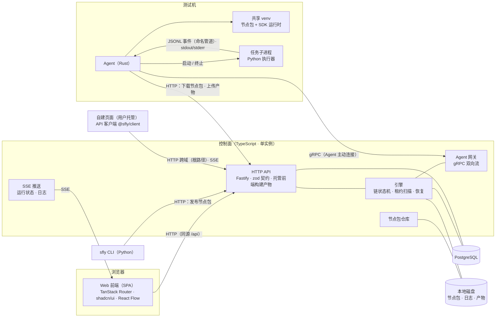
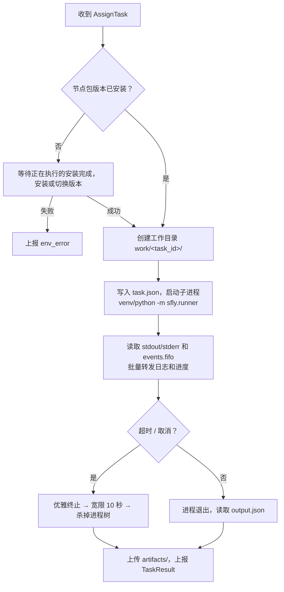

# sfly 架构设计

> 状态：草案 · 2026-11-13（随 #263 更新：开放 HTTP API 和 API 客户端，用户用它开发自建页面）
> 术语见 `GLOSSARY.md`，执行语义见 `docs/SEMANTICS.md`，关键决策见 `docs/adr/`。

---

## 1. 定位与边界

sfly 是内网测试用的自动化任务编排平台：用户在画布上把节点编排成链，平台把节点派发到指定的 Agent 上执行，并展示状态、日志、进度和产物。

**范围内**

- 在编排画布上编排场景，场景版本管理，防止并发修改；场景可以写说明、归档与恢复
- 手动触发运行，执行链和异步子流程
- Python SDK 开发节点包，发布到平台，由 Agent 下载并安装
- 实时日志、进度、节点指标与图表、产物
- 开放现有的 HTTP API，提供 TypeScript 的 API 客户端 `@sfly/client`：用户用它开发自己托管的自建页面（看板、按参数触发场景的页面）和程序（ADR 0022）

**范围外（明确不做）**

- 连接生产环境；平台只用于测试
- 反向代理头和 OIDC 登录（只保留外部身份列）；本地账号与登录见 6.8，项目里的权限见 6.6（在 #494 之前不登录也能照旧使用，只用浏览器昵称做标记）
- "测试环境"这类概念；Agent 部署在哪里，任务就在哪里执行
- 条件、循环、foreach、join、try/catch 等控制节点
- Cron 触发、Webhook 触发、周期任务
- 资源锁、Agent 标签匹配和自动选择 Agent
- 密钥服务、自定义指标面板、跨场景复用子流程
- 托管或展示用户的自建页面、进程内插件；为自建页面新增接口（事件推送和对外的 Webhook、跨运行的指标查询、运行列表的时间范围和翻页）

平台与被测系统的业务领域无关。原型中的交易链路节点（Git、柜台、策略、下单等）都属于用户自己用 SDK 开发的节点包。

---

## 2. 总体结构



| 组件 | 技术 | 职责 |
|---|---|---|
| Web 前端 | 纯 SPA：TanStack Router、TanStack Query、shadcn/ui（Base UI）、Tailwind v4、React Flow；构建产物由控制面托管 | 控制台、场景列表、编排画布、版本与冲突处理、运行抽屉、运行监控（时间线、图表、日志）、运行记录、Agent 与节点包管理 |
| 控制面 | Node LTS、TypeScript、Fastify、Drizzle ORM | HTTP API、SSE、前端页面、引擎、Agent 网关、节点包仓库；单进程、单个 HTTP 端口部署，以 Docker 镜像发布（ADR 0010） |
| 数据库 | PostgreSQL | 唯一可信的状态来源 |
| 文件存储 | 控制面本地磁盘 | 节点包文件、任务日志、产物 |
| Agent | Rust、tokio、tonic | 连接控制面、安装节点包、执行任务、转发日志/进度/结果；以 musl 静态二进制发布（ADR 0010） |
| SDK 运行时 | Python，**只用标准库** | 在任务子进程中加载并调用节点函数 |
| SDK CLI | Python | 生成节点元信息、构建并发布节点包、本地开发模式、操作平台（场景等，#238） |
| API 客户端 | TypeScript，ESM 与类型声明，没有运行时依赖 | 自建页面和用户程序调用 HTTP API：带类型的接口调用、断线自动重连的事件流订阅、下载地址的拼接、统一的错误类型；控制台的请求层也建立在它上面（ADR 0022） |

前端只负责页面，不写业务逻辑；引擎需要常驻进程（Agent 长连接、租约扫描、故障恢复），所以控制面独立部署。

---

## 3. 仓库结构

```
apps/web            前端 SPA（vite 构建，Playwright 端到端测试在 apps/web/e2e）
apps/server         控制面（API · 引擎 · Agent 网关 · 节点包仓库）
apps/assistant      助手服务：单独的助手容器里拉起和看管 pi，唯一依赖 pi 的代码（ADR 0027，§6.9）
agent/              Rust Agent（cargo）
sdk/python          Python SDK 运行时 + CLI（uv）
proto/              Agent ↔ 控制面的 protobuf 契约（buf 管理，breaking 检查）
packages/schema     场景文档、节点包元信息与 HTTP 接口契约的 schema（zod，导出 JSON Schema 供 Python CLI 校验）
packages/orchestration  场景文档的纯逻辑（链结构、引用与静态检查、整理布局），前端与控制面共用
packages/client     API 客户端 @sfly/client（ADR 0022）：类型和路由表从 HTTP 契约生成，构建成 ESM 与类型声明，打成控制面提供下载的安装包
docs/               架构、语义规范、ADR；docs/guide 是用户文档（ADR 0013：前端「开发文档」、控制面原文与 /llms.txt、SDK 里的 skill 都出自它）
```

- JS/TS 使用 pnpm workspace；Rust 使用 cargo；Python 使用 uv。
- 文档和代码里的名称不一一对应（GLOSSARY 不写实现，对照在这里）：
  - **场景**在代码里叫 `orchestration`：`orchestrations` 表、`packages/orchestration`、`/orchestrations` 路由、`OrchestrationStore`、`OrchestrationDocument`；前端的页面目录是 `apps/web/src/scenarios/`，接口路径仍是 `/orchestrations`。
  - **子流程**在代码里叫 `chain`（链）：`chain_instances` 表、`chain_id`；主链和子流程都是链，**异步任务节点**到子流程入口节点的连线叫 `dispatch`。
  - **节点包**在代码里叫 `package`（`node_packages` 表、`apps/server/src/packages/`、`PackageNode`），不要和 pnpm workspace 的 `packages/` 目录弄混，后者是 TypeScript 库；标准节点包在 `std/`。
- 三份契约，各有唯一来源：
  - **线上协议**（Agent ↔ 控制面）：`proto/`，生成 TS（protobuf-es）和 Rust（prost/tonic）代码。
  - **文档格式**（场景文档、节点包元信息）：`packages/schema`，前端和控制面直接使用；Python CLI 使用导出的 JSON Schema。
  - **HTTP 接口**（浏览器、CLI、Agent ↔ 控制面）：`packages/schema/src/http`（ADR 0007），见 §7。它同时导出一份路由清单（`sdk/python/src/sfly/schemas/routes.json`，随 SDK 打包，`pnpm gen:check` 保证最新），`sfly api` 用它列出、说明和校验接口（每个接口的说明、只读还是有副作用、作用的资源、响应的 JSON Schema 都在里面）。已移除的节点种类（ADR 0028）也导出一份给命令行读（`removed-node-kinds.json`，同样由 `pnpm gen` 生成），命令行里没有第二份清单。API 客户端的类型和路由表是这份契约的又一份生成物（`packages/client/src/generated/`，见 §7.4）。

---

## 4. 节点包与 SDK

### 4.1 编写节点

```python
from sfly import node, Context

@node(title="HTTP 检查")
def http_check(ctx: Context, url: str, expect: int = 200) -> dict:
    ctx.log.info("checking %s", url)
    ctx.progress(1, 3, "建立连接")
    path = ctx.artifacts.save("response.json", body)
    return {"status": 200, "report": path}
```

- 输入：从函数参数的类型注解生成元信息。
- 节点类型的说明：函数的文档字符串去掉缩进后整段写进元信息里节点类型的可选字段 `description`（最长 4000 个 Unicode 字符，超过时 `sfly build` 报错；没有文档字符串就不写）。「添加节点」菜单和节点包管理页显示第一段，检查器的「说明与指标」页显示全文；节点包列表接口里的节点摘要也带 `description`。节点类型这一层是严格对象，带说明的包发布到旧版本的控制面会被拒绝，所以要先升级控制面；Agent 把元信息当 JSON 原样转发，不受影响。
- 节点类型的默认超时：`@node(timeout=秒)`（1 到 4294967295 之间的整数，`sfly build` 遇到别的值报错并指出是哪个节点）写进元信息里节点类型的可选字段 `timeout`；控制面派发时按「场景里这个节点写的 → 节点类型声明的 → 平台默认的 1 小时」取（`@sfly/orchestration` 的 `effectiveTimeout`，docs/SEMANTICS.md §3.3），检查器的「执行」页和 `sfly scenario show` 写出生效的值和它从哪来。节点类型这一层是严格对象，声明了超时的包发布到旧版本的控制面会被拒绝，没声明的元信息不变。
- 输出：函数的返回值（JSON 对象，上限 1 MB）；返回值的键在装饰器或返回类型注解中声明，用于画布补全和保存时的引用检查。输出 TypedDict 字段注解里的 `Annotated[T, Doc("…")]` 写成这个输出 schema 的 `description`（规则和输入一样，最长 500 个字符），检查器「说明与指标」页的输出表、引用补全、节点包管理页和 `sfly package show` 显示它。
- 指标与图表：`@node(metrics=[Metric("tps", unit="笔/s"), Metric("rejected", kind="counter")], charts=[Chart("TPS", type="line", metrics=["tps"])], primary_metric="tps")`。`Metric` 可以声明标签键（`Metric("conn_tps", labels=["host"])`，#78），每组标签值是一个序列。`sfly build` 校验：每个节点类型最多 50 个指标、20 张图表，指标名不重复，每个指标最多 3 个标签键（命名规则同指标名、不重复），图表引用和主指标必须是已声明的指标；主指标不能带标签键，`stat`、`bar` 图表不能引用带标签的指标（`line`、`area` 可以混用），控制面发布时用 zod 镜像做同样的交叉校验。没被任何图表引用的指标由节点包查询 API 补上默认图表（`default: true`；带标签的指标和 gauge → 折线，不带标签的 counter → 数值卡）。
- 失败：抛出异常。
- `ctx`：日志、进度、指标（`ctx.metric(name, value, labels={...})`：未声明的指标名、非有限数值（NaN、无穷、大到转不成浮点数的整数）、标签键与声明不一致或标签值为空、超过 128 个字符的点被丢弃并写警告日志；每个任务最多 1000 个序列，超出后新序列的点被丢弃，每个指标警告一次）、产物、取消检查（`ctx.cancelled()`）。

### 4.2 节点包格式

一个节点包是一个归档文件（`.sflypkg`，zip 格式）：

```
sfly-package.json     元信息：包名、版本、Python 版本要求、节点列表
                       （每个节点的名称、标题、输入/输出 schema、入口 module:function、
                        指标、图表、主指标）
<name>-<ver>.whl      用户代码的 wheel；依赖写在 wheel 的 Requires-Dist 中
```

- 依赖由用户在 `pyproject.toml` 或 `requirements.txt` 中声明，CLI 构建时写入 wheel 元数据。
- 节点包存在控制面后端，**不上传到 PyPI 镜像**；依赖从内网 PyPI 镜像安装。

### 4.3 发布与开发

| 命令 | 作用 |
|---|---|
| `sfly build` | 扫描 `@node`，生成 `sfly-package.json`（含 `[tool.sfly] requires-sdk` 声明的 SDK 版本，没写时为构建时 SDK 版本的下限；以及 `requires-agent` 声明的 Agent 版本，没写时没有），构建 wheel，打包成 `.sflypkg` |
| `sfly publish` | 上传到控制面；控制面校验元信息，`包名@版本` 已存在时拒绝 |
| `sfly dev <path>` | 让本机 Agent 以可编辑方式安装本地源码目录，注册为 `包名@dev` |
| `sfly debug <节点>` | 本地调试：在当前项目环境里用 Agent 同一个执行器执行节点，不经过控制面和 Agent |

`sfly dev` 通过 Agent 的本地 Unix socket（`--dev-socket`，默认 `$SFLY_HOME/work/agent.sock`，只在本机可访问）通知 Agent；这是 CLI 与本机 Agent 之间的本地接口，不经过控制面。`sfly publish` 的控制面地址按 `--server` > `SFLY_SERVER` > `$SFLY_HOME/agent.env` 的 `SFLY_CONTROL_PLANE_URL` 取值。

**操作平台的命令（#238）**：人和 AI 编程助手用同一套命令，经控制面根路径上的 HTTP 接口（与 `sfly publish` 相同）查看和操作平台。

| 命令 | 作用 |
|---|---|
| `sfly scenario list` | 列出没有归档的场景（名称、id、最新版本号、默认 Agent），可用 `--search` 按名称、说明或引用的 Agent 名搜索、`--agent` 按 Agent 筛选 |
| `sfly scenario show <场景>` | 场景最新版本的默认 Agent 和运行预设，入口参数（含参数说明）、主链和子流程上的节点（显示名称、节点类型、锁定的节点包版本、Agent，节点表下面是这条链的备注），没有连进任何链的节点，最后是注释框（标题、成员、备注） |
| `sfly scenario versions <场景>` | 场景版本：版本号、作者、保存时间，经 AI 编程助手保存的写「经 …」 |
| `sfly scenario pull <场景> [-o 文件] [--version N]` | 把最新版本（或第 N 版）写成 `{"scenario", "base_version", "document"}` 的 JSON 文件；`base_version` 总是最新版本号 |
| `sfly scenario push <文件>` | 先按随 SDK 打包的场景文档 JSON Schema 在本地校验，再带 `base_version` 保存新版本（沿用场景版本的乐观锁，冲突退出码 2，没有强制覆盖）；控制面给没有坐标的节点补坐标；成功后把文件里的 `base_version` 和 `document` 更新为保存的结果 |
| `sfly scenario create --name … [--description …] [--from 文件]` | 新建场景，给了文件就保存第一个版本 |
| `sfly scenario copy <场景> --name …` | 复制场景，源场景最新版本的内容作为副本的第 1 版（联调时改副本）；第 1 版的警告写在输出里 |
| `sfly scenario rename <场景> [--name …] [--description …]` | 修改名称和说明，不产生场景版本 |
| `sfly run start <场景> [--param 名=值]… [--params JSON] [--preset 名称] [--wait] [--timeout …]` | 先预检（有问题时列出并退出码 2，不触发），参数按入口节点声明的类型转换，触发最新版本；给了 `--preset` 时预设参数由控制面填入预设保存的值，`--param`、`--params` 只给其余的参数；`--wait` 订阅运行的 SSE（断线自动重连，以接口返回的最新状态为准）等到结束，stderr 写进度，stdout 输出摘要（状态、耗时、失败节点的错误、每个失败任务的最后 50 行日志） |
| `sfly run wait <运行> [--timeout …]` | 等已有的运行结束；超时（124）和 Ctrl-C（130）只停止等待，不取消运行 |
| `sfly run cancel <运行>` | 取消运行；运行已结束时报 `run_not_running` |
| `sfly run list [--scenario …] [--status …]` / `sfly run show <运行>` | 最近的运行；各链各节点的状态和失败节点每次尝试的错误 |
| `sfly run logs <运行> [--failed] [--node 链:节点] [--level …] [--tail N] [--before/--after 游标] [--all 文件]` | 整次运行按控制面时间合并后的日志，默认最后 200 行，截断时写明用游标继续读；`--all` 下载 JSONL |
| `sfly run artifacts <运行> [--task …] [--download 目录]` | 列出各任务的产物，按 sha256 校验后下载 |
| `sfly agent list` | 在线状态（准备环境中的写明已多久，时长用响应的 `x-sfly-time` 作为「现在」）、版本、是否与控制面一致、运行中的任务数、对外地址、开发包 |
| `sfly package list` / `sfly package show <包>[@版本]` | 节点包的版本；节点类型的标题、输入（类型、默认值、是否必填）和输出 |
| `sfly api <METHOD> <路径> [--query 名=值]… [--body JSON 或 @文件]` / `sfly api --list` / `sfly api --describe <METHOD> <路径>` | 直接调用上面没有覆盖的接口，发请求前按随 SDK 打包的路由清单校验；`--list` 列出路由清单（含只读还是有副作用和一句话说明），`--describe` 说明一个接口（作用、资源、请求与响应的字段） |

`sfly run` 的退出码：0 成功，1 运行失败，3 运行被取消，124 等待超时，130 Ctrl-C，2 命令本身出错（操作平台的其余命令只有 0 和 2，`sfly api` 按 Ctrl-C 停止时也是 130）。旧写法 `sfly run <节点>` 报错并提示改用 `sfly debug`（退出码 2）。

**给 AI 编程助手的 skill**：`sfly init` 把两份 skill 写进项目的 `.agents/skills/`（`.claude/skills/` 下是软链接）：节点开发 `sfly-node-dev`（`reference.md` 是 SDK 参考页），和操作平台 `sfly-platform`（联调闭环的步骤和操作规则，`reference.md` 是「用命令行操作平台」页）。两份的源文件都在 `docs/guide/`（ADR 0013），控制面经 `/docs/skills/<名称>/…` 提供原文并列在 `/llms.txt`，SDK 里 `sfly/cli/skills/` 下是指向源文件的软链接。`sfly skill update` 把两份换成当前 SDK 版本的内容，每份各自做哈希检查，改过的不覆盖（`--force` 才覆盖）。

所有操作平台的命令共用同一套约定，实现在 `sdk/python/src/sfly/cli/` 的小模块里，新命令直接复用，不各写一份：

- **请求（`client.py`）**：只用标准库。控制面地址按 `--server` > `SFLY_SERVER` > `$SFLY_HOME/agent.env` 的 `SFLY_CONTROL_PLANE_URL` > 默认地址取值（`home.control_plane_url`，`sfly publish` 共用）；昵称按 `--nickname` > `SFLY_NICKNAME` > 系统用户名取值，放进 `x-sfly-nickname`（URL 编码，只读请求也带，控制面不依赖它）；每个请求带 `x-sfly-client: sfly-cli/<版本>`，检测到在 AI 编程助手里运行时追加 ` agent/<名称>`（`AI_AGENT` 有值用它；`CLAUDECODE` 是 `claude-code`；`CODEX_` 开头的环境变量是 `codex`），检测结果不改变输出格式。**命令行打印服务端的文字之前先过一遍**（`safe_text.py`，#670）：服务端的文字里有客户端自己报的、没人看过的（「经 …」的名称、昵称、Agent 报的版本、节点写的日志、升级前存下的旧值），原样打到终端上会改写屏幕、藏话；整段去掉的只有 CSI（颜色、光标移动、清屏）和两个字节的 ESC 序列（7 位和 8 位的写法）：它们的参数只能是数字和标点，吃不了任意文字（一个没写完的 CSI 最多带走紧跟着的一小段数字和标点再加一个字符，只在同一行里）；**串序列（OSC、DCS、SOS、PM、APC）不整段去掉**，正文可以是任意文字，整段去掉就是给了写的人一把删别人文字的工具（JSON 里记录之间没有换行，一个节点写开头、另一个节点写结尾，夹在中间的别人的记录就没了）：它们的开头和结尾和别的不该到终端的字符（控制字符、双向控制字符、看不见的字符、孤立的代理码元，和控制面拒绝名字的是同一张表）一样写成看得见的 `\uXXXX`，正文留着，换行和制表符保留；零宽连接符、零宽不连字符、变体选择符用名字的位置规则（位置不对的才写成转义，Python 和 TypeScript 两头对照同一份用例）；`--json` 里写成 JSON 的转义（解析回来不变）；`sfly api` 的输出只在 stdout 是终端时过一遍，正文是 JSON 的（响应、事件流里 `data:` 的内容）只转义、不删任何东西，不是 JSON 的按上面的普通文字处理，重定向到文件或管道时原样。控制面写入时也不收：`x-sfly-client` 里 `agent/<名称>` 的名称只收字母、数字和 `. _ + -`、最多 64 个字符（不合格的存固定的占位值 `?`，不可能是合格的名称，显示成「未知」，请求照常成功），Agent 在 Hello 里报的名称过名字的那张表（不合格的连接被拒）、版本、系统、架构不合格的整段换成空串，控制台显示库里已有的旧值时按同一个规则判断。
- **版本告警**：控制面在所有 HTTP 响应（含错误响应和 SSE 流）上带 `x-sfly-version`（`CONTROL_PLANE_VERSION_HEADER`）；与命令行版本不一致时命令行在 stderr 告警一次，写明升级方法（重新运行 `install.sh --dev`，或 `uv add --dev "sfly[cli]==<控制面版本>"`），命令照常执行。
- **输出（`output.py`）**：默认精简文本，`--json` 输出一行精简 JSON（列表是数组、单个对象是对象）。错误写到 stderr，文本是「错误：原因」加可选的「下一步：命令」，`--json` 时是 `{"error": {"code", "message", "next"}}`，`code` 沿用控制面的错误码（命令行自己的错误用 `unreachable`、`scenario_not_found` 这样的短名）；退出码 2。所有命令都不弹交互式确认。
- **列表上限**：列表类命令默认最多输出 50 条（`--limit` 可调），超出时文本的最后一行写明还有多少条、怎么看更多；`--json` 时提示写到 stderr，stdout 保持纯 JSON。
- **指定场景（`scenario_lookup.py`）**：写 id 或准确名称；先按 id 找，找不到再按名称找；名称对应多个场景时报错并列出每个候选的 id 和最新版本号；已归档的场景不参与名称匹配。
- **外壳（`session.py`）**：`common_options()` 给命令加上 `--server`、`--nickname`、`--json`；`command(handler)` 创建请求客户端和输出，把 `CliError` 输出成错误并以退出码 2 结束，handler 可以返回自己的退出码。

开发机上的 `sfly` CLI 从控制面的包索引安装：`GET /simple/`（PEP 503）只有平台自己的两个包，`sfly` 和 `sfly-std`。`/simple/sfly/` 只列出与控制面同版本的 SDK wheel（链接带 `#sha256=`）；`/simple/sfly-std/` 列出**公共项目**里已发布的标准节点包的 wheel（`src/packages/std-index.ts`：wheel 取自节点包归档里唯一的那个 `.whl`，摘要按归档的 sha256 缓存，链接带 wheel 的 `#sha256=` 和 `data-requires-python`，文件在 `/simple/sfly-std/files/<文件名>`），别的项目里发布的 `sfly-std` 版本、公共项目里别的名字的包都不在索引里（项目页 404）；wheel 要和归档对得上（索引里唯一由上传内容决定的东西，uv 从 wheel 文件名读版本）：文件名里的发行版名是 `sfly_std`、版本和归档登记的版本是同一个版本（`src/packages/pep440.ts`，PEP 440 的写法差异不算），对不上的不列并报告；同一个版本（PEP 440 规范化之后）只列最早发布的那个（先按发布时间，相同时按版本的文本；后发布的归档里同版本的 wheel 不进索引，否则 uv 装 `==<版本>` 时可能选中它的内容，绕过「已发布的版本不能覆盖」；被去重的归档只是不进索引，节点包列表、版本详情、归档下载、场景引用都照常）；读索引出错（数据库出错等）时项目页和下载都是 500，不是 404（404 会让 uv 转去 PyPI 取同名的包）；索引的每个成功的响应（根页面、项目页、wheel 下载）都带响应头 `x-sfly-package-index`，值是控制面的版本（`src/http/sdk-routes.ts` 的 `PACKAGE_INDEX_HEADER`），Agent 靠它确认回答的是控制面（见 §4.4）；公共项目里还没有发布 `sfly-std` 时，`/simple/sfly-std/` 是 200 和一个没有任何版本的页面，不是 404：uv 对一个名字只看第一个有回应的索引，404 才会转去下一个索引，所以没发布时依赖它的节点包装不上，而不会装上 PyPI 上有人放的同名包。其余名字 404，所以不会从 PyPI 镜像装到同名的其他包。**不需要凭据**：索引的几个路径在契约里都是 `system` 类（ADR 0029「不属于项目」一类：`/sdk/python` 的 wheel、Agent 二进制、安装脚本同类），经契约路由注册、过启动守卫的同一处检查；理由是内容只有平台自己的包（公共项目的包本来任何凭据都能读，ADR 0029），而 uv 从索引地址里的凭据取认证会把它写进命令行和安装输出（Agent 的安装输出会进任务错误和 `InstallStatus`）。公共项目的包只有平台管理员能发布，所以索引里不会出现别人上传的内容；发布到公共项目：`POST /packages?project=public`（过渡的查询参数，#565，路径带项目 #488 之后由路径里的项目替代），只有平台管理员的登录或个人令牌能这样做（见 §5 访问检查），不加这个参数发布到默认项目、不会出现在索引里；发布到公共项目时拒绝和同一个名字已有版本规范化（PEP 440）之后相同的版本（409，信息写明已有的是哪个；`PackageRepository.publish` 在事务里先取这个名字的咨询锁再比较，并发发布的两个也只有一个通过），所以索引里同一个版本不会有两个候选，上面的「只列最早发布的那个」只是对升级迁移、手工改库留下的数据的防御；升级时迁移进公共项目的 `sfly-std` 版本也在索引里。`install.sh --dev` 在安装 Agent 之外用一次性的镜像环境变量装好 uv（没有时），再 `uv tool install --index sfly=<控制面>/simple/ 'sfly[cli]==<控制面版本>'`（其余依赖走 PyPI 镜像）；重新运行即升级到控制面的版本。

### 4.4 Agent 上的安装（共享 venv）

- 每个 Agent 有**一个**共享 venv（与 Agent 自身完全隔离），节点包和 SDK 运行时都装在里面。
- venv 不存在时，Agent 在收到控制面的 Welcome 之后用 `uv venv --python 3.13` 创建，Python 从 Welcome 下发的 GitHub Release 镜像下载（ADR 0012；控制面不可达时不创建）；没有指定 `--uv` 时先准备 `SFLY_HOME/bin/uv`（不存在就用镜像上的 `uv-installer.sh` 安装）；环境准备失败时 Agent 以退出码 78 退出；节点包依赖从 Welcome 下发的 PyPI 镜像安装（本地 `--index-url` 优先），同时把控制面的包索引（`Welcome.package_index_url`，`<对外地址>/simple/`，#556）作为优先于镜像的索引：`uv pip install --index <控制面的包索引> --default-index <PyPI 镜像> --index-strategy first-index`（`agent/src/install.rs` 的 `index_args`），所以节点包可以依赖 `sfly-std`，它只会来自控制面的索引，PyPI 镜像上同名的更高版本也不会被装上（策略写在命令行上，环境变量 `UV_INDEX_STRATEGY` 或用户级的 uv 配置换不掉它）。这个钉法有一个前提：索引对 `sfly-std` 的项目页有回应（不是 404、不重定向到别处）——uv 对一个名字只看第一个有回应的索引，404 才会转去 PyPI 镜像，装上同名的别人的包，安装照样成功。控制面自己的代码总是有回应，但对外地址指到了别的 HTTP 服务、反向代理漏转了 `/simple/` 时回答的不是控制面，所以 Agent 每次装依赖之前先确认 `<package_index_url>sfly-std/` 直接返回 200（不跟随重定向）**并且带控制面的标记头 `x-sfly-package-index`**（`Installer::check_package_index`），不是就不装、任务以 `env_error` 失败，错误信息写明请求的地址、状态码（或重定向到哪、或「回了 200 但不是 sfly 控制面的包索引，或者中间的反向代理去掉了这个响应头」）和该查什么：只看状态码拦不住对外地址指到了一个 PyPI 风格的索引、那里恰好有同名包而回 200 的配错，标记头是别的索引服务不会带的；它防的是配错，不是有意伪造（能控制这个地址的人本来就能直接给出假包）；控制面发 `package_index_url` 的同时一定带这个头（索引的路由总是注册），所以不存在「有地址、没有标记」的合法组合；Agent 的环境里配了 uv 的 find-links 时那里的同名包不受 first-index 约束，不检查，文档要求部署者不要配；旧版本控制面的 Welcome 没有这个字段（空串），Agent 不检查也不加这个索引，就只用 PyPI 镜像，和以前一样（命令行上总是写明 `--index-strategy first-index`、PyPI 镜像用 `--default-index`，所以部署者自己在环境变量或 uv 配置里换了索引策略的机器，现在会被命令行盖掉），旧 Agent 不认识这个字段、照常读其余字段（版本不一致的 Agent 本来就不派任务、要先更新到控制面的版本，ADR 0014，所以这两种组合只出现在更新的间隙里）；SDK 运行时由控制面提供（构建时打包 `sdk/python` 的 wheel，`GET /sdk/python/<版本>/<wheel>`），Welcome 给出与 Agent 版本相同的 wheel 地址和 sha256，venv 里的 SDK 版本不一致时 Agent 下载、校验并安装，一致时不重装。
- 任务需要的 `包名@版本` 与已安装的版本不一致时，Agent 用 `uv pip install` 安装或切换版本。
- **安装与启动新任务互斥**：安装期间不启动新任务，已经在运行的任务继续执行。
- 安装失败（包括依赖冲突）时，任务以 `env_error` 失败，不重试，并展示完整的 uv 输出。共享 venv 里一个包只有一个版本（`sfly-std` 也是：同一台 Agent 上所有依赖它的节点包共用一份）：两个节点包对同一个包的版本要求互相矛盾时，uv 只说「你要求 sfly-std<0.4」，不说是哪个包要求的，所以错误信息在 uv 的输出后面补一段，写明是哪几个节点包、各要求什么（`install.rs` 的 `conflict_note`，只列要求确实不能同时满足的包：同一个包的几条要求按版本区间算有没有共同能满足的版本（`conflicting_requirements`，不用 `pep440_rs` 的 `version-ranges` 功能，它会带进 MPL-2.0 许可的包），彼此相容的（`>=0.25` 和 `>=0.20`）不列，判断不了的（带标记的、URL 形式的、没有版本限制的、`===`、`!=X.*`、版本带本地标签的、版本段大得加不了一的、读不懂的）不参与、不列，只确定满足不了的才列；一条要求自己就满足不了的（`x>=2,<1`）单独列出、写明「这一条自己就满足不了」，不拿它去和别的配对；两两都能满足、三条以上合起来才满足不了的逐条试着去掉，只列去掉哪一条都不再矛盾的那几条；只按版本的先后次序算，预发布、后发布的细则（`<2.0` 不含 `2.0` 的预发布之类）没有算进去，所以有的矛盾不会被列出来，少列，不会多列；正在装的节点包自己也算一方，它被 wheel 文件钉在自己的版本上，写成「名字@版本（正在装） 要求 名字==版本」，这样锁定 `sfly-std` 0.3.0 的场景和依赖 `sfly-std>=0.4` 的节点包撞上时，说明里能写出是哪个节点包要求 `>=0.4`；什么时候加这一条不看 uv 的文字（交给 `conflict_note` 的输出第一行是 Agent 自己写的命令行，里面总有这个包的名字，它自己的依赖卷进失败时 uv 的话里也会写到它），而是按 PEP 440 算：别的已装节点包对它的要求里，正在装的版本不满足的才列，满足的不列，一条都不满足时不加这一条，失败是别的原因造成的时候就不会拿它凑对（版本用 `pep440_rs` 比；要求那一行自己拆成包名、可选的方括号、版本限制，带环境标记的、URL 形式的、没有版本限制的、拆不出来的、用 `===` 或 `!=X.*` 的（`pep440_rs` 对这两种写法的判断和 uv 不一样，会列出 uv 并不认为冲突的一对，用真 uv 对照过 81 种「版本 × 要求」只有这两类）当作不适用、不列，也不去问解释器判断标记；它自己的版本和依赖读 wheel 里和文件名对得上的那份 METADATA 的头部）；正在装的包自己的那一组排在最前面，最多列 20 对，其余写「另有 N 对没有列出」（一组被截短时先列一对冲突的两方；连两条都放不下的整组不列）；一对都没有时不写说明，也不写怎么办；最后一句说明怎么办：把节点包和锁定了它们的场景一起升级，或者分到不同的 Agent 上）；uv 提示的 `--index-strategy unsafe-best-match` 不能用（它让 PyPI 上同名的包顶替平台自己的包），输出里有这个提示时补充说明。

---

## 5. Agent

### 5.1 身份与连接

- Agent 配置项：`name`（全局唯一）、控制面地址、可选的共享注册令牌、并发槽位数 `slots`（默认 4）、共享 venv 路径、PyPI 镜像地址。
- Agent 的统一目录 `SFLY_HOME`（默认 `~/.sfly`）：`bin/`、`venv/`（共享 venv 的默认路径）、`work/`（任务工作目录的默认根目录，dev socket 默认是 `work/agent.sock`）、`agent.env`。启动时读取 `agent.env`（每行 `SFLY_*=值`，键与对应参数的环境变量同名），优先级为命令行参数 > 环境变量 > `agent.env` > 默认值；从哪个目录启动都一样。
- 启动顺序：连接控制面、收到 Welcome → 准备环境（准备 uv → 准备共享 venv → 安装 SDK 运行时）→ 立即发一次心跳、开始接任务。每次连上都要准备环境，环境已就绪时只做几项检查。
- 「开始接任务」以 Welcome 之后的第一次心跳为界：控制面收到它才把这条连接记为已准备好，从这时起给它派发；准备环境期间 Agent 不发心跳，算在线，排队的任务留在队列里。已准备好只记在控制面内存里，跟着连接走，断开就没了。
- 启动后主动建立 gRPC 双向流。**Hello 里的 `token` 是什么、能不能连上**（`apps/server/src/agents/agent-auth.ts`，ADR 0029「迁移与过渡」、ADR 0014）：
  - **Agent 凭据**（`sfly_agt_` 前缀，按「项目 + Agent 名字」签发；名字过名字的那张表、最多 64 个字符，签发时和 Hello 里同一个检查，Hello 里的检查在认证之前，见 `docs/SEMANTICS.md §2.5.1`；名称在路径里，路径参数的长度上限是 128 个 UTF-16 码元（解码之后，`src/http/api.ts` 的 `MAX_PATH_PARAM_LENGTH`），放得下 64 个 emoji 的名称）：项目和名字从凭据得出，`Hello.name` 和它不一致就拒绝；吊销的拒绝。一台 Agent 可以同时有几个有效的凭据（轮换：先签发新的、换上之后吊销旧的）。记在一个用户名下的（开发 Agent）还要所属用户没有被停用：停用期间拒绝连接、已连着的连接在停用的那一刻断开，启用之后同一个凭据照常（停用是可撤回的暂停，不吊销凭据）；他自己在停用期间吊销不了，项目管理员可以。
  - **共享令牌**（`SFLY_AGENT_TOKEN`，控制面启动时登记成默认项目的旧式凭据）：照旧可以连，Agent 页标出「用共享令牌连接」。
  - **没有凭据**：没有配置共享令牌时，只接受默认项目里已经登记过的名字（过渡版本，下一个版本起拒绝）；配了共享令牌的部署不带令牌照旧被拒绝。
  - **名字在这个项目里有没被吊销的 Agent 凭据，就只认凭据**（只看连接的项目，别的项目为同一个名字签发的凭据不算）：「以旧方式连接」（共享令牌、没有凭据）不能再用这个名字，不论真的那台在不在线（它离线时，用它的名字冒连就拿得到它的任务、入参和任务凭据，凭据的保护等于没有）；这个名字的 Agent 凭据**全部吊销**之后才又接受旧方式（那是管理员明确的选择，而吊销要凭据，见下）。这一条在认身份时和登记之前的再确认里各查一次（`AgentAuthenticator.#standing`）。**后果（有意的取舍）**：只按这个项目算，所以过渡期里名字是**先到先得**：一个名字只在别的项目里签发过凭据、还没连上过时，共享令牌的持有者可以先用这个名字连上、登记在默认项目，之后那个项目里带凭据的 Agent 来连就被拒绝（和「没有登记过」是同一句话）；选这一种而不是「按任何项目算」，是为了撞名时让后来的一方失败、不让先在用的一方断线（`worker-1` 这种名字多半是无意撞上的，按任何项目算的话，别的项目的管理员给同名的 Agent 签发一个凭据，这个项目里用旧方式连着的那台下次重连就连不上了）；共享令牌本来就是整个部署的旧口令，过渡期结束会去掉。带凭据的 Agent 连不上、而原因是名字已被旧方式占用时，处理办法是把占着名字的那一台注销、再用凭据连；**现在还没有注销 Agent 的接口**（登记工作台，#549），在那之前给带凭据的 Agent 换一个名字；管理员现在**看不出**是这个原因（Hello 的回应是同一句话，不能用来探别的项目里的事），要不要给管理员一个看得出来的办法记在 #492 的评论里，不在这个 PR 里做。
  - 「以旧方式连接」指共享令牌和没有凭据：同名的新连接顶掉旧连接照旧（断电、断网后重启的 Agent 马上连得上），但以旧方式连接的顶不掉带 Agent 凭据的连接（被拒绝，原连接不受影响；上一条之后这条只剩登记表自己守着的最后一道）；带 Agent 凭据的新连接能顶掉同名的任何连接（`AgentHub.attach`）。
  - **连接的项目**：Agent 凭据的项目，以旧方式连接的是默认项目，记在连接上（`AgentConnection.project`）。名字全局唯一、登记只在第一次连上时写：认身份时名字还没有登记，两个项目的凭据可以同时通过，**登记前在引擎的锁里再核对一次「已登记的项目等于连接的项目」**（`AgentHub.attach`，不靠调用方的再确认），后到的被拒绝，连接表里不会有「登记在甲、活着的却是乙的连接」；**派发前比较的是连接的项目和运行的项目**（`Engine.#prepareAssign`），不是库里登记记录的项目。
  - **Hello 的回应不透露别的项目里的事**：连接的一方对这个名字所在的项目没有有效凭据时，「还没有登记」「登记在别的项目」「在别的项目里被停用」「这个名字有 Agent 凭据而来的是旧方式」是**同一个回应、同一句话**（`notRegisteredHere`，gRPC `Unauthenticated`），**先比项目、后看停用**；「已被停用」只对登记在自己项目里的名字说（和 #610 对别的项目的 Agent 的口径一致：和没有注册过一样）。
  - **给 Agent 签发凭据现在就要登录**（不等 #494）：签发、列出、吊销 Agent 凭据，停用、恢复 Agent 这五个接口不带凭据是 401（共享令牌 403），范围照常要「管理」（`REQUIRES_CREDENTIAL_ROUTES`）；它们是新这一套信任的根，不带凭据的请求能给任意名字签发凭据、再用它连上来顶掉用共享令牌连着的那一台。所以**第一次给 Agent 签发凭据之前要先有管理员账号**（`SFLY_ADMIN_LOGIN`、`SFLY_ADMIN_PASSWORD` 建第一个平台管理员，或初始化码，见「用户」）；打包的控制面、`install.sh`、评测环境里签发凭据的地方都先登录。
  - **新 Agent 连旧控制面**：带 Agent 凭据的新 Agent 连一个**配了共享令牌**的旧控制面会被拒绝（旧控制面只认共享令牌），连一个没配共享令牌的旧控制面照旧能连（旧控制面把任何令牌当没有凭据）；`AssignTask.task_token` 旧控制面不带，Agent 读到空值时不带任务凭据（SDK 不带 `Authorization`）。写进版本说明。
  - **停用的 Agent**（`agents.disabled_at`）不论带不带凭据都不能连接，不参与派发（预检阻断并写明原因）；停用一台正连着的 Agent 立即断开，它手上的任务按失联处理（租约过期后 `agent_lost`，走现有的重试规则）；**它手上任务的任务凭据立刻不认**（不等租约过期，`taskIsActive`：这台 Agent 停用了，或者派发这次尝试时那条连接用的那一个 Agent 凭据被吊销了；不看这个名字此刻有没有别的有效凭据，轮换时新连接上派发的任务凭据不受影响，详见「任务凭据」）。凭据被吊销时，用它连着的连接同样断开。
  - 每条连接是以哪种方式认的身份记在连接上，也记在 `agents.last_auth_kind`（none / shared / agent）。
- 供其它 Agent 连接的端口（ADR 0019，`agent/src/peer.rs`）：Agent 在所有网卡上监听 `--listen-port`（默认 50052），提供 gRPC 服务 `AgentPeer`（`proto/sfly/agent/v1/peer.proto` 的 `Describe`：名称、版本、能力）和每项 Agent 能力各自的服务（例如 `files.proto` 的 `AgentFiles`）；没有认证，只应在内网使用。监听不了（端口被占用等）时照常执行任务，原因随 Hello 上报。Hello 带上能力列表（`agent/src/capabilities/`）、端口和安装时显式配置的对外地址 `--public-address`；控制面另记连接来源地址，对外地址取显式配置的，否则取来源地址（`apps/server/src/agents/agent-endpoint.ts`），Agent 页显示。
- 画布上按名称选择 Agent。

### 5.2 协议（`proto/sfly/agent/v1/agent.proto` 草图）

```proto
service AgentGateway {
  // RPC 名用 Session：tonic 生成的客户端已有构造函数 connect()，同名会冲突
  rpc Session(stream AgentMessage) returns (stream ServerMessage);
}

message AgentMessage {
  oneof body {
    Hello         hello      = 1;  // name, token, agent_version, os, arch, slots,
                                   // installed_packages, dev_packages, running_tasks,
                                   // agent_time_unix_ms、monotonic_ms：建立这次连接的「单调时钟读数 → 控制面时间」
                                   // 对应关系并测时钟偏差（ADR 0018）；
                                   // capabilities、peer：Agent 能力及版本，供其它 Agent 连接的端口、显式配置的对外地址、
                                   // 监听失败的原因（ADR 0019）
    Heartbeat     heartbeat  = 2;  // running_tasks：Agent 实际持有的任务，只续约这些；
                                   // update：更新状态（无 / 下载中 / 等待任务结束 / 替换中 / 失败 / 需要手动升级）；
                                   // agent_time_unix_ms、monotonic_ms：更新时钟偏差；
                                   // Welcome 之后的第一次表示 Agent 已准备好环境，控制面从这时起派发
    TaskStarted   started    = 3;  // 执行器子进程真正启动：任务从派发阶段进入 running
    LogBatch      logs       = 4;  // task_id, [seq, ts, stream, level, text]
    Progress      progress   = 5;  // task_id, current, total, message（合并为每秒最多一次）
    TaskResult    result     = 6;  // task_id, attempt, status, outputs_json, error{kind, message}
    InstallStatus install    = 7;
    MetricBatch   metrics    = 8;  // task_id, attempt, [name, 秒, value, min, max, labels], dropped_points
                                   // （按「任务 × 序列（指标名 + 标签）× 单调时钟秒」合并，每秒最多一批；每个点带 Agent 时间和这一秒的单调时钟读数；断线排队有上限，丢弃最早的点）
    Notification  notification = 9;  // task_id, attempt, event_json：ctx.notify 写进事件管道的那一行原文，Agent 不解析；
                                     // 排在之前的日志之后，断线排队与日志相同（ADR 0020）
    ActionSummary action_summary = 10;  // task_id, attempt, event_json：最新一份 action_summary 的原文，Agent 不解析；
                                        // 每个任务每秒最多一份、结果之前发完，断线期间每个任务只排队最新的一份
    ActionBatch   actions    = 11;  // task_id, attempt, [时间, 单调时钟读数, 开始 | 结束 | 标记]：动作和标记的明细，
                                    // 约每 100 毫秒一批、结果之前发完，断线排队与日志相同
  }
}

message ServerMessage {
  oneof body {
    Welcome    welcome = 1;  // 对 running_tasks 的处置：继续 / 放弃；心跳间隔、SDK wheel、PyPI 与 GitHub Release 镜像；
                             // package_index_url：控制面的包索引 `<对外地址>/simple/`（#556，字段 10，只增，旧控制面为空）；
                             // 目标 Agent 版本（控制面版本）与对应架构的 Agent 二进制地址、sha256
    AssignTask assign  = 2;  // TaskSpec：task_id, attempt, package@version, node,
                             //           inputs_json（已解析引用）, timeout, artifact_upload_url
    CancelTask cancel  = 3;  // task_id, force
    Ack        ack     = 4;
    UpdateNow  update_now = 5;  // 立即更新：按取消流程终止手上的任务，然后替换（5.5）
  }
}
```

- 连接由 Agent 主动发起，任务由控制面在流上推送；一个 Agent 同时最多执行 `slots` 个任务。
- 结果上报按 `task_id + attempt` 幂等处理。
- 大文件（节点包下载、产物上传）走 HTTP，不经过 gRPC 流。

### 5.3 任务执行



上传 `artifacts/` 之前，Agent 先把里面的文件大小加一遍，和 `AssignTask.artifact_limit_bytes`（每个任务的产物合计上限，#477）比：没超限照常上传；超限时只上传放得下的文件（从小到大），放不下的不发起请求，成功的任务以 `env_error` 失败（重试一遍还是超限，不按重试配置重试），失败的任务保留原来的错误、没上传的文件附在后面。字段是 0（旧版本控制面没带）时不预先检查，由控制面的上传接口按同一个上限拒绝（413）。节点在 SDK 里保存时就知道上限（`ctx.artifacts.limit_bytes`，见 5.4 的 `SFLY_ARTIFACT_LIMIT_BYTES`），超过时 `save` 抛出 `ArtifactLimitExceeded`，节点可以改成把大文件留在本机。

**上传请求的超时、重试和取消**（`agent/src/artifacts.rs`，#648）：每个上传请求有「多久没有进展」的上限（`--upload-idle-timeout`，默认 60 秒，和控制面读请求体 60 秒没有数据就回 408 的空闲超时一个量级）：连接建立、请求体被对方收下的每一块、发完之后等响应，各自这么久没有动静就算这次请求失败；大文件只要还在被收下就不会超时。失败的请求照网络错误重试（一共 3 次尝试，每次之间等 0.5 秒），5xx 和 408 同样重试，别的拒绝（413、403 等）不重试；重试用完，成功的任务以 `node_error` 失败、失败的任务在原来的错误后附上原因，任务照常上报结果，不会因为控制面卡住而一直占着槽位。上传期间任务收到新的取消请求（开始上传之后才到的取消，或者优雅取消之后又来的强制取消）时放弃上传，原因写成「任务被取消，上传已放弃」；开始上传之前已经有的取消（取消的任务、超时进入收尾时间的任务）不打断上传，它们照样上传已经存下的产物。

### 5.4 Agent 与执行器之间的本地协议

执行器在共享 venv 中运行，**SDK 运行时不能引入任何第三方依赖**，以免和用户节点包冲突。因此本地协议只用文件、命名管道和环境变量：

| 环境变量 | 内容 |
|---|---|
| `SFLY_TASK` | `task.json` 路径：节点入口、已解析的输入、超时等 |
| `SFLY_OUTPUT` | 执行器写入返回值 `output.json` 的路径 |
| `SFLY_EVENTS` | 命名管道 `events.fifo` 的路径：SDK 以追加方式打开，逐行写入结构化日志、进度、指标、飞书通知以及动作和标记（JSONL）；Agent 在启动执行器前创建它并打开读端（ADR 0015） |
| `SFLY_ARTIFACTS` | 产物目录，任务结束后由 Agent 上传 |
| `SFLY_ARTIFACT_LIMIT_BYTES` | 这个任务的产物合计上限（字节，来自 `AssignTask.artifact_limit_bytes`，控制面的 `SFLY_ARTIFACT_LIMIT_MB`；#477）：`ctx.artifacts.limit_bytes`，`ctx.artifacts.save` 超过时抛出 `ArtifactLimitExceeded`。旧版本控制面不带这个字段时不设置，SDK 不检查 |
| `SFLY_ARTIFACTS_URL` | 产物下载地址前缀；`ctx.artifacts.save()` 返回的产物引用 = 前缀 + 按路径段编码的名称；`ctx.artifacts.download()` 按产物引用直接从控制面下载，不经过 Agent |
| `SFLY_TASK_TOKEN` | 任务凭据（`AssignTask.task_token`，旧版本控制面不带时不设置；#492）：只在这次任务尝试有效，只能下载本项目任务的产物；`ctx.artifacts.download()` 只对以控制面的前缀（`SFLY_ARTIFACTS_URL` 去掉结尾的 `tasks/<任务 ID>/artifacts/`）开头、后面接着 `tasks/` 的地址带 `Authorization: Bearer`：比较在原文上做，协议和主机不分大小写，别的不做归一化；带用户名段、反斜杠、空白或控制字符的地址，会被当成上一级目录的写法的地址，别的地址都不带，重定向之后一律不带（不带时照常发请求）；控制面允许的产物名称，按路径段编码之后都带，只有名称的某一段解码之后是 `.` 或 `..` 的例外（引用不带凭据，下载得到 401）。Agent 只放进执行器的环境变量：不写 `task.json`、任务目录里的任何文件、日志；Agent 里带它的 `AssignTask` 和 Agent 凭据（`Hello.token`、`Config.token`）的 `Debug` 输出写 `<redacted>` |
| `SFLY_DOWNLOADS` | 只有本地调试给了下载内容时设置（`sfly debug --download`、`sfly.testing` 的 `downloads`）：下载内容表 `downloads.json` 的路径（产物引用 → 本地文件路径）；`ctx.artifacts.download()` 遇到表里的引用时直接复制那个文件，不访问网络 |
| `SFLY_CANCEL` | 取消标记文件；出现时 `ctx.cancelled()` 返回 true |
| `SFLY_PROCS` | 这次运行的后台进程目录 `$SFLY_HOME/procs/<运行 ID>/`（`--procs-dir`，不预先创建），即 `ctx.procs_dir`；0.0.4 起设置，旧 Agent 不设置时 SDK 取同样的默认位置 |
| `SFLY_AGENT_SOCKET` | Agent 的本地 socket（与 `sfly dev` 共用，`<work_dir>/agent.sock`）：节点调用 Agent 能力（`ctx.agent()`）时经它交给自己所在的 Agent（`agent/src/calls/`）。本地调试时不设置，改设 `SFLY_LOCAL_AGENTS`（「Agent」类型的输入引用的 Agent → 本地目录的映射表，没有映射的为 null） |

- Agent 能力的调用（ADR 0019）：每次调用一个连接，SDK 发一行 JSON（任务 ID、attempt、目标 Agent、方法、参数、超时），Agent 回复若干行 JSON（流式的项、最后是结果或错误）后关闭连接。Agent 按任务的 `referenced_agents` 检查目标，对自己直接调用本机服务的实现，对另一台 Agent 用 gRPC 客户端连到它的端口（连接复用，调用前用 `Describe` 确认名称和能力）。任务被取消、超时进入收尾时间（执行器 `Running::time_out` 向这个任务的取消信号发一次优雅取消，只有调用和执行器自己看它，任务的结局不受影响）、节点进程退出（连接关闭）时 Agent 放弃调用。协议见 `agent/src/calls/mod.rs`。
- 建立在 Agent 能力之上的辅助函数（`std/src/sfly_std/agent_files.py`，下载、删除源文件共用 `_pull.py`，ADR 0030）：`pull_files_from_agent` 列出后逐个下载；`watch_agent_files` 在后台线程里读 `files.watch` 的快照和事件、放进本地队列，主线程逐个下载（节点下载大文件时事件不在 Agent 上堆积溢出）。它按「文件标识 + 大小」去重、每份快照（包括重连后 `missed` 的）为准，「至少 N 秒没有修改」用本机的单调时钟计时、下载前再 `stat` 一次比较，不拿另一台 Agent 的修改时间和本机时间比；监听的连接中断、重连超时后隔一会儿重新开始监听，只有第一次就连不上时失败。

- 事件管道：Agent 先以非阻塞方式打开读端、自己持有一个写端（没有写者时读端读到 EOF），再启动执行器；容量调到 `/proc/sys/fs/pipe-max-size`。数据只在内核缓冲区里，有数据时立即读取；写满时 SDK 的写入阻塞等待，不丢事件。执行器退出后 Agent 关掉自己的写端，把剩余数据读完（后台子进程还持有写端时最多等 2 秒）。本地调试（`sfly debug`、`sfly.testing`）用同样的做法。
- 事件管道里的事件：每行一个 JSON 对象，`type` 是 `log`、`progress`、`metric`、`notify`、`action_start`、`action_end`、`mark`、`action_summary` 之一；Agent 不认识的内容原样记成一行 SDK 日志。动作和标记（`ctx.action`、`ctx.mark`，规格 #345）用后四种，字段和规则以 `sdk/python/src/sfly/context.py` 的模块说明为准，这里只写概要：
  - **`action_start`**：一个动作开始，带 ID、父动作、名称和字段。
  - **`action_end`**：一个动作结束，带结果（成功、失败、未结束）、失败的原因和 `note()` 补充的字段。
  - **`mark`**：一个标记，记一个时刻，没有持续时间，也没有结果，所以没有结束事件。
  - **`action_summary`**：目前为止的汇总：动作和标记的个数、正在做的动作、最近结束和最近失败的动作。有变化时才发，每秒最多一次，节点进程退出时尽力再发一次；明细超过上限以后仍然准确，只有最新一份有用。
  - **上限（SDK 执行）**：每种名称最多上报 5 万个明细，全部名称合计最多 10 万个，动作和标记都算，超过以后只计数；只超过每种名称的上限、之后失败的动作，结束时补发明细，直到合计 10 万个。
  - **Agent**：认得这四种事件，不会当成不认识的内容记成日志。`action_summary` 和进度一样只保留最新一份，每个任务每秒最多以 `ActionSummary` 发一次（那一行原文），任务结束前发完最后一份再发结果；断线期间每个任务只排队最新的一份（断线期间结束的任务，重连后先重发结果，摘要随后到达）。另外三种解析成 `ActionEvent`（开始、结束、标记），和日志一样约每 100 毫秒一批（一批最多 1000 个、约 2 MiB，先到的为准）以 `ActionBatch` 转发，任务结束前发完再发结果；Agent 时间取 SDK 写的 `ts`，单调时钟读数取 SDK 写的 `mono`，没有时取读到这一块时的读数；字段按 SDK 写的先后转发。背压与日志相同：转发跟不上时暂停读取事件管道，写满后 SDK 的写入等待；断线排队也与日志相同（排队的字节数有上限，超出时丢弃新的批次）。日志有序号，`ActionBatch` 没有，所以断线时丢弃的批次控制面看不出缺口；摘要照常送到，任务结束以后，它的 `reported`（SDK 上报了明细的个数）减去控制面存下的明细条数和兜底丢弃的个数，就是没送到的明细数。断线期间结束的任务除外：它的最后一份摘要和排队的明细都在结果之后才到，按「动作摘要」「动作明细」两行的规则被丢弃，摘要停在断线前的最后一份，`reported` 小于 SDK 最终上报的个数，这时算出来的只是下限（可能是 0，实际有明细没送到）。
  - **一行的长度**：标准输出 / 标准错误的一行和事件管道里的一条日志（SDK 日志的消息、不认识的内容；消息里的换行不拆）超过 64 KiB 就拆开（#622、#674）：拆在字符边界上，每段多带前后各最多 16 KiB、只用来打码的上下文 `LogLine.before` / `after`，所以一行最多 96 KiB（不是合法的 UTF-8 时有损转换，每个坏字节变成 3 字节的替换字符，最坏约 3 倍）；控制面在 `before + text + after` 上打码、只输出 `text`，`SecretSet.maskInContext`，规则见 docs/SEMANTICS.md §2.1；`agent/src/logs.rs` 的 `LineSplitter`，事件管道里的日志走 `LineSplitter::split_whole`，拆法和标准输出的同一行完全一样）。事件管道的一行超过 4 MiB（`MAX_EVENT_LINE_BYTES`）时整行丢弃（包括还没读到的后半截，一直丢到这一行的换行），在它原来的位置写一行 Agent 日志（来源 agent、级别 warn）：丢了多少字节、丢的是哪一种事件、丢了以后会怎样（日志：没有记下来、请拆开写；动作摘要：没有更新，控制面上停在之前的一份；进度、通知、指标、动作明细、标记各写各的），不带内容。种类是丢弃之前留下的这一行开头固定大小的一小段（256 字节，不随行的长度变）里认出的 `type`（`EventKind::of_head`，`type` 要是第一个字段）；认不出就写不分种类的一句，不猜。同一种事件每个任务只在第一次写警告，之后只计数，任务结束时再写一行合计（这一种一共丢了几行、最大的一行多大）：动作摘要每秒一份，节点跑一小时不会写出几千行同样的警告。管道关闭时最后一行没有换行（没写完）也写一行警告（只有大小，不认种类），原来是不声不响丢掉的；改之前事件管道的一行不限长度，读不到换行就一直攒着，Agent 的内存跟着节点写的量走，一条日志整条发给控制面也可以超过网关一条消息的上限（80 MiB）。一行超过上限时，Agent 的峰值内存几乎不涨（一行 200 MiB、1000 MiB 的，实测都只涨 3 到 4 MiB；改之前同一个节点写一行 200 MiB 的事件，20 秒内结果都没有送到控制面）；没超过上限的行路径没有改，一口气写出一批接近上限的行（40 行、每行 4 MiB 的不认识的内容）时 Agent 的峰值内存审查量到涨约 266 MiB，没超过上限的行在 Agent 内存里没有合计的上界，这里没有量出来，也没有改（另开 issue）。4 MiB 够不够要看动作摘要，它是 SDK 能写出的最长的一行：摘要里每种动作名称一项，名称的种类没有上限的时候（这个 PR 的基点，旧版本的 SDK 也一样），名称每种都在文档上限以内、种类够多（每秒新开 8000 种、每种 64 个字符的，约 4 秒）就超过 4 MiB，这时整份摘要被丢弃，控制面上的摘要停在之前的一份，警告里写明丢的是动作摘要、不再说日志（审查的复现：控制面最后收到的一份是 3.8 MiB，之后每秒的新摘要包括节点退出时的最后一份都被丢）；名称的种类有上限之后（#726 限到 1000 种），SDK 文档上限以内最长的一行约 1.7 MiB（1000 种最长的名称加三个列表列满），4 MiB 够用。这一句说的是两个 PR 之中后合入的那一个合入之后的事实，后合入的在合并 dev 时改它；**一批的大小**：日志（`LogBatch`）和动作明细（`ActionBatch`）一批最多 1000 条、2 MiB（`MAX_BATCH_BYTES`，先到的为准，到了就发，不等下一个 100 毫秒）。只按条数限的话，每条都在上限以内一批也可以比 Agent 自己的排队上限（64 MiB，`DEFAULT_TELEMETRY_QUEUE_BYTES`）还大，连接正常、队列是空的时候也被 `Telemetry::send` 整批丢掉，控制面在日志里只看到序号的缺口；2 MiB 是队列上限的 1/32，加上最后一条也远在上限以内，同时也让控制面一次处理的一批、网关一次收的一条消息有个上界。`Telemetry::send` 丢弃时在 Agent 的标准错误写一行说明，不说「断线」（连接正常时也会满）。摘要里正在做的、最近结束的、最近失败的都列满，名称、字段、失败原因都取上限时，这几个列表有几百 KiB，也整行转发（`agent/tests/action_summary.rs`）；SDK 发出的名称、字段值、失败原因可以比上限长，最多多 `ACTION_LIMITS.transportMargin`（4096）个字符（再长才由 SDK 截断，传输的保护），控制面先把 secret 值打码、再截到上限，控制面按原文的位置截（只取原文的前 N 个字符，跨在 N 上的完整出现整个换成掩码），所以每种写法不超过余量的 secret 值不会在上限处被切成两半（写法比余量还长的值跨在 SDK 的传输上限处时可能留下一段开头，是 docs/SEMANTICS.md §2.1 里写明的边界，#583）；这几个列表都取最长时一份摘要约 16 MiB（下面），超过事件管道一行的上限（4 MiB），整行丢弃、Agent 写一行警告（写明是动作摘要），只有节点自己这样写才会出现。**每个事件都在 SDK 的上限以内时，一批动作明细的大小和控制面处理它的耗时**（汉字，UTF-8 里三个字节；每个事件取 SDK 能发出的最长：名称、8 个互不相同的字段的键和值、失败原因都取最长，结束事件还带 8 个补充字段，开始、结束、标记轮着来；`pnpm heavy` 里粗量，机器负载约 5，不算安静，只看数量级）：改之前的 SDK（上限处截断：名称和键 64、值 256、失败原因 4096）一批 1000 个事件约 11 MiB，`prepareEvents` 约 8 毫秒，一份列满的摘要 0.9 MiB、解析加打码约 1 毫秒；这个改动之后（余量 4096：名称和键 4160、值 4352、失败原因 8192）同样的一批约 211 MiB、约 520 毫秒，一个事件最多约 224 KiB（全是 4 字节的字符时约 298 KiB），一批已经远超过 Agent 自己的排队上限（64 MiB），连接正常时也会被整批丢掉；Agent 一批同时按字节数限（`MAX_BATCH_BYTES`，2 MiB，#622）之后，一批约 10 个事件、约 2.1 MiB、约 4 毫秒，1000 个事件分成约 100 批，总量不变，一批的耗时不随节点写得多快而变；摘要不分批（每个任务每秒最多一份）：一份约 16 MiB，解析加打码约 38 毫秒（这是控制面一侧的量；这样的一份在 Agent 一侧超过 4 MiB，已经被丢弃）。读取不变（存下的仍截到上限，读 4000 条明细再打码约 69 毫秒）。字段的个数最多 8 个：SDK 丢弃多出的，控制面的 `mergeFields` 再兜底一次。每种名称的计数不限种类，随名称的种类变长（超过 100 种时 SDK 警告；名称取最长时一种约 12.5 KiB，跟进见 #694），同样整行转发。
  - **重连后的发送顺序**：重连之后先重发没被 Ack 的结果，断线期间排队的日志和指标随后发出。断线期间结束的任务，控制面先收到结果、再收到它排队的日志和指标；控制面照常接收（日志、指标只看任务属于这台 Agent，不看任务有没有结束）。动作摘要和动作明细在结果之后到达时被丢弃，见上面「Agent」一条。
- 任务被终止（取消、超时、被停止子流程节点停止）：Agent 先写取消标记再向进程树发 SIGTERM，执行器（`sdk/python/src/sfly/runner.py`）把它变成节点里的 `Cancelled`。这是正常终止，不是节点出错：`Cancelled` 一直抛到执行器时不往标准错误写堆栈（它是 ERROR 级的日志），改为往事件管道写一行 INFO（和 `ctx.log.info` 一样，来源是 sdk），写明停在哪（`任务被终止（SIGTERM），执行到 模块.函数 第 N 行`，取栈里最里面、不是辅助函数内部的一帧：辅助函数内部指 `sfly` 包、Python 标准库、平台自带的标准节点包 `sfly_std`（`runner.py` 的 `PLATFORM_PACKAGES`）的帧，以及从 `sfly_std` 的帧往里调到的、不是节点自己代码的帧（它依赖的 `psutil` 之类；节点自己的代码用 `_is_node_code` 认，失败时的出错位置用的是同一个判断，所以用户传给辅助函数的回调仍然报回调那一行）。停在 SDK、标准库或标准节点包的辅助函数里时报调用它的节点代码那一行，用户直接调用的那个辅助函数（报出的那一帧之后第一个 `sfly_std` 的帧）写在后面作补充：`…第 12 行（正在 sfly_std.waiting.wait_for_port 第 130 行）`；用户把辅助函数包进自己的工具模块时报工具模块里调用它的那一行；节点自己是标准节点——入口的顶层模块是 `sfly_std`——时不跳过它的帧；用户自己的代码直接停在第三方库（site-packages）里时报库里的位置；整条栈都是辅助函数内部时报最里面一帧 `sfly_std` 的帧，没有 `sfly_std` 的帧时报最里面一帧；取位置出错时只写原因，这条路径上不再抛异常）；`output.json` 照常写 `failed`，Agent 和本地调试按取消、超时处理这些任务时不读它。节点自己抛出的其他异常（包括清理时抛出的）照常把完整堆栈写到标准错误。
- 节点失败（抛出异常，不是被终止、不是输入有问题）：执行器（`runner.py`）把失败写进 `output.json` 的 `error`：`type`、`message`、`traceback`，加上 `location`（出错的位置，节点代码里的那一行，写成 `模块.函数 第 N 行`，取不到时没有这个键）。`message`（异常的类型加文字）和 `traceback` 各自限长（#723）：说明最多 64 KiB（`runner.py` 的 `MAX_FAILURE_MESSAGE_BYTES`，首尾各留一半，写明省掉了多少字节），堆栈最多 64 KiB（`MAX_FAILURE_TRACEBACK_BYTES`，只留最后的几帧，从一帧的开头起）；`type` 和 `location` 一定留着；堆栈必须省掉一些的时候，末尾那份和说明相同的异常文字不再留（同样的文字不存两份）；没超过上限的失败一个字不变；完整的文字和堆栈照旧写进标准错误，任务日志里有全文。`traceback` 从节点代码那一帧开始，去掉开头连续的执行器帧（`sfly/runner.py`；导入节点模块时失败的还有导入机制的帧），中间和末尾的 SDK 帧、异常链的每一段照常保留；整段栈都是执行器的帧时（执行器自己出的错）不动。位置取异常经过的栈里最里面的一帧节点自己的代码：不是 SDK、标准库、第三方库；节点包装在共享 venv 的 site-packages 里，所以入口模块所在的顶层包（以及 `task.json` 的 `package` 这个发行版装进来的顶层模块）算节点自己的代码，同在 site-packages 里的其他库不算；异常从第三方库里抛出时报调用它的那一行节点代码（和被终止时不同：终止时停在第三方库里报库里的位置）。没有文件的帧（`<string>`：`exec` 出来的函数、dataclass 生成的方法）排在有文件的节点代码帧之后：先报调用它们的那一行，整条栈都没有文件时才用它们。异常组（`asyncio.TaskGroup` 里的子任务抛出的）取第一个子异常（嵌套的一直往下）里的位置，不取它自己停在 `async with` 的那一行。导入节点模块时语法错误，位置取异常自己带的文件和行，文件写成模块名（`mypkg.nodes 第 2 行`，包的 `__init__.py` 是包名）；判断是不是节点自己的代码按文件所在的路径找顶层包，节点包装在 site-packages 里时也一样（Agent 和本地调试一致）。执行器还往事件管道写一行 ERROR 级的日志 `出错位置：…`（先于堆栈写进标准错误，`sfly run logs --failed` 只看日志也看得到）。Agent 把 `location` 放进 `TaskError.location`（只新增的字段，旧版本的 Agent 或控制面互相兼容，ADR 0014），控制面存进 `tasks.error_location`，运行视图、尝试和控制台「最近结束」的 `error` 里是 `location`（可为 null），运行通知的卡片也写它（`src/runs/run-read.ts` 的 `readNodeError`）。
- 输入里有节点没有声明的名字：执行器在调用节点函数之前，按函数签名（任务上下文不算输入、有 `**kwargs` 的函数不检查）检查派发来的输入，有多出来的名字就不调用节点（场景里写了没有声明的输入名，保存时就有警告 `input_not_declared`、触发前预检阻断：`@sfly/orchestration` 的 `inputs.ts`，锁定开发版本的节点用节点派发到的 Agent 上报的元信息检查，这几台都在线、都加载了、内容相同才查，`apps/server/src/orchestrations/dev-node-types.ts`），写 `output.json`：`{"status": "failed", "error": {"kind": "config_error", "message": "节点 http_load 没有声明输入 duraton，它声明的输入有：url、duration、concurrency"}}`（没有 `type` 和 `traceback`，标准错误里也不写），退出码 1。`error.kind` 是可选的：两个读取端都把 `config_error` 记成配置错误（不按重试次数重试），把 `env_error` 记成环境错误（同样不重试），没有这个键、或是别的值的失败记成 `node_error`，所以旧版 SDK 和旧版 Agent 搭配时只是退回 `node_error`。`env_error` 是节点没接住 `ctx.artifacts.save` 抛出的 `ArtifactLimitExceeded` 时写的（和 Agent 上传前发现产物超限同一个类型，重试一遍产物还是这么大，#477）：这时失败照常带 `type`、`message`、`traceback` 和 `location`，只多一个 `kind`。
- 读取端的一致：事件管道和 `output.json` 有两个读取端，Agent（`agent/src/logs.rs`、`agent/src/executor.rs`）和本地调试（`sdk/python/src/sfly/local.py`），两边各有一份实现，跑同一份用例表 `testdata/local-protocol-cases.json`（Agent 一端是 `agent/src/local_protocol_tests.rs`，本地调试一端是 `sdk/python/tests/test_local_protocol.py`）：事件管道的一行读成什么、退出码和 `output.json` 怎么判成结果、两边各抄一份的常量（标准输出 / 标准错误一行、一条日志最大 64 KiB，事件管道一行最大 4 MiB、执行器退出后排空等 2 秒、失败时附带的标准错误尾部 8 KiB、终止的宽限期 10 秒）、两端认识的事件类型集合。`NaN`、`Infinity`、`-Infinity` 不是合法的 JSON，两端都当作不是 JSON：事件管道里含它们的一行记成一行 SDK 日志，`output.json` 里有它们按执行器异常退出判（Python 的 `json.loads` 默认接受它们，本地调试一端用 `parse_constant` 拒绝）；执行器自己不会写出它们：`ctx.progress` 丢弃、`ctx.notify` 的消息不发送、返回值里有它们任务失败，都写明原因。已知两端不一致的地方在用例表的 `known_differences` 里逐条写明，哪一端改了它的断言就会红。新增一种事件要同时改 `context.py`（或 `actions.py`）、`logs.rs`、`local.py` 和这份用例表：只改一端，事件类型集合的测试会红。
- 标准输出 / 标准错误：Agent 读出、还没转发的内容也有上限（与事件管道一样最多排 16 块）；转发跟不上时 Agent 暂停读取，管道写满后节点写标准输出 / 标准错误阻塞等待，不丢日志，Agent 内存不随节点的输出量增长。
- 工作目录 `work/<task_id>/` 里还有 `task.json`、`output.json`、`artifacts/`、取消标记，以及 Agent 写的标准输出 / 标准错误副本 `stdout.log` / `stderr.log`：每个文件 8 MiB，超过后改名为 `.1`（覆盖旧的 `.1`）再新建，每个流最多 16 MiB，写失败时忽略。执行器异常退出时，错误摘要附带的标准错误末尾（8 KiB）取自 Agent 内存，不读 `stderr.log`。
- `task.json` 里有 `task_id`、`attempt`、`run_id`、`node_id`，SDK 据此提供 `ctx.task`；本地调试时任务 ID 是 `local`、attempt 是 1。任务通过「Agent」类型的输入引用的 Agent（`AssignTask.referenced_agents`：名称、地址、端口、不能调用的原因）不写进 `task.json`，记在 Agent 的任务台账里（`agent/src/ledger.rs`）。SDK 不读这份名单：节点用 `ctx.agent(名称)` 调用另一台 Agent 时，寻址和名单检查都在 Agent 里（ADR 0019）；本地调试时引用的 Agent 和它们映射到的本地目录在 `SFLY_LOCAL_AGENTS` 里。任务通过「飞书机器人」类型的输入引用的机器人名称随任务下发（`AssignTask.referenced_feishu_bots`，不重复，不检查是否已登记，ADR 0020），供节点发通知时检查。
- 任务目录的保留期：`--task-dir-retention`（`SFLY_TASK_DIR_RETENTION`），默认 `7d`，`0` 表示结果被 Ack 后立即删除。结果被 Ack 时写结束标记 `.finished`；Agent 启动时和之后每小时扫描工作目录，删除超过保留期的任务目录。保留期按真实流逝的时长判断（单调时钟），不看 Agent 时间和文件的修改时间（ADR 0018）：从结果被 Ack 那一刻算起，这个时刻只记在内存里；Agent 或机器重启后，已有的任务目录从启动那一刻重新算起。正在执行或结果未 Ack 的任务、以点开头的目录（`.dev`、`.install`）、`agent.sock`、既没有标记也没有 `task.json` 的子目录不动。
- 后台进程目录（节点启动、节点结束后继续运行的进程的日志，例如 `start_process`）不在任务目录里，任务目录被删除或同一任务重试时不受影响。同一次扫描按同一个保留期删除过期的运行目录：同样按真实流逝的时长判断，从运行在这台 Agent 上的最后一个任务结束（结果被 Ack）那一刻算起，Agent 重启后从启动那一刻重新算起；两次扫描之间目录里有新的写入时从这次扫描重新算起（后台进程还在写日志时不过期）；运行还有任务在手上时不动；以点开头的目录和文件不动。保留期为 0 时，运行的任务都不在手上之后的下一次扫描就删除。

进程树终止方式：Linux 使用进程组（Windows 目前只能结束子进程本身，整棵树靠 Job Object，还没做，#20）。执行器自成进程组，收不到发给 Agent 的 SIGTERM / Ctrl-C；Agent 收到它们时先按取消的方式终止手上任务的进程树（先写取消标记再 SIGTERM，宽限期 `--terminate-grace` 后强制杀掉；宽限期内再收到一次 SIGTERM / Ctrl-C 时立即强制杀掉）再退出，不留孤儿执行器，这些任务由控制面按 `agent_lost` 处理。开始终止之后不再启动新的执行器：还在准备环境的任务按执行器启动失败处理。Agent 被 SIGKILL 时来不及终止它们，由 systemd 按服务的控制组一并结束。

### 5.5 自更新（ADR 0014，`agent/src/update/`）

Agent 的目标版本就是控制面的版本（Welcome 下发，高于或低于都算）；版本不一致时控制面照常连接、续约、收结果，只是不派新任务。

- **能否自更新**：二进制在 `$SFLY_HOME/bin` 下、目录可写、没有指定 `--no-auto-update`；否则在心跳里上报「需要手动升级」及原因。
- **状态**（`Heartbeat.update`）：下载中 → 等待任务结束（剩余任务数）→ 替换中；失败时「更新失败」及原因，继续以旧版本保持连接，下一次 Welcome 重试（下载有连接、读取超时）。
- **排空**：先在后台下载新二进制、校验 sha256、试运行 `--version`；准备好后不再接新任务（派来的任务忽略，控制面按 `agent_lost` 处理），等手上的任务都结束、结果都被 Ack。
- **替换**：持有 `bin/.sfly-agent.lock`（同一 `SFLY_HOME` 下的 Agent 和 install.sh 串行），当前文件已是目标 sha256 时跳过；否则保存为 `sfly-agent.prev`（硬链接）、同目录临时文件 `rename` 覆盖、fsync 目录，写状态文件 `bin/update-state.json`（目标版本、旧版本、新二进制的 sha256、失败次数），以原来的参数 `execve`（附加 `SFLY_UPDATED_FROM`）。开发版本登记在工作目录里，新进程重新读取。
- **试用与回滚**：正在运行的二进制就是状态文件里的新二进制时，进程是试用中的新版本：启动最早期（读取配置、解析参数之前）和每次连接前计一次尝试，握手成功且环境准备完成时健康（删除状态文件）；连不上控制面时撤回这一次。试用中环境准备失败以退出码 1 退出（由 systemd 重启）。连续 3 次失败后恢复 `.prev`、记为坏版本并 `execve` 旧版本；旧版本看到目标仍是坏版本时上报「更新失败」、不再尝试，目标版本变化或回到与自身一致（清除坏版本记录）后重新尝试。`execve` 本身失败时恢复 `.prev`、记为坏版本并以非零码退出。
- **立即更新**：`POST /agents/:name/update-now` 只接受下载中或等待任务结束的 Agent；控制面让它手上的任务以 `agent_lost` 失败（按重试配置重新排队），提交后发 `UpdateNow`；Agent 按取消流程终止任务、结果被 Ack 后立即替换（还在下载时从这时起就不再接任务）。

---

## 6. 控制面

### 6.1 引擎

- **状态全部落库**，引擎是 PostgreSQL 之上的状态机；每次状态迁移在一个事务内完成。
- 推进由事件驱动：任务结果、租约和排队超时到期、Agent 上下线、用户取消。
- 派发阶段：任务推送给 Agent 后先处于 `dispatched`（Agent 在下载、安装节点包或启动执行器），Agent 上报 `TaskStarted` 后才是 `running`；超时和耗时都从 `running` 开始计算，与 Agent 的计时起点一致。
- 租约：心跳携带 Agent 实际持有的任务（`Heartbeat.running_tasks`），控制面只续约这些；控制面认为在这个 Agent 上、但连续两次心跳都没上报的任务以 `agent_lost` 失败。租约过期同样视为 `agent_lost`，按节点的 `retries` 决定是否重新派发。Agent 准备好环境之前不派发，准备环境再久也不会让任务的租约过期。以 `agent_lost` 失败时 Agent 可能其实还连着、还在执行这次尝试（例如派发消息晚到）：控制面先发强制取消，再派发下一次尝试，同一个节点不会在 Agent 上同时跑两份；连接已断开时由重连时的 Welcome 放弃它。租约默认 30 秒，Welcome 告诉 Agent 每 10 秒（租约的三分之一，`Welcome.heartbeat_interval_ms`）心跳一次。
- 被控制面拒绝：握手时回 `Unauthenticated` 或 `PermissionDenied`（凭据无效或被吊销、名字和凭据不一致、Agent 被停用、旧方式的连接顶不掉带凭据的同名连接……）时 Agent **不退出**（退出了 systemd 每 5 秒拉起一次，等于快速重试），按 30 秒起翻倍、5 分钟封顶的等待重试（`REJECTED_RETRY_MIN`、`REJECTED_RETRY_MAX`，连上一次就重置；每次实际等的是算出来的时长的一半到全部，很多台同时被拒绝时不按同一个节奏一起重试），管理员在控制面改好之后它自己连上，不用去每台机器上重启；被拒绝期间手上的任务照常跑完（和连不上控制面时一样，不终止，结果留在台账里，恢复之后由握手决定继续还是放弃），所以吊销、停用一台 Agent 并不会停下它手上正在跑的任务，要停下那台机器上的工作得停掉 Agent 服务；前面有反向代理时，代理回的 401、403 也会被当成被控制面拒绝；原因（控制面回的说明，不带凭据的任何部分）只在第一次被拒绝和原因变了的时候打一行到标准错误，恢复时再打一行；试用中的新版本被拒绝算这个新版本的失败（同握手失败，连续 `MAX_ATTEMPTS` 次后回滚）：自更新在旧版本握手成功之后才开始，新版本一启动就被拒绝，多半是它自己的毛病，不算的话它永远不回滚、也收不到修好的下一个版本；代价是试用那几分钟里凭据恰好被吊销时一台机器上的好版本被记成坏版本（可恢复）；回滚之后的旧版本被拒绝时照旧不退出、退避重试。
- 重连：Agent 在 Hello 中上报手上的任务（正在执行的，以及结果还没收到 Ack 的；心跳里列的是同一份，由 Agent 的任务台账独占，`agent/src/ledger.rs`），控制面在 Welcome 中逐个答复继续或放弃（放弃的任务被立即杀掉、结果丢弃）；控制面认为在这个 Agent 上运行、但 Hello 里没有的任务立即以 `agent_lost` 失败。
- **Agent 发出的结果有上界（#723）**：没收到 Ack 的结果每次重连都先于遥测重发，控制面收一条消息有上限（#674，默认 80 MiB），超过的会被拒绝，重发一遍被拒一遍，所以结果的每一部分都要有上界。成功结果的输出（`outputs_json`）不超过 1 MB（SDK 的执行器本地检查过，控制面收到后再检查，Agent 自己也检查：超过的不发出去，直接判 `node_error`，文字和控制面的一样：`节点输出超过 1 MB 上限（N 字节）`）。失败结果的文字（`TaskError.message`）：SDK 的执行器写失败结果之前自己限长（见上面「节点失败」，说明和堆栈各 64 KiB，类型和位置一定留着），所以正常情况下 `output.json` 远小于 Agent 的读取上限；旧版本的 SDK 把异常的文字同时写进 `message` 和 `traceback`，Agent 拼成一条之后再限一次：超过 1 MiB（`MAX_ERROR_TEXT_BYTES`）的把中间省掉、开头和末尾各留一半、写明省掉了多少（所以实际是 1 MiB 再加一百多字节的说明），末尾另有一句能照着做的话（升级 SDK）；出错位置（`location`）不超过 1 KiB。每一处构造带错误的结果（失败、超时、取消、执行器出错，以及产物上传失败的原因追加到失败信息之后：追加之后再过一次，`artifacts.rs` 的 `with_upload_reasons`；上传被拒绝时对面回的响应正文也只读开头 8 KiB，不然既占内存、又让失败原因和 Agent 写到标准错误的那一行跟着变大）都经过这一道（`executor::result_with_error`、`bound_error_text`）。Agent 读 `output.json` 最多读 16 MiB（`MAX_OUTPUT_FILE_BYTES`，旧版本的 SDK 一份 8 MiB 的异常文字写出 16 MiB），更大的不读，按执行器异常退出判失败、附上标准错误的最后一段（异常文字的末尾，堆栈在它前面）；失败原因里写明「升级节点包用的 SDK 就能看到类型和位置，完整的堆栈在任务日志里」。这样一个结果最多约 1 MiB 多一点（输出 1 MB，或者失败文字 1 MiB 加一百多字节的说明、1 KiB 的位置）。截断的位置也可能落在一个 secret 值中间，和 SDK 在传输上限处截断是同一类边界（docs/SEMANTICS.md §2.1）。**被控制面以「消息超过上限」拒绝之后**（`resource_exhausted`，状态说明里有上限）：待发和待 Ack 的结果里，作为一条消息发出时（整条 `AgentMessage`，比结果自己的编码多 4 到 5 个字节，和控制面比的是同一个数）超过这个上限的换成 `node_error` 失败，再发（`Ledger::replace_results_over`）。失败原因写明原来的结果是成功还是失败、整条消息多大、上限多大、怎么办；原来是失败的，带着出错的位置和原来文字的开头 2 KiB。类型是 `node_error`（和控制面自己把超过输出上限的结果换成失败一致），所以会照节点的 `retries` 重跑，重跑出来的结果还是一样大的话还会被换。没超过上限的不动（被拒的是遥测时，成功的结果不能变成失败）；取消的结果不换。台账只在内存里：Agent 进程重启之后 Hello 里没有这个任务，控制面按 `agent_lost` 结束它。**重连的等待**：握手成功不再把等待重置成最短，连上之后撑过 30 秒（`STABLE_CONNECTION`）才重置：握手成功、马上被断开的 Agent（比如重发的东西每次都被拒）等待从 0.5 秒起逐次翻倍到最长 10 秒，不再每半秒重连一次、每次让控制面走一遍握手和续约。代价：握手成功之后 30 秒内又断开的（控制面滚动重启时连着重启两次、网络抖动），下一次等的是之前累积下来的等待，最长 10 秒，以前是 0.5 秒，Agent 重连得慢一些（不影响租约：Hello 会续约）。各自的上界见下表（常量都在代码里，表和代码一起改）。

  | Agent 发给控制面的消息 | 部分 | 上界 | 常量 |
  |---|---|---|---|
  | `TaskResult`（成功） | `outputs_json` | 1 MB（1 MiB） | `executor.rs` 的 `MAX_OUTPUT_BYTES`，SDK 的 `runner.py` 同名 |
  | `TaskResult`（失败） | 说明（异常的类型加文字，SDK 写的） | 64 KiB，首尾各留 32 KiB | `runner.py` 的 `MAX_FAILURE_MESSAGE_BYTES` |
  | | 堆栈（SDK 写的） | 64 KiB，只留最后几帧 | `runner.py` 的 `MAX_FAILURE_TRACEBACK_BYTES` |
  | | `TaskError.message`（Agent 拼成一条之后） | 1 MiB 加一百多字节的说明 | `executor.rs` 的 `MAX_ERROR_TEXT_BYTES` |
  | | `TaskError.location` | 1 KiB | `MAX_LOCATION_BYTES`（SDK 一侧 `MAX_FAILURE_LOCATION_CHARS`） |
  | 读执行器写的 `output.json` | 文件大小 | 16 MiB，更大的不读 | `MAX_OUTPUT_FILE_BYTES` |
  | 产物上传被拒绝时写进失败原因的响应正文 | 正文 | 开头 8 KiB，其余不读、写明只留了开头 | `artifacts.rs` 的 `MAX_RESPONSE_BODY_BYTES` |
  | 一条 `TaskResult` | 合计 | 约 1 MiB 多一点 | 上面几项的和 |
  | `LogBatch` | 一批 | 最多 1000 行，到 2 MiB 就发出；一行 64 KiB，拆开的每段多带前后各 16 KiB 的上下文 | `logs.rs` 的 `MAX_BATCH_LINES`、`MAX_BATCH_BYTES`、`MAX_LINE_BYTES`、`SPLIT_CONTEXT_BYTES` |
  | | 一条 SDK 日志（`ctx.log` 的消息、事件管道里不认识的内容） | 超过 64 KiB 就拆开，和标准输出的超长行一样（#732） | `LineSplitter::split_whole` |
  | 事件管道 | 一行 | 4 MiB，更长的整行丢弃、按种类写一行警告（动作摘要、日志、进度等各写各的后果）；留下的开头 256 字节只用来认种类 | `logs.rs` 的 `MAX_EVENT_LINE_BYTES`、`EVENT_HEAD_BYTES`，`local.py` 同名 |
  | `ActionBatch` | 一批 | 最多 1000 个，到 2 MiB 就发出 | `MAX_BATCH_ACTIONS`、`MAX_BATCH_BYTES` |
  | `MetricBatch` | 一批 | 最多 1 万个点 | `metrics.rs` 的 `MAX_BATCH_POINTS` |

  表里还没有的：动作摘要（`ActionSummary`）和进度的说明文字（#694；名称的种类有上限之前一份摘要可以超过事件管道一行的 4 MiB，见「一行的长度」）、没超过 4 MiB 的行在 Agent 内存里的合计（#739）。它们都定下来之后，网关的上限可以降到多少才能在这里写。
- 单条消息失败：Agent 上报的字符串里的 NUL 在网关入口换成 U+FFFD（数据库存不下，docs/SEMANTICS.md §2.5）。处理一条消息出错（例如写库失败）时记下错误、跳过这一条，不关闭这台 Agent 的流；任务结果写不进数据库时这次尝试以 `node_error` 结束并回 Ack，连这一步也失败（数据库不可用）才关闭流，由 Agent 重连后重发。指标写库连续失败 3 次后丢弃这个任务还没写入的点。
- 重启：运行、链实例、任务都在库里，启动时不重放；只把已经（或即将）到期的租约和排队超时顺延到一个租约之后，给 Agent 重新连接的时间。升级前还在 `waiting` 的任务里，节点是已移除种类的（定时、Sleep 节点，ADR 0028，docs/SEMANTICS.md §5）再没有人会唤醒它，`Engine.recover` 调用 `src/engine/removed-nodes.ts` 的 `failRemovedWaits` 把它们按 `config_error` 失败、让链继续推进；停止子流程节点也是 `waiting`，不动。
- 派发：任务 `queued` 后，目标 Agent 在线并已准备好环境、版本与控制面一致且有空闲槽位时推送；超过 `queue_timeout` 仍未派发则 `env_error`（排队截止时间 = 进入排队的时刻 + `queue_timeout`，`queue_timeout` 是 1 到 4294967295 秒之间的整数，保证截止时间是有效的时间：保存时拒绝更大的值、预检阻断、引擎排队时对库里已有的更大的值以 `config_error` 失败而不是抛出 `Invalid time value`，docs/SEMANTICS.md §3.3）。版本不一致的 Agent 照常连接、续约、上报日志和结果，只是不派新任务（ADR 0014），Agents 页显示它的更新状态。
- 触发准入：`Engine.trigger` 在自己的事务里调用注入的依赖 `admitTrigger`（`control-plane.ts` 用 `src/runs/trigger-admission.ts` 的 `createTriggerAdmission` 造出它），由它回答场景现在能不能触发、用什么参数触发：读场景（加共享锁，与归档互斥）和最新版本，依次过预检、运行预设、入口参数和按参数实际值做的检查，返回拒绝（HTTP 状态码、错误码、原因）或可以（版本、执行计划、入口参数、记在运行上的预设）。它只读不写：创建运行和主链实例并开始推进的仍是 `Engine.trigger`，所以版本和预设是在创建运行的同一个事务里读的（ADR 0024）。
- 派发内容：`Engine.#prepareAssign` 为排队中的任务取出所在的链和作用域，交给注入的依赖 `assignContent`（`control-plane.ts` 用 `src/engine/assign-content.ts` 的 `createAssignContent` 造出它）回答这次尝试派什么：解析输入，检查节点包要求的 SDK 和 Agent 版本，按节点类型的输入 schema 校验，解析「Agent」类型的输入引用的 Agent，收集「飞书机器人」类型的输入引用的机器人。回答是 `AssignTask` 的内容（连同要记在任务上的输入和机器人名单），或失败的类型（`config_error`、`env_error`）和原因，输入已经解析出来时一并给出。它只读不写：把任务记为 `dispatched` 并设租约，失败时先记下输入再 `#failTask`，都在引擎的同一个事务里。
- 任务凭据（ADR 0029「凭据」，#492）：派发一次任务尝试时，引擎在派发的同一个事务里签发（`src/agents/task-credentials.ts`：`api_tokens`，种类 `task`，限本项目、属于这次尝试），原值随 `AssignTask.task_token` 下发一次，库里只有哈希。**有效期看这次尝试此刻的状态，不靠逐处吊销**：还在 Agent 手上（派发中、执行中）才有效，结束、被取消、租约过期（`agent_lost`）、重试（新的一次尝试是新的任务行、新的凭据）都自然失效，不会有哪条路径忘了吊销。**任务凭据跟着派发时这条连接用的那一个 Agent 凭据走**（`api_tokens.agent_credential_id`，迁移 0039）：这台 Agent 被停用、那一个凭据被吊销之后立刻不认，不等租约过期；不看「这个名字此刻有没有别的有效凭据」（那样凭据外泄之后「全部吊销、再给真的那台签发新的」，外泄出去的任务凭据会因为新凭据又被认回来，别的项目给同名的 Agent 签发的凭据也会让它在吊销之后照样被认）。**轮换**（先签发新的、Agent 用新的重连、再吊销旧的）时，旧连接上派发的任务凭据在旧凭据被吊销后不再认（旧连接随吊销断开，手上的任务走租约过期的 `agent_lost` 和重试），新连接上派发的不受影响。派发时连接用的是旧方式（共享令牌、没有凭据）的，不记凭据，只看停用；这一列加进来之前派发的任务凭据也留空，按这一种处理，随租约过期自然失效。它只能调用一个接口：下载本项目任务的产物（`GET /tasks/:id/artifacts/*`，清单在访问检查里）。凭据的行随所属运行的日志和产物一起，在保留期到了时删除（`Retention`）。**Agent 和 SDK 一侧**：Agent 把它放进执行器的环境变量 `SFLY_TASK_TOKEN`（只放这里，见上面本地协议的环境变量表）；SDK 的 `ctx.artifacts.download` 只对以控制面的前缀（`SFLY_ARTIFACTS_URL` 去掉结尾的 `tasks/<任务 ID>/artifacts/`；控制面的对外地址可以带路径前缀，同一个主机和端口上别的服务不带）开头、后面接着 `tasks/` 的地址带它，写法不规矩的地址一律不带，重定向之后一律不带（`sdk/python/src/sfly/download.py`）。Agent 凭据可以经环境变量 `SFLY_TOKEN` 交给 Agent：Agent 起的所有子进程（执行器、Agent 能力 `exec.run` 起的命令和它留下的后台进程、装依赖的进程——`uv pip install` 会运行第三方包的构建脚本、准备环境的进程）的环境里都去掉这个变量。起进程只有一个出口（`agent/src/subprocess.rs` 的 `command`），`agent/tests/spawn_exit.rs` 扫源码，直接起进程的写法只能在出口和启动 Agent 自己新版本的两处（试运行、替换自己）里出现。这是多一层防护，不是隔离：节点和 Agent 是同一个系统用户，读得到 `agent.env`（ADR 0029：边界是那台机器）。Agent 自己下载节点包归档、上传产物用的是 Agent 凭据（`Authorization: Bearer`，只对控制面下发的 `package_url`、`artifact_upload_url` 带，重定向到别的主机时 reqwest 去掉它；SDK wheel、PyPI 和 GitHub Release 镜像的下载不带）。
- Welcome 里和调度无关的部分（目标 Agent 版本、SDK 运行时 wheel、PyPI 和 GitHub Release 镜像、Agent 二进制）由 `src/agents/agent-environment.ts` 的 `createAgentEnvironment` 回答，引擎在 `onOnline` 里把它并进 Welcome，配上自己负责的对重连前任务的处置和心跳间隔。Agent 上报的安装状态（`InstallStatus`）和更新状态（`Heartbeat.update`）只改 Agent 的注册信息：`AgentHub.recordInstall`、`recordUpdate` 收 proto 消息并转成存储形式，安装状态由控制面的消息分派直接交给它、不经过引擎，更新状态随心跳由引擎转交。
- 飞书发送队列与投递（ADR 0020）：`ctx.notify` 和运行通知的消息都先写进 `feishu_messages`（发送队列，`feishu-queue.ts` 的 `enqueueFeishuMessage`，必须在调用方的事务里）：`ctx.notify` 的在 `TaskNotifications` 里入队，运行通知的在运行失败或被取消的事务里入队（见下面两条）；入队后唤醒投递（`FeishuDelivery`）。投递每个机器人一个循环，按入队顺序串行发送，最终的结果写成这个任务的一条日志（控制面自己写的行，source `system`），不经过引擎、不改变任何状态；控制面启动和周期扫描时也会唤醒它，重启前入队的消息接着投递（ADR 0020）。可靠性的规则都在投递这一层，没有定时器：可重试的失败把下一次尝试的时间（控制面时间）记在消息上（`next_attempt_at`），队首没到点就结束这一轮，周期扫描唤醒时再看；限速（每个机器人每秒 5、每分钟 100 个请求，`SendRateLimiter`）按内存里每个请求有了结果（响应回来、失败或超时）的时刻判断：飞书按收到请求的时刻数，那一刻落在发出和响应回来之间，同一个机器人的请求一个接一个地发，按结束的时刻记才能保证两次收到之间不少于一个窗口，重启后从头算；积压超过 1000 条时在每一轮开头丢弃最旧的；退避间隔、期限、限速和积压上限的取值在 `feishu/delivery-policy.ts`，文本消息超过 20 KB 的截断在组装请求体时（`feishu/messages.ts` 的 `textMessage`，文本格式的消息都经过它；原始消息不截断）。每发一次请求，结果同事务记在机器人上（`last_delivery_*`），管理页显示它和积压条数。请求体由 `src/feishu/messages.ts` 组装：文本消息经 `textMessage`，原始消息经 `rawMessage` 校验后原样入队；Markdown 卡片由 SDK 的 `sfly.feishu.card` 组装、按原始消息投递，控制面不再组装一遍；运行通知的卡片由 `run-notification.ts` 用 `interactiveCard` 和 `fitCard` 组装。文本、卡片、原始消息的规则与 SDK 共用 `testdata/feishu-*-cases.json` 里的用例。
- 运行通知：`Engine.#finishChain` 在第一次把运行记为结束的事务里（`update runs … where status = 'running'`，所以只发生一次）调用 `src/feishu/engine-notifications.ts` 的 `EngineNotifications.runFinished`，它再调用 `src/feishu/run-notification.ts` 的 `enqueueRunNotification`：读场景当前的设置，运行失败或被取消、而且满足触发条件的（`SENDS_ON`：`failed` 只发失败，`failed_or_cancelled` 发失败和取消；成功的运行从不发，触发条件里没有 `always`）组装卡片（用 `messages.ts` 的 `interactiveCard` 和 `fitCard`）写进发送队列，并在运行上记下机器人；机器人已不存在时不入队，在运行上记下未发送的原因。卡片只写第一个失败的节点、失败原因和出错位置：第一个失败的节点是 `readRuns`（轻量的 `board`，不读输入和输出）的 `failures[0]`，和控制台、运行监控、运行记录是同一个；失败原因和出错位置再用一条查询读这个节点的任务行（`run-read.ts` 的 `readNodeError`，打码用同一次读取的 `RunRead.secrets`，由调用方包成 `(text) => read.secrets.mask(text)` 交进去），失败原因用 `@sfly/schema` 的 `errorHeadline` 取一行、最长 300 个字符，出错位置是 `error.location`（标签 `ERROR_LOCATION_LABEL` 也定义在 `@sfly/schema`，和画布检查器、运行监控共用）。运行结束的事务里为通知做的一共这几步：读场景设置、读运行（`board`）、读这个节点的任务行、查机器人是否登记、写发送队列和运行上的记录，不读关注项的读数，所以 `EngineNotifications` 不依赖指标查询（#446 去掉了 `focusDeps`）。**通知不能拦住运行结束**：`runFinished` 把这些步骤放在一个保存点里（`step.tx.transaction`），任何一步出错（不认识的触发条件、读取出错、卡片拼不出来）只回到保存点、记一条日志（`control-plane.ts` 里 `EngineNotifications` 的依赖 `onError`），这次不发，运行的最终状态和这个事务里别的写入照常提交；没有放到提交之后再读再发，因为那样读到的场景设置和失败原因可能已经变了，入队也不再和运行结束是一个整体（重启时不漏发、不重复发）。卡片的「查看运行」链接只在配置了 `SFLY_PUBLIC_URL` 时给（`EngineNotifications` 的依赖 `runUrl`，在 `control-plane.ts` 里组装）。运行详情的 `run_notification` 由运行的读取（`src/runs/run-read.ts`，`full`）读队列里这个运行的消息得出，没有任务的运行通知不写日志。触发条件和机器人、标题、附加说明一样存在 `orchestrations` 的列里（不属于场景版本）：`always` 在 #446 去掉了，迁移 `0034_run_notify_always_to_failed_or_cancelled` 把存量的 `always` 一次性改成 `failed_or_cancelled`，并给这一列加了 CHECK 约束（`orchestrations_run_notify_trigger`，只能是 `failed`、`failed_or_cancelled`），库里写不进别的值；保存设置时还写 `always` 的请求在 `orchestrations.update` 的 `requestError` 里被拒绝（400 `invalid_request`，消息是 `@sfly/schema` 的 `runNotificationTriggerRemovedMessage`）。
- 运行预设（ADR 0024，`src/presets/`）：触发准入（`createTriggerAdmission`）在触发的事务里读取请求里的预设（`findPreset`，必须属于这个场景），用 `engine/params.ts` 的 `withPresetValues` 填入预设参数（对 secret 预设参数传了任何值、对其他预设参数传了不同的值返回 `preset_param_locked`，是不是 secret 取入口节点的声明），再照常 `fillParams`；运行上记下预设的 ID、名称和预设参数的名单（`presetParamNames`，按入口参数的声明顺序）。预设是否可用由 `preset-validity.ts` 的 `presetProblems` 判断（参数已声明、值符合类型，和 `fillParams` 共用 `matchesParamType`；按参数名称排序返回 `missing` / `type_mismatch` 的问题清单），预设的视图（`status`、`problems`）、触发准入（失效时在 `findPreset` 之后返回 409 `preset_invalid`，不产生运行）、新建和修改时的检查（`preset-input.ts` 的 `checkPresetParams`）和保存版本时的警告都用它，不各写一套；`checkPresetParams` 对 secret 参数和其他参数一样检查，`{name, keep: true}` 沿用预设现在保存的 secret 值（只能用在声明为 secret、预设里已有值的参数上，沿用的值也照常检查类型）；预设的视图只由 `preset-view.ts` 的 `toPresetView` 生成，预设列表、预检和新建、修改、复制的响应都经过它，它的 `paramView` 把 secret 参数（以最新版本的声明为准，已不在声明里的参数也算）的值换成 `SECRET_MASK`，任何接口都不返回 secret 的原值。保存或恢复场景版本后，`orchestration-routes.ts` 在警告里追加 `preset-invalidation.ts` 的 `presetInvalidatedWarnings`：对照新版本的上一个版本，原来可用、现在失效的预设各一条 `preset_invalidated`（原来就已失效的不重复；文字说明由 `preset-validity.ts` 的 `describePresetProblem` 生成，预设视图里每个问题的 `message`、409 的消息都用它，控制台和命令行显示这个 `message`，不自己拼）。运行上记下的预设由 `run-preset.ts` 读出：`runPresetView`（运行详情的 `preset`，带预设参数的名单）和 `runListPreset`（两个运行列表接口的 `preset`，只有 ID 和名称），都只读运行上的列，不回头读预设表，所以预设之后改名、删除都不影响。维护都在 `preset-store.ts` 的 `PresetStore`：`update`（没有 `params` 只改名称和说明，给了就按新建的规则对照最新版本检查；先给预设行加排他锁，同时修改依次执行，后保存的覆盖先保存的）、`copy`、`remove`，名称重复时 `update` 靠 `run_presets_name` 唯一约束、新建和复制靠 `ON CONFLICT DO NOTHING` 返回 `preset_name_taken`；写预设时给场景行加共享锁，与保存版本互斥。`OrchestrationStore.copy` 在复制场景的同一个事务里调用 `copyPresets` 复制全部预设（包括 secret 的值）。归档不限制预设的写入。
- 关注项（`src/focus/`，GLOSSARY「关注项」）：场景的设置，不属于版本，存在 `orchestrations.focus_items`（有序列表 `{node_id, chart, title?}`，`chart` 是图表标题）和 `focus_edit`（最后一次修改）。`PATCH /orchestrations/:id` 的 `focus_items` 整份替换：`OrchestrationStore.update` 给场景行加排他锁后读出旧列表，交给 `focus-settings.ts` 的 `replaceFocusItems`：`focus-list.ts` 的 `checkFocusList` 检查数量（最多 8 项，失效的项也算）和重复，新加入的项（旧列表里没有的）再用 `focus-views.ts` 的 `focusItemViews` 对照最新版本，状态不是 `ok` 就返回 `focus_item_unknown_chart`，已经在列表里的失效项原样保留，写回 `focus_edit.before`（撤销）时整份不再检查，所以移除一个已经失效的项之后也能撤销；和旧列表一样的写入不算修改。事务里读状态（`replaceFocusItems`、`focusFields`）传 `tx`，不用连接池的 `db`（`OrchestrationStore.#view` 的 `db` 没有默认值，每个调用处都要明写传 `tx` 还是 `this.deps.db`，免得在事务里忘了）：事务已经占着一个连接，连接池只有 10 个，再另取一个会让十个并发的写入互相等死（`归档` 同理；规则见 CODING_STANDARDS「数据库」）。场景视图的 `focus_items` 每次读取时对照最新版本得出状态（`ok`，带图表声明的类型 `chart_type`（只有这一种状态有），场景设置的「关注项」页用它标出数值还是图表；`node_missing`，`last_version` 是 jsonb 包含查询找到的、包含这个节点的最后一个版本；`chart_missing`），不存状态；图表来自 `declaredCharts`（节点锁定的节点包版本的声明，加上默认生成的图表，开发版本取节点所在 Agent 加载的源码，和指标目录用同一套 `nodeTypeOf`、`withDefaultCharts`）。`focus_edit` 的「改了什么」由 `describeFocusChange` 比较新旧列表生成（添加、移除、移动、改名）；`focus_edit.before` 存修改之前的列表，下一次写入恰好把它写回去时由 `describeFocusUndo` 记为「撤销」，撤销之后没有可以再撤销的列表。`OrchestrationStore.copy` 在同一个事务里用 `copiedFocus` 复制列表（包括失效的项），最后修改记为复制的人。场景列表（`OrchestrationSummary`）只有 `OrchestrationBase`，不带关注项，免得每个场景都对照一遍最新版本。
- 场景版本里 secret 参数的默认值（`src/orchestrations/secret-defaults.ts`，#467）：库里是明文，场景版本离开存储层的那一处 `orchestration-store.ts` 的 `toVersionView` 经 `maskSecretDefaults` 换成 `SECRET_MASK`（和运行、运行预设同一个掩码，定义在 `@sfly/schema`），编辑起点、某个版本、保存和恢复版本的响应、触发前预检里入口参数的声明都从它出去，所以新增的出口默认就是打码的；`test/scenario-secret-defaults.test.ts` 还对契约里的每个 GET 接口读一遍，响应里出现原值就失败。需要原值的地方不经过它：引擎（`#document`）、触发准入、运行读取各自在自己的事务里读 `orchestration_versions`，复制场景和恢复历史版本在存储层内部原样复制。保存版本（`OrchestrationStore.saveVersion`）在 `base_version` 的冲突检查之后、同一个行锁内读出上一个版本，`restoreSecretDefaults` 把文档里 secret 参数的占位符换回上一个版本里同名参数（入口节点 ID + 参数名）的默认值，沿用不了（没有上一个版本、没有同名参数或默认值、类型变了、参数不再是 secret）时返回 `secret_default_unresolved`，路由给 400 `secret_default_placeholder`，什么都不保存；`secretDefaultWarnings` 给每个写了默认值的 secret 参数一条 `secret_param_default` 提醒（保存和恢复的 `warnings`，不阻断）。secret 参数的默认值因此写不成 `******` 本身。画布（`ParamsEditor`）把占位符显示成「已设置」，点「替换」才重新输入。触发时（`engine/params.ts` 的 `placeholderParams`，`trigger-admission.ts`）请求里 secret 参数的值是 `******` 时拒绝（`preset-input.ts` 对预设同理）；触发时的检查（`runs/preflight.ts` 的 `createParamsCheck`）在问题的说明里写出的值，按 `runs/known-params.ts` 的 `secretTexts` 打码（`BotToCheck.shown`、`AgentReference.shown`；`param-input-type.ts` 用同一份），触发时的报错不回显 secret 的值。前端触发表单（`run-drawer/trigger-form.ts`）读不到 secret 的默认值，没动过的 secret 参数不放进触发的参数，布尔参数用「使用默认值 / true / false」的下拉区分「没选」和「选了关」。路由层不能拿到未打码的版本文档：`biome-plugins/raw-version-document.grit` 拦下 `http/` 里直接读 `orchestrationVersions`、取 `readRuns` 结果的 `version.document`，`OrchestrationStore.rawHeadDocuments()` 的名字里写着 raw；`test/scenario-secret-defaults.test.ts` 按契约声明的 `effect` 遍历接口读一遍，并要求每个写接口被请求过，响应里出现 secret 原值就失败。
- secret 值要打码的东西只有一份（`src/logs/secrets.ts` 的 `SecretSet`，#479；规则见 docs/SEMANTICS.md §2.1）：`secretPartsOf` 把一个 secret 参数的值拆成「在文字里按子串换成掩码的文本」、「作为整个节点等于它就换成掩码的数字、布尔和对象」两类（字符串、数字、布尔、对象和数组、多行的值、JSON 转义和 Python `json.dumps` 默认的写法都在那里处理，对象里不少于 `MIN_LEAF_CHARS` 个字符的叶子按值算，没有内容的容器什么都不算）；`SecretSet` 不可变，匹配用一个自动机（`src/logs/aho-corasick.ts`：Aho–Corasick，自己实现）：这个运行此刻所有值的所有写法放进去，按值集合建一次、跟着值集合缓存，每段文字只是线性的一遍扫描：步数是线性的（沿失败链退回的步数合计不超过前进的步数），每一步的耗时有上限，因为所有写法的总长有上限（下面），都和值的个数、形状无关（运行里有了新的 secret 值就是另一个值集合，重新建）。每个位置只看以它结尾的最长的那个出现，边扫边把重叠的合成一段，找到的段各换一个掩码。节点按插入的顺序编号，一个文本新建的节点连续编号，所以链上的孩子就是 `s + 1`，只有分叉出去的孩子放哈希表（每个自动机自己的随机种子）；最浅的若干层（广度优先，最多 `1 << 20` 项）另存完整的转移表，编号在前，随机的文字绝大多数时间停在这几层里；字符按它们在值里出现过没有分类（字符类表是 32 位的：65536 个码元都出现时有 65536 个类），没出现过的转移到根。所有写法的总长超过 `MAX_AUTOMATON_CHARS`（2^20 个码元；自动机最大约 16 MiB，放得进缓存，每一步的耗时才有上限）的值集合建不了，这个运行里要打码的文字整段盖住，这个运行的写日志的任务里留一行平台写的说明（`OVERSIZE_NOTICE`，`logs/task-logs.ts` 的 `#write` 在值集合变大之后这个任务第一次写日志时放在这一批的最前面，时间取这一批里第一行真正写入的行的时间（重发的旧行不算，没有要写入的行就等下一批），是打码时唯一原样放行的文字；之前写下的行、从不写日志的任务没有它；运行这一级另有 `RunView.secrets_oversize` / `RunReport.secrets_oversize`（`read.secrets.oversize`，#657），控制台的运行抽屉、运行监控页、命令行的摘要和 `run show` 据此提示）；`mask` 任何时候都不抛错（出了意外就把这段文字整个盖住），错误不往外带，读取和写日志都不会因为打码失败而失败。整段写法里键的顺序用 `canonicalJson`（字节序排好、自己写出文本，不靠 JS 对象的键顺序，比较键时不分配），和 Agent 的 `serde_json` 顺序由 `testdata/key-order-cases.json` 钉住；数字另外有节点（Python）打印的写法（`pythonNumber`）和 Agent 写进任务文件的写法（`serdeNumber`，绑在 `serde_json` 的版本上），由 `testdata/number-form-cases.json`（三端共用）钉住。读取运行时每个对象和数组都要问「是不是等于某个 secret 对象」，先比元素或键的个数和紧凑写法的长度，对得上才算标准写法；值集合按值缓存（`secretSetOf`：值一样就是同一个集合，所以写日志的每一批不用重建；运行里多了一个子流程实例带来的 secret 值，值变了就是另一份）。输出是「所有完整的出现，重叠的合成一段，每段一个掩码，相邻但不重叠的各是一段」，和以前（正则的多选一加长文本的字面量查找）逐字相同，测试里把以前的做法留作参照（`test/support/regex-mask-oracle.ts`）随机对照。打不打码只看完整的出现，部分匹配（文字的结尾是某个值的前缀）、值的形状都不影响输出，也不影响预算（docs/SEMANTICS.md §2.1）。读取时的打码有预算（`WorkBudget`）：线性的扫描一页上千行、一页几百条动作也要花时间，所以读取方在一次读取开始时取一个带预算的视图（`SecretSet.withBudget()`，值集合和自动机都和原来的是同一份，只是多一个计数；`actions/task-actions.ts` 的读取、`agents/agent-tasks.ts`、`runs/run-read.ts` 的 `readRuns`（一次调用里每个运行各一份）、`LogMask`）。预算只记一样：完整的出现合并之后的段数（`READ_MASKS`，2^20，限住输出被撑大），和值的内容无关；用完之后这次读取里还有完整的出现的文字整段盖住，没有的原样。没有「扫过的字符数」的预算：打码的耗时和读到的文字成正比，每个读取出口读多少由它自己的上限管（一页日志的字节上限、单个输入输出的 1 MiB），再设一个会把正常的内容盖住的数比读得慢更糟。日志下载一行里的一处完整的出现只记一次（`SecretSet.wouldChange` 只问「有没有要盖的」，不计预算）。下载一块一块、流一批一批地读，每一块、每一批用 `LogMask.fresh()` 换一份新的。上限放在可以改的 `secretLimits` 对象里，只给测试用：测试把它们调小，用几十 KB 的文字就能让真实的读取出口用完预算、让一份值集合大到建不了自动机（`test/support/secret-limits.ts`；改上限时把值集合的缓存清掉，`clearSecretSetCache`）。值集合的缓存（`secretSetOf`）同时按条数（64）和占用的字节数（`SET_CACHE_MAX_BYTES`，160 MiB）限制：值集合的文本按每个字符 2 字节算，加上建好的自动机（`automatonBytes`，建好之后才计入，数组在堆外）；总长到上限的值集合，自动机最大约 16 MiB、加文本约 18 MiB，缓存至少放得下 8 份；从最早的开始丢，最新的一份总是留着（实测：64 份各 6.2 万个字符的小集合，每份的转移表占满 4 MB，之前不限字节数时占堆外 340 MB，现在 163 MB）。**160 MiB 是整个进程里值集合加自动机占的上限**，前提是值集合只由这个缓存持有：`TaskLogs` 的任务状态之类的长期对象不留着它（`#write`、`recordProgress` 每次用之前重新取，用完即放；`test/log-secret-retention.test.ts` 守着：被缓存挤出去的值集合没有别处引用）。读取运行（`runs/run-read.ts` 的 `masker`：`maskRecord` 打码参数、输入、输出这些「名字到值」的映射，映射本身不换成掩码，里面整个等于 secret 值的值才换；`maskParams` 把声明为 secret 的参数整个读成掩码）、写日志和动作（`logs/task-logs.ts` 的 `runSecrets`）、触发时的报错（`runs/known-params.ts` 的 `secretTexts`）都调它，不各自写一套。预检的 `secret_short_leaf` 警告（`runs/secret-leaf-warnings.ts`）数短叶子用同一处的 `shortLeafCount`。值集合太大（`SecretSet.oversize`）的运行，触发之前就拦下来（#632）：`SecretSet.oversize` 只比总长（`aho-corasick.ts` 的 `overAutomatonLimit`，建自动机时用的也是它，不为回答「太不太大」去建十几 MB 的自动机），`runs/secret-size.ts` 的 `secretSizeProblem` 用汇总出的这一份判断（和运行里是同一个判断，不另写一套），在触发的按实际值检查里（`createParamsCheck`，`runs/preflight.ts`）给出阻断项 `secret_params_too_large`；检查之前请求体里的参数先过 `util/jsonb.ts` 的 `asStoredJson`（变成库里读回来的样子：`jsonb` 重排对象的键，运行里整段写出的几种写法里有「按参数里写的键序」的，键序不同合计就不同；`test/jsonb-order.test.ts` 和真的库对拍）。触发时改不了的值（`fixedSecretChains`：子流程里的常量、子流程自己的默认值）自己超限是阻断项（`fixedSecretSizeProblem`）。各参数的大小用 `secretValueChars`，说明里取整到千。预检接口读不到触发时给的值：`runs/secret-size-preflight.ts` 的 `secretSizePreflight` 用路由读一次传进来的原始文档和预设值（`runs/raw-scenario.ts` 的 `rawScenario`，和 `secret_short_leaf` 共用），按默认值和每个还能用的运行预设各算一次，用不进缓存的值集合（`secretSetUncached`），每算一个预设让出一次事件循环；算出来的 secret 值和默认值相同的预设不另给，记在默认值那一条的 `origin.preset_ids` 里。`test/secret-params-too-large.test.ts` 守着。测试 `test/secret-texts.test.ts` 直接测它（含和参照实现的随机对照、数步数的线性检查、预算），`test/json-secret-params.test.ts` 走真实的运行，`test/scenario-secret-defaults.test.ts` 让假节点把每个 secret 值用各种写法写进每个出口，对契约里的每个 GET 和 SSE 接口读一遍。
- 运行的读取（`src/runs/run-read.ts` 的 `readRuns(db, runIds, detail)`）：控制面里读运行的链实例、节点状态和尝试只有这一个入口，运行视图、运行列表、控制台、关注项读数和运行通知都从它取，不各自查链实例和任务。一批运行一次读出（查询次数与运行数无关，同一场景版本只规划一次）；节点状态取最后一行任务（含跳过等占位），尝试不含占位；最后一行是没开始就被取消或停止的占位（第一次尝试，或重试在排队时被取消、被停止）时，读取结果的 `closedWhileQueued` 带着那一行的结束时间，运行状态的投影据此给起止时间：没开始（`started_at` 为空）、结束是取消或停止的时间，不能还是上一次真正执行过的尝试的时间；最终失败的节点按失败的先后排好（第一项是「第一个失败的节点」），进行中的节点也一并算好。返回的用户内容（参数、输入、输出、错误信息、进度消息、正在做的动作）都已按这次运行此刻的 secret 值打码，读取方拿不到原文；引擎要原文时在自己的事务里读。`detail` 为 `board` 时只读状态和时间，`state` 再读每次尝试的错误（类型、信息、出错位置），`full` 再读输入、输出和运行通知的状态。**`full` 读到的输入、输出有上界**（#633）：每个输入、输出本来有 1 MiB 的上限（`engine/output-limit.ts`），个数没有，几十个任务各有接近上限的输出时一次响应是几十 MB，序列化时事件循环一次被占住几百毫秒（60 个任务 × 1 MiB：172 MB、1.15 s、338 ms），事件流每次状态变化又推一份。所以单个超过 16 KiB 的输入、输出在 SQL 里就不读出来（`case when octet_length(列::text) <= 16384 then 列 end`，只带回存着的大小，不进 pg 的解析、打码和序列化），视图里内容是 null、`inputs_omitted_bytes`、`outputs_omitted_bytes` 是存着的大小（打码之前，向上取整到 KiB——精确的大小和打码之后的内容一减就露出 secret 值的长度；只在内容被省略时不是 null）；整份视图内联的合计另有上限 1 MiB（`runView` 里的 `IoBudget`：按链、节点、尝试的顺序，每次尝试先输入后输出，节点层的 `outputs` 那一份最后，按实际写进响应的字节算，某一份放不下它和之后的都只给大小）。运行视图（`GET /runs/:id`、事件流的 `run` 事件、触发和取消的响应）共用这一处，一起有界。全文用 `GET /tasks/:id/io`（`readTaskIo`，每一次尝试的输入和输出，打码走同一条路，访问检查是任务的路由那一套）取。把输入输出当逻辑用的地方不依赖视图里的内容：控制台「停止子流程」节点的目标从运行绑定的版本里读，引擎直接读库。命令行 `sfly run show --outputs` 遇到被省略的输出自动取全文。`db` 可以是事务（运行通知在运行结束的事务里读 `board`，失败原因再用一条查询读第一个失败的节点的任务行：`readNodeError`，打码用同一次读取的 `RunRead.secrets`（`secrets.mask`））。
- 运行摘要（`GET /runs/:id/summary`，`src/runs/run-summary.ts` 的 `buildRunReport(deps, runId)`，契约 `RunReport` 在 `@sfly/schema` 的 `http/run-summary.ts`）：给人和 AI 编程助手读运行结果的唯一入口，命令行运行结束时的摘要（`run start --wait`、`run wait`、`run show` 的两段新内容）读它，不再在客户端拼。响应是运行状态（`RunState`）加上只有接口给得起的内容。运行状态由 `@sfly/schema` 的纯函数 `projectRunState`（`run-state.ts`）从运行的读取结果投影出来：`runStateSource` 把 `readRuns(db, [id], "full")` 的结果换成投影的输入（普通 JSON），摘要接口和节点的输入（#452）共用这一个函数和 `testdata/run-state-cases.json` 这张用例表（TS 的投影函数和 Python SDK 的 `sfly.RunState`、`sfly.testing.run_state` 各自对着它测）；错误信息拆成异常信息和堆栈（`splitErrorText`：存下的错误信息是「异常信息 + 空行 + Python 堆栈」，从第一个独占一行、顶格的 `Traceback (most recent call last):`（或异常组的 `  + Exception Group Traceback (most recent call last):`）处拆开，之前的是异常信息（去掉末尾的空白），没有堆栈时整段是异常信息；执行器异常退出、没有写出结果时 Agent 写的是「执行器异常退出（状态），没有写出结果」加标准错误的尾部，标准错误里堆栈前面的行留在异常信息里），失败原因一行同运行监控页头（`errorHeadline`），节点里的错误不限长度（节点的输入里才有长度和大小的限制，`RUN_STATE_LIMITS`）。额外的内容：失败的任务（每个节点上失败的尝试，按链、节点、尝试的顺序，最多 20 个，总数在 `failed_tasks_total`；每项带完整的错误信息和最后 50 行日志，日志读日志文件的尾部，`TaskLogs.describeRun` 一次查询取出全运行的文件概况，运行过了保留期时 `expired`，控制面记着写过日志而文件里读不出行时 `missing`；尾部的每一行读取时再按这次运行此刻的secret 参数打一遍码，`TaskLogs.logMask`）、失败的动作（一次查询取 `task_action_summaries.summary -> 'recent_failed'`，全运行合并后按结束时间取最近 10 个，名称、字段、原因按这次运行此刻的secret 参数的值再打一遍码，`maskedAction`）、有异常的关注项（只在场景设了关注项时用 `resolveRunFocus`（`points=0`）取，只留有异常的项；日志类异常的说明读取时同样再打一遍码）。查询次数与节点数无关：运行的读取、日志文件概况、动作摘要各一次，关注项读数最多 8 项；`test/run-summary-queries.test.ts` 用只有一个连接的数据库数查询次数。出错的位置（`error.location`）取读取结果里尝试的 `error.location`（执行器算出、存在任务上的 `tasks.error_location`，#471，读取时和失败原因一起打码），没有位置时是 null。任务的凭据读不了运行（ADR 0029），这个接口只给人和 AI 编程助手用。
- 节点输入里的运行状态（`${{ run.state }}`，ADR 0031，docs/SEMANTICS.md §2.7）：`Engine.#prepareAssign` 在把任务记为 dispatched 的同一个事务里，经 `Engine.#assignContent` 准备这个任务的派发内容，只在这个节点的输入里引用了 `run.state` 时（`@sfly/orchestration` 的 `referencesRunState`）才读运行状态，没有引用它的节点派发时没有任何多出来的查询。读取是 `src/runs/run-state-source.ts` 的 `runStateForDispatch(tx, runId, self)`：`readRuns(tx, [runId], "state")`（`state` 档在 `board` 之上多读每次尝试的错误列，不读输入和输出，三条查询，与运行里的节点数无关）→ `runStateSource(read, self)`（和运行摘要共用这一个换成投影输入的函数；读到的引用者还是排队中，它的状态换成这个事务马上要写的 `dispatched`）→ `projectRunState(source, { self, limits: RUN_STATE_LIMITS })`，读取在保存点里做（数据库报错也只回滚到保存点，事务不中止），整份太大（去掉全部错误信息之后仍然超过 256 KB）时抛 `RunStateError`；准备这个任务的内容时出错（读运行状态、太大、解析、序列化……，数据库报错且没有保存点保护的除外，那种事务已经中止，原样抛出）一律让这个任务以 `config_error` 失败、写明原因，不让一个任务回滚整个派发的事务、卡住这台 Agent 上排在它后面的任务；结果放进 `ResolveScope.runState`，`resolveInputs` 解析 `run.state` 时取它，解析出的值和别的输入一起记在任务上。异步任务节点的参数映射、等待节点的作用域里没有 `runState`，引用它是错误（保存时的警告和触发前的预检已经阻断，见下）。静态检查在 `@sfly/orchestration` 的 `run-state-references.ts`：位置（只能整值引用、只能写在包节点的输入里：`reference_run_state_embedded`、`reference_run_state_misplaced`）和用 `sfly.RunState` 声明的输入（输入 schema 的 `x-sfly-type: run_state`）有没有接对（`input_run_state_missing`、`input_run_state_value`）；它们和别的静态检查一起在 `documentWarnings` 里，保存时警告、预检阻断。引擎派发的状态机、租约、重试和 Agent 一侧都没有改，所以任务派发协议的 TLA+ 模型（`verify-task-dispatch`）不用改。
- 运行里的关注项读数（`GET /runs/:id/focus?points=N`，`src/focus/run-focus.ts` 的 `resolveRunFocus(deps, read, options)`，`read` 是这次运行的 `full` 读取，`deps` 是 `{ db, clock, queries }`，`queries` 是 `MetricQueries`）：控制面里读一次运行的关注项读数只有这一个入口（不要自己拼指标查询），调用它的是 HTTP 接口和控制台接口；控制台接口（`GET /dashboard`）里失败的最近结束的运行整批读取一次，再逐个顺序解析关注项，`points` 为 0，只取关注项模式的前 4 项，不并发、不放进事务；`deps.db` 可以是事务，所以这条路径上的查询都走 `deps.db`、一个接一个地读（`readSeries` 逐个节点读，`MetricQueries.taskSeries` 先分桶再取最近的点，第三个参数是数据库，默认连接池），不另从连接池取连接、不在同一个连接上并发：事务锁着运行行，连接池其余连接可能正等着这一行的锁（例如指标写入的 `for share`），另取连接会互相等死（CODING_STANDARDS「数据库」）；`TaskMetrics.unwritten` 只取已经加载好的内存状态，还在加载的当作内存里没有点，不等它。列表取场景现在的关注项，一项也没有时 `mode` 是 `primary`，改读准备中、执行中节点的主指标（节点类型声明了主指标的、状态是准备中或执行中的包节点，按节点在运行里的顺序，`chart` 与 `title` 是指标名，按数值卡读）。节点在这次运行里的位置和状态取自运行的读取（`read.chains`）：运行绑定的版本里没有这个节点的项不返回（`position` 仍是它在作者列表里的位置）；节点在版本里、但所在的子流程还没触发（还没有链实例）时照样返回，状态是 `pending`、`source.chain_instance_id` 为 null、没有数据；每项带来源节点的显示名称 `display_name`（取自运行绑定的版本，界面写成「显示名称（节点 ID）」）。来源的链实例、状态和最新一次尝试（不含跳过、没开始就取消或停止的占位，`src/runs/run-read.ts` 的 `isPlaceholderAttempt`，运行视图、指标目录用同一个判定）都取运行读取里同一个链实例：第一个有这个节点的链实例（按层级、开始时间、ID 排；一个子流程在一次运行里最多一个实例，所以节点至多在一个链实例上，这条规则只让结果确定），`task_id`、`chain_instance_id`、`status` 不分开取；图表定义从这次运行绑定的版本锁定的节点包版本读（`src/metrics/node-types.ts` 的 `declaredNodeType`，`focus-views.ts` 也用它；开发版本取任务所在 Agent 当前加载的源码，不一定是运行当时的定义），版本里没有这张图表的项 `unavailable` 是 `chart_missing`。同一个节点的几个项合并成一次序列读取（`MetricQueries.taskSeries`，指标序列查询 `series` 共用它）：时间范围取这些指标已有数据的首尾，按 `points` 降采样（`points=0` 只要最新值，不返回序列）；除了降采样的桶，每个序列另给最后一个点的精确控制面时间和值，`latest` 取最近更新的序列的最后一个点（同一时刻取靠前的，`@sfly/schema` 的 `latestSeries`；指标序列查询每个序列也带最后一个点的精确时间 `last_at`，画布检查器给不是关注项的图表取最新值用同一个函数，不按桶的时间比）并带上它的指标名和标签，数值卡只画图表引用的第一个指标；每项的 `metrics` 是它读的指标（数值卡只有第一个）和声明的标签键，每个桶除了 `min`、`max`、`last` 还有 `avg` 和 `points`——概览给序列起名（`@sfly/schema` 的 `series.ts` 的 `seriesName`，标签值按声明的标签键排）和挑哪些序列画（`defaultShown`，平均值按桶的点数加权）用的是和详情的图表同一套函数，需要的数据都在这份读数里，不另读指标目录。`final` 是来源节点成功、已停止或已取消。每项的异常只在控制面判断（`focus-anomaly.ts` 的 `focusAnomaly`，页面只显示这份结果，不自己判断），按读数生成的时刻（控制面时间，ADR 0018）算：`failed` 是来源节点失败；`log` 是来源任务最近一条 WARN / ERROR（`tasks.log_issues`）在 10 分钟以内，原因写它的级别、时间、正文和这次尝试的总条数；`retry` 是最新一次尝试的号大于 1、10 分钟以内开始（还没开始执行时按进入排队的时间），原因是上一次尝试错误信息的第一行（`failed`、`retry` 的错误信息和运行视图一样在读取时按运行此刻的 secret 值打码，由运行的读取统一完成，所以各页面拿到的原因都已打码）；`stale` 是来源节点准备中或执行中（与主指标同一个口径），距离最后一个点超过 max(30 秒, 6 × 采样间隔)，一个点都没有时从这次尝试开始执行算起（准备中还没开始执行的不判断），图表在节点包版本里不存在的项不判断。规则排成一张表，同时满足几种时按 failed、log、retry、stale 的顺序只报一种；`final` 的项不判断。采样间隔 `sample_interval_ms` 是最近更新的那个序列最近 10 个点之间间隔的中位数（点不够两个时为 null，至少 1 秒）：`taskSeries` 带 `recent` 时每个序列另给最近这些点的控制面时间，内存里的点（含当前段已写过库的）不够时，用一条查询对每个序列（`metric_series` 的一行）横向取 `metric_segments` 里按起始时间倒数的至多 10 段，在子查询里累加点数，只解出凑够 10 个点要用的那几段的时间偏移，再和内存里的点按时间去重。`items` 里有异常的项在前、其余在后，两部分各自按作者设定的顺序（没设关注项时按准备中、执行中节点在运行里的顺序）。运行的指标已过保留期时 `expired` 为 true，每一项都没有数据。
- `ctx.notify`：Agent 把节点写进事件管道的通知原样放进 `Notification` 转来，控制面不经过引擎处理（`TaskNotifications`）：只接受任务所在 Agent 发来的；机器人在派发时记在任务上的名单里（`tasks.referenced_feishu_bots`，与 `AssignTask.referenced_feishu_bots` 相同）并且已登记时，写进发送队列、唤醒投递，投递结果同样写进这个任务的日志。请求体按事件里的内容组装：带 `text`（和 `at_all`）的按文本格式（`textMessage`）；带 `message` 的是原始消息（`sfly.feishu.card` 组装的卡片也走这一种），经 `rawMessage` 校验（对象、`msg_type`、不超过 20 KB，不截断）后原样入队；`text` 和 `message` 恰好有一个，其余内容不完整。不能发送的（机器人不在名单里或没登记、原始消息不合格、内容不完整）在这个任务的日志里写一条 warning，不发送。
- ID 确定性生成：子流程实例 ID 和任务 ID 都由运行、链实例、节点、attempt 推导，崩溃恢复时不会重复创建。

### 6.2 数据模型

| 表 | 主要字段 |
|---|---|
| `orchestrations` | id, project_id（所属项目，外键；`(id, project_id)` 唯一，给 `runs` 的组合外键引用）, name, description, head_version, created_at, archived_at, run_notify_bot / run_notify_trigger（`failed` 或 `failed_or_cancelled`，没有 `always`，默认 `failed`）/ run_notify_title / run_notify_note（运行通知的设置，bot 不是外键）, focus_items（JSONB：关注项的有序列表）, focus_edit（JSONB，可空：关注项最后一次修改的昵称、用户 ID、时间、说明和修改之前的列表）；名称、说明、运行通知设置和关注项不属于版本内容；归档后不出现在默认列表、不能触发，不物理删除 |
| `run_presets` | id, orchestration_id, name（场景内唯一，区分大小写）, description, values（JSONB：参数名 → 值，键就是预设参数的名单）, created_at, updated_at, updated_by（最后修改人的昵称）, updated_by_user_id（用户 ID，可空，升级之前的为空）；运行预设，场景的设置，不属于版本内容（ADR 0024） |
| `orchestration_versions` | id, orchestration_id, number, document（JSONB：节点、连线、参数、布局、锁定的包版本）, author, author_user_id（保存人的用户 ID，可空）, author_via（经哪个 AI 编程助手保存，可空）, author_token（经哪个令牌保存：令牌的名称，可空）, session_id（经哪个会话保存：会话令牌属于的会话，外键到 `sessions`，可空，#547）, created_at；`unique(orchestration_id, number)` |
| `node_packages` | name, version, project_id（所属项目，外键；标准节点包 `sfly-std` 的版本属于公共项目）, metadata（JSONB）, file_path, sha256, published_at, published_by / published_by_user_id / published_token（发布人：显示名、用户 ID、经哪个令牌，升级之前发布的为空）；`unique(name, version)`：`名字@版本` 仍然全局唯一，同一个名字的不同版本可以分属两个项目（ADR 0029 的第二步改成项目内唯一，#502） |
| `agents` | name, project_id（所属项目，外键）, info（JSONB）, status, last_seen_at, disabled_at（停用的时间，可空）, last_auth_kind（最近一次连接用的凭据：none 没带凭据 / shared 共享令牌 / agent 按台签发的 Agent 凭据，库里有约束；可空：记下之前连接的 Agent）；名字仍然全局唯一 |
| `feishu_bots` | name（主键，全局唯一、不能修改）, project_id（所属项目，外键）, webhook_url（明文，接口和日志里打码）, created_at, last_delivery_at / last_delivery_ok / last_delivery_error（最近一次投递：每发一次请求记一次，丢弃不算；管理页显示）（ADR 0020） |
| `feishu_messages` | seq（主键，入队顺序）, bot_name, source, run_id, task_id, body（飞书请求体）, enqueued_at, status（queued / delivered / failed / discarded）, attempts, next_attempt_at（可重试的失败之后最早的下一次尝试）, last_error, finished_at；飞书发送队列，投递结果不改变任何节点、任务、链或运行的状态，记录跟随所属运行的保留期（ADR 0020） |
| `runs` | id, orchestration_version_id, project_id（所属项目：冗余一列，按项目的列表和统计不用联表；索引 `(project_id, started_at, id)`；`(orchestration_id, project_id)` 是指向 `orchestrations (id, project_id)` 的组合外键（NO ACTION），运行的项目恒等于场景的项目，由数据库约束保证；场景不能换项目：有运行的场景改项目会被拒绝）, triggered_by, triggered_by_user_id（可空）, triggered_via（经哪个 AI 编程助手触发，可空）, triggered_token（经哪个令牌触发：令牌的名称，可空）, session_id（经哪个会话触发：会话令牌属于的会话，外键到 `sessions`，可空，#547）, cancel_requested_via（第一次取消经哪个 AI 编程助手，可空）, cancel_requested_by_user_id / cancel_requested_token（可空）, params, preset_id / preset_name / preset_params（触发时选用的运行预设：ID 不是外键，名称是触发时的，预设参数的名单；不用预设时为空）, status, started_at, ended_at, notification_bot / notification_not_sent（运行通知发给哪个机器人；没进队列时的原因；消息在 `feishu_messages`，source `run_notification`） |
| `chain_instances` | id, run_id, chain_id, parent_chain_instance_id, async_node_id, depth, params, status |
| `tasks` | id, chain_instance_id, node_id, attempt, agent_name, status, inputs, referenced_feishu_bots, outputs, error_kind, error_message, progress, lease_expires_at, log_path, log_seq, log_agent_seq, log_issues（JSONB，可空：日志里 WARN / ERROR 的条数和最近一条）, started_at, ended_at, start_clock_offset_ms, start_clock_offset_measured_at, end_clock_offset_ms, end_clock_offset_measured_at, action_details（已存的动作明细条数）, action_rev（明细的修订号）, action_capped（控制面兜底丢弃过明细、警告已写） |
| `task_action_summaries` | task_id（主键）, summary（JSON：最新一份动作摘要，时间已折算成两种、secret 值已打码；不用 JSONB，保留字段的先后）, current_action（JSONB，可空：从摘要里选出的最外层、开始得最早的正在做的动作）；和任务行分开存，读任务行时不读出它（规格 #345） |
| `task_actions` | (task_id, id) 主键, kind（action / mark）, parent, depth, name, fields（JSON，保留写入的先后）, noted（JSON：结束时补充的字段，读取时覆盖到 fields 上）, started_at, agent_started_at, start_mono, ended_at, agent_ended_at, duration_ms, result（还在做时为空）, reason, rev（最后写入这一行的那一批的修订号）；索引：(task_id, started_at, id)、(task_id, name, started_at, id)、只含失败的 (task_id, started_at, id)、(task_id, rev, id)（实时推送补发）；没有指向任务的外键（写入路径上逐行检查，与 `metric_segments` 一样）（规格 #345） |
| `task_action_names` | (task_id, name) 主键, stored（存下的明细个数，不含补发的失败动作）, dropped（控制面兜底丢弃的个数）, dropped_from / agent_dropped_from（被丢弃的明细里最早的开始） |
| `artifacts` | id, task_id, name, path, size, sha256, created_at（上传时间，控制面时间）, agent_modified_at（文件在 Agent 上的修改时间，Agent 时间，可为空） |

用户与项目（ADR 0029）。第一次迁移（`0032_users_and_projects`）只建表和回填，不改变任何接口的行为；登录、令牌、鉴权在后面的任务里往这些表里写数据：

| 表 | 主要字段 |
|---|---|
| `projects` | id（主键，就是项目的标识：小写字母、数字、连字符，不以连字符开头，最长 63 个字符，创建后不变）, display_name, created_at；迁移时建默认项目 `default` 和公共项目 `public` |
| `users` | id, login_name（唯一，小写字母、数字、下划线，长度 1–32，不含连字符：库里有约束）, display_name, password_hash（`scrypt` 存储串，只靠外部身份登录的用户为空）, disabled_at, is_platform_admin, external_identity（留给反向代理头或 OIDC，唯一）, created_at；密码哈希和外部身份至少有一个 |
| `project_members` | (project_id, user_id) 主键, role（read_only / editor / project_admin）, created_at |
| `api_tokens` | id, kind（personal / project / session / task：会话令牌和任务凭据的种类先留出来）, name, prefix（展示用的前缀）, token_hash（SHA-256，唯一，原值只在签发时显示一次）, user_id（个人令牌的所属用户、会话令牌的发起人）, project_id（项目令牌的所属项目；会话令牌、任务凭据、可选的个人令牌限定的项目）, session_id（外键到 `sessions`，不级联）, task_id（`tasks.id`：任务凭据属于一次尝试）, agent_credential_id（外键到 `agent_credentials`，凭据行删除时级联；只有任务凭据能记：派发时连接用的那一个 Agent 凭据，旧方式连接的为空）, scopes（范围的名字数组，库里不约束）, created_at, expires_at, revoked_at, last_used_at；每种令牌用哪几列由约束保证；只吊销、不删除 |
| `logins` | id, user_id, cookie_hash（唯一）, created_at, last_used_at, idle_expires_at（空闲期限）, revoked_at；控制台的登录 Cookie |
| `agent_credentials` | id, kind（agent：按台签发 / shared：旧式共享令牌）, project_id, agent_name（按台签发的有，共享令牌为空）, prefix, token_hash（SHA-256，唯一）, user_id（开发 Agent 的凭据记在签发它的编辑者名下，项目管理员签发的为空）, created_at, revoked_at, last_used_at；控制面启动时配了 `SFLY_AGENT_TOKEN` 就登记它的哈希为默认项目的共享令牌（换了新值，旧的那条随之删除） |
| `platform_admin_actions` | id, project_id, user_id, at, route（`方法 路径模板`）, resource_kind / resource_id（请求定位到的资源）, token_name, member_role（他当时在这个项目里的角色，不是成员为空）, status（响应的状态码，请求结束时回填；只有 2xx、3xx、4xx 说明了结果，空和 5xx 都按「结果未知」看待：空是请求还在处理、进程在回填之前退出、客户端在响应发出之前断开（`onResponse` 不触发）、回填本身失败；5xx 是处理函数出错，出错之前可能已经做成了一部分）；平台管理员在自己不是成员的项目里的写操作（以及靠管理员权限才通过的写）：访问检查先于处理函数写下，项目的成员看得到（查看页在 #499）；索引 `(project_id, at)` |

助手会话（ADR 0027，`apps/server/src/sessions/`，一次迁移 `0035_sessions`）：

| 表 | 主要字段 |
|---|---|
| `sessions` | id, project_id（所属项目，外键；竖切里都是 `default`）, title（第一句话的前 60 个字（看起来的字：表情、国旗、带变音符号的字母不切开）；超过时末尾加「…」，截的位置不切开网址（`http://`、`https://` 开头、不分大小写、后面连着的 ASCII 可见字符；例外：截在网址之前之后前面剩下的内容去掉首尾空白和标点不到 10 个字时不躲，照常截在第 60 个字、网址被切开）；已有会话的标题不迁移）, status（idle 空闲 / running 在做 / queued 排队中 / ended 已结束：约束里一次写全，竖切只用前两个）, created_by（发起人的昵称）, created_by_user_id（发起人的用户，可空：#494 之前的请求没有用户）, created_at, last_activity_at；索引 `(project_id, last_activity_at)`；每个项目至多一个 `running` 的会话（部分唯一索引 `sessions_one_running_per_project`）：同一个项目同一时刻只跑一轮，并发的两个「开始一轮」只有一个写得成 |
| `session_events` | (session_id, seq) 主键, type, payload（JSONB：事件里除 `type` 以外的字段）, created_at；只存持久的那几类事件（`PERSISTED_SESSION_EVENT_TYPES`）；`seq` 是会话内序号，从 1 起，严格递增；`created_at` 是事件产生的时间，不是落库的时间；部分索引 `session_events_turn_end`（`(session_id, seq desc) where type = 'turn_end'`）给「上一轮的结局」；会话删除时事件一起删 |

`api_tokens.session_id`（会话令牌属于一个会话）是指向 `sessions` 的外键，不级联（no action）：令牌只吊销、不删除，所以签发过会话令牌的会话删不掉；骨架里没有删除会话的接口，做会话的删除和保留期时要一起处理令牌。`session_events` 的外键是级联的。迁移 0035 加这个外键时，库里不能已经有 `kind = 'session'` 的令牌行（外键会让迁移失败并整体回滚）；还没有任何代码签发会话令牌，真实的库里不会有。

场景、Agent、节点包、飞书机器人和运行都属于一个项目（`project_id`）。存储层的列表、按名字取和新建都要传项目（类型上必填，`apps/server/src/projects/project-id.ts` 的 `ProjectId`）：
别的项目的资源和不存在一样；按场景或运行的 ID 取、再确认它在某个项目里用 `getInProject`、`getRunViewInProject`。节点包例外地多读公共项目：任何项目都读得到公共项目里的包（`readableProjects`），
升级后标准节点包 `sfly-std` 在公共项目里，接口和 Agent 下载归档仍然找得到它。接口的路径还不带项目，调用点先传 `DEFAULT_PROJECT`（#488 起从路径取）。

**保存时的检查、局部编辑、预检、触发时的参数检查和派发按名字找 Agent 和节点包，都只看场景（运行）所在的项目**（#610）：Agent 只看本项目的（`agentsInProject`，所有按名字找 Agent 的地方都用它，没有第二份实现），节点包是本项目加公共项目（`findPackageVersion`）。别的项目的 Agent 和没有注册过一样，别的项目发布的节点包和没有发布过一样，说明是同一句话，不透露它在别的项目里存在；预检响应里引用到的 Agent，别的项目的状态是 `unknown`。派发时同样按项目判断：任务入队前核对派发到的 Agent 在运行所在的项目里，不在的任务不入队，以 `config_error` 失败；派发前再核对一次（升级前已经排上队的，和入队之后 Agent 才换了项目的）；「Agent」类型的输入在派发时才知道值的，解析时也只在运行所在的项目里找；控制面启动时（`Engine.recover`，`src/engine/foreign-agent-tasks.ts`），升级前排上队、已经派出去的任务，目标 Agent 注册在别的项目的，同样以 `config_error` 失败，不留在队里。核对只多读一次库、失败走已有的 `config_error` 路径，不改派发、结果、心跳、租约和重试的时序。立即更新（`updateNow`）、工作台的 Agent 按 `projectId` 加名字找，本来就看项目。

**飞书机器人同样按场景（运行）所在的项目找**（#621）：保存和检查、预检和触发时的参数检查、运行通知、`ctx.notify` 都用同一个带项目的函数（`registeredBots`，`src/feishu/bot-checks.ts`，没有第二份实现）：别的项目的机器人和没有登记过一样，说明是同一句话，不透露它在别的项目里存在；运行通知和 `ctx.notify` 不入队（运行详情里是「未发送：机器人已删除」，任务日志里是「还没有登记或已被删除」）；引用列表不判断登记：它只列本项目的场景，认「飞书机器人」类型的输入用的节点包元信息按本项目加公共项目找（`findPackageMetadata`）。发送队列里的消息按发起它的运行所在的项目投递（`FeishuBots.getForDelivery`）：升级前排上队的、和入队之后机器人才换了项目的消息，目标机器人不在运行所在的项目里，只丢弃这一条（和机器人已删除同一条路径），同名的机器人自己项目里的消息照常发。每次请求有结果（成功，或者失败：可重试的失败也算）都回写机器人的「最近一次投递」，仍按名字：它只在消息还在排队时回写，并且 `FeishuBots.remove()` 在同一个事务里丢弃这个名字排队的消息，所以请求在途时机器人被删除、同名的在别的项目重新登记，回写也不会落到新机器人上；发送队列改成「项目 + 机器人名字」时（#502）一起带上项目。

运行的项目恒等于它的场景的项目，由数据库约束保证（`runs_orchestration_project_fk`，组合外键 `(orchestration_id, project_id)` 引用 `orchestrations (id, project_id)`，更新和删除都不级联）：直接写入项目不一致的运行会被拒绝，有运行的场景也不能改项目。场景不能换项目；ADR 0029 和现有任务都没有「搬场景」的功能，以后要做时另行设计：把这条约束改成 `DEFERRABLE`（改约束的属性不用重扫 `runs`），在同一个事务里显式地改场景和运行，并处理任务凭据、项目密钥这些带着自己 `project_id` 的相关行。
### 6.3 日志、进度与产物

| 数据 | 存储 | 读取 |
|---|---|---|
| 日志 | 每个任务一个文件（磁盘），元数据在 PG；单个任务上限 200 MB，超出后截断并写入截断标记（来源 `system`）；**打码写两遍**（#517）：写入时按那一刻已知的 secret 值打码（`TaskLogs.#write`，文件里不留明文）；secret 参数声明在子流程入口上时要等那个子流程的实例创建才进入名单，在那之前写下的行里后来才成为 secret 的值，文件里是原文，所以每个读日志的出口在读取时再按这次运行此刻的 secret 值打一遍（`logs/log-mask.ts` 的 `LogMask`，`TaskLogs.logMask(runId)`）：按任务分页和按时刻定位、按运行合并分页、两种下载、连上实时流时补发的行和文件尾部（`TaskLogs.tail` 自己打码），运行摘要里失败的任务的日志尾部（`run-summary.ts` 的 `taskLogTails` 交的就是这个 `mask`，读出来的行不再另打一遍），以及关注项里「日志」类异常的正文（`readRuns` 读出 `logIssues` 时）。动作也是同一个口径：`actions/action-text.ts` 的 `maskedAction` / `maskedSummary` 在 `TaskActions.summary`、`page`、`follow`（每个事件发出前取一次此刻的 secret 值）和运行摘要的失败动作里再打一遍；`readLogPage` / `readLogPageAt` 的 `mask` 是必填的，新的读日志的地方要明确交一个，不会漏。没有 secret 值时 `NO_LOG_MASK` 什么都不做，没有声明过 secret 参数的版本按版本缓存（`TaskLogs.runSecrets`），写日志的每一批也不再为它查库；下载逐行先看行的字节里有没有 secret 值，没有就原样通过，不解析。订阅之后才写入的行写入时已经按当时的名单打了码；已经推给订阅者的行追不回来。写入时给任务记下 WARN / ERROR 的条数和最近一条（`tasks.log_issues`：级别、控制面时间、打码之后截到 500 个字符的正文，和字节数、序号在同一次更新里写库；截断标记是一行 WARN，算一条，之后的行不再写入，也不再计数），关注项判断「最近 10 分钟内有 WARN / ERROR」只读它，不扫日志文件；任务执行中途 Agent 时间跳变超过 2 秒时，Agent 自己往日志里写一行提示（来源 `agent`，ADR 0018）。每行带两种时间：`time` 是控制面时间（Agent 读到这一行时打单调时钟读数，控制面按连接的对应关系折算；旧版本 Agent 没有读数时取收到的时刻），`agent_time` 是 Agent 时间，原样保存；同一任务内折算出的 `time` 比上一行早不到 2 秒（ADR 0018 的一致性阈值；重连后重新建立对应关系等，量级是一次网络往返）时记成上一行的时间，早得更多时保留折算出的时间（说明折算出了错，例如上一行偏到了未来；一律记成上一行的时间的话，之后的行会全部停在那个时刻），所以同一任务内 `time` 通常随序号不减，个别任务会有超过 2 秒的倒挂；顺序和去重只按序号。序号由控制面分配，逐行递增：Agent 上报的行按 Agent 自己的序号去重（`tasks.log_agent_seq`），比上一行多出的部分等于 Agent 序号多出的部分，断线时丢弃的行仍显示为缺口；控制面自己写的行（source `system`：截断标记、飞书通知的告警和投递结果）接在最后一行后面，不占用 Agent 的序号，控制面时间取写入的时刻，同样按上面的 2 秒规则记，也和 Agent 上报的行一样按运行发布，出现在按运行读取、实时推送和下载里。升级之前写入的行只有 Agent 时间，读出时控制面时间为空 | 按偏移量分页读取 + 下载日志文件（每行都带两种时间）；SSE 推送新增行（`after_seq` 从分页读到的位置接上）；前端先加载历史再接实时流，按 `seq` 去重；时间列默认显示 Agent 时间，可以切换成控制面时间（选择存在浏览器本地），点一行在时间线上定位、按时间范围过滤只用控制面时间，没有控制面时间的旧行不能定位；实时流与历史之间有缺口时从实时流处往前翻页；浏览器最多保留 5000 行，更早的向上滚动重新加载。按时刻定位（#347）：`GET /tasks/:id/logs?at=<控制面时间>` 在日志文件里按控制面时间二分找到那一刻的位置（旧行没有控制面时间，是文件开头连续的一段，算在那一刻之前），返回包含它的一页：前后各取一半，靠近开头或末尾时不足的一侧由另一侧补满，所以早于第一行是第一页、晚于最后一行是最后一页；响应的 `locate` 写明那一刻的位置 `at_offset`（这个字节偏移之前的行控制面时间都早于那一刻，晚于最后一行时是文件大小）和 `exact_seq`（控制面时间与那一刻相差不超过 50 毫秒、并且这个范围里只有它的那一行，`log-pages.ts` 的 `EXACT_WITHIN_MS`；没有这样的行、或者不止一行时为 null：日志和动作都按 Agent 的单调时钟换算成控制面时间（ADR 0018），时间是准的，范围放宽或者几行里挑最近的，高频时会挑中别的订单的那一行）；可以和 `level`、`source` 一起用（只在筛出的行里定位，正好对应的行也必须符合筛选），不能与 `before`、`after` 同时给，没带 `at` 时 `locate` 为 null。从这一页用 `before=start`、`after=end` 接着翻页，和最新一页的翻页相同；前端的任务日志读取器（`monitor/task-log-reader.ts`，`useTaskLogs` 把它接到组件上）在这一页之后还有行（`end` 小于 `size`）时先用 `after=end` 向下滚动翻到文件末尾，之后才连实时流，不然实时流推来的行与已加载的行之间会有缺口。按运行读取（#220，没选中节点时的日志视图）：`GET /runs/:id/logs` 把一次运行全部任务的日志合并分页读取，每行是任务日志的一行加上来源（`task_id`、链路实例 ID、子流程名、`node_id`、`attempt`）。排序键（`@sfly/schema` 的 `run-log-order.ts`，分页、实时推送、下载和前端插入实时行共用同一个比较函数）：先按排序时间，即控制面时间，没有控制面时间的旧行用任务开始时间（旧行是升级之前写入的，升级之后追加的行都带控制面时间，而日志文件只追加，所以旧行一定是文件开头连续的一段；因此「任务的第一行用任务开始时间、之后的旧行沿用上一行的排序时间」与「每个旧行都用任务开始时间」结果相同，后者不必往前找上一行）；相同时按链（层级、链开始时间、链路实例 ID）、节点在场景版本这条链上的位置、尝试序号，这些都不随运行的推进而改变（之后才出现的尝试和子流程实例不影响已有的行之间的先后）；再按 `seq`。每行都带着排序键里行本身没有的部分（`chain_depth`、`chain_started_at`、`node_index`、`task_started_at`），只凭行就能比较先后，不必查运行视图。每个任务的文件是一条按 `seq` 排好的流，不同任务之间按排序键多路归并，同一任务内永远按 `seq`，单个文件沿用按偏移量的分页读取：任务的排序键随 `seq` 不减时，从尾部往前和从头部往后归并得到同一个顺序；有超过 2 秒倒挂的任务（以及 2 秒规则之前写入的文件里残留的毫秒级倒挂），在倒挂附近与别的任务交错的位置可能随读取方向不同，翻页时每行仍恰好出现一次。分页游标（#223）是不透明字符串，内容是每个任务在自己文件里读到的字节偏移组成的向量（任务用创建顺序 `tasks.seq` 代替 ID，偏移为 0 的不写，每个任务十来个字符，几百个任务时几 KB；游标放在查询参数里，而控制面的请求头上限是 Node.js 默认的 16 KB（URL 也算在内），游标里的任务上到一千多个时请求会被拒绝（431），所以按几百个任务以内设计）：不给游标时读最新的 `limit` 行，`before` 从每个任务的位置各往前读、归并后取最后 `limit` 行，`after` 从每个任务的位置各往后读、取最前 `limit` 行；每页返回新的 `before`、`after`、`reached_start`（`before` 之前已经没有任何行）和 `reached_end`（读取的那一刻 `after` 之后已经没有任何行）。每个任务只读到列出任务那一刻已写入的字节数，读取期间写入的行留给下一次请求（不然一页里只有部分任务带上新行，与别的任务的相对位置会错）。拿到游标之后才开始的任务不在游标里，往前翻页时视为之前没有内容，往后接续时从头读；文件只追加，同一个游标什么时候用都读出同样的行，翻页期间写入的行（包括晚到的行）只出现在 `after` 之后。单次请求的扫描量有上限（默认 8 MB）：第一轮每个要读的任务读一小段（4 KB，任务很多时按上限平分）；某个任务读到的行都取完了、文件那一侧还有没读的内容时，归并不能接着往下取（它没读的下一行可能排在前面），剩下的扫描量就集中给这些任务补读，直到取满一页或扫描量用完。用完时这一页就停下，不会漏掉夹在中间的行，所以一页可能不满 `limit` 行，这不表示读到了开头或末尾。每次读取至少读完一行，可能比分到的量多出一行，所以实际扫描量不超过「上限 + 要读的任务数 × 一行」：任务很多或单行很长时，实际上限是设定值与「任务数 × 一行」中较大者的量级。范围与级别（#224）：分页、实时推送和下载共用同一个范围参数 `nodes`（`@sfly/schema` 的 `run-log-scope.ts`：一组「链路实例 ID + 节点 ID」，范围内每个节点的每次尝试都算；同一条链的节点合成一组写进查询参数，几百个节点也放得进 URL；不给是全部节点，给空字符串是没有节点），分页另有 `level`（逗号分隔；下载不受级别影响）。两者都在服务端执行：范围外的任务不参与归并，游标、截断列表和 `reached_start` 都只看范围内的任务；级别在读每个文件时筛选，翻页时跳过不匹配的行。游标只对读它时的范围和级别有效，换了范围或级别要从最新一页重新读（新纳入范围的任务不在游标里，往前翻会漏掉它们）。带级别筛选时，某个任务在分到的扫描量里一行都没有匹配、文件那一侧还有内容，这一页是空的但 `reached_start`（往后接续时是 `reached_end`）为 false（游标照常往前走）：前端在已加载的页都没有行时自动接着往前读，直到读到匹配的行或读到开头，不会显示成没有日志。前端合并视图向上滚动时用 `before` 往前翻页。实时推送（#225）：`GET /runs/:id/logs/events` 与分页用同一组 `nodes`、`level`，推送范围内全部任务新写入的行（格式与分页相同），包括订阅之后才开始的任务和尝试（`TaskLogs` 写入后除了按任务，也按运行发布；推送方第一次见到某个任务时查一次运行视图，取它的来源和排序信息）。每页另返回 `live_after`（实时流起点：读这一页那一刻范围内每个任务已写入的最大 `seq`），前端读完最新一页后从它接上。推送到的位置按任务记序号，写法与分页游标相同（任务的创建顺序加数，几百个任务时几 KB），开头的标记不同，两种游标不能混用；每个事件的 ID 就是推送到的位置：前端（API 客户端的订阅）断线重连时经 `Last-Event-ID` 带回，控制面对每个任务取它与 URL 里 `after` 的较大者，先补发之后已经写入的行，再推送新写入的，按 `seq` 去重，与历史合起来不重复也不遗漏；级别不符的行不推送，但位置照样前进。连上时要补发的行（按序号估算）超过 5000 行（浏览器保留的上限）时不逐行补发（SSE 没有背压），推送 `reload`，前端从最新一页重新读再接上。前端合并视图的缓冲区始终按排序键排列：往前翻的页和推送的行都按排序键插到对应位置，按「`task_id` + `seq`」去重；同一任务内插入位置夹在序号更小和更大的行之间，所以有倒挂的任务也保持 `seq` 顺序。晚到的行比已加载的最早一行还早时同样加入，成为第一行，之后往前翻到的页插到它前后。超过 5000 行时整页丢掉最早的历史页（每页记下自己加入的行，丢掉的行用剩下最早那一页的 `before` 读回）；推送的行往前翻页读不回来，所以不丢，它们多到只剩最新一页也超过上限时，断开推送、重新读最新一页再接上（推送过的行都已写进日志文件，在新的一页里，或往前翻得到）。按运行下载（#226）：`GET /runs/:id/logs/download` 把范围内的整次运行日志流式输出成 JSONL，用同一个范围参数 `nodes`、不带 `level`（不受级别筛选影响）；每行是 `{seq, time, agent_time, source, level, text, task_id, subflow, node_id, attempt}`（两种时间都有，升级之前写入的行补齐；不带排序用的字段，顺序已经体现在行的先后上），文件名 `run-<运行 ID>.log.jsonl`；运行已过保留期时 410 `expired`，运行不存在时 404。顺序与合并视图相同：从每个任务的开头往后读，用与分页同一套取行、补读（同一个排序键和比较函数，不另写一套归并），所以与往后接续（`after`）读到的顺序一致；与往前翻页读到的顺序之间的差别同上（有超过 2 秒倒挂的任务，倒挂附近与别的任务交错的位置可能不同）。只包含请求那一刻已写入的内容：请求开始时取一次每个任务已写入的字节数，整个下载都只读到这里，下载期间写入的行不在文件里（分页每次请求各取一次，下载不能这样，否则后面的批会带上下载开始之后写入的行）。下载不用游标逐页重读：每个任务读到手里还没取走的行不超过单次请求扫描量上限（默认 8 MB）按任务数平分的一份，每批最多取 1000 行，取走的行随批丢掉，所以内存只和任务数、批量有关，和日志总量无关（单个任务最多 200 MB、任务可以有几百个，也不会随之增长）。前端合并视图的下载按钮下载这个文件，范围与合并视图相同。**两种下载（任务、按运行）都不能悄悄少了内容**（#669，`logs/log-files.ts`）：日志文件只追加，写入是先追加文件、再更新数据库（`tasks.log_bytes`、`tasks.log_seq`，每一批都是整行），所以正常情况下文件不会比数据库记的短。有行写入过的任务，文件不见了或者比 `log_bytes` 短，下载在响应开始之前就是 410 `expired`（按运行下载时范围内任何一个任务有这个问题都是 410：不给一份缺了一个任务的下载；`details` 写明是哪几个任务、各是不见了还是变短了，服务端日志同样写出任务；已经过了保留期的运行仍是原来的「保留期清理」说明，先判断），不是 200 加空正文或缺了一截的正文。**文件比库记的短不只是「被删了、被截短了」**：还有主机掉电或内核崩溃（`appendFile` 不 fsync 而数据库提交了，最后几秒写进页缓存的日志会丢），和数据库与数据目录分开备份、恢复而数据库的备份更新；这之后这个任务的下载一直是 410，分页还能读到剩下的内容。进程被杀不在此列（先追加文件、后更新库，文件只会比库记的长，长出来的部分照常读到，不是问题）；换成另一个更长的文件认不出来，只看大小，接受。从没有日志的任务（没有行写入过、没有文件）下载是空的 200。读的过程中认出来的（响应已经开始）：任务日志读到的字节数不到请求开始时的大小（文件被截短），按运行下载时某个任务的文件下一批读不到了或者变短了（每一批都重新打开文件，以前文件不存在被当成空页、读短了被当成读到了末尾，只有已经读到的那一批、正常结束），**错误落到响应流上、连接被断开**，不在响应里插一行平台写的说明：下载的是 JSONL，给程序和命令行读，每一行都是日志，插进去的说明会和日志行混在一起（和读文件出错时的做法一致，#647）。**断开连接看不看得出没下完取决于传输**：直连控制面、或者反向代理用 HTTP/1.1 连控制面（响应分块，没有结尾的 0 长度块）时，curl（退出码 18）、`fetch`、`@sfly/client`、浏览器的下载都看得出；反向代理用 HTTP/1.0 连控制面时（nginx 1.29.7 之前 `proxy_http_version` 的默认值就是 1.0）响应靠关闭连接结束，断开和正常结束分不出来，代理给客户端一个完整的响应，下到的文件只有断开之前的行、客户端不报错（HTTP/1.0 的客户端直连也一样），所以反向代理要配 `proxy_http_version 1.1`（README「反向代理」）。**不靠传输层也能核对**（#721）：200 的下载响应带头 `x-sfly-log-expect: tasks=<m>; last_seq_sum=<S>`（`LOG_EXPECT_HEADER`，`RunLogs.readAll` 和任务下载在响应开始之前给出）：范围内有日志的任务数 `m`，和它们各自最后一个序号（数据库记的 `log_seq`）之和 `S`。**大小固定**（几十个字节，和任务个数无关）：逐任务列「任务:序号」，几百个任务就几 KB，超过 nginx 默认的 `proxy_buffer_size`（4 KB 或 8 KB）会回 502，比不核对更糟。**合计的是最后一个序号，不是行数**：序号不是一行一个、连续的（Agent 断线排队时丢弃的行在文件里留序号缺口，`task-logs.ts` 的「序号」一节）。每一行带自己的序号、按运行下载只读到请求那一刻的快照，所以读到的每个任务的最大序号不会超过它的 `log_seq`，**合计相等当且仅当每个任务的最后一行都读到了**（运行还在写时也一样，多出来的行盖不住别的任务少的行）；任务下载读到文件此刻的内容，读到的只会不少于。命令行 `sfly run logs --all` 读完后按任务记下读到的最大序号，任务数或合计比头里的少、有一行读不懂、最后一行没有写完，都报 `download_incomplete`（和连接断开时同样处理：不留半个文件、不替换已有的文件、提示带选项）；没有这个头（旧的控制面）或头读不懂时不核对。浏览器的下载是普通下载，不核对。打开着的文件在读的过程中被删除不受影响（读到的还是那份内容），任务日志照常读完，按运行下载因为每一批重新打开文件会断开：两种都说得通，判断的时刻是请求开始那一刻。命令行 `sfly run logs --all` 按块读响应（分块的响应在两块之间断开时，直接按行迭代不报错、悄悄当作读完了），没下完报 `download_incomplete`、退出码 2、不留半个文件，提示的重新下载命令带着原来的 `--failed`、`--node` 和加了引号的路径；`sfly api` 读带长度的响应读到一半断了同样报错、退出码非 0。**分页和实时流在这种情况下不改成 410**（页面需要拿到这一页才能提示），**在页里说明**（#721）：任务页 `file_problem`（`missing` 文件不见了、`short` 比库记的短、没有问题是 null），运行页 `file_problems`（范围内有问题的任务：来源加 `problem`，最多 20 个，和下载 410 的 `details` 一样；每个页都带）和 `file_problems_total`；实时流（任务、运行）连上时有问题就先发一条事件 `file_problem` / `file_problems`（内容同页里的字段），之后不再发（连着期间才出的问题不报，和下载「请求开始那一刻判断」一致；不认识这个事件的客户端忽略它）。判断和下载是同一个函数（`logFileProblem`）：文件比记录的长、从没有日志的任务、目录都不算；已经过了保留期的运行页里是原来的 `expired`，不带这些。控制台日志面板在行的上面说明（任务页写是不见了还是变短了，合并视图列出是哪几个任务），没有行时空态说的是文件的问题、不再是「没有日志输出」；命令行 `sfly run logs` 读页时把说明写到标准错误（不写到标准输出；`--failed`、`--node` 时只列选中的尝试），`--json` 时标准错误里是一行 `{"warning": {code, message, next, details}}`（和命令行的错误同一种形状，`details` 里是 `file_problems`、`file_problems_total`），退出码不变（读到的是真的、剩下的内容；要确认日志完整用 `--all`，下载在文件有问题时报错）。**保留期清理正在删文件的那几秒**（#734 的审查）：清理在一个事务里先锁住运行的行（`FOR UPDATE`）、再删日志目录、最后写 `purged_at` 提交，期间 `isPurged` 读不到还没提交的 `purged_at`；两种页、两种流、两种下载认出文件的问题之后，先用 `Retention.isPurgedAfterWait`（`FOR KEY SHARE` 再读一次 `purged_at`，只和清理的 `FOR UPDATE` 冲突，产物上传核对运行有没有被清理是同一个办法）核对，是清理就按 `expired` 回（下载回「保留期清理」那一句），不当成「文件不在了」；没有问题的请求不多查；等待有上界（`lock_timeout`，默认 3 秒），等不到按「正在清理」回 `expired`，同一个运行同时的核对共用一次（每个等着的核对占一个数据库连接）。控制面里对运行行用 `FOR UPDATE` 的只有保留期清理（删着目录，几秒）和 `Engine.cancel`（几个查询，毫秒，且在已结束的运行上马上以 409 返回）。 |
| 进度 | `tasks.progress` 只保留最新值，同样带控制面时间和 Agent 时间 | 通过 SSE 推送，显示在节点卡片上 |
| 动作摘要 | `task_action_summaries` 每个任务只保留最新一份；控制面时间由摘要里 SDK 写的单调时钟读数按连接的对应关系折算，耗时取读数之差，Agent 时间原样保存；名称、字段（键和值）、失败原因里的 secret 值打码，再按 SDK 同一组上限截断（名称 64、字段值 256、原因 4096 个字符、字段最多 8 个，字段的键 SDK 不限、控制面按 64 个字符兜底，`actions/action-text.ts`），名称最多列 1000 种（SDK 不限种类），被改过的 SDK 也写不出更大的摘要。任务结束（成功、失败、取消、`agent_lost`）以后，读取时正在做的动作为空，之后才到的摘要（断线补发）不再收（和明细一样在事务里锁住任务行确认还在执行），摘要停在任务结束前的最后一份。控制面有没有兜底丢弃过明细记在任务上（`tasks.action_capped`），读取摘要时合成 `control_plane_capped`（存下的摘要只有 SDK 写的那一份），第一次丢弃时实时推送一份新摘要，检查器的上限说明看它 | `GET /tasks/:id/actions/summary`；运行视图的尝试和 Agent 列表的 `running_tasks` 带 `current_action`（最外层、开始得最早的正在做的动作），它变了时运行的 SSE 重新推送运行视图；Agent 列表的 `running_tasks` 还带 `progress`（和运行视图里同一次尝试的进度相同）；进度说明和 `current_action` 的名称写入时按那一刻已知的 secret 值打码，运行视图和 Agent 列表读取时都按运行此刻的 secret 值再打一遍（`taskProgressView`、`currentActionOfTask` 都要传 secret 值），之后才创建的子流程带来的 secret 也算，两处口径一样；执行中的节点卡片和 Agent 管理页的槽位格写出它和已持续多久，没有动作时写进度的说明 |
| 动作明细 | `task_actions` 每个动作、标记一行：任务、动作 ID、父动作 ID、层级、名称、字段、开始与结束的控制面时间和 Agent 时间、开始的单调时钟读数、耗时、结果、失败原因、修订号。控制面时间由 SDK 写的单调时钟读数按这次连接的对应关系折算，耗时取结束与开始两个读数之差（Agent 的系统时间被改动不影响）；字段用 `json` 存，保留写入的先后；名称、字段（键和值）、失败原因里的 secret 值打码，再按 SDK 同一组上限截断（名称 64、字段值 256、原因 4096 个字符，字段的键按 64 个字符兜底，`actions/action-text.ts`，和摘要共用）。控制面兜底的上限：每个任务最多 10 万条，每种名称最多 5 万条（补发的失败动作只算进合计），超出的丢弃，按名称记下丢弃的个数和其中最早的开始时间（`task_action_names`），并在任务日志里写一行 system 级别的警告，每个任务只写一次（`tasks.action_capped`）。任务结束（成功、失败、取消、`agent_lost`）以后还没结束的动作，读取时记为未结束，结束时间取任务的结束时间；之后才到的明细（结束和新开始的，Agent 在结果之前就发完了明细（ADR 0015），之后才到的只可能是断线补发）整批丢弃：写入前在事务里锁住任务行、确认还在执行，所以未结束定格在任务结束的那一刻，时间线上的动作条不会超出尝试的结束。库里已有的动作在同一批里重复开始又结束时，重复的开始被忽略、结束照样补到已有的行上 | `GET /tasks/:id/actions`：按开始时间从新到旧分页（游标不透明），可以按名称、只看失败筛选，同时返回起点落在这一页范围里的只计数的段（见下）；`GET /tasks/:id/actions/events`：SSE，推送摘要和新写入、刚结束的明细，事件 ID 是修订号（`tasks.action_rev`，每写入一批加一），断线后按 `Last-Event-ID` 接上；任务结束时推送一份正在做的为空的摘要和记为未结束的明细 |
| 指标 | PG 按天分区的分段表 `metric_segments`（ADR 0009；一段最多 120 点、行内压缩，当前段约每 10 秒重写一次，任务结束立即写入）+ 摘要表 `metric_series`，两者都以「任务 × 指标名 × 标签（`labels` jsonb，不带标签为 `{}`）」区分序列；点按控制面时间（Agent 的单调时钟读数按连接的对应关系折算，ADR 0018）排序、去重和分区，每个点另存 Agent 时间（段里的 `agent_offsets`：每点「Agent 时间 − 控制面时间」，全段相同时只存一个元素），对 Agent 时间不做范围检查；标签键与节点类型声明不一致的点被丢弃并计入任务的丢弃数；单个任务上限约 50 MB（所有序列合计）（`SFLY_METRIC_LIMIT_MB`，按每点 28 字节折算），超出后截断；单个任务最多 1000 个序列（固定，不带标签的指标各算 1 个并预留名额），SDK 先执行一次（新序列的点丢弃，每个指标写一次警告），控制面兜底：新序列的点丢弃并计入丢弃数、任务记「序列超限」标记（`tasks.metric_series_capped`），已有序列照常写入，与 50 MB 上限互不影响 | `GET /runs/:id/metrics/summary`：每个任务每个序列（带 `labels`）的点数、最小、最大、平均、最新值、首尾的控制面时间与 Agent 时间，以及截断标记 `truncated` 和序列超限标记 `series_capped`；`GET /runs/:id/metrics`：运行的指标目录（每个包节点的指标声明、含默认图表的图表定义、主指标，每次尝试的摘要、截断标记和序列超限标记；图表定义来自锁定的节点包版本，dev 版本取任务所在 Agent 当前加载的声明）；`GET /runs/:id/metrics/series`：一个节点（默认最新一次尝试）按时间范围（控制面时间）和目标点数降采样的序列（带 `truncated`、`series_capped`；每项 `{name, labels, buckets}`，每个序列分别降采样，按指标名查询时返回这个指标的全部序列），每个桶给出起始的控制面时间 `time`、桶里最后一个点的 Agent 时间 `agent_time`、最小、最大（尖峰可见）、平均、最新值（升级之前存下的数据没有控制面时间，`time` 为 null），整段落在一个桶内时直接用段摘要，内存中尚未写库的点也包括在内；运行事件流的 `metrics` 事件推送执行中任务新收到的点（每个点带 `labels`、控制面时间 `time` 和 Agent 时间 `agent_time`），断线后用序列接口补齐；`GET /runs/:id/metrics/platform`：平台自带图表（节点耗时、重试次数、排队与等待时长，并发任务数与 Agent 槽位占用），全部由任务记录推导，不另存数据；运行结束超过指标保留期后摘要、目录与序列接口返回 `expired: true`（不含数据），平台自带图表不受影响 |
| 产物 | 磁盘；单个任务的产物总大小默认上限 1 GB（`SFLY_ARTIFACT_LIMIT_MB`，换算成字节后要在 1 到 2^53 − 1 之间：不是数、`Infinity`、太大的值控制面启动时就报错退出，因为它随任务下发给 Agent，下发不了会让派发出错），随任务下发给 Agent；SDK 保存时、Agent 上传前先检查，控制面上传接口也拒绝（413，请求带长度时不读请求体），超限的任务以 `env_error` 失败；同一个任务的上传在控制面里一个接一个做（并发上传时合计也不超过上限，#588），读请求体时 60 秒没有收到数据的上传以 408 `upload_idle_timeout` 结束（不存、回了响应就关掉连接、放开队列：不然 Agent 重试的上传永远排在卡住的那份后面，任务收不了尾；计时只在等客户端发数据时开着，写盘、记账、排队的时间不算）；上传先写进 `<数据目录>/artifacts/.uploading/` 下的临时文件（`.upload-<uuid>`），写完才 `rename` 成产物（临时文件不放在任务的产物目录里：产物的名字也可以是 `.upload-…`，不能和临时文件混在一起）；被拒绝或出错时先等写入流关闭、再删临时文件（写入流是异步建出文件的，出错得早的上传——分块上传第一块就超限、空闲超时——先删就删了个还不存在的文件，随后文件才出现，留下零字节的临时文件，#649），控制面启动时在开始监听之前把这个目录整个清掉（上次进程被杀、断电时留下的；清不掉只记日志，不挡住启动），升级之前留在任务目录里的 `.upload-…` 零字节文件随所属运行的保留期清理一起删；上传的请求体一律按原始字节收，不看 `Content-Type`（上传的路由去掉了框架自带的 `text/plain`、JSON 解析器，请求里带了的 `Content-Type` 不管写的是什么，在解析之前一律改成字节流（写得不成样子的框架本来会回 415），`ArtifactStore` 也拒绝字符串块：以前这类请求体在到达存储之前就被读成字符串或对象，大小按字符数记、按重新编码后的字节存，合计守不住上限，#665） | 通过输出中的引用下载（运行视图里显示为下载链接） |

只计数的段（`CountOnlyPeriod`）告诉看明细的人哪段时间、哪种名称有多少个动作或标记没有明细、为什么：

- **SDK 的上限**：摘要里每种名称的 `capped_at` 是这个名称第一个没有明细的动作或标记的开始时刻，这个名称没有明细的 `total − reported` 个都不早于它。所以每种名称一段：从 `capped_at` 起，到任务结束（还在执行时至今），个数是 `total − reported`。原因按这个名称先碰到的上限：合计还没满，或者 `capped_at` 早于摘要的合计 `capped_at`，是「每种名称超过 5 万个」（`name_limit`，这个名称失败的动作仍有明细），否则是「合计超过 10 万个」（`total_limit`）。合计的 `capped_at` 只是第一次因为合计已满而丢弃明细的时刻，不是明细的终点（之后仍可能有补发的失败动作），这里只用它判断原因。
- **控制面兜底**：每种名称被丢弃的明细一段（`control_plane`），从被丢弃的明细里最早的开始时刻起（补发的失败动作开始得比之前的明细早），个数是丢弃的个数。
- **分页**：一页的范围是「这一页最早一条的开始时间」到「游标的开始时间」（含下界、不含上界；最新一页没有上界，最早一页没有下界），返回起点落在这个范围里的段，一直往前翻，每一段正好出现一次。按名称筛选时只返回这个名称的段；只看失败时，`name_limit` 的段只在合计也满了时返回（之前失败的动作都有明细）。
- **界面**：SDK 上限的两种段完全由摘要算出（`@sfly/schema` 的 `sdkCountOnlyPeriods`，控制面分页用的是同一份），web 用最新的摘要（推送来的）算，不从分页取：执行中才开始只计数的名称，它的起点可能落在已经读过的页里，高频时重读最新一页也到不了那么早。还有更早的页没读时只显示起点不早于已读到的最早一条明细的，读到最早一页以后全部显示；控制面兜底的段摘要里没有，照旧从分页取；所以画布检查器（只读摘要）看不到它们，上限说明只写「控制面收到的明细超过上限时，超出的会丢弃」并指到「动作」页签，「动作」页签「最近 20 个」的说明和只看失败时第三组的说明认读到的控制面兜底的段（更早的页没读完时按「可能有」写）。只看失败时：只计数的段里没有明细的动作可能有失败的，个数却包括成功的，所以界面写明这一段里失败的个数不知道，并写出这个名称一共失败多少个（摘要里的 `failed`，不论有没有明细）；这个名称一个都没有失败过的段不显示。显示 Agent 时间时，只计数的段只有起点的 Agent 时间（`agent_from`），结束只有控制面时间，所以写「起」不写结束。

时间线上的动作轨道（运行监控「详情」，#359；`monitor/use-action-tracks.ts` 读数据，`monitor/action-tracks.ts` 是合并、排版的纯函数）：

- **哪些节点有轨道**：展开的链上每个开始执行过的包节点，每次尝试读一份摘要（和底部面板共用缓存，执行中每 5 秒重读，结束时再读一次）；有动作或标记的节点下面画「动作」（第 0 层）和「子动作」（第 1 层起）两条轨道，链收起、汇总模式时一起收起。一个节点的几次尝试画在同一对轨道上（时间不重叠）。
- **读哪些明细**：不连明细的推送（每个有动作的节点一条 SSE 会用完浏览器对同源的连接数），每次尝试读最新一页（500 条；明细不多时就是全部）；最新一页不是全部时，再读失败的一页（500 条）和少见名称的各一页（个数最少的 10 种，每种 50 条）。摘要里和一页相关的计数变了才重读那一页，所以执行中、动作很多的节点约每 5 秒重读一次最新一页。时间线不往前翻页：一个节点最多 10 万条明细。底部「动作」页签滚动读到的更早明细是另一份，不进时间线。
- **全程的密度能不能只用读到的明细和摘要的计数画**：只计数的段（摘要算出、分页里控制面兜底的）、失败的、少见名称的、标记、正在做的和最近结束的都画在准确的位置上，它们要么在摘要里，要么在读到的那几页里。常见名称的明细只读到最新一页，更早的只知道个数（这个名称的 `reported` 减去读到的条数）：平均分在尝试开始到最新一页最早一条之间（这个名称只计数以后的不算，那时只有失败的有明细，已经读到），并进密度带。带的范围和总个数是对的，形状是平均的；放大到这一段里看到的也是平均的带，不是一个个动作（悬停提示写明，逐个查看用「动作」页签）。要画出准确的形状，需要控制面按时间分桶返回个数，现在没有这个接口。
- **怎么画**：画出来的元素只和像素宽度有关。够长的动作（16px 以上）一条条画，最多 200 条；其余的按覆盖的像素每 2px 分一桶，桶里只有它一个就单独画成短线，和别的挤在一桶里就进密度带，带按每桶的个数分三档（2、8、32 个起）。密度带上失败的画红色短线，少见名称的子动作画白色短线（够长、一条条画出来的少见子动作在开头也标一条），每桶每种至多一个；标记画小旗，少见名称的每桶一面，常见名称的挤在一起时隔开 12px（一面旗的宽度）才再画一面。完全在看的范围外的不画，跨过边缘的裁到范围里。
- **少见的名称**（`rareNames`）：个数不到最常见那种名称的 1%，并且不超过 50 个。原型里「重连撮合网关」（1 个，「下单」有 128 万个）是少见的，「下单」不是；名称都不多时没有少见的，能分开时本来就一个个画出来。只在子动作这条突出：最外层的动作多半只有几个、每个持续很久（「预热」「保持 4 小时」），本来就一条条画出来。
- **范围里的节点**：底部面板看的节点用 `selected-row`（白色短条）标出。打开页面（地址里的 `node`）、换范围（换节点、切尝试）时滚到它，之后版面变了（轨道读到以后多出两行、图表和底部面板加载、窗口或时间线调高）再对准一次，直到用户自己滚动时间线；没选中节点时是第一个正在执行或失败的节点，用户滚动过以后不再跟着跳。

日志、产物和动作（明细、每种名称的计数、摘要）默认保留 30 天，可以配置（`SFLY_RETENTION_DAYS`，大于 0、最大 36500 天，约 100 年；不想清理就填 36500，没有别的「永不清理」的写法：保留期用来算清理的截止时间，再大的值会让截止时间早于数据库能表示的下限或不是有效的时间，清理每分钟报错、悄悄不清理，所以启动时就拒绝，#577）：运行结束超过保留期后一起删除、标记 `runs.purged_at`，接口返回「已过保留期」，之后迟到的动作摘要和明细不再写回。**清理一个运行是一个事务：先锁住这个运行的行（`FOR UPDATE`），再删文件（日志目录、产物目录）、删产物行等记录、标记 `purged_at`，一起提交**：一个运行一把锁、批次里顺序做；删文件多久事务就开多久（大目录要几秒；这个运行结束已经超过保留期，没有别的事务要更新它）；中途出错或进程被杀，事务回滚、没有标记，下一次扫描重新处理（删除是幂等的）。产物上传的最后一步（改名成产物、记账）在同一个运行行的 `FOR KEY SHARE` 锁下做并核对运行没有被清理（#649）：上传在改名中时清理等它提交、之后连它存下的一起删；清理拿着锁时到的上传等清理提交、读到「已清理」，409、不改名不记账。不这样的话上传进行中运行被清理时，文件会落进已经清理过的运行目录、库里多一行，没有人再删。`KEY SHARE` 只和 `FOR UPDATE` 冲突：引擎对运行行的普通更新（`UPDATE`）不等它。代码里显式锁运行行的只有两处：取消运行（`engine.cancel`，`FOR UPDATE`）先锁运行行、再锁任务行，上传也是先运行行、再任务行（插产物行的外键），锁的次序一致；指标写入（`metrics/task-metrics.ts`，`FOR SHARE`，运行的指标已过期时 `FOR UPDATE`）只锁运行行、不锁任务行，和 `KEY SHARE` 不冲突。引擎别处是先锁任务行、再 `UPDATE` 运行行（`FOR NO KEY UPDATE`，和 `KEY SHARE` 不冲突），不会和上传互相等。指标的保留期单独配置（`SFLY_METRIC_RETENTION_DAYS`，默认 30 天，范围同上）：与日志、产物共用保留期扫描，提前创建今天和之后两天的分区，删除整天都超过保留期的分区；运行结束超过保留期后删除它的指标摘要、标记 `runs.metrics_purged_at`，接口返回"已过保留期"，之后迟到的点直接丢弃、不再写回；删除分区时，在其中有数据的运行（例如跨天运行的开头几天）同样标记为已过保留期，内存里尚未写库、落在已整天过期日期的点不再重建分区。分区、过期和可接收范围都按点的控制面时间判断（ADR 0018），Agent 时间不参与：只接受控制面时间在「现在 − 保留期」到最后一个提前创建的分区结束之间的点（例如排队太久、已过保留期的点被丢弃），Agent 时间是多少都不影响。旧版本 Agent 的点不带单调时钟读数，控制面时间取收到的时刻。

### 6.4 场景编辑、版本与并发

1. 编辑中的内容是浏览器本地草稿（localStorage），刷新不丢失。同一浏览器的多个标签页共用一份草稿：另一个标签页改写了草稿时，当前标签页停止写草稿并提示，由用户选择载入那份草稿或直接保存。
2. 点击"保存"时提交 `base_version`；如果服务器上的最新版本已经不同，返回 **409**。
3. 发生冲突时可以：查看差异（节点、参数、连线）、放弃本地修改并载入最新版本、另存为新场景。不做自动合并。
4. 布局属于版本内容；只有点击保存才生成新版本。命令行（`sfly scenario push`）和 API 上传的文档里，没有 `position` 的节点由控制面在保存时用「整理布局」同一套算法补上坐标，已有坐标的节点不动；补的位置压住已有节点时，用画布「添加节点」找空位的同一套逻辑挪到附近的空位（浏览器保存的节点都有坐标，不受影响）。`sfly scenario push` 成功后把控制面实际保存的文档（含补好的坐标）写回文件，再 push 同一个文件不会重新补坐标。校验错误不阻止保存，只显示警告；触发运行时必须全部通过。
5. 历史版本只读，可以查看和对比；"恢复"会用旧内容生成一个新版本，原样写下、不过保存时的检查（升级前存下的超限的超时、排队超时照样恢复，响应的 `warnings` 带出问题，复制场景同理，docs/SEMANTICS.md §3.3）。
6. 身份：在 #494 之前不登录也能照旧使用——首次打开页面时填写昵称，保存在浏览器中，每个请求通过请求头携带；只用于显示，不做鉴权。登录之后（6.8）写操作的身份是登录的用户，页面不再弹昵称弹窗，也不看昵称请求头。命令行（`sfly`）的请求另带 `x-sfly-client: sfly-cli/<版本> agent/<AI 编程助手名称>`，`agent/` 部分只在命令行检测到自己运行在 AI 编程助手里时才有。控制面把 `agent/` 后面的名称记在这个请求触发的运行（`runs.triggered_via`）、第一次取消请求（`runs.cancel_requested_via`）和保存的场景版本（`orchestration_versions.author_via`）上，只保存名称、不保存命令行版本号；接口返回 `triggered_via`、`cancel.requested_via`、`author_via`，界面在触发人、版本作者旁显示「经 Claude Code」（`claude-code` 显示为 Claude Code，`codex` 显示为 Codex，其他名称原样显示）。没有这个请求头、或没有 `agent/` 部分（浏览器的请求就是这样）时为空。**这只是标注，不是鉴权**：和昵称一样不做校验，任何人都能伪造请求头，它只帮人回溯一次操作经过了哪个 AI 编程助手，不能当作权限依据（ADR 0004 的昵称同理）。

### 6.5 开放的 HTTP API 与 API 客户端（ADR 0022）

平台的扩展方式是开放现有的 HTTP API：用户用 API 客户端 `@sfly/client` 写自建页面，自己托管。平台不为自建页面新增接口，也不托管、不展示它们。用户文档是「用 API 客户端做自己的页面」（`docs/guide/api-client.md`）。

- **哪些接口进入 API 客户端**由契约里每个接口的 `client` 标记决定（见 §7.4）：场景、运行预设、预检、运行、日志、指标、产物、动作、Agent、节点包、飞书机器人、控制台统计、健康检查。给 Agent 和安装脚本用的接口、上传、项目设置、用户文档原文和安装包下载不进入。
- **API 客户端**：`createClient({ baseUrl, nickname, fetch, onVersionMismatch, onControlPlaneTime })`。按领域分组的方法从生成的路由表绑定，领域名和方法名沿用契约；底层的 `request` / `url` / `subscribe` 接受任何 `{ method, path, kind }` 形状的路由，控制台用契约里的 zod 定义调用它们。只有 `exchange.ts` 调用 `fetch`：拼地址和请求头（`x-sfly-client: sfly-client/<版本>`；昵称在创建时可以不给，但每个非 GET 请求都要，包括控制面本身不检查昵称的 `agents.updateNow`，没有时在发请求之前抛出 `nickname_required`。ADR 0022 写的「初始化时要求填昵称」按规格改成了这条规则），响应头里的控制面时间交给 `onControlPlaneTime`，版本和自己不一致时每个客户端警告一次。事件流用 `fetch` 读流（浏览器和 Node.js 相同，不用 EventSource）：断线、连不上和 5xx 时带着最后一条消息的 id 重连，4xx 时停止。所有失败抛出 `ApiError`，连不上时错误码 `network_error`。不校验响应、不重试 JSON 调用、不缓存。
- **安装包**：`pnpm --filter @sfly/client run tarball <目录>` 构建并打成 `sfly-client-<版本>.tgz`（`packages/client/scripts/check-dist.mjs` 检查发布物没有运行时依赖）。`pnpm --filter @sfly/server build` 把它放进 `apps/server/dist/client`，打包控制面时随之进入产物和 Docker 镜像（ADR 0010）。控制面从 `SFLY_CLIENT_DIR`（默认就是这个目录，打包后是 `main.mjs` 旁边的 `client/`）提供 `GET /client`（列出可下载的版本）和 `GET /client/<版本>/<文件名>`，和 SDK wheel 的两个接口对称；目录不存在时列表为空，控制面照常启动。用户用包管理器直接从下载地址安装。
- **版本**：API 客户端和控制面同一个版本号，由 `pnpm release:version` 统一管理和检查（`packages/client/package.json` 与 `src/version.ts`）。1.0 之前不保证跨版本兼容；让生成的类型出现不兼容变化的 PR 加标签 `breaking-change` 并在描述里写明，Release 说明把它们单独列出（`docs/agents/branching-and-release.md`）。
- **跨域**（`src/http/cors.ts`）：所有 API 路由（根路径和 `/api` 前缀）回应跨域请求和预检，托管控制台静态文件的路径不带跨域头。默认允许所有来源（`Access-Control-Allow-Origin: *`），不带凭据；环境变量 `SFLY_CORS_ORIGINS`（逗号分隔的来源）设置后只对名单里的来源回应允许，并带 `Vary: Origin`，名单里有一项不是来源时启动失败。允许的请求头是 `content-type`、`authorization`、`x-sfly-nickname`、`x-sfly-client`、`last-event-id`，对页面暴露 `x-sfly-version`、`x-sfly-time`；每个请求都带 `x-sfly-client`，都要预检，所以预检结果让浏览器缓存 600 秒。预检在 `onRequest` 钩子里答复；事件流的响应绕过 `onSend`，在打开事件流时把已经设置的跨域头一并写进响应头。没有登录时，「允许所有来源」意味着内网用户打开的任何网页都能调用他访问得到的控制面。
- **公网页面访问内网的控制面**：Chrome 142 起的「本地网络访问」要求公网页面是 HTTPS，并在第一次访问内网地址时请用户授权；控制面不需要 `Access-Control-Allow-Private-Network`（2026-11 在 Chrome 157 上核实，结论和应对办法写在用户文档里）。
- 控制面的其余环境变量见 `apps/server/src/main.ts` 顶部注释。数值类的环境变量（端口、保留天数、日志/产物/指标的上限、登录的空闲期限）在启动时由 `src/config/env-settings.ts` 的 `readEnvSettings` 一起检查：有限、在有意义的范围里，不合法的写明变量名、填的原文和范围，一次报完，控制面不启动；程序里直接给 `startControlPlane` 的同名数值选项按同一个范围检查（#577）。
- **启动时检查哪些环境变量**（#577、#619）：都由 `readEnvSettings` 一起检查，写错的写明变量名和要求（数值类的还写填的值，最多 12 个字符），一次报完，退出码 1、不打印堆栈、不启动（`main.ts` 接住 `EnvSettingsError`）。`readEnvSettings` 只检查写法，不访问网络，也不碰文件系统，**除了数据库地址**：交给连接库解析时它会读 `sslcert`、`sslkey`、`sslrootcert` 指的文件（连接时读的是同一回事）。**数据目录另外要试写一次**（#651，`config/data-dir.ts` 的 `dataDirProblems`）：`main.ts` 在读完环境变量之后、起控制面之前做，结果和环境变量的问题一起报（有环境变量写错、数据目录又写不了时一次报完，说明里写「N 个启动检查没通过」）；它在控制面的任何启动动作之前，包括启动时清理上传的临时文件（`artifacts/.uploading`，#649）：先看写不写得了，再清（那一步清理读不了 `artifacts/.uploading` 时只记一行日志、不挡启动）。判断的标准：写错了会**悄悄**出错、或出错的信息看不懂的，启动时检查；写错了第一次用到就明确报错（错误里有路径和原因）、或检查需要访问网络的，留给第一次用到。碰文件系统的启动检查只有两处：数据库地址交给连接库解析时读 `sslcert`、`sslkey`、`sslrootcert` 指的文件，和数据目录的试写。**已知的情况**：数据目录在网络盘上、而网络盘挂住（调用不返回）时，试写也挂住，启动没有任何输出、没有时限；没有给这一步加时限（超时之后也不知道目录写不写得了，挂住的调用还在后台占着），遇到时先看数据目录所在的盘。
  - **启动时检查**：数值类（见上）；`SFLY_HTTP_HOST`、`SFLY_GRPC_HOST`（#651：只认 IP 地址或主机名——每一段不超过 63 个字符、总长不超过 253 个字符，IPv6 带区域标识时区域标识也算在总长里；带协议、用户名密码、端口、路径的不合法，说明不回显填的值：以前原样交给 `listen`，误填成带凭据的地址时监听失败的报错把整串带出来；空串当作没设置、监听所有网卡的 IPv4 地址 `0.0.0.0`，不再是 `::`）。**检查认的写法监听时仍然可能失败**（任何一串字母数字都像主机名，IPv6 的区域标识后面能跟任意字母数字：解析不了、本机没有这个地址），Node 的监听报错会把填的值原样带出来，所以 HTTP 和 Agent 网关的监听各包一层（`util/listen-error.ts`，`ListenError`）：说明只有变量名、端口、系统的错误码和一句怎么办，不带监听地址，也不带系统报错的原文；`SFLY_DATA_DIR`（#651：空串当作没设置、用 `./data`，写成地址（带 `://`）不合法、`~` 开头的不合法（环境变量里没有人展开它，当相对路径用会在当前目录下建出一个叫 `~` 的目录；让人写绝对路径），都不回显填的值；目录要写得了：不存在就建（建不出来时找路径上最深的已经存在的位置，说真正的原因，不是递归建目录报的「不存在」）、里面试写一个文件写完删掉、下面已经存在的 `logs`、`artifacts`、`packages` 各试写一次（断掉的符号链接、不是目录的也是问题，不然要到第一次写才失败），写不了的写明哪个目录（完整的路径）、原因、当前用户和怎么改（按原因说：权限不对才让人改属主、例子里用当前用户的 uid 和 gid；只读的挂载、磁盘满、路径里有一段是文件各说各的，不让人改属主），不留试写的文件，也清掉上次被杀留下的 `.sfly-write-check-*`（只清检查的几个目录的根，按完整的名字规则认））；`SFLY_TRUST_PROXY`；来源名单 `SFLY_CORS_ORIGINS`、`SFLY_DEV_ORIGINS`；初始管理员 `SFLY_ADMIN_LOGIN` 和 `SFLY_ADMIN_PASSWORD`（要一起给，登录名和密码的规矩）；`SFLY_PUBLIC_URL`（带协议和主机的 http 或 https 地址，不带用户名密码、`?`、`#`，路径前缀可以）；`SFLY_PUBLIC_GRPC_URL`（同上，不带路径；没写时用 `SFLY_PUBLIC_URL` 的主机名加网关端口在启动时算好，端口填 0 让系统选时要监听之后才知道，留给控制面）；`DATABASE_URL`（连接库 pg 自己解析得了：用 `new pg.Client` 构造时解析连接串的那个函数判断，只拒它也解析不了的，不另定前缀规则，所以 Unix 套接字的三种写法、`sslmode`、多个参数、IPv6 都过；它解析时会读 `sslcert`、`sslkey`、`sslrootcert` 指的文件（连接时它读的是同一回事，读不到就是解析不了，这是「只检查写法」里唯一碰文件系统的地方），`sslmode=require` 的那条一次性警告它自己只发一次，检查不去压；空串和空白当作没设置、用默认地址，`reset-password` 和控制面读它是同一个函数 `databaseUrlFromEnv`）；`SFLY_PYPI_MIRROR`（http、https 地址，可以带用户名密码；还认 `file://` 地址和绝对路径，uv 的 `--default-index` 认）、`SFLY_GITHUB_RELEASE_MIRROR`（http、https 地址，可以带用户名密码；还认 `file://` 地址，裸的绝对路径 curl 不认）。**原则：检查不比真正用这个值的一方更严**（它认的写法，检查就认；检查只拦它也用不了的、和会悄悄不生效的）。**报错的顺序是读的顺序**（稳定）：网关端口、对外地址、网关地址（网关的对外地址要用它们算）、数据目录、保留天数、指标保留天数、三个大小上限、登录的空闲期限、HTTP 端口、两个监听地址、数据库地址、代理信任、两个来源名单、初始管理员、两个镜像；`EnvSettings` 的键绑在 `ControlPlaneOptions` 上，`main.ts` 用 `...settings` 放在选项最后一次交给控制面，不逐项接线。
  - **留给第一次用到**：各个目录（`SFLY_WEB_DIR`、`SFLY_SDK_DIR`、`SFLY_CLIENT_DIR`、`SFLY_MIGRATIONS_DIR`、`SFLY_DOCS_DIR`、`SFLY_AGENT_DIR`：启动时本来就读，读不到是启动失败，或者按设计不提供下载）；`SFLY_AGENT_TOKEN`（任意字符串）；`SFLY_ASSISTANT_URL`、`SFLY_ASSISTANT_SECRET`（助手是可选功能，配错了按设计「不开启」，原因写进启动日志和就绪状态，原因里不回显地址和密钥，ADR 0027）；`SFLY_WORKBENCH_AGENT`（Agent 可以晚点注册，启动时没法判断，建会话时 503 写明原因）。
  - **报错里不出现密码、密钥和地址里的凭据**：所有环境变量的报错回显填的值，**只经过 `src/config/echo.ts` 这一个文件里的函数，而且只有数值类回显、最多 12 个字符**，**除了一处写明的例外：数据目录的路径**（#651，`config/data-dir.ts`）——数据目录写不了时说明里写它的完整路径（不然说明没法用：相对路径解析到哪、是哪个子目录；以后任何一次写文件失败，系统的报错里本来就带着它，拦不住），不经过 `echo.ts`、不限长度；所以不按形状猜哪些路径「像凭据」（带 `@`、`:` 的路径是合法的），写成地址（带 `://`）的和 `~` 开头的在检查字符串那一步就拒绝（说明是固定的文字，不回显）。监听失败的说明也不回显地址（上面 `util/listen-error.ts`）。试过两种别的做法，都留着口子：「看起来像凭据的不回显」（全角的 `＠`、凭据放在路径里、放在代理信任的某一项里……总有认不出的形状），和「认得的才回显」（地址只写协议、主机和端口，代理项只写 IP 用得到的字符：认得的形状里仍然装得下任意内容，主机的位置没有长度上限，代理项的字符集和令牌重合）。每一种都要靠「没有人会把要保护的东西写成这个样子」才安全；回显只是省得人去看一眼自己的配置，不值得留口子。所以：数值类（`echoNumber`：端口、保留天数、各种上限、登录的空闲期限、代理的层数）像一个数（带不带单位后缀）、或者 `Infinity`、`NaN`，而且不超过 12 个字符才回显，更长的只说「有 N 个字符，没有回显」；地址类（`SFLY_PUBLIC_URL`、`SFLY_PUBLIC_GRPC_URL`、两个镜像、`SFLY_CORS_ORIGINS` 和 `SFLY_DEV_ORIGINS` 的每一项）、代理信任的地址段（`SFLY_TRUST_PROXY`）、`DATABASE_URL`、`SFLY_ADMIN_PASSWORD`、`SFLY_ADMIN_LOGIN`、`SFLY_ADMIN_DISPLAY_NAME` 一律不回显：说明里只说是哪个变量、第几项、哪里不对（没有写协议、协议写错、主机或端口写错、带了用户名密码……）和一个正确写法的例子，`DATABASE_URL`、管理员密码的说明是固定的文字。`DATABASE_URL` 由连接库（pg）自己解析，解析时会读 `sslcert`、`sslkey`、`sslrootcert` 指的文件；带 `@` 而没有 `://`（`用户:密码@主机/库名`）的写法也拒绝，因为连接库不把它当地址，而是把整串当库名、主机取默认值。守着它的是 `test/main-env-settings.test.ts` 的表驱动测试：变量清单（`STRING_ENV_NAMES`、`NUMERIC_ENV_NAMES`）里每个变量 × 用户名密码、全角 `＠`、路径里的令牌、查询串里的令牌、逗号分隔的一项带凭据、标记放在主机和端口的位置（数据库地址有连接库拒绝而通用的地址解析却解析得了的两种）、数值类的 13 位数等形状，走真的 `main.ts`，标准输出和标准错误的全文里没有凭据的标记（任何一段都没有）；新加的变量没进表、或者绕开清单读环境变量，测试变红。

### 6.6 访问检查（ADR 0029）

每个契约路由在进处理函数之前先过同一处检查（`src/http/contract-route.ts` 的 `register`，装在路由的 `onRequest` 钩子里：先于读请求体——发布节点包要把整个归档读进内存——也先于校验；事件流、下载和 Fastify 为 GET 自动生成的 HEAD 路由都经过它；没有安装检查时注册契约路由会抛错）。检查本身是 `src/auth/access-guard.ts` 的 `AccessGuard`，不依赖 Fastify：输入是凭据和接口在契约里的声明，输出是「谁、哪个项目、允许还是拒绝、拒绝的原因」，读数据走 `AccessStore`（`src/auth/access-store.ts`，数据库实现一个方法一条查询）。一个请求读库的次数是固定的：登录 Cookie 查一次登录；Bearer 先查令牌表、没有再查 Agent 凭据表（所以库里没有的 Bearer、共享令牌、Agent 凭据是两次凭据查询；令牌没有统一的前缀可以直接决定查哪张表：前缀只是展示用，共享令牌是运维自己写的任意串）；再加成员一次、资源所在的项目最多一次（Agent 上传产物把任务的项目和派给了哪台 Agent 放在同一次查询里）。固定次数有测试。

- **只对带了凭据的请求生效**（#494 才拒绝不带凭据的请求）：不带凭据的请求、带共享令牌（`SFLY_AGENT_TOKEN`，登记成默认项目的旧式 Agent 凭据，不对应任何一台 Agent）的请求照旧放行，没有身份。带了凭据就一定检查：库里没有的 Bearer、过期的、吊销的、用户停用的，一律 401，不会退回到「不带凭据」的放行（一处例外：停用的用户的登录和个人令牌在吊销自己的凭据的三个接口上还认，见「停用、注销」一条）。不属于项目的接口（`system`，不需要凭据）带什么都不看。
- **凭据**：`Authorization: Bearer` 的令牌（个人、项目、会话令牌、任务凭据）和 Agent 凭据，库里只存 SHA-256 哈希（`apps/server/src/auth/credential-hash.ts`）；Bearer 优先，没有时看 `sfly_login` Cookie 里的登录：两个都带时以 Bearer 为准，Bearer 无效时不退回 Cookie。写了 `Bearer`（令牌空的、缺的也算）或带了 `sfly_login` Cookie 就是带了凭据，库里没有就 401；`Basic …` 这类别的 Authorization 写法不是 sfly 的凭据，当作没带（#494 之后它和不带凭据一样被拒绝）。开发 Agent 的凭据记在编辑者名下（`agent_credentials.user_id`），所属用户被停用时它立即失效；按台签发的和共享令牌没有用户。登录在 #490，个人令牌和项目令牌的签发在 #491（下面「令牌」一条），Agent 凭据的签发在 #492。
- **项目从请求的哪里来**（`src/auth/access-rules.ts` 的 `locatorOf`，由契约里每个接口的声明得出）：不属于项目的（`system`）；路径带项目（列表和新建，以及按名字定位的 Agent、节点包、飞书机器人）取路径里的 `:project`——#488 把路径改成 `/projects/:project/…` 之前路径里没有项目，就是默认项目；经场景（`/orchestrations/:id/…`）、经运行或任务（`/runs/:id/…`、`/tasks/:id/…`，任务经它所属的运行）、经会话（`/sessions/:id/…`，路径里不带项目）取那个资源所在的项目；会话的列表和新建在 `/projects/:project/sessions`，项目取路径里的 `:project`（契约里第一批带项目前缀的路径：`resource.target` 写 `collection`，路径里的 `:project` 只限定项目，不算在定位某个资源，`checkRouteDeclarations` 按这条判断；`/projects/:project/…` 以外的路径参数照旧）；资源类别 `project`（项目本身和项目的管理面：项目令牌，以后的成员、项目密钥）取路径里的 `:project`，`resource.target` 写 `{ params: "project" }`（路径里还有别的参数时，那个参数是它名下的子项，例如 `/projects/:project/tokens/:id`）；账号类（`account`）不属于任何项目，不走这里。发布节点包（`POST /packages`）的路径里没有项目，项目在过渡的查询参数 `project` 里（#565）：不写是默认项目，写了只认 `public`，别的值 400（信息写明现在只能写 public）。**公共项目只有平台管理员能写**，判的范围是：项目写在查询参数或路径里的写接口（发布节点包 `POST /packages?project=public`，路径里的项目是公共项目的写接口，例如 `POST /projects/public/sessions`，以后的 `POST /projects/public/packages` 同样），对所有身份都判；和带了凭据的、按 ID 定位的写接口（场景、运行、任务、会话，读库得出项目之后在范围表那一步判）。不带凭据和共享令牌的、按 ID 定位的写，访问检查读库之前没有项目可判，这一类**没有判项目**：强制登录（#494）之后它们都要带凭据，落进上面带凭据的那一类，所以不在这里为它们加一次读库的判断，这一条由 #494 关上。被判的请求：不带凭据 401、共享令牌和不是平台管理员本人的登录或个人令牌（项目管理员、项目令牌、会话令牌、限定了别的项目的令牌）403、信息写明原因（不是「资源不存在」的 404：公共项目的存在不是秘密）；平台管理员写公共项目留一条 `platform_admin_actions`（他不是公共项目的成员时），发布人（用户、令牌名称）照常记在 `node_packages` 上。资源不存在、ID 写得不对、属于别的项目、凭据限定的项目不是这个、不是项目的成员：一律 404（同一句话，`ACCESS_NOT_FOUND_MESSAGE`），不透露别的项目里有什么；403 只用于「在这个项目里，但没有这个范围」。公共项目任何凭据都能读它的节点包。
- **范围**（`src/auth/scopes.ts`）：由「接口作用在哪类资源上 × 只读或写」查表得出：只读都是「读」；写取声明的 `creates`（有的话）否则取 `resource.kind`：场景写要「编辑」、运行写要「运行」、节点包写要「发布」、Agent 和飞书机器人写要「管理」，任务的写没有人和程序能调用；项目的管理面（`project`：项目令牌，以后的成员、项目密钥）读和写都要「管理」：它的列表不给只读和编辑者看（谁有令牌、令牌的前缀和范围）。ADR 0029 的范围表里「所有只读接口 × 读」这一行，`project` 是例外（已接受的 ADR 不改正文，规则写在这里）；账号类（`account`）不走范围表，各接口认哪种凭据写在 `ACCOUNT_ROUTES`。表是 `Record<ResourceKind, …>`，契约里加资源类别不加一行过不了类型检查。三种角色是固定的一组范围，平台管理员在每个项目里是项目管理员；有用户的凭据（登录、个人令牌、会话令牌）取令牌的范围和用户此刻在这个项目里的范围的交集，所以用户被降级、移出项目、停用后他的令牌立刻失去权限；项目令牌没有用户，只看自己的范围，并且不能带「管理」（成员、角色、Agent 和它的凭据、飞书机器人的管理只能由人做；令牌行里写了 `manage` 也不认）。
- **Agent 凭据和任务凭据不走范围表**：各有一份显式的接口清单（`AGENT_CREDENTIAL_ROUTES`、`TASK_CREDENTIAL_ROUTES`），清单之外一律 403，先于得出项目：403 只取决于接口，不取决于资源存不存在、在哪个项目里。Agent 凭据：下载节点包归档（本项目和公共项目的包）、上传产物（派给这台 Agent 的任务）；任务凭据：下载产物（本项目的任务），不能读日志和动作。
- **会话令牌**（#547）：代发起人、限一个项目，范围上限是读、运行、编辑、会话构建（`SESSION_TOKEN_SCOPES`，令牌行里写了发布、管理也不认；所以项目管理员、平台管理员的会话令牌读项目令牌列表也是 403「缺少管理范围」），照常和发起人此刻的角色取交集：发布、管理是 403「缺少范围」。在此之上三条独立的规则（`access-guard.ts` 的 `#checkScoped`）：资源类别 `session` 的写一律 403（不能建会话、对会话说话、停止或结束会话）；声明了 `removes` 的接口（删除、归档）一律 403（#495 记下「会话自己建的场景」之后放开它自己建的）；对已有运行的写（取消）只放行**这个会话自己触发的运行**（看 `runs.session_id`；得出项目和这一条核对是同一行，`AccessStore.runOwner` 一次读出），别的会话、人触发的是 403。**令牌和它的会话要对得上**：库里有组合外键 `api_tokens(session_id, project_id)` → `sessions(id, project_id)`（令牌的项目恒等于会话的项目，会话删除时令牌随它删除）；取令牌时联表读出会话，令牌的发起人必须是会话的发起人、会话没有结束，对不上的当作不认识的令牌（401）。**已结束的会话，它的令牌从此无效**（会话结束时吊销令牌，#544，由这一条兜住；新的请求 401，已经打开的事件流在定期重新检查时关：重新检查也看会话有没有结束、发起人对不对，最迟一个间隔之后）。令牌行必须有用户、项目和会话，缺一个也是 401。骨架期间会话能改项目里的任何场景、往任何 Agent 派任务（勾选在 #495），所以骨架不对真实用户开放。**用户被停用**：他的会话令牌照旧拒绝（401，访问检查每次看用户有没有停用），停用期间吊销不了、启用之后恢复（会话令牌不由用户吊销，随一轮结束吊销）；开发 Agent 的凭据同样（Hello 时看所属用户有没有停用，见 5.1 身份与连接）。**读库次数**：会话令牌取令牌时联表读会话，仍是一次令牌查询；取消运行时项目和会话同一次读出，次数不增加。
- **「经哪个会话」**（#547）：请求带会话令牌时，访问检查把令牌属于的会话放进 `access.sessionId`，`Actor.sessionId` 带到处理函数，触发运行（`Engine.trigger`）写 `runs.session_id`，保存、恢复、复制场景版本（`OrchestrationStore`）写 `orchestration_versions.session_id`，**在同一个事务里**给这个会话写一条 `platform` 事件（`SessionStore.recordPlatform`：`run`——运行 ID、场景名；`scenario_version`——场景 ID、名称、版本号），事务提交之后才推送（`announce`；引擎经 `Step.afterCommit`）。**`turn` 是会话最近的一轮**（`current_turn`）：会话在做时就是正在做的那一轮；空闲的会话记在最近一轮的 `turn_end` 之后；从没开始过一轮的（`current_turn` 为 0，产品里造不出带令牌的这种会话）按第 1 轮；已结束的会话令牌无效，到不了这里。依据是控制面收到的请求带着哪个会话的令牌：模型在对话里说「运行成功了」，会话里没有记录，成果栏也就没有它；`x-sfly-client` 和别的请求头是不经校验的标注，伪造它们改不了 `session_id`。
  **不变式：任何代码都不在拿着数据库连接或开着事务的时候等进程里的锁**（引擎的锁、会话的链都是进程里的锁）。进程里的锁只在拿连接之前拿，或者这条路径干脆不用它、只用数据库的行锁（提交时放掉，数据库看得见、会判死锁）。违反它是数据库看不见的死锁：一边在进程里等、一边在库里等，数据库只看得到一半，不会判死锁，也没有超时；同样的原因还会耗尽连接池（十几个写各拿着一个连接在事务里空等进程里的锁，链上的任务要一个新连接，谁也动不了）。会话令牌的写以前「先做慢的、最后才排会话的链」，恰好是拿着连接去等链，所以现在**不排链**：
  - **事务里**先做慢的（引擎的锁在拿连接之前；场景那一行的锁；运行和版本的写入；运行的推进），**最后才**给会话那一行加锁（`FOR NO KEY UPDATE`）、在锁下分配事件的序号、写记录，然后立即提交（`recordPlatform` 是事务的最后一件事）。这一把是每条路径上最后拿的一把数据库锁，占着它的时间是毫秒级：别的会话的事件、同一个会话的助手事件都不被拖住（测试：场景那一行被别的事务锁着时，这个会话和别的会话的助手事件都不被拖住）。
  - **提交之后**才把推送交给会话的链（`announce`），**不等它**：引擎的锁里、请求的处理函数里不被链上的事件拖住。
  - **锁的先后**（全仓库一个顺序，没有反过来的路径，包括外键检查隐含加的锁）：引擎的锁（进程里，拿连接之前）→ 场景那一行（`FOR UPDATE`、`FOR SHARE`）→ 插入带 `session_id` 的行（`runs`、`orchestration_versions`）时外键检查给会话那一行加的 `FOR KEY SHARE`（持有到事务结束）→ 会话那一行的 `FOR NO KEY UPDATE`（最后一把）。`FOR KEY SHARE` 和 `FOR NO KEY UPDATE` 不冲突，`FOR UPDATE` 和 `FOR KEY SHARE` 冲突，所以**会话那一行的行锁一律用 `FOR NO KEY UPDATE`**（写事件、轮次的开始和结束），不用 `FOR UPDATE`；同一个会话的事件之间仍然互斥，序号靠它串行。会话模块自己的路径（助手事件落库、建会话、发话、停止）只拿会话那一行，不再去拿前面的锁；删会话（`DELETE`，只在建会话失败时）要排他的行锁，数据库看得见，冲突时由数据库判死锁。
  - **推送的顺序等于序号的顺序，不漏、不重**。事件流的实时阶段按 `seq` 去重，先推送了大的序号，后到的小序号就被当作「已经发过」丢掉，所以顺序不能乱。会话那一行的行锁保证**提交的先后就是序号的先后**；推送靠每个会话的「已推送到的序号」（`SessionStore.#publishInOrder`，内存里，在事务里分配序号的那一刻登记，闲置很久的清掉；**有在途推送的不清**：登记过的序号还没推完的（已提交、`announce` 还没调，或者正在补推），清掉的话那条事件在实时流里就再也不推，只有闲置超过一小时、说明是事务分配序号之后回滚留下的才清）：序号正好是已推送加一就直接推；序号更大（序号小的别的事件已经提交、还没轮到推送）就从库里读已推送之后已经提交的事件，按序号推到这一条为止；序号不大于已推送的已经被前面的补推推过了，不再推。推送中途失败（补推时读库出错）时**只记日志、不抛出去**（已经提交的写不能被报成失败：发话返回 500、会话却已经是「在做」、助手没收到这一轮）、指针不前进，下一条事件推送的时候从库里补上，所以平台记录推送失败之后，订阅的一方在下一条持久事件推出去时补到它（序号连续、按序号），重连的订阅从库里补发；进程停了，没推出去的事件已经在库里，重连读库补发。
  - **助手事件的路径**（`append`、`appendFromAssistant`、`createWithTurn`、`beginTurn`、不持久事件的发布、事件流补发读库）仍然排在会话的链上，链任务**在提交之后等自己的事件推完才放链**：这条路径「落库加推送」一次一个，不持久的增量和持久的事件在事件流里的先后就是它们到的先后，`follow.ts` 的假设不变。唯一的差别：补发读库可能读到一条已提交、还没推出来的平台记录（以前它要等链），`follow` 按 `seq` 去重，这条记录之后推出来时被丢掉，不重不漏仍成立。
  - **失败之后不留下卡住的状态**：会话令牌的写根本不碰链，事务失败、写记录失败、客户端中途断开（处理照常做完）之后同一个会话的下一条事件马上落库、推送；推送抛异常只记日志（`announce` 吞掉错误，不让已提交的运行变成 500、不挡后面的取消和派发）。
  - **兜底：等锁有上限**。会话令牌的写（触发、保存、恢复、复制）的事务第一条语句 `SET LOCAL lock_timeout`（默认 5 秒，`sessionWriteLockTimeoutMs`），超时这一次请求回滚、响应 503（`server_busy`）；不让任何一种没想到的等待变成永远卡住。**带会话令牌的触发在引擎的锁里最多等满这 5 秒**（等场景那一行或会话那一行的锁），这期间引擎不推进别的运行（别的运行的触发、结果、派发排在它后面）；人的触发本来就在引擎的锁里等场景的行锁、而且没有上限，所以这不是退化，只是会话令牌的触发也有同样的等待、有了上限。**连接池**是 10 个连接（`src/db/database.ts`）：这几条写路径每个请求占一个连接（事务里），同时进来的写超过池的大小时多出来的在池外排队等连接（不是在事务里等锁），所以最多同时占 10 个连接；占着连接的写等的只有数据库的行锁，行锁的持有者都在往前走，连接会还回来。
  响应里多一个可选字段 `session`（ID 和会话此刻的标题，只在会话做的时候有）：运行视图、场景的运行列表、运行记录、运行摘要、看板里在跑的运行、版本历史、单个版本和保存的响应；标题随会话改名。**不带 `session` 的**：场景的头部（编辑起点，`GET /orchestrations/:id/head`）——它给的是当前状态的摘要，不是「谁做的」的记录；运行状态（`run.state`，节点里读到的，ADR 0031）不带它。**删除**：`runs.session_id`、`orchestration_versions.session_id` 是 `ON DELETE SET NULL`，两列有（部分）索引，被引用的会话能删掉；令牌随会话删除。测试：`test/session-token-locks.test.ts`（链被占着、链头在等行锁、同一个会话两件写并发、60 个并发写、连接池、失败之后不卡、等锁超时）、`test/session-store-order.test.ts`（推送顺序）。
- **只有人能做的写**（范围表里的 `humanOnly`，`writeNeedsPerson`）：会话的写（建、发话、停止）和项目令牌的签发、吊销（`project` 一类，项目令牌本来就不能签发令牌）在「范围够」（会话是编辑、项目令牌是管理）之上还要「凭据是人」——只有登录的用户和个人令牌算人，**别的凭据一律 403**（`AccessGuard.#checkScoped` 里按凭据种类做白名单：项目令牌（服务账号，没有用户）、会话令牌，以后新种类的凭据默认也不行；按台签发的 Agent 凭据和任务凭据不在接口清单里也是 403；共享的注册令牌在会话的写接口上和不带凭据的请求待遇相同，竖切期间不带凭据照旧，没有多放出什么，强制登录是 #494）；读按各自的范围照常。竖切期间不带凭据、带昵称的请求照旧（没有身份，#494 才拒绝）。`humanOnly` 在范围表的每一行都要写（布尔，类型是 `{ write; humanOnly: boolean }`），新的资源类别漏写过不了类型检查；接口作用在 `resource.kind` 上或新建出 `creates` 时，任何一个是 `humanOnly` 就算（ADR 0032）。
- **平台管理员**在自己不是成员的项目里的写操作，在这一处检查里写一条 `platform_admin_actions`（谁、什么时候、哪个接口、作用在哪个资源上——定位到的那个，触发运行记的是场景、经哪个令牌、他当时的成员角色），先于处理函数写下（记不上整个请求就失败，不会漏记），响应发出之后回填响应的状态码（`onResponse`；失败的请求 400、404、409、500 也留一条，靠状态码区分。只有 2xx、3xx、4xx 说明了结果，状态码为空（进程在回填之前退出、客户端在响应发出之前断开、回填本身失败）和 5xx（出错之前可能已经做成了一部分）都按「结果未知」看待）；所有的读不记。查看页在 #499。
  **他是成员、但这次写要靠平台管理员的权限才通过（他的角色没有这个范围）时也记**：ADR 0029 只写了「自己不是成员的项目」，这里有意多记这一种——不记的话，管理员先给自己加一个只读成员，之后在这个项目里的写就不留痕迹了；`member_role` 区分这两种情况（不是成员为空）。角色本来就够的写不记。ADR 已接受、正文不改，规则写在这里。
  路径参数含 NUL 的请求（存不进 PostgreSQL 的文本）在检查里就是 404，和不带凭据时一样，不留记录。
- **身份交给处理函数**：通过检查的凭据放在 `request.access`；写操作的 `Actor`（`src/actor.ts`）带用户 ID 和令牌的名称，记进 `author_user_id`/`author_token`、`triggered_by_user_id`/`triggered_token`、`cancel_requested_by_user_id`/`cancel_requested_token`、`run_presets.updated_by_user_id`、`focus_edit.by_user_id`、`node_packages.published_*`。带了凭据的请求，显示名（`author`、`triggered_by` 等）是用户的显示名（项目令牌是令牌的名称），不看昵称请求头，也不要求带它；`*_via` 仍是 `x-sfly-client` 里不经校验的助手名，令牌名是检查过的，两者分开记。
- **启动检查**（`guardHttpContract`）：每个接口的声明站得住（`checkRouteDeclarations`），访问检查认得出每个接口的项目从哪里得出（`checkAccessRules`），缺声明的接口让控制面起不来；每条路由都是经 `register`（`contractRoute`、`contractStream`、`contractDownload`）注册的：`register` 在路由的 config 上打了标记，`onRoute` 检查它，手写一条契约里有的路径会绕过访问检查，所以启动就失败；HEAD 也要求标记（Fastify 为 GET 自动生成的 HEAD 带着 GET 的标记；先于契约里的 GET 手写的 HEAD 会顶掉自动生成的那个，没有访问检查）。按 ID 查 uuid 列的地方（`AccessStore` 的各个方法和 Agent 上传产物前的任务查询）先判断格式，不是 UUID 的和不存在一样（404）：PostgreSQL 对不是 UUID 的字符串报错，会变成 500；有一条真库的测试对每个按 ID 定位的接口、每种凭据都请求一遍，保证不会是 500。
- **测试**：`test/access-scopes.test.ts`（范围表对着 ADR 的表，每一行一条）、`test/access-guard.test.ts`（鉴权模块，内存里的 `AccessStore`：每种角色对每个接口的结果、凭据、公共项目、平台管理员、Agent 凭据和任务凭据）、`test/access-http.test.ts`（经 HTTP：身份写进库、记录、HEAD 和事件流）、`test/access-cross-project.test.ts`（从路由清单生成：项目甲的每种凭据请求项目乙的资源，每个属于项目的接口一条；写接口前后控制面留下的痕迹没有任何变化）。造凭据的辅助在 `test/support/credentials.ts`。

### 6.7 助手会话（ADR 0027，`src/sessions/`）

会话（GLOSSARY「会话」）是用户和助手围绕一件事的一次对话；助手是单独的助手容器里的助手服务（apps/assistant 包，唯一依赖 pi 的代码）里的 pi，控制面是用户和助手之间唯一的入口：会话接口在 HTTP 契约里，经 §6.6 的同一处检查，助手服务只和控制面说话。类型都在 `@sfly/schema`：`sessions.ts`（平台的会话事件、会话接口的请求和响应）、`assistant-protocol.ts`（控制面和助手服务之间的命令和事件流，不进 HTTP 契约），接口在 `http/sessions.ts`（`sessionsApi`）。这一节写控制面这一侧：会话的落库和读、和助手服务的连接。

- **事件的落库与推送**（`SessionStore`）：只存持久的几类事件（用户的话、一轮的开始和结束、助手的整条消息、工具调用和结果、提示、平台留下的记录、会话结束），文字增量、工具输出、思考、排队状态、快照只推不存（页面重放要的是条目，不是 token 流）。`append` 在同一个事务里锁住会话那一行再取下一个序号，并发写同一个会话的几条事件依次执行，序号连续、不重复；落库的同时更新会话的 `last_activity_at`（用控制面自己的时钟，不倒退：助手服务盖的时间可能偏，兜底拿它判断「多久没有动静」会误判）；事件的内容先过 `SessionEventBody` 的 schema；发布在事务提交之后，订阅的一方收到时库里一定读得到它。**同一个会话的「落库加发布」在进程内依次执行**（按会话 ID 的 Promise 链，`SessionStore.#serial`）：发布的先后就是提交的先后（也是 `seq` 的先后），事件流的实时阶段不会序号大的先到、序号小的被去重丢掉；事件流补发的读库排在同一条链上，所以补发读到的事件一定已经发布过。这在控制面只有一个进程时成立，多副本要换成数据库的通知。**一轮的开始和结束都在一个事务里，并且认轮次**：会话有 `current_turn` 列（此刻在做的那一轮；迁移回填时取该会话 `turn_started` 的条数）。`beginTurn`（对空闲的会话发话）和 `createWithTurn`（建会话）把「改成在做、`current_turn` 加一、写 `user_message` 和 `turn_started`」放在同一个事务里：中途出错整个回滚，不会留下「会话在做、这一轮却没有开始」，项目也不会被一个没开始的一轮占着。结束一轮的 `turn_end` 带着轮次：只有会话在做、且它的轮次等于 `current_turn` 时才把会话改回空闲。同一轮的 `turn_end` 只记一条（后到的不记、不发布，返回已有的那条），但**「记不记」和「改不改状态」是两件事**：这一轮已经有 `turn_end`、会话却还在做（旧版本留下的不一致）时，照样把会话改回空闲；别的轮次的 `turn_end`（迟到的、重复的）动不了此刻在做的那一轮。**助手服务发来的每一条事件落库或发布之前都先核对**（持久的和不持久的一样，`appendFromAssistant`、`publishFromAssistant`）：会话存在、在做，记录的 `turn` 等于 `current_turn`，`turn_end` 里写的轮次和记录的一致；不满足的丢掉，不落库、不推送、不改状态，日志写会话、轮次、事件类型和原因，不写内容（增量一类每个「会话、轮次、原因」只记第一条，不刷屏）。助手服务能产生的事件类型由协议里的 `AssistantEvent` 限定，用户的话、一轮开始、平台留下的记录、会话结束这类只该由控制面产生的，整行跳过。所以上一轮迟到的事件不会记进下一轮，空闲和已结束的会话收不到事件。事件的时间是产生它的时间：控制面自己产生的用控制面的时钟，助手服务产生的由它盖时间、控制面原样存。**已知的代价**：事件流补发的读库和写排在同一条按会话的链上（上面说的），所以同一个会话上一阵重连风暴会让这个会话的落库排在读后面，不持久的事件（增量……）也一样（`publishFromAssistant` 排在链上，每条读一次库）。链是按会话分的，但**所有会话共用助手服务的一条事件连接，`AssistantConnection` 处理完一行才读下一行**：会话 A 的链被占住时，排在后面的会话 B 的事件也要等。实测（真库）：50 个客户端反复重连 A 时，紧跟在 A 后面的 B 的事件延迟的中位数从 0.8 秒变成 1.6 秒；一个在做的会话连发 2000 条增量，事件流 0.77 秒收齐（约每秒 2600 条）。骨架阶段够用；要不要把补发的读放到链外、事件按会话并行处理是 #545（续传）要一起考虑的事。
- **事件流**（`GET /sessions/:id/events`，SSE）：和动作明细的实时推送同一个做法（§6.3）——先订阅再从库里补发，补发期间到的实时事件（持久的和不持久的）按到达先后缓冲，补发完按原来的相对顺序放出，持久的事件按 `seq` 去重，所以按事件 ID 接续不重复也不遗漏；缓冲里排在「已经补发过的、取代它的持久事件」前面的不持久事件当作过时丢掉，不会出现在它后面（`src/sessions/follow.ts`）：文字增量和思考被它之后落库的那条完整的助手消息（`assistant_message`）取代，工具输出被同一次调用的 `tool_result` 取代；**别的持久事件取代不了增量**（一轮进行中用户插话的 `user_message`、`notice`、平台记录、一轮的开始，都会落在一条消息的增量中间，#544），增量前后夹着它们时前半截增量也留下，页面上这条消息是完整的、不会只有后半截；`steer_queue`、`turn_queued`、`snapshot` 每条都是完整的当前状态，按到达先后放出，不判断过时。补发分批读库，每发完一批等对端读走（`drain`）再读下一批，慢客户端不会把整段历史顶进内存；补发期间缓冲的实时事件有上限，超过就关掉这条流，客户端按 `Last-Event-ID` 重连。`after` 和 `Last-Event-ID` 取较大的一个；序号不超过 int4 的最大值（`SESSION_SEQ_MAX`），`before`、`after` 超过是 400，`Last-Event-ID` 超过当作没带。事件名是事件的 `type`，持久的事件以 `seq` 作 SSE 的事件 ID、data 带 `seq` 和 `at`，不持久的没有 ID，不推进续传的位置。读历史（`GET /sessions/:id`）一页最多 200 条持久事件，`before` 往前翻页。
- **配置**（`src/main.ts` 读环境变量，经 `ControlPlaneOptions` 传进去）：`SFLY_ASSISTANT_URL`（助手服务的地址）、`SFLY_ASSISTANT_SECRET`（和助手服务共用的密钥，短于 32 个字符当作没有配置，原因写进日志和就绪状态，不静默地关着）、`SFLY_WORKBENCH_AGENT`（哪台 Agent 是工作台，Agent 的名字，只在骨架期间；#549 换成项目上的一列、删掉这个变量）。**助手默认关闭**：地址和密钥都配好了才开；没配时会话的写接口返回 503 `assistant_not_configured`，读接口照常，就绪状态里写明原因。地址里带用户名和密码也当作没配好（`fetch` 不让请求带它，每个请求都会失败，出错的原文还会把这段地址带进日志），原因不回显地址，只说共享密钥写在 `SFLY_ASSISTANT_SECRET` 里。进日志的助手服务的原文有长度上限（`MAX_REJECTION_DETAIL_CHARS`，500 个字符），回应体不是约定的形状时日志里不写内容（它可能带着会话的内容），只写状态码和长度。这是代码保证的开关，不是文档（`src/sessions/assistant-config.ts`）。
- **一轮的交接**（`SessionService`，`src/sessions/session-service.ts`）：建会话、对空闲的会话发话，都是先把会话改成「在做」、写 `user_message` 和 `turn_started`（三件事在一个事务里，见上；同一个项目同一时刻只跑一轮：每个项目至多一个在做的会话，库里的唯一索引守着；项目里有别的会话在做（或在排队）时，新的一轮排队，见下面「插话、排队、结束会话」；排队中发话 409 `session_queued`，已结束 409 `session_ended`，在做时发话是插话），再把这一轮交给助手服务（`POST /sessions/:id/prompt`）：助手服务的事件可能在回应之前就到了，用户的话要排在它们前面。交给助手服务的内容：工作台是配置的那台 Agent，地址用它上报的地址和端口（`agentEndpoint`，写成 `主机:端口`），工作区 `/work`；环境变量**只在 `commandEnv` 一个函数里生成**（普通的 `SFLY_NICKNAME`、`AI_AGENT=pi`，`secret_env`（secret 环境变量那份）现在是空的，#547 在这个函数里加会话令牌）。助手服务没接住：新建的会话删掉（不留下会话）；已有的会话补一条结局为失败的 `turn_end`（用户的话还在历史里，会话回到空闲，可以再说一次）。**`prompt` 的回应和插话一个口径**：助手服务明确拒绝（503 是登记之前就知道起不了，409、4xx 也是）、连接没建起来（被拒绝、域名解析不了）的，这一轮一定没有开始，马上补一条失败的结局；**别的 5xx、超时（`prompt` 最多等 10 秒）、连接在发出请求之后断了，结果是未知的**（助手服务可能已经收下了这一轮，冷启动慢的时候就会这样）：响应照常是 503，控制面在后台补发带这一轮轮次的 `abort`，从发出起等助手服务带回结局或者到期（`STOP_GRACE_MS`），到期才补失败的结局，**结局写下之前项目的位置不空出来**（助手服务那边这一轮其实还在做的话，同一个工作台上不会有两轮；新建的会话也一样：结局写下之后**只在会话没有被碰过时才删**（`SessionStore.deleteUntouched`，在锁着会话那一行的事务里核对：空闲、没有话排着、这是它的第一轮、事件里只有最初的一句话、只有控制面自己写的那几种事件（用户的话、`turn_started`、`turn_end`）、最后一条事件就是这一轮的 `turn_end`；这一轮里有来自助手服务的事件（含它带回的结局）就是助手服务其实收下了这一轮、做了事，工作区里的改动留着，会话记录不能没；有人正在结束这个会话也不删），等结局的这段时间别人对它说的话回了 200，不能跟着会话一起没了；会话在这期间被删了，说话、停止、结束回 404；不满足就留下，它带着一条失败的第一轮照常能用；那之前它留着，状态是在做）（**控制面关闭时放弃这些后台的等待**，不为它们延长关闭的上限（`SessionService.close()`），也不在关闭时自己补结局：重启之后这些会话还是在做的，中止已经发出，助手服务带回结局就照常收下，带不回来由兜底结束（#545），项目的位置最长要等到兜底才空出来）；这期间用户又说的话是新的一轮的开头，排在这一轮后面（见「插话、排队、结束会话」），助手服务这一轮的事件还在做时照常记、已经不在做时按「不是此刻在做的那一轮」丢弃（见「事件的落库与推送」）。**这一轮的 `prompt` 还没有得到 202 时，这一轮的插话先留着**（`user_message` 照常写），202 之后按说的先后转发；没有得到 202（503、超时、连不上、别的 5xx）时留着的话不转发，各写一条 `steer_dropped`（`prompt` 一定没有开始的写「没有送到」，结果未知的写「没有确认送到」）；回应翻译成接口的错误码：连不上、拒绝、密钥不对都是 503 `assistant_unavailable`（连不上的说明只有原因的种类：没有及时回应、连接被拒绝、域名解析不了……，不带助手服务的地址和端口；回给请求的人、写进就绪状态和 `turn_end` 的原因的都是这一句，底层错误的原文在错误的 `cause` 里只进日志），助手服务拒绝时说明也是按错误码给的固定的一句（`ASSISTANT_REJECTION_TEXT`，例如「助手服务起不了这一轮的进程」），助手服务自己写的那句话可能带内部的地址、路径和文件系统错误的原文，在 `AssistantError.detail` 里只进日志；助手服务的地址配错时，就绪状态和 503 里只说是哪个变量、哪一类问题，不回显配置的地址（地址里可能带用户名和密码）；模型没有配置或连不上是 503 `model_unavailable`，助手服务说已有一轮在做是 409 `turn_running`（控制面看来已经结束、助手服务那边还有一轮在做，比如停止等到了期限、控制面自己补了结局，而助手服务那边那一轮其实还没停下）。**停止 = 这个会话在做的一轮停掉、排着的话移出队列**：排队中的会话移出队列（见下面）；在做、而且停止途中说了话排在后面的会话，再点一次停止就是撤掉那句话（只撤这次停止之前就排着的，这次停止的等待期间说的话照旧排在后面）；不在做时不改会话，返回当前状态（助手没有配置时仍是 503）；**空闲的会话也向助手服务补发一次带最近那一轮轮次的 `abort`**（尽力而为，不等结果、不影响响应；从没有过一轮的会话不发）：中止**带着要结束的轮次**（`AbortCommandBody`），助手服务按这一轮的状态处理：在做就中止它；**还在做的、轮次比它小的那一轮也结束**（控制面看来比它早的轮次都已经结束了：助手服务回过一次 409 之后，那次发话已经把控制面的轮次加了一，之后空闲时点停止带的是新轮次，要是只认这一轮，真正还在跑的上一轮没人停，最多跑二十分钟）；还没登记（它的 `prompt` 还没处理完、或者还没到）就把中止记号提到这一轮，`prompt` 到了直接以 `stopped` 结束；已经结束只是把记号提到它（只增不减，没有别的影响）；别的轮次不受影响，不按时间去猜。所以 `prompt` 超时之后补发的中止（带那一轮的轮次）即使先于这一轮的 `prompt` 处理完到达也收得住；用户在空闲的会话上点了停止、紧接着说一句话，新的一轮（轮次更大）照常做，不会被当成晚到的上一轮结束掉。这一次补发是给「第一次补发没送到」的兜底，让用户有办法把它停下来（协议要求助手服务收到 `prompt` 先登记这一轮再做慢的事，写在 `assistant-protocol.ts`）；在做时先记下此刻在做的是哪一轮，把这一轮的 `abort` 发给助手服务，它会带回这一轮的 `turn_end`（等的时间 `STOP_GRACE_MS` 是协议里的 `ASSISTANT_STOP_WAIT_MS`，23 秒，**从发出 `abort` 的那一刻起算**，不是收到 202 的那一刻：**不短于助手服务停止一轮最晚的时间**，两边引用同一个数：先用 pi 的 `abort` 等 10 秒（`ASSISTANT_ABORT_SETTLE_MS`），不行才结束进程，SIGTERM 之后 10 秒才 SIGKILL（`ASSISTANT_PROCESS_KILL_GRACE_MS`），结局在进程退出之后才发，再加 3 秒余量；短了的话控制面先补一条 `stopped`、会话回到空闲，用户马上再说一句，助手服务那边上一轮还挂着。助手服务按协议处理这种情况：旧的一轮还在停止时来了新的一轮，登记着、回 202、等旧的一轮结束再开始，不回 409，所以窗口里再发话照常成功，旧的一轮迟到的 `turn_end` 带旧的轮次、控制面丢掉。平时助手服务很快带回结局，马上返回；最坏情况下响应要等这 23 秒。**中止没有得到 202（命令超时、连接被拒绝、被拒绝、5xx）时也一样等到这个期限**，不马上补结局：助手服务那边这一轮可能还在做，不能先把项目的位置空出来；期间收到助手服务带回的 `turn_end` 就用它，到期才由控制面补（助手没有配置时没有谁会带回结局，马上补）。等待期间：同一个会话上再点停止，每次都再发一次中止、各自等，结局仍只有一条（同一轮的 `turn_end` 只记一条）；**用户又说的话不是插话，是新的一轮的开头**，排在这一轮后面（`SessionService.#stopping` 记着正在停止的会话，`SessionStore.queueBehind`；见下面「一个项目一次一轮，其余排队」）；浏览器断开不影响，停止在控制面照常做完，不依赖这条连接）；助手服务没有配置、没有及时带回结局（连不上、拒绝了中止也是）时，**由控制面自己补一条这一轮的、结局为 `stopped` 的 `turn_end`**（带明确的轮次，不是「已经有几轮」），会话回到空闲，哪怕这一轮已经有 `turn_end` 也一样回到空闲：助手服务不回话，用户也停得下来，项目不会因此一直开不了新的一轮。**谁能建会话、发话、停止**：只有人（见 §6.6「只有人能做的写」）。两个并发的「开始一轮」撞上「每个项目至多一个在做」的唯一索引时，输的一个排队，不是 500（建会话和对不同会话发话都是）。昵称和正文里数据库存不进去的字符（NUL，不成对的代理字符）在改任何状态之前就是 400：不会出现状态已经改了、事件写不进去的会话。**不变量**：发话在任何一步失败之后，会话要么回到空闲，要么能被停止或兜底收拾，项目不会因此开不了新的一轮（`test/session-assistant.test.ts` 在每个失败点上验证）。
- **插话、排队、结束会话**（#544，协议见 `assistant-protocol.ts`；控制面这一半在 `session-service.ts`、`session-store.ts`）：
  - **插话**：会话在做时发话（`POST /sessions/:id/messages`）不再是 409：在一个事务里核对会话此刻在做、写 `user_message`（`steer: true`，发话人是说话的人），再交给助手服务的 `POST /sessions/:id/steer`（带这一轮的轮次 `turn`、这句话的 `message_id`；只有那一轮在做助手服务才接受，迟到的插话不会落进下一轮；这一轮的 `prompt` 还没有得到 202 时先留着，202 之后转发，见「一轮的交接」）。**控制面发出中止、这一轮的结局还没有写下（正在停止）时说的话不是插话**，见下面。助手服务回 409 `no_turn_running`（这一轮刚好结束、在停止、助手服务重启过）时，为这句话写一条 `steer_dropped` 的提示（`notice`，带 `message_id`，写「没有送到」），不重试、不当作新的一轮，响应仍是 200（这句话在时间线上、提示说明没送到）；超时、连不上、5xx（结果未知，助手服务可能已经收下了）也写一条（写「没有确认送到」），响应是 503。读到的时候已经空闲了就按空闲处理（开始新的一轮）。送到之后助手服务的 `steer_queue` 事件（不持久）去掉这句话。**控制面自己补一轮的结局时**（停止等不到助手服务带回的 `turn_end`、兜底、这一轮没有交到助手服务手上；`SessionStore.appendTurnEnd`，一个事务）：这一轮里没有确认送到、也还没有 `steer_dropped` 的每一句插话（`turn_started` 之后写的 `steer: true` 的 `user_message`），各补一条「没有确认送到」的 `steer_dropped`，排在补的 `turn_end` 前面；**一轮的 `turn_end` 写下之后，不再为这一轮的插话写 `steer_dropped`**（`SessionStore.appendSteerDropped` 在事务里核对：还在路上的插话命令之后失败了也不写，不会落在 `turn_end` 后面、更不会落进下一轮）；`appendTurnEnd` 只在写**当前这一轮**的结局时才清掉「确认送到」的记录（更早一轮的重复结局不动当前这一轮的）；「确认送到」是这句话在某一份 `steer_queue` 里出现过、之后又收到过一份不含它的（控制面记在内存里，重启之后没有，都按没有确认处理）。助手服务晚到的这一轮的 `steer_dropped` 和 `turn_end` 因为这一轮已经结束而被丢掉，所以每句插话要么确认送到、要么恰有一条 `steer_dropped`。
  - **一个项目一次一轮，其余排队**：`sessions.queued_at`（迁移 `0040_session_queued_at`；排队中（`queued`）的一定有 `queued_at`，在做（`running`）的会话停止途中又说了话时也有，空闲和已结束的没有，库里有约束 `sessions_queued_at`）。空闲的会话要开始一轮（建会话、空闲时说话），项目里有别的会话在做（`running`）或在排队（排队的先来，新来的不能插队）时，这个会话排队：状态 `queued`、记下 `queued_at`（控制面的时钟）、这句话照常写 `user_message`、不写 `turn_started`、不交给助手服务；同一时刻开始的两个撞上「每个项目至多一个在做」的唯一索引，输的排队。排队中再说话 409 `session_queued`。队列变化时（有会话排上队、被停止、被结束、排队的开始了）给项目里每个排队中的会话推一条 `turn_queued`（不持久：排第几、在等哪个会话和它的发起人）；会话列表和会话视图带 `queue_position`、`waiting_for`，刷新页面后拿得回来。**停止途中说的话**（控制面发出 `abort` 之后、这一轮的结局写下之前，会话是在做、`SessionService` 记着它正在停止）：不是插话，是新的一轮的开头：`SessionStore.queueBehind` 在一个事务里核对会话此刻在做、还没有话排在后面，写 `user_message`（`steer: false`）、记下 `queued_at`（**按说话的时刻排进项目里已有的队列，不插队**：项目里已经有别的会话在排的话，它排在它们后面），会话仍是在做；这一轮的结局写下之后（助手服务带回的或者控制面补的），`appendTurnEnd` 把它改成排队中（保留 `queued_at`）而不是空闲，由排队开始它；它的 `queue_position`（会话视图、列表和 `turn_queued` 的排位）按 `queued_at` 在所有有排队时间的会话里排；排队中（包括这种）再说话 409 `session_queued`。
  - **轮到谁**：`SessionStore` 在一条 `turn_end` 把会话从在做改回空闲（有话排在后面的改成排队中；不论是助手服务带回来的、控制面补的还是兜底补的）、事务提交并发布之后，调用会话服务登记的监听（`onTurnEnd`，参数是项目和会话：叫醒在等这一轮结局的停止，再让排队的开始），它在后台开始项目里 `queued_at` 最早的那个会话（同一时刻的按 ID；**跳过正在结束的会话**）。**助手服务不能用时不开始，排队的留在队里**：开始之前问一次**此刻的** `/health`（不用缓存，最多等 2 秒），答不上来就什么也不开始，等兜底的扫描（每分钟）和这个项目下一次有一轮结束；工作台不在线也一样。不看 `/health` 里的进程数：它是活着的 pi 进程数，空闲常驻的也算（一个会话一个进程），到了上限时助手服务先关掉最久没用的空闲进程，只有全都在做才回 503 `process_limit`。协议的规矩不变：已经开始的一轮，`prompt` 确定没开始，这一轮立即以失败结束；**队首最多失败一个，后面的留在队里**：从队里开始的一轮，`prompt` 确定没开始、原因是连不上助手服务或者助手服务回 503（含 `process_limit`）时，这个项目不因为这条结局接着开始下一个（`SessionService.#paused`），剩下的等下一次兜底（每分钟）或者这个项目里下一次有人说话（那时再问一次 `/health`）。已知的情况：助手服务一直是「全都在做」（进程数到了上限、没有空闲的可以回收）时，排队的会话按兜底的节奏每分钟失败一个，这个项目里每有人说一句话（新建会话、空闲的会话说话）也会再失败一个（说话解除暂停、再试一次），原因写的是进程数到了上限；让助手服务报「在做的进程数」、控制面据此先不开始，是开放给用户之前要做的事（#544）。会话一变成在做，「插话等 `prompt` 的 202」的门就在同一步设上（存储层在事务提交之后、释放这个会话的链之前调用 `started` 回调），这个窗口里来的插话先留着。开始排队的会话：`queued` → `running`、轮次加一、写 `turn_started`（一个事务，没有会话在做才成功），把它排队时说的那句话（最近一条 `user_message`）交给助手服务，发话人取这条 `user_message` 的发起人；没接住的话这一轮以失败结束：确定没开始、原因是连不上助手服务或它回 503 时，这个项目先不接着开始下一个（下面「助手服务不能用时」一条），回 409、4xx、结果未知时下一个照常开始；剩下排队的各推一条 `turn_queued`。控制面启动时和之后每分钟（`sessionSweepIntervalMs`，和兜底「在做的会话没有动静」同一次）扫一遍：有会话排队、项目里却没有会话在做的，开始排队最早的那个。助手服务不知道项目，也不排队。
  - **停止排队中的会话**：移出队列、回到空闲（清掉 `queued_at`），给排队时说的那句话写一条 `notice`（`queue_cancelled`，带它的 `message_id`），后面的会话的位置随之更新；不需要助手服务。
  - **结束会话**（`POST /sessions/:id/end`，写，会话，只有人）：在做的一轮先停止（上面的停止）并**等到这一轮的结局**（助手服务带回的，或者等了 `ASSISTANT_STOP_WAIT_MS` 之后控制面自己补的），排队的先移出队列（`queue_cancelled`，包括停止途中说了话、排在这一轮后面的），然后**先**在一个事务里把会话改成 `ended`、写 `session_ended`（`by` 是结束它的人的昵称；和「此刻没有一轮在做、没有在排队」的核对在同一个事务里；**一开始就把会话记成「正在结束」**（进程内的记号，`SessionService.#endings`，同一个会话同时只有一次结束在进行，第二次 `/end` 等第一次的结果）：这期间对它说话回 409 `session_ended`，后台的「轮到谁」跳过它，已经开始、还没发出 `prompt` 的一轮也不发（照停止结束它），所以排着的话不会在这一轮的结局写下之后抢在移出队列之前被开成新的一轮），**写下之后才把 `end` 发给助手服务**（它结束这个会话的 pi 进程；收到就回 202，尽力而为：连不上时会话照样已经结束）：协议「结束会话」的先后，助手服务不记得会话结束了，写下 `session_ended` 之后控制面不再为这个会话发 `prompt` 和 `steer`；之后发话 409 `session_ended`；已经结束的再调用无害（不再写事件、不再发 `end`）；停止到结束之间会话又开始了一轮就再停一次，最多三次。工作区、提交、场景版本、运行都留着，不删除任何东西。结束之后调用 `SessionServiceDeps.onEnded`（`ControlPlaneOptions.onSessionEnded`）：会话令牌（#547 / #616）合入之后在那里吊销这个会话的令牌，抛错只进日志。
  - **测试**：`test/session-queue.test.ts`（插话、排队、轮流开始、停止和结束排队中的会话、重启后接着开始排队的、旧的一轮过一会儿才结束时新的一轮不回 409、停止途中说的话排在后面、插话等 `prompt` 的 202、结束会话的先后；假助手服务 `test/support/fake-assistant.ts` 的 `strictTurns` 开着时按协议的表回应：每一轮各有一份待送的插话队列，`emit` 直接发的 `turn_end` 也先为没送到的插话发 `steer_dropped`，助手服务不记得 `end`，在等的第 k 轮被中止时立即结束；`stopSettleMs` 模拟旧的一轮过一会儿才结束；`test/fake-assistant-protocol.test.ts` 一格一格对协议的表）、`test/session-store-order.test.ts`、`test/session-follow.test.ts`。
- **事件连接**（`AssistantConnection`，`src/sessions/assistant-connection.ts`）：控制面启动时（配置了助手服务的话）打开助手服务的 `GET /events`（一条 NDJSON 长连接），断了按退避重连（第一次等 1 秒，之后翻倍，到 30 秒为止）。收到的记录依次处理：持久的事件按会话落库（事件的时间用助手服务盖的）并发布，不持久的只发布，**两者都先核对会话在做、`turn` 是此刻在做的那一轮**（见「事件的落库与推送」，不满足的丢掉并记日志）；不是约定形状的行跳过，日志写这一行的会话、轮次、事件类型和哪个字段不对（不写内容）。收到此刻这一轮的 `turn_end` 时会话回到空闲，和这条事件在同一个事务里（页面看到一轮结束时，接着发的话一定能开始新的一轮）。**心跳**：协议的事件流里助手服务每 15 秒（`ASSISTANT_STREAM_HEARTBEAT_MS`）写一行 `{"type":"heartbeat"}`（协议上是多一种行，不改已有的），控制面超过 3 个间隔（`ASSISTANT_STREAM_IDLE_INTERVALS`，45 秒）没有收到任何字节（心跳、事件、hello 都算）就当连接已经死了，自己中止请求、按退避重连。计时只算「没有收到字节」的时间：调用方处理一行（落库）的时候停表，处理完回去等下一块再计时，对端一直在写、处理得慢不会被当成连接死了。原因：Node 的 `fetch` 对响应体默认 300 秒没有数据就断开，一个空闲的连接会每 5 分钟断一次，断线期间的事件现在是丢的（续传是 #545）；半死的连接（对端没了、没有关闭）也只靠这条发现。`fetch` 自己的响应体超时（300 秒）比这个检测长得多，所以先触发的总是控制面自己的检测（空闲上限设得比 300 秒长，构造时就拒绝）；不去改 `fetch` 的超时，那要换成 undici 自己的 fetch 和连接池，和 Node 自带 fetch 的版本要配套。断线期间的事件丢掉；续传、纪元变化的处理、助手服务重启之后的中断是 #545。所有发给助手服务的请求带 `Authorization: Bearer <共享密钥>`（`AssistantClient`，`src/sessions/assistant-client.ts`），密钥不出现在任何事件、响应和日志里。
- **兜底：会话不会永远停在「在做」**：控制面崩溃或重启、助手服务没有回话时，没有人会写这一轮的 `turn_end`，会话停在 `running`，这个项目就再也开不了新的一轮（同一个项目同一时刻只跑一轮）。控制面启动时和之后每分钟（`sessionSweepIntervalMs`）收拾一遍：「在做」的会话超过 30 分钟（`STALE_TURN_MS`，一轮最长 20 分钟）没有持久事件，就补一条这一轮的、结局为 `interrupted` 的 `turn_end`，会话回到空闲（只按控制面注入的时钟判断，「最近的动静」取的是控制面自己记的 `last_activity_at`）；这一轮已经有 `turn_end`、会话却还在做的不一致，也在这里回到空闲。结束一轮时 `current_turn` 也抬到这一轮（在做、但一条 `turn_started` 都没有的旧数据回填成 0，不抬的话下一轮又是第 1 轮，那一轮真正的 `turn_end` 会被当作重复吞掉）。这是兜底（用户点停止的那条路见「一轮的交接」里的停止）；断线之后的续传和助手服务重启之后的中断处理是 #545。
- **就绪状态**（`SessionService.readiness`，列表和会话接口一并返回）：助手现在能不能用，每次列出会话时算一次：`assistant_not_configured`（没配地址或密钥）、`assistant_unreachable`（助手服务的 `/health` 不通：最多等 2 秒，结果缓存 5 秒，同时来的请求共用一次，所以一个接了连接不回话的助手服务不会让列出会话跟着卡 10 秒）、`workbench_not_set`（没设置工作台，或设置的 Agent 不属于这个项目）、`workbench_offline`（那台 Agent 不在线，或没有上报能力端口），原因都列出来，`workbench` 是设置的工作台的名字；模型的两项是 #548。
- **列表**：在做和排队中的会话在前，其余按最近活动倒序，最多 `SESSION_LIST_LIMIT`（200）个，超出时响应里 `truncated` 为 true（页面据此提示「还有更早的会话」）；带上一轮的结局（最近一条 `turn_end` 的 `outcome`）：查询走部分索引 `session_events_turn_end`（`(session_id, seq desc) where type = 'turn_end'`，每轮一条），不扫会话的全部事件。
- **测试**：`test/sessions.test.ts`（序号、时间、内容、读、事件流、助手没有配置时的 503、范围）、`test/session-store-order.test.ts`（同一个会话的落库和发布顺序、一轮的开始和结束在一个事务里、助手事件的核对，真实数据库）、`test/session-title.test.ts`（会话标题的截法：60 个看起来的字、不切开网址、前面留不下 10 个字时不躲网址）、`test/assistant-connection.test.ts`（心跳和死连接检测、对助手事件的核对和日志，假 fetch）、`test/session-assistant.test.ts`（对着进程内的假助手服务 `test/support/fake-assistant.ts`：建会话和发话交给助手服务的内容、收回的事件落库和推送、409 和 503、发话失败后的不变量、`prompt` 超时、就绪状态、心跳和断线重连、兜底）；读接口和事件流也在 `test/read-only-routes.test.ts`、`test/access-cross-project.test.ts`、`test/access-guard.test.ts` 的生成测试里；表的约束在 `test/tenancy-schema.test.ts`。

### 6.8 本地账号与登录（ADR 0029，#490）

账号类接口（契约里资源类别 `account`，`target: "self"` 或用户 ID，路径不带项目；契约在 `packages/schema/src/http/accounts.ts`，处理在 `src/http/account-routes.ts`，逻辑在 `src/auth/accounts.ts`）：

| 接口 | 认哪种凭据 |
|---|---|
| `GET /auth/status`（还没有任何用户吗，控制面认的公开地址，控制面看到的 Host）、`POST /auth/setup`（用初始化码建第一个管理员并登录）、`POST /auth/login` | 不要凭据（带了什么都不看；过期的 Cookie 不该让登录页登录不了） |
| `POST /auth/logout` | 什么凭据都不拒绝（`logout`）：登出是幂等的、总是 204、总是清掉浏览器上的 Cookie；带着有效的登录 Cookie 就注销库里的这一个登录，**不看同源判定**（跨站、公开地址和浏览器打开的地址对不上，都照样注销：Cookie 清了、库里的登录却还有效，拿到这个 Cookie 的人还能继续用；能带上这个 Cookie 的「不同源」请求只有同站的，它们能做到的只是强迫登出，而清 Cookie 本来就是无条件的）。没带 Cookie、Cookie 已失效时只清 Cookie，不然页面说「已登出」、Cookie 还在、刷新又是登录着 |
| `GET /auth/me`、`POST /auth/logout-all`、`POST /auth/password` | 只认登录 Cookie（不带 401，带令牌 403）；改密码另要旧密码 |
| `GET /users`、`POST /users`、`POST /users/:id/disable`、`/enable`、`/password` | 只认平台管理员的登录 Cookie |

认哪种凭据写在 `ACCOUNT_ROUTES`（`src/auth/access-rules.ts`）：契约里的账号类接口不在表里启动就失败；这些是新接口，没有「不带凭据照旧放行」可言。个人令牌的三个接口（`/account/tokens`）也在这张表里，见下面的「令牌」。
- **令牌**（#491；契约 `packages/schema/src/http/tokens.ts`，处理 `src/http/token-routes.ts`，逻辑 `src/auth/tokens.ts`）：库里只存 SHA-256 哈希和前缀（`sfly_pat_`、`sfly_prj_` 加 24 字节随机数的十六进制，前缀列存种类前缀加原值的前 4 个字符，只用来认出是哪一个），原值只在签发那一次的响应里出现一次，列出、日志、别的响应里都没有。两种令牌：**个人令牌**属于用户，不属于项目（资源类别 `account`，路径 `/account/tokens`，`ACCOUNT_ROUTES`）：列出自己的（`login_or_personal`：登录或个人令牌，响应里带令牌所属的用户，命令行靠它知道「自己」是谁）、吊销（登录能吊销自己的任何一个，个人令牌只能吊销它自己：`sfly logout` 用）、签发（`login_or_password`：登录 Cookie，或请求体里的账号密码——`sfly login` 用，和登录共用同一份限速，也不留下登录；带了令牌是 403：令牌不能签发令牌）。**项目令牌**属于项目（服务账号，资源类别 `project`，路径 `/projects/:project/tokens`）：列出、签发、吊销都要「管理」范围，签发只认登录（`LOGIN_ONLY_ROUTES`，范围表之外的一条凭据种类的限制：令牌不能签发令牌，带了「管理」范围的个人令牌也不行），列出和吊销令牌可以用带「管理」范围的个人令牌（令牌吊销令牌只会收窄权限）。资源类别 `project` 现在就要求凭据（`REQUIRES_CREDENTIAL`，不走「不带凭据照旧放行」的过渡）：项目的管理面没有身份就没法做，#494 开始所有类别都要求凭据，到时这张表删掉。
  - **签发的规则**：个人令牌的范围不写是签发人此刻能有的全部范围，写了的不能超过它（403 `scope_exceeds_role`）：限定了项目的看他在那个项目里的角色，没限定的看他在所有项目里的角色加起来；项目令牌的范围必须写，不能带「管理」（400 `manage_scope_not_allowed`：成员、角色、令牌、Agent 和它的凭据、飞书机器人的管理只能由人做），也不能超过签发人此刻的范围。使用时再和用户那一刻的角色取交集（`effectiveScopes`），所以用户被降为只读后，他原来签的带「运行」范围的令牌触发运行也被拒绝。令牌的名称、用户的显示名、写操作的昵称都出现在「经 …」、作者和命令行的输出里（命令行的输出会进到 AI 助手读到的内容里），所以不能含下面这张明确的表里的字符（`packages/schema/src/text-safety.ts`，400；表，写成码位范围，不依赖运行时的 Unicode 版本，不是某个 Unicode 类别）：C0、C1 控制字符（换行、制表、转义序列、NUL、DEL……）、行分隔符和段分隔符、**孤立的代理码元**（U+D800–U+DFFF 里不成对的：不是合法的文字，进了数据库和 JSON 之后各处的表现不一致）、**盲文空白（U+2800）**（看起来是空的，只由它组成的名字和空名字一样）、**两组不占位置的格式控制字符**（行间注释的锚点 U+FFF9–U+FFFB、埃及象形文字的格式控制 U+13430–U+1343F：不是「默认可忽略」的码位，但只由它们组成的名字看起来是空的，也能当例外的载体；数字前面的符号 U+0600–U+0605 这类正常显示、看得见，不拦），和**默认可忽略的码位**（Unicode 的 `Default_Ignorable_Code_Point`，含其中未分配的）：零宽空格、词连接符和不可见的运算符、软连字符、字节顺序标记、双向控制字符（嵌入、覆盖、隔离，和方向标记）、各种填充符、蒙古文的自由变体选择符、**标签字符（U+E0000–U+E007F，能在名字后面拼出一整句看不见的话）和补充的变体选择符（U+E0100–U+E01EF，能逐字节编码任意数据）**。**目标只有一个：名字不能在控制台和终端里倒着显示、藏字、换行**；不承诺「看起来一模一样的名字不能同时有效」（同一个字的两种 Unicode 写法、西里尔字母冒充拉丁字母这类看得见的字符都不拦：要拦得做规范化、唯一约束、处理已有的数据，不在这里）。**三种例外**（正常的文字和表情要用它们）：零宽连接符（U+200D）、零宽不连字符（U+200C）、变体选择符 U+FE00–U+FE0F，但**必须紧跟在一个看得见的字符后面**（不能在名字开头、不能连着出现、**不能接在空白后面**：空白不是看得见的字符，空白之后的状态和名字开头一样，例外不能挂在空白上；变体选择符一个字符后面最多一个，**它后面只能接零宽连接符**；表情里零宽连接符前面可以是一个变体选择符：🏳️‍🌈、❤️‍🔥；结尾的零宽连接符照旧放行：有的文字的词尾要用它），这样名字不会因为它们变成一串看不见的东西（波斯文、僧伽罗文、印地文，带肤色和家庭组合的表情，带变体选择符的表情、国旗、中日韩、带变音符的拉丁字母照常）；名字去掉首尾空白之后**至少要有一个看得见的字符**（不在拒绝表里、不是三种例外、不是空白）。**代价**：英格兰、苏格兰这类子区域旗（靠标签字符拼出来）和少数靠补充的变体选择符区分写法的汉字、传统蒙古文用的自由变体选择符（U+180B–U+180D、U+180F）和元音分隔符（U+180E）、用行间注释的锚点和埃及象形文字格式控制的名字，名字里用不了；有真实的使用者提出来再放开。被拒的几乎都看不见，所以**报错说出第几个字符、哪个码位**（例如「第 6 个字符是 U+200B」，四处同一句）；**第几个字符按码位数，从去掉首尾空白之后的第一个算起**（一个带零宽连接符的表情会算成好几个字符），报错里也写明了。四处（令牌的名称、显示名、昵称、初始管理员的显示名）和控制台的昵称弹窗共用一个函数（弹窗先去首尾空白再查，和控制面一致）；**昵称是每个写请求都带的请求头**（没有登录的请求），不是存好的数据，所以只用这张表、不比它更严。**和升级前比，有意的行为变化**：升级前昵称只拦 NUL，现在整张表都拦，带制表符、方向标记、零宽空格、软连字符、C1 控制字符、标签字符、盲文空白的昵称升级前能写、升级后 400；不含表里字符的昵称照旧能用（用例对着改之前的校验）。初始管理员的显示名（`SFLY_ADMIN_DISPLAY_NAME`）**只在要建初始管理员的那一次启动里检查**（库里还没有任何用户），不合格不启动；已经有用户的部署不检查，设过不合格的值也照常起来。昵称请求头的值要按 `encodeURIComponent` 编码（契约）：直接写 UTF-8 的调用方，中文、日文、韩文的字节大多会被读成 C1 控制字符或软连字符，被表拒绝，这时报错里才写明要编码（按契约编码过的请求不再收到这条提示，说字符的事；少数汉字的字节里没有会被拒的字符，没编码的照样存成乱码）。库里已经存着的显示名和令牌名称不动，登录、列出、读写、吊销都照常。 同一个所有者名下不能有两个有效的同名令牌（409 `token_name_taken`：名称记在「经 …」里，要认得出是哪一个），有效令牌最多 100 个（409 `too_many_tokens`）；名字和数量的检查与插入在同一个事务里，同一个所有者的签发用建议锁串行化，并发的签发撞不出同名。有效期是从签发起算的天数（1–3650），不写不过期。
  - **`last_used_at` 为什么、怎么节流**：令牌的最后使用时间只用来让人看出一个令牌还在不在用（几分钟的误差不影响判断），而每个请求写一次库会让每个只读请求都变成写请求，所以每个令牌每分钟最多写一次（`TOKEN_TOUCH_INTERVAL_MS`，和登录的续期同一个间隔）。「到没到时间」放在更新语句的条件里（`AccessStore.touchToken`：`last_used_at` 为空或早于一个间隔之前才写），并发的请求只有一个写成功，不靠进程里的表：控制面重启之后不会多写，将来有多个进程也不会各写各的。令牌用了就记，不管这个请求最后被允许还是被范围拒绝（令牌本身是有效的）；失效的令牌不记。
  - **打码**：令牌原值的写法（任何一种前缀加字母数字，`TOKEN_VALUE_PATTERN`）在 `SecretSet.mask` 里按前缀认出来换成掩码（`maskTokens`，只在文字里有 `sfly_` 时才扫），对每个集合都生效，不用先知道是哪一个；和 secret 值的出现在原文上一起找、合并成一组（`aho-corasick.ts` 的 `mergeSpans`：重叠的合成一段，相邻但不重叠的各是一段）、一次换掉，不分先后；有 secret 值的运行里，两种的段数一起计入读取的段数预算，没有 secret 值的运行不带预算、读取时只认令牌，读日志的出口也不再打一遍（写入时已经盖过）（#631）；节点或脚本把令牌打印进日志，写入和读取时都被盖住。控制面自己的日志**不经过 `SecretSet.mask`**，另有三处：请求头一个都不记（`Authorization`、`Cookie` 不进日志）；请求日志里 `req.url` 先过同一个 `maskTokens`（`http/request-log.ts` 的 `serializeRequest`：客户端写错、把令牌放进查询参数时，原值不进日志）；错误里带的数据库参数由 `safeError` 去掉（令牌的哈希在参数里）。
  - **项目令牌不随签发人失效，但记着是谁签发的**：项目令牌属于项目（服务账号），签发人被停用、被移出项目之后它照样有效（项目的自动化不该因为一个人离开而断掉）；令牌行上记了签发人（`api_tokens.issued_by_user_id`，迁移 0037，个人令牌不记：签发人就是所属用户），列表里带显示名（`TokenView.issued_by`，控制台的「签发人」列），那一列加进来之前签发的为空（显示「未记录」）。要让一个人签发的令牌随他失效，就吊销它们（项目管理员在「项目令牌」页看着签发人来吊销）。
  - **失败的令牌鉴权不限速，为什么**：登录的账号密码要限速（`login-throttle.ts`），因为密码是人记得住的低熵的值，能猜；令牌是 192 位的随机数（24 字节），按哈希查库，不比较原值，没有时间差可测，穷举不了，限速挡不住什么、反而让合法的脚本被别人的乱猜拖累，所以不限。令牌本身的保管（不进日志、不进命令行参数、凭据文件 0600）才是要守的。
  - **过期的令牌打开的事件流靠重新检查关掉**：吊销、停用有立即的广播（`RevocationBus`），过期没有谁去吊销它，打开着的事件流每 `streamRecheckMs`（默认 30 秒）重新按库检查一遍凭据（`AccessStore.liveCredentials`：没吊销、没过期、所属用户没停用），不通过的关掉：所以令牌过期之后，它打开的事件流最多再开 30 秒（直接改库停用用户、重置密码这类没有广播的失效也一样）。新的请求用过期的令牌是立即 401。
  - **`Authorization` 头写错了写法**：`Authorization` 里有我们的令牌（认得出 `sfly_pat_` 这类前缀），却不是 `Bearer <令牌>` 的写法（`Authorization: <令牌>`、`token <令牌>`、`Bearer: <令牌>`……），返回 401 并写明正确的写法，不当作没带凭据照旧放行（#494 之前，写错请求头的脚本会以昵称的匿名身份继续写，没人发现）。登录、初始化、状态、登出、系统接口本来就不看凭据，不受影响；`Basic …` 这类和我们无关的方案（里面没有我们的令牌前缀，前面有反向代理做基本认证的部署）照旧当作没带；放在别的头里（`X-Api-Key`）的认不出来，不管。
  - **命令行不把令牌带到别的主机，也不在明文链路上悄悄带**：`sfly` 的请求经 `Client`（`sdk/python/src/sfly/cli/client.py`，包括 `sfly publish`）发出，跟随重定向时，重定向到不同的源（协议、主机、端口任一不同）就去掉 `Authorization`（urllib 默认原样带到新地址，控制面前面的反向代理、单点登录网关、任何一处开放重定向都能借此把令牌转走）；API 客户端走 `fetch`，跨源重定向时浏览器和 Node 自己去掉这个头。命令行和 API 客户端在不是本机的 `http://` 地址上带令牌时提示一次（令牌和 `sfly login` 的密码在网络上是明文），命令行读凭据文件时发现权限别人也读得到（不是 0600）提示一次。`sfly login` 先换到新令牌、存好，再吊销旧的（密码输错、被限速时原来有效的登录原封不动；旧令牌占着默认名称时新令牌带「·新」后缀）；`sfly logout` 收到 401 时（令牌已经失效：别处吊销了、过期了；账号被停用时令牌照样能吊销它自己，所以不是这个原因）本机的凭据照样删，但如实说令牌没有被这次登出吊销，别的失败（403、500、连不上）不删本机的，并说明令牌没有被吊销、本机的凭据保留着。
  - **控制台**：账号菜单的「令牌」页（`/account/tokens`，个人令牌）和项目的「项目令牌」页（`/projects/:project/tokens`，要「管理」）共用一个页面组件（`apps/web/src/tokens/`）：列表（名称占剩下的宽度、前缀、范围、限定的项目（个人令牌）或签发人（项目令牌）、创建、最后使用、过期、状态、操作；三个时间都带年份，同一列写法一致；「吊销」是带边框的按钮）、签发弹窗（范围先选「全部范围」或「只选一部分」，后者才列出勾选项；提交过一次、标着问题时「签发」不可用；成功后同一个弹窗里显示原值，复制按钮，原值整个选中，只能点「我已保存，完成」关掉，Esc 和点遮罩都不关）、吊销确认。状态由吊销和过期算出（`tokenState`，吊销优先，到点就失效），页面用控制面时间，放着不动到期的令牌也会变成「已过期」。项目切换在 #499 之前，页面按路径里的项目显示，个人令牌页指向默认项目的项目令牌页。
  - **命令行**：`sfly login` 用账号密码换一个个人令牌，存进 `$SFLY_HOME/credentials.json`（0600，每台控制面一条，先写临时文件再换名）；`SFLY_API_TOKEN` 优先于文件（不用 `SFLY_TOKEN`：它是 Agent 的共享令牌，同一台机器上会混）；有令牌时昵称被忽略并提示一次，`--package-dir` 取代 `--project`（见 ADR 0029，旧名保留一个版本并提示）；401 的信息写明 `sfly login`。**API 客户端**的 `token` 选项放进每个请求（含事件流）的 `Authorization: Bearer`，`nickname` 保留到 #494（控制台没有登录的人还在用）并标为已弃用。

- **第一个管理员**：启动时没有任何用户，就生成一次性的初始化码（5 组 4 个字符，去掉 0/O/1/I/L），打印在日志里，同时写进数据目录的 `setup-code` 文件（0600）；`/setup` 页用它建第一个平台管理员（同时是默认项目的项目管理员），建好就登录，码立即失效、文件删掉；重启后换新码，直到有了用户；已经有用户时启动会删掉遗留的码文件。并发的两次初始化靠 PostgreSQL 的建议锁串行，只有一次成功；码猜错按来源地址限速。环境变量 `SFLY_ADMIN_LOGIN`、`SFLY_ADMIN_PASSWORD`（可选 `SFLY_ADMIN_DISPLAY_NAME`）直接给出初始管理员，只在没有任何用户时生效（有用户时忽略并在日志里说明）；只设置一个或值不合规矩就启动失败。
- **密码**：Node 自带的 `crypto.scrypt`（`src/auth/password.ts`），存储串 `scrypt$ln=16,r=8,p=2$<盐>$<哈希>`，参数和盐都在串里：默认 N=2^16、r=8、p=2（OWASP 备忘单给出的配置之一）；调高默认参数后旧哈希仍能验证，并在下一次登录成功时按新参数重新存；密码先规范成 NFC；长度 8–128 个字符，不做复杂度规则；存储串坏了或参数超过上限一律验证不过、不抛错。登录名不存在时也验证一次假的哈希，响应时间不泄露账号存不存在（假哈希启动时就算好、只算一次，**不过并发闸**，算失败了不缓存：它不是某个请求的验证，闸正好满的时候第一次算它被拒绝、被拒绝的结果又被缓存下来，之后不存在的登录名就永远是 503、存在的用户错密码却是 401，能直接分辨登录名有没有这个人）；停用的账号和密码不对一样返回 401（不说账号是否存在、是否停用）。
- **登录限速**（`src/auth/login-throttle.ts`）：内存里，按「登录名 + 来源地址」连续失败 5 次之后每次失败等待翻倍（2 秒起，上限 15 分钟），同一个地址上失败 30 次之后整个地址也限速；成功清零，一小时没有失败就忘掉，记录数有上限；被限速是 429 `too_many_attempts` 带 `Retry-After`，限速期间对的密码也要等，**被限速的请求不去验证密码**。**先占位再验证**（`acquire`）：验证一次要算几百毫秒，失败等算完才记的话，并发的几十次请求都在「还没有一次失败」的时候通过了检查，限速形同虚设；所以检查和占位在同一步里做完，占了位的尝试就是一次失败，验证通过了（`confirm`）清零并把地址整体的计数还回这一份，没有去验证（算不过来被拒绝，`cancel`）就把位还回去、不算失败。改密码时旧密码猜错、初始化码猜错同样按这套限速。没有只按登录名（不看来源）的限速：那样任何人都能不停地输错，把某个账号（尤其是管理员）锁在外面；限速不是账号锁定，重启清零，被限速的只是这个来源要等一会儿。
- **来源地址和 `SFLY_TRUST_PROXY`**（`src/http/trust-proxy.ts`）：默认取 TCP 连接的对端地址。反向代理把它看到的客户端地址**追加**在 `X-Forwarded-For` 的最后，客户端自己写的在前面，所以要取「可信代理之前的那一个」，不能取最左边的一段（它是客户端写的，每次换一个就绕过按地址的限速；Fastify 的 `trustProxy: true` 信任所有跳，取的正是最左边的）。每个取值的意思：不设置（空、`false`、`0`）不看 `X-Forwarded-For`，来源地址是 TCP 对端（在反向代理后面这样配，所有人是同一个来源地址）；逗号分隔的代理地址段（`127.0.0.1,10.0.0.0/8`，也认 `loopback`、`linklocal`、`uniquelocal`）交给 Fastify：连接控制面的对端在段里才信它带来的 `X-Forwarded-For`，从右往左跳过段里的地址，第一个不在段里的就是客户端；代理的层数（`1`、也可以写 `true`，`2`……最多 10）：Fastify 5.12 起数字写法不再按层数用（它没法验证直接连上来的对端，直连的客户端能伪造），所以这里自己写成信任函数 `(address, hop) => hop < 层数`，不管对端是谁都跳过右边这几个地址，控制面的端口只能经代理访问。**层数要和实际的代理层数一致**：配多了取到客户端自己写的地址（限速被伪造的来源绕过），配少了（两层代理只写 `1`）取到内层代理的地址，所有人落在同一个限速桶里（偏向多拦，不是绕过）。写错了启动失败。这个变量是随本地账号一起加的，没有更早的取值要兼容。**限速的键用归一后的来源地址**（`src/auth/source-address.ts`）：去掉端口和方括号（代理追加的段里可能带着，`10.9.9.9:5555`、`[2001:db8::1]:443`），IPv4 映射的 IPv6（`::ffff:10.9.9.9`）就是那个 IPv4，其余 IPv6 按 /64 归在一起（一个用户通常拿到一整个 /64），认不出的值原样当键（偏向多拦）：不然同一个人换个端口、换个 /64 里的地址就能每次重新开始计数。**局限**：IPv6 按 /64 归并，拿到更大前缀的来源（比如整个 /48）有多个限速键，每个键各有一份次数；配合在途计数（占位的键是「登录名 + 来源地址」，和限速一样，另有按来源地址整体的一份）和密码验证的并发闸，够用，不改实现。可信代理写出不带方括号又带端口的 IPv6（`2001:db8::1:443`，不是标准写法）时认不出端口，地址原样当键：这个值由可信代理写、客户端控制不了，只是同一个来源可能分到几个键。
- **密码验证的并发闸**（`src/auth/password-gate.ts`）：scrypt 走 libuv 的线程池（默认 4 个线程），一次约 0.2 秒、占约 64 MiB，同一个线程池还做任务日志的追加写、产物、节点包下载的文件读写。没有上限时，一阵并发的登录（不用登录就能发）会把线程池占满，文件读写排在后面（实测：120 个并发登录期间，读 SDK wheel 的接口最慢 8.7 秒，没有风暴时 4 毫秒）。所以同时算的密码最多 2 个，再多的排队（最多 16 个），队列满了直接回 503 `server_busy` 带 `Retry-After`，不去算哈希，也不算失败的尝试（占的位还回去）。登录、初始化、改密码（验证旧密码和算新密码）、管理员建用户和重置密码都走同一个闸。参数（N=2^16、r=8、p=2）没有变。**客户端断开之后，排队的请求不再占着闸**：登录和改密码把请求的中止信号（`src/http/client-gone.ts`：响应还没写完就 `close`，不用 Fastify 的 `request.signal`，它在请求体读完时就触发）传进 `run`，排队时断开的请求马上退出队列（让出位置，后来的不会因为队列被断开的请求占满而 503），哈希和验证一次都不算，限速里的在途占位还回去（`PasswordGateAborted`，响应 499 没人收，不写错误日志）；已经在算的那一个不打断。不然发了请求马上断开，几乎没有成本就能让闸一直满着（实测：18 个请求进闸、300 毫秒时全部断开，随后一次正常登录用了约 2.4 秒，基线约 0.34 秒）。
- **登录 Cookie**：`sfly_login`，值是 32 字节随机数（base64url），库里只存 SHA-256；`HttpOnly`、`SameSite=Lax`、`Path=/`，HTTPS 下加 `Secure`（公开地址是 https，或请求本身是 https，或反向代理带了 `X-Forwarded-Proto: https`；判断不准时偏向加 `Secure`）。空闲期限默认 12 小时（`SFLY_LOGIN_IDLE_HOURS`，2 分钟到 876000 小时：下限是续期间隔 `LOGIN_TOUCH_INTERVAL_MS`（60 秒）的两倍——续期只在距上次续期满这么久之后的请求里做，期限比这短，一直在用的登录也会过期；小于 1 秒时下发的 Cookie 是 `Max-Age=0`，谁都登录不了；环境变量和选项 `loginIdleMs` 同一个下限，#577；期限从最近一次续期算起、不是从最近一次使用算起，续期最多每 60 秒一次，所以登录最多比写的期限早 60 秒失效，下限 2 分钟时最多早一半，一直在用的登录不会过期）：用着就顺延，每分钟最多写一次库（最后使用时间和新的期限），同时重新下发 Cookie 续期；Cookie 对应的登录失效时响应让浏览器删掉它。**开着的事件流本身不算活动**（否则空闲期限形同虚设）：只开着页面看运行、不发别的请求的人，登录到了空闲期限后事件流会被关（下一条的定期检查），页面回到登录页。**登录的标识每次都是新的随机数**，不用用户 ID 和时间拼，同一个用户、同一个时刻登录两次得到两个不同的、都有效的登录。
- **跨站检查**（`src/auth/cross-site.ts`）：只对带登录 Cookie 的请求，检查不过就当作没有登录（不是 403）。优先看 `Sec-Fetch-Site`：`same-origin`、`none` 放行；`cross-site`、`same-site`（同一个公司域名下的别的内网站点）和不认识的值，只有 GET、HEAD 的页面导航（`Sec-Fetch-Mode: navigate` 且 `Sec-Fetch-Dest: document`，从飞书卡片、别的站点点开日志或产物的链接）放行，其余（有副作用的方法、fetch、图片、iframe 里的导航）都不放行。没有 `Sec-Fetch-Site`（浏览器在 http 的内网地址上不发它）时看 `Origin`：等于 `SFLY_PUBLIC_URL` 的来源（加上开发时 `SFLY_DEV_ORIGINS` 里 vite 的地址）放行；没有配置 `SFLY_PUBLIC_URL` 时用请求的 `Host` 兜底（比较主机和端口，不比较协议）。两个头都缺：GET、HEAD 放行（curl、旧浏览器的导航），有副作用的方法当作跨站。CORS 永远不发 `Access-Control-Allow-Credentials`，允许的请求头加上了 `authorization`。
- **停用、注销**：停用是可撤回的暂停，不是作废：他的登录、个人令牌、开发 Agent 的凭据在停用期间都拒绝（访问检查每次看用户有没有停用；开发 Agent 在 Hello 时看，已连着的连接在停用的那一刻断开），打开的事件流关掉；启用之后它们都恢复可用；要永久作废就吊销凭据本身（登出、注销全部登录、吊销令牌），吊销了的不会因为启用而恢复。**停用期间也能吊销自己的凭据**（#578，`REVOKE_OWN_ROUTES`）：登出、注销全部登录、吊销个人令牌这三个接口认被停用的用户自己的登录 Cookie 和个人令牌（登录可以吊销自己名下的任何一个令牌，个人令牌只能吊销它自己），不然想登出的人（脚本里的 `sfly logout`、停用之前开着的页面）吊销不了，启用之后这些凭据又能用；**停用的用户的个人令牌只有吊销它自己通过**，别的（含注销全部登录、吊销同一个人的别的令牌）一律 401，和已吊销的令牌分不出来；已注销的、空闲期限到了的登录在这三个接口上同样无效。会话令牌（401）、项目令牌（403：这几个接口本来就不认项目令牌）和别的接口照旧拒绝，这样用也不顺延登录的空闲期限、不记令牌的最后使用时间。停用的 Cookie 打任何别的接口都会 401 并被浏览器删掉，页面随即回到登录页，所以这条例外的主要受益者是 `sfly logout`（令牌吊销它自己）；停用之前开着的页面多半已经被别的请求带回登录页，用不上它。**不在这条例外里**：停用用户的会话令牌、开发 Agent 的凭据（停用期间吊销不了、启用后恢复，规则各在 #547、#492）。ADR 0029 写的是「用户被停用时，他的登录、令牌和他发起的会话全部立即失效」，这条例外是对它的更新（ADR 末尾追加了一行，正文不改）。登出关掉这个登录打开的事件流，注销全部登录关掉他所有登录打开的事件流（令牌打开的流不受影响）。**打开着的事件流定期重新检查它的凭据**（`src/sse/stream-recheck.ts`，间隔 30 秒，`streamRecheckMs`）：把流用的登录和令牌按凭据去重，每种一次查询查一批，查不到有效记录（吊销了、过期了、空闲期限到了、用户停用了）的就关掉用它们的流，**最迟 30 秒之后流被关**。进程内的注销、停用、吊销有立即的通知（`src/auth/revocations.ts`），用来马上关；定期检查兜住通知够不着的：主机上的 `reset-password` 命令（另一个进程，直接改库）、直接改库停用或吊销、空闲期限到了。库一时连不上时不关任何流，下一轮再查。**定期检查也看空闲期限**：登录的空闲期限只被带着 Cookie 的请求顺延，事件流自己不算；所以只开着页面看、不发别的请求的人，到了空闲期限流会被关，页面回到登录页（这是想要的行为，不是故障）。改密码之后别处的其他登录注销、当前保留；管理员重置密码之后他的全部登录注销（令牌不受影响）。不能停用自己，也不能用重置接口重置自己的密码（用改密码）。
- **主机上的重置命令**：`node main.mjs reset-password <登录名>`（容器里 `docker exec -it <容器> node /app/main.mjs reset-password <登录名>`）在终端里输入两遍新密码（不回显），`--password-stdin` 从标准输入读一行；连 `DATABASE_URL` 指向的数据库，不需要控制面在运行；重置之后他的全部登录注销。
- **控制台**：`/login`、`/setup`（全屏，不带侧边栏和顶栏）；登录之后顶栏是账号菜单（显示名、登录名、平台管理员标记，修改密码、登出）代替昵称按钮，昵称弹窗不再出现（写操作的昵称取登录用户的显示名，`apps/web/src/lib/nickname.ts`）；没有登录时昵称弹窗照旧，里面有「已有账号，去登录」。登录之后回到 `redirect` 指的本站路径，只认以 `/` 开头、不是 `//`、整个字符串里没有反斜杠和控制字符的本站路径（自己拒绝，不靠路由库兜底）。**登录失效之后页面回到登录页**（空闲期限到了、被注销、被停用）：事件流重连拿到 401 时订阅就停了，所以控制台所有请求（接口、下载、事件流重连）走的 `fetch` 都看一眼状态码，拿到 401 就告诉身份模块（`lib/identity.ts` 的 `noteUnauthorized`）：**只有本来登录着的**（身份是 `user`）才处理，并且先问一次 `GET /auth/me` **确认登录真的失效了**（也是 401）：才把身份改成没有登录，清掉查询缓存，回到 `/login?redirect=<现在的页面，含查询参数>&expired=true`，登录页写明「登录已失效」，登录之后回到原来的页面；`GET /auth/me` 说登录还有效（200），或者问不出结果（网络出错、10 秒没有回），都留在原页面，这次请求的错误由页面自己显示（一直不回的请求不能一直占着「正在确认」，不然之后登录真的失效也不会跳转；**回答只对问的那一刻有效**：问的这段时间里身份变过——登出、换了一个人登录——回来的 200 或 401 都丢掉，以现在的状态为准，不然已经登出的人顶栏又出现账号、或者刚登录的人被踢下线）（#578：公开地址和浏览器实际地址不一致、又不是安全上下文时，登录有效但写请求被当作没登录而 401，跳转会让人困在「登录、被带回登录页」的循环里）；从没登录过的人（昵称模式，#494 之前仍然合法）、页面刚打开还不知道有没有登录、登录页上登录失败的 401 都不问也不跳转，同时到的好几个 401 只问一次、最多跳转一次。**浏览器打开的地址和控制面认的公开地址不一致时**（`GET /auth/status` 带出 `public_url` 和 `request_host`，页面比较 `location`，`apps/web/src/lib/origin.ts`），登录页、初始化页和控制台顶部提示「请用 <公开地址> 打开」；开发服务器上不提示，**页面在安全上下文（https、localhost、127.0.0.1，`window.isSecureContext`）里也不提示**：浏览器只在安全上下文里发 `Sec-Fetch-Site`，控制面看到 `same-origin` 就放行、不比公开地址和 `Host`，这时拿公开地址去比是误报（https 下用别名主机名打开、反向代理改写了 `Host` 但走的是 https）。
- **日志里的数据库报错不带查询的参数**（`src/util/safe-error.ts`）：drizzle 的查询出错时，错误的 message 里带着查询的参数（`params: …`），写 `users` 表出错时密码的 scrypt 哈希会进日志，别的表的参数里有令牌的哈希、secret 参数的默认值、飞书 Webhook 的地址；pg 的错误还有 `detail`（`Key (…)=(…) already exists.`）。要保留的是 SQL（`$1` 这样的占位）和数据库给的原因（错误码、约束名、表名、列名）。**控制面的代码往终端写东西只有一个出口**（#578；Fastify 的日志是另一条出口，见下）：`src/util/output.ts` 的 `printError(what, error)`、`printWarning`、`printInfo`、`writeStdout`、`describeError`；`printError` 里先过 `safeError`。`apps/server/src` 里除了这个文件，**不能用 `console`、`process.stdout`、`process.stderr`**：lint 规则 `no-direct-output`（`biome-plugins/no-direct-output.grit`）拦这一类写法。**助手服务（`apps/assistant/src`）是同一个规矩**（#693）：出口是 `apps/assistant/src/output.ts`——`writeLog`（收字符串，写一行、行首是时间）、`printError(what, error)`、`describeError`（错误只取 message、不带堆栈，按形状打码、截到 500 个字符，即 `src/redact.ts` 的 `forLog`）、`writeRawLog`（一行里嵌着工作台连接上的原文、手边没有会话时：按形状打码、截过再写）；会话里的 secret 值和模型的密钥由 `src/sessions.ts` 的 `#forLog` 先按值打码，再交给出口。远程工具扩展在 pi 里用工作台客户端的默认日志（`writeLog`，整行不截断），它进 pi 的标准错误，助手服务按这个会话的 secret 值打码后才写进 `pi-stderr.log`（先截断会把一个值切成认不出的半截）。同一条规则管 `apps/assistant/src`（出口文件除外），出口文件由 `apps/assistant/test/output.test.ts` 用同一个做法守。`packages/` 里没有服务端自己往终端写的代码（`@sfly/client` 的 `console.warn` 是给使用方的默认回调，可以换掉），构建脚本（`apps/assistant/scripts/`）不进生产，都不在规则的范围里。**这条规则是方便，不是保证**：它认的是下面这个清单里的写法，清单之外的写法不保证拦住——它只看源码里写出来的名字，不跟踪值的去向，写法是开放的，清单不求列全，所以不是「再也不会有某一处忘了去掉参数」，要靠审查。**认的写法**（每一种有名字，诊断以 `[名字]` 开头）：`[console]` `console` 这个名字的任何用法（换打印的函数、`const log = console.error`、把 console 交给别人、`globalThis.console`、`const { error } = console`）；`[process-stream]` `process.stdout`、`process.stderr`，`[process-stream-optional]` 可选链的写法，`[process-stream-global]` 经 `globalThis`、`global` 取 `process`，`[process-stream-global-optional]` 再加可选链；`[process-emit-warning]`、`[process-emit-warning-global]` `process.emitWarning`（Node 默认把警告打到标准错误，传进去查询错误时 message 里的参数整段打出来），`[process-raw-debug]` `process._rawDebug`；`[process-destructure]` 从 `process` 解构出 `stdout`、`stderr`、`emitWarning`、`_rawDebug`（初始值本身是 `process`，外面可以有括号、`as …`、`!`，子进程的结果里的 stdout 不报），`[process-destructure-global]` 初始值是 `globalThis.process`、`global.process`，`[process-destructure-from-global]` `const { process: { stderr } } = globalThis`；`[module-import-static]` 静态导入 `node:process`、`process`、`node:console`、`console`（导入本身就报）、`[module-import-dynamic]` 动态 `import()`、`[module-require]` `require()`；往文件描述符 1、2 写（只认整数字面量 `1`、`2`、`0x1`、`0x2`，任意接收者和直接调用各一个名字，直接调用的带 `-direct`）：`[write-sync]`、`[write-sync-direct]`、`[writev-sync]`、`[writev-sync-direct]`、`[write-file-sync]`、`[write-file-sync-direct]`、`[append-file-sync]`、`[append-file-sync-direct]`、`[write]`、`[write-direct]`、`[writev]`、`[writev-direct]`、`[write-file]`、`[write-file-direct]`、`[append-file]`、`[append-file-direct]`（函数依次是 `writeSync`、`writevSync`、`writeFileSync`、`appendFileSync`、`write`、`writev`、`writeFile`、`appendFile`），以及 `[create-write-stream]`、`[create-write-stream-direct]` `createWriteStream(path, { fd: 2, … })`（选项里有 `fd: 1|2` 就认，别的选项不碍事）。**认不出的**（几种典型的，不求列全，规则文件开头那段注释的末尾是同一份）：把 `process` 存进变量再取标准输出（`const p = process; p.stderr.write(…)`）、传给别的函数、`Reflect.get(process, "stderr")`；赋值解构（`({ stderr } = process)`）、参数默认值里的解构；再导出（`export { stderr } from "node:process"`、`export * from "node:console"`）；模块名不是字符串字面量的导入（模板字符串）、`createRequire(import.meta.url)("node:process")`；拼出来的名字（`globalThis["con" + "sole"]`）、用变量当文件描述符的写；写 `/dev/stderr` 的文件流、`tty`、`util.debuglog`、`diagnostics_channel`、子进程和工作线程继承来的标准输出、第三方日志库自己的输出；Fastify 的日志是另一条出口（见下）。样例在 `biome-plugins/fixtures/no-direct-output/`，由 `test/biome-plugins.test.ts` 跑：它要求规则里的每个名字至少有一个样例命中它（同一个名字下少几个样例，它看不出来），并要求规则文件开头的清单（每个名字一行，行首是 `[名字]`）、规则里的名字、本段的名字三处整个一致，两个方向都查：规则里加了一种写法没列进清单、清单或本段里列了规则里没有的名字，都红。统一的出口文件自己被规则排除，改由 `test/error-log.test.ts` 守，并且**认同一批写法**：用同一条规则跑这个文件的副本（换个文件名，规则就不把它当出口文件），命中落在哪个顶层语句里，那个语句就是「直接往终端写」的，**每个命中都要落在登记的那几个声明里**，落在别的地方（新加的函数、默认导出的箭头函数、顶层直接打印的语句、导入）都会红；收错误的先过 `safeError`。`printWarning`、`printInfo`、`writeStdout` 收字符串：把错误拼进去时已经是字符串，认不出来、去不了参数，要打印错误用 `printError`。`control-plane.ts` 的 `logError(what, error)` 只是它的一层（没开日志时不打印），启动时的数据库连接池错误、飞书投递、Agent 会话、运行通知入队、周期扫描、重启恢复的出错都走它；`SSE` 主题的监听器直接用 `printError`。**启动失败**也过它：`startControlPlane` 抛出去的错误已经是 `safeError` 之后的（用环境变量建第一个管理员时写库失败，错误里带着密码的哈希），`main.ts` 捕获后用 `printError` 打印、退出码 1；`reset-password` 子命令写库失败时只给操作者看 `describeError` 的一行说明（没有新密码的哈希）。`safeError` 还处理几类：**聚合的错误**（`AggregateError`，指标写入失败时里面包着几个查询错误）把里面的每一个也处理；**数据库把值写进错误信息本身**的那类（类别 22 的数据异常，例如 `invalid input syntax for type uuid: "<值>"`）：**不解析信息**——值怎么括、括不括取决于数据库的消息语言（德语是 `»值«`，有的语言不括），按引号去值换了语言就一个字也去不掉；所以 message 整句换成 `Database data exception [<错误码>] in <routine>`，只留数据库给的错误码和报错的函数（`routine`，如 `string_to_uuid`，排查时看得出是哪一步），和信息的语言、值的括法无关；**套得很深的错误**：`cause` 超过 6 层的那一层换成占位的错误，不原样放行。`describeError` 给操作者看的一行说明是去掉参数之后的 message，后面接最里层的原因（`（原因：…）`，带数据库的错误码和报错的函数；连不上数据库时 pg 抛的 `AggregateError` 自己的 message 是空的，每个成员的原因都接上），不然写库失败和连不上数据库都只显示一行 `Failed query: …`。测试：`test/error-log.test.ts`（上面几类、`printError`、启动失败）、`test/reset-password-cli.test.ts`（写库失败）；运行通知入队那一步出一个带参数的数据库错误（触发器让写入失败）时，日志里没有参数的值（`feishu-run-notification.test.ts`）。Fastify 日志的入口统一过一遍：`hooks.logMethod` 在每次记日志之前把**所有参数**里的错误换成去掉参数的（错误本身、普通对象的每个值、数组的每一项，往下 4 层；`{ error }`、`{ cause }`、后面的参数都处理；pino 在没给说明文字时用错误**自己的** message 当 `msg`，只靠序列化器拦不住），`serializers.err` 再序列化一遍；认不出来的是已经变成字符串的（把错误拼进模板字符串、先 `util.inspect`），所以日志里的错误一律用 `err` 这个键传（CODING_STANDARDS.md「日志与错误」）；错误自己的属性里直接放着的错误（`Object.assign(new Error("外层"), { original: 查询错误 })`）只在 `err` 键下序列化时处理，`{ error: 外层 }`、`%o`、`printError("…", 外层)`、属性里套着数组或对象的不处理，所以错误一律用 `err` 键直接传，不要把错误包进别的错误的属性里；`log.child({ error })` 的绑定不经过 `logMethod`，处理不到，不要用它放错误；`console.error` 的地方用 `safeError`。
- **测试**：`password.test.ts`（存储串、参数升级、坏串）、`password-gate.test.ts`、`trust-proxy.test.ts`、`error-log.test.ts`、`accounts-throttle.test.ts`（被限速的请求不验证、并发的错密码、登录标识每次不同、并发闸、闸满过一次之后的假哈希、排队的请求断开）、`source-address.test.ts`（限速的来源地址归一）、`login-hardening-http.test.ts`（并发限速、来源地址、事件流定期检查、登录风暴、登出清 Cookie、登录状态里的公开地址）、`login-throttle.test.ts`、`cross-site.test.ts`、`bootstrap.test.ts`、`reset-password-cli.test.ts`、`accounts-http.test.ts`（初始化、登录登出、改密码、管理账号、停用与恢复、限速、事件流关闭）、`accounts-cross-site.test.ts`（跨站检查、CORS、跨项目）、`accounts-secrets.test.ts`（每个账号类接口的出口里没有密码、Cookie、初始化码、哈希）；前端 `lib/identity.test.ts`、`lib/api.test.ts`（401 通知）、`e2e/accounts.spec.ts`（含登录失效之后回到登录页）和视觉基线。

### 6.9 助手服务（ADR 0027，`apps/assistant`）

助手服务不在控制面里：它在单独的助手容器里（镜像 `apps/assistant/Dockerfile`，构建上下文是 `pnpm bundle:assistant` 组装的 `out/assistant/`），只和控制面说话。它只做三件事：起和看管 pi 进程（RPC 模式，一个会话一个进程）；把 pi 的事件翻成平台的会话事件；执行控制面发来的命令。不碰数据库，不存业务状态。它是唯一依赖 pi 的代码：pi 的版本写在 `apps/assistant/package.json` 里（精确版本），升级要过评测集；`biome-plugins/pi-only-in-assistant.grit` 拦下别处对 pi 的引入。

- **和控制面之间**：协议的类型在 `@sfly/schema` 的 `assistant-protocol.ts`。控制面发命令（`POST /sessions/:id/prompt`、`/abort`；`/steer`、`/end` 是 #544 的协议，见下面「停止、插话、结束会话」一条），打开一条 NDJSON 长连接收事件（`GET /events`；每条连接每 15 秒写一行心跳 `{"type":"heartbeat"}`，有没有事件都写：控制面 3 个间隔收不到任何字节就断开重连，重连时不补发），`GET /health` 看纪元、版本和进程数；每个请求带共享密钥 `SFLY_ASSISTANT_SECRET`（短于 32 个字符时助手服务拒绝启动）。`prompt` 先回应（202）再去拉起 pi：控制面等回应只等 10 秒，冷启动加第一次调模型不能算在里面。事件记录带纪元、持久事件的序号和产生的时间（`src/bus.ts`）；没有连接时产生的事件丢掉（续传是 #545）。
- **拉起 pi**（`src/launch.ts`）：参数照 #539 第 1–4 题的结论（只加载平台的远程工具扩展；系统提示里只有镜像里的 skill 和平台说明 `src/platform-prompt.md`；`--session-dir --session-id` 新建和恢复是同一条命令）。设置目录（`PI_CODING_AGENT_DIR`）每次启动新建、只放模型文件、进程退出后删掉：设置目录里的 `SYSTEM.md` 会替换整个系统提示，几个开关挡不住。子进程的环境只有 `PATH`、`HOME`、`PI_CODING_AGENT_DIR`、`PI_TELEMETRY=0`、模型文件里 `"$变量名"` 引用的变量和这一轮配置文件的路径；共享密钥和命令的环境变量都不给它。
- **工具在工作台上执行**（远程工具扩展，`src/extension/`，打包成 `dist/extension.mjs`）：读、写、编辑、命令经工作台 Agent 的能力端口执行；工作台的地址、命令的环境变量（含 secret 的）、默认超时写在这一轮的配置文件里（会话目录下的 `turn.json`，只有属主可读，这一轮结束时删掉）。**两边路径相同**：pi 在助手容器里和工作台上同一个路径（工作区，镜像里有一个空的 `/work`）下运行，skill 在两边都放在 `<工作区>/.agents/skills/`（助手容器里的那份所有会话共用，内容和镜像一样时不动、不一样时复制到旁边再换上去，pi 经 `--skill` 读它；工作台上的那份每一轮开始时经能力端口写入，工作区目录不存在时一起建好），所以系统提示里写的工作目录、skill 的位置就是工作台上的，扩展不改系统提示；工具解析相对路径也固定在这一轮的工作区（#539 第 10 题只证明了系统提示里的工作目录能改，skill 的位置和工具的工作目录换不过来）。扩展不根据工具结果里的文字决定读本机的哪个文件，不根据工作台返回的内容在本机写任何文件（`test/extension.test.ts`、`test/integration.test.ts` 守着）；skill 由助手服务从镜像写到工作台的 `<工作区>/.agents/skills/`。**工作区不是安全边界，工作台才是**：工具的路径（绝对路径、`..`）原样交给工作台，读写到哪里由工作台上 Agent 的用户和容器决定。**每次调用都有期限**（`src/agent.ts`）：命令是它自己的超时（夹到这一轮的用时上限以内）加 20 秒余量（Agent 在命令超时之后先 SIGTERM、最多等宽限 10 秒再 SIGKILL、再等管道最多 2 秒才回复，余量要盖过这一段；宽限是 Agent 的 `--terminate-grace`，助手服务不知道它，按默认的 10 秒算：配得超过约 18 秒时，不理 SIGTERM 的命令超时之后，模型看到的是「工作台在期限内没有回应这次命令（还连得上）」而不是命令超时，这一轮照常往下走），读写文件 60 秒（按块读的只限多久没有动静），HTTP/2 连接每 15 秒发一次 ping、10 秒没回应就关掉（命令没给超时时期限比这一轮的用时上限还长，工作台在命令进行中冻住时靠 ping 发现）；过了期限或连接断了就探一下工作台，探不通时工具结果以「工作台连不上」开头；探得通时只是这次调用以错误结束。助手服务在工具结果里看到这几个字时自己再探一次这一轮的工作台（探完就关这条连接），探不通才让这一轮以 `failed` 结束、不等到用时上限，原因用它自己的说法（工具结果里那一行可能是命令的输出）；探得通就当普通的工具错误（命令自己的输出里也可能有这几个字），探的时候这一轮的结局先等着。**命令的输出有上限**（10 MiB，`OUTPUT_LIMIT_BYTES`）：超过的丢掉、结果末尾写明丢了多少；pi 的完整输出文件在每个进程自己的临时目录（`TMPDIR`，容器临时目录下的 `sfly-assistant-<数据目录的哈希>/<进程>/`，工作台上的 `/tmp` 一定在、谁都能写，也不占持久卷；按数据目录分开，本机起两个助手服务时启动清理不互相删）里，按块传到工作台上同一个路径（先建父目录），一轮结束时清空、进程退出时删掉。
- **一轮**（`src/sessions.ts`）：从 `prompt` 到 pi 报告 `agent_settled`（`completed`，中止了是 `stopped`，模型出错、重试用尽是 `model_unavailable`；**上游的错误原文、工作台连接上的原文不进事件**（#640）：上游返回的错误体里可能有供应商的名字、账户、请求 ID、内部主机名，助手服务换成自己的说法（`src/upstream-error.ts`：类别 `error_class` 和状态码，规则的表在协议里 `ErrorClass` 的说明，例如「上游出错（上游返回 502），正在重试第 1 次」）；工作台这条连接上的错误认得的才放行（`src/agent.ts`：Agent 自己的应用层回答，文件不存在、没有权限、参数不对这一类），连接层的失败不论哪种都探一次，探不通按「工作台连不上」结束这一轮，其余换成自己的说法。原文只写进助手服务的日志：先打码（secret 环境变量和模型文件引用的环境变量的值，`Authorization`、`Bearer` 后面的串、地址里的用户名和密码），一条截到 500 个字符，同一次失败记一次；上游会把用户的话回显在错误里，所以这份日志里可能有用户的话，它是运维看的日志。`model_unavailable` 的原因不带「模型不可用」，页面按结局加；给人看的原因写工作台的名字，不写地址）、到了上限（40 次模型调用或 20 分钟，`limit`）、被停止（`stopped`）、pi 进程退出（`interrupted`），以一条 `turn_end` 结束。**中止、停止、上限、插话、结束会话照协议做**（#544 的助手服务那一半，要点见下一条）：中止记号是只增不减的轮次（`abort N` 提到 N，轮次不大于它的 `prompt` 回 202、以 `stopped` 结束、不起 pi，`prompt` 不清掉它，10 分钟没被提高就过期，总数上限 1000）；用户停止、到了上限、结束会话、探不通工作台走同一条路（`#stop`），计时都从决定结束的那一刻起：接连写 `clear_queue` 和 `abort`，10 秒内 pi 报告 `agent_settled` 就发结局、进程留着，下一轮交 `prompt` 之前先 `clear_queue` 一次；等不到才结束进程（先关 stdin，再 SIGTERM，10 秒后 SIGKILL；#539 第 8 题：pi 都中止正在跑的命令、很快退出、会话文件的最后一行完整，工作台上的命令随连接断开结束）；23 秒的硬上限到了照样发结局。决定结束之后 pi 还在吐的事件不外传，只更新插话的记录。依赖 pi 的几条行为（模型输出到一半时 `abort` 之后同一个进程再发一轮照常做、发给模型的请求里没有那条半截的助手消息；`clear_queue` 之后紧跟 `abort` 不漏插话；一次全送；按顺序认送到；`handled`）是 rpcprobe 第 11 到 17 题在真的 pi 上测过的（`evals/assistant/README.md`）。进程结束之后再发一轮用同一条命令起 pi、恢复会话：发给模型的请求里有被中止的那次工具调用和它的结果，没有内容为空的助手消息（`test/integration.test.ts`）。每次起 pi，会话里多一条 role=system 的消息，翻译事件时不当成助手的话；「插话已送出」以这句插话作为用户消息出现（`message_end`，role=user）为准，不看 `queue_update` 的 `steering` 变空（`clear_queue` 之后也会变空），也不依赖两者的先后（#539 的两组记录里先后不一样；#544）。同时活着的 pi 进程最多 8 个（一个空闲约 117 MiB、一轮的峰值约 137 MiB，#539 第 9 题；容器内存上限按 2 GiB 配）：满了时先关掉最久没用的空闲进程（关 stdin，它没有在做的一轮），没有空闲的就回 503 `process_limit`。一轮进行中不关 stdin：pi 不等这一轮做完，正在跑的命令会被中止（#539 第 8 题）。
- **停止、插话、结束会话，和「旧的一轮还在退出」（#544 的协议）**：命令和规则写在 `assistant-protocol.ts` 的文件头注释里，两边只照它做；助手服务那一半已经照它实现（`src/sessions.ts`、`src/steers.ts`，用例 `test/interrupt.test.ts` 逐格对着协议的表），控制面那一半在 #625 做完（`SessionService`、`SessionStore`，用例 `test/session-queue.test.ts`、`test/session-assistant.test.ts`，假助手服务 `test/support/fake-assistant.ts` 照协议的表）。要点：（1）助手服务对一个会话记两样东西：轮次的状态——没有一轮 / 在做（第 n 轮，`prompt` 登记了，包括 pi 还没拿到 `prompt` 的时候）/ 在停止（第 m 轮，收到 `abort`、到了上限、收到 `end`，还没发 `turn_end`）/ 在停止、又有第 k 轮在等——和**中止记号**（一个只增不减的整数：「中止到第几轮」；`abort N` 把它提到 N；**轮次不大于它的 `prompt` 一律回 202、以 `stopped` 结束、不起 pi，收到 `prompt` 不清掉它**；十分钟没有被提高就过期，助手服务重启后不记得，`end` 不动它）；不记项目，不排队（一个项目一次一轮是控制面的事）。命令×状态的每一格（回应是什么、之后发生什么）写在协议的表里，`prompt` 先看记号、再看有没有一轮在做（有就 409 `turn_running`，只有这一种情况回 409）、再登记（有一轮在停止就等它结束再开始）。（2）**停止一轮**，用户停止、到了上限、结束会话走同一条路，**助手服务这一侧的计时都从决定结束的那一刻（T0）起算**：T0 起接连发 pi 的 `clear_queue` 和 `abort`（不等前一条的回应，先 `clear_queue`），同时开始等 `agent_settled`，最多 `ASSISTANT_ABORT_SETTLE_MS`（10 秒）；等到了进程留着，没等到就结束进程（SIGTERM，`ASSISTANT_PROCESS_KILL_GRACE_MS`（10 秒）后 SIGKILL）、进程退出之后发 `turn_end`；**没送到的插话（pi 队列里的、助手服务自己留着没有交给 pi 的）各发一条 `steer_dropped`（带 `message_id`），排在 `turn_end` 前面**；最晚 `ASSISTANT_STOP_WAIT_MS`（23 秒，含 3 秒余量），SIGKILL 之后进程仍不退出也照样发；控制面等结局的时间从**发出 `abort` 的那一刻**起算、也是这个常量（控制面的 `STOP_GRACE_MS` 就是它）；决定结束时 pi 已经报告过 `agent_settled`、没有东西在跑的，不等这段时间、直接发 `turn_end`。**控制面发出 `abort` 之后、结局写下之前用户说的话，是新的一轮的开头，不是插话**：排在这一轮后面，结局写下之后才发它的 `prompt`；「在停止 × `prompt`」那一格因此只在控制面自己补了结局之后才会走到。**这句话按说话的时刻排进项目里已有的队列，不插队**（别的会话已经在排的话它排在后面，页面的「排在第几位」照这个算）。在等的第 k 轮被中止时立即 `stopped`，状态回到「在停止（第 m 轮）」；**不同轮次的 `turn_end` 不保证先后**（k 的可能排在 m 的前面），读的一方按轮次认事件；`prompt` 的 503 只在登记之前决定（容量满等），登记之后起不了的 202 + `failed`；进程留着时，下一轮把 `prompt` 交给 pi 之前先 `clear_queue` 一次（544-B 先测，退路是停止改成结束进程）。「`abort` 之后进程留着」依赖「模型输出到一半时 `abort`、之后再发一轮」可以，544-B 先测；不成立时停止改成结束进程、下一轮重起并恢复会话，对控制面没有区别。（3）**插话**（`steer`，带 `turn`、`message_id`、`text`）：这一轮在做就回 202（pi 还没拿到 `prompt` 时助手服务先留着，`prompt` 交给 pi 之后依次发），其余回 409 `no_turn_running`（迟到的插话不会落进下一轮）；在当前这一步的工具调用做完之后、下一次调用模型之前送到（要等长命令做完）；最后一次回复不带工具调用时发的插话也会送到（pi 再请求一次模型）；连发的几句一次送完（助手服务启动 pi 时把插话的模式设成「一次全送」，pi 默认每完成一次助手回复送一句，两句会分到两次模型调用里；544-B 先测这个模式和两句是不是各一条用户消息，有问题退回默认）；pi 的队列里只有文字、没有 `message_id`，所以助手服务自己按交出的顺序记着每句话的 `message_id` 和原文，「送到」按顺序对 pi 的用户消息、不比文字，这一轮自己的 `prompt` 那一条不算，不看 `queue_update` 的 `steering` 变空；停止时 `clear_queue` 回了 k 条，就把交出去、还没送到的前 k 句记成没有送到（前提是插话进 pi 队列的先后等于写出的先后，现在的 pi 和扩展上成立，协议「怎么认『送到』」写了什么时候会不成立）；`disposition` 是 `handled`（被扩展吃掉）的当作没送到，发 `steer_dropped`；在停止的一轮回 409 是因为 pi 在 `abort` 之后会继续执行留在队列里的消息，所以先 `clear_queue` 再 `abort`、决定结束之后插话不再交给 pi；送到时助手服务不发 `user_message`（控制面收到时已写），只发 `steer_queue`（还没送到的完整列表，不持久）。控制面等这一轮 `prompt` 的 202 之后才转发插话（之前说的先留着，`prompt` 失败时各写一条 `steer_dropped`）。**不变式**：每句回过 202 的插话，在这一轮的 `turn_end` 前要么送到，要么有一条带它 `message_id` 的 `steer_dropped`，不论这一轮怎么结束；通用规则：一句话从 `steer_queue` 里消失，要么送到了，要么先有了它的 `steer_dropped`（任何结局下都一样）；**`turn_end` 到的时候，最后一份 `steer_queue` 里还列着、又没有 `steer_dropped` 的话算送到**（决定结束之后才送到的），页面照此显示。控制面自己补结局时，这一轮里还没有确认送到（出现在某份 `steer_queue` 里、之后又有一份不含它）也没有 `steer_dropped` 的每一句，补一条「没有确认送到」的 `steer_dropped`；`steer` 回 409、超时、连不上、5xx 时控制面也为这句话写一条（超时和连不上写「没有确认送到」），不重试。（4）**结束会话**（`end`）：收到就回 202，不等这一轮停下、也不等进程退出；有一轮在做就照停止处理，`turn_end` 发出之后关闭这个会话的 pi 进程（关 stdin）；在停止的，等它停完再关；没有一轮就直接关；重复调用和不认识的会话也是 202；不动中止记号，不删会话目录和工作区。控制面那一侧的先后：先停止、等到结局（或自己补上），**再写 `session_ended`**（和「此刻没有一轮在做、没有在排队」的检查在同一个事务里，写下之后不再为这个会话发 `prompt` 和 `steer`），**最后发 `end`**（尽力而为，发不出去会话照样已经结束，助手服务那边的进程留到进程数满了被回收或者助手服务重启）；助手服务不记着收到过 `end`，`end` 之后来的、轮次比记号大的 `prompt` 照表处理（正确的控制面不会发）。（5）**旧的一轮还在停止、或它的进程还在退出时来了新的一轮**：不回 409，登记新的一轮、回 202，等旧的一轮发出 `turn_end`（需要结束进程的，等它退出）再起，最多 `ASSISTANT_STOP_WAIT_MS`（从旧的一轮决定结束算），等不到新的一轮以 `failed` 结束并写明原因（进程在 SIGKILL 之后一般马上退出，只有卡在不可中断的状态才等不到）；旧的一轮已经以硬上限结束、进程还没退出时才来的一轮，同样等它退出，最多 `ASSISTANT_STOP_WAIT_MS`，从这一轮登记时算。**控制面这一侧**（#625）已经照协议做完：插话、`end`、排队、等结局 23 秒（从发出 `abort` 起算，`abort` 没得到 202 也等到期限）、自己补结局时补 `steer_dropped`、停止途中说的话排在后面、假助手服务照协议的表；协议文件头注释最后一节「各部分的进度」有分工表。
- **secret 环境变量的值**（`src/redact.ts`）：在源头打码：扩展拿到工作台返回的命令输出、文件内容之后、交给 pi 之前就按值打码（按字节，值跨两块也认得出；编辑工具例外：它要读原样的内容再写回去，读到打过码的内容写回去就把文件里的值换掉了，所以编辑读原样的、结果交给 pi 之前再打码；反过来，模型先读到打过码的内容、再用写工具整份写回去，文件里的值就成了 `******`，现在的 secret 环境变量只有会话令牌，工作台上的文件里一般不会有它），所以 pi 的截断、临时文件、会话文件（`pi-session/`）里都是打过码的，不会先截断、后打码留下半截（和 #529 的规矩同一条：打码在截断之前）。助手服务发出事件、写下 pi 的原始事件和标准错误、写日志之前再过一遍。认的写法：原文、JSON 转义的写法、`\u` 写法，值有几行时每一行。**按值打码的边界**：编码过的（base64、十六进制、URL 编码等）、被拆成几段打出来的值认不出，不去猜各种编码，靠会话令牌的权限范围兜底。每一轮的配置文件里有值的原文（0600，这一轮结束时删掉）；助手服务被强行结束时会留下，启动时清掉上次留下的配置文件、设置目录和临时目录。发出的事件里 NUL 和不成对的代理字符换成看得见的占位（控制面的 jsonb 存不进去）。
- **模型文件**：pi 的 `models.json`，`apiKey`、`headers` 里照 pi 的模板规则引用环境变量（`$NAME`、`${NAME}`，可以夹在文字里），助手服务只把引用到的变量交给 pi（`src/models.ts`）。没有模型文件、写了要执行的命令（`!` 开头）或认不出的 `${...}` 时拒绝启动；引用的变量环境里没有时启动时提醒。
- **数据目录**（`SFLY_ASSISTANT_DATA`，默认 `/data`，卷）：`sessions/<会话 ID>/` 下是 pi 的原始事件 `events.jsonl`（打过码）、`pi-stderr.log`、pi 的会话文件 `pi-session/`、平台说明 `context.md`，布局照评测集的结果目录；`agents/` 下是运行中的 pi 进程各自的设置目录，`tmp/` 下是它们各自的临时目录。`events.jsonl` 不存命令输出的每一次更新（每一次都是到那一刻为止的全部输出），工具结束时的结果里有。pi 的工作目录是工作区在助手容器里的同名目录，里面只有助手服务放的 skill，所有别的文件都在工作台上。
- **排障**：会话卡住，看事件流里最后一条工具调用（`tool_call`）是哪条命令；要看 pi 到底收发了什么，看这个会话目录里的 `events.jsonl` 和 `pi-session/`；pi 起不来看 `pi-stderr.log` 和助手服务自己的标准错误（容器日志）。
- **测试**（`apps/assistant/test/`）：`integration.test.ts` 用真的 pi、打包好的扩展、照剧本回复的假模型（`test/support/fake-model.ts`）和假的工作台（`test/support/fake-workbench.ts`，能力端口的 gRPC 服务，在本机临时目录里真的执行）跑完整的一轮；`sessions.test.ts` 用照 RPC 协议说话的假 pi（`test/support/fake-pi.mjs`）测上限、中断、进程数和打码；`translate.test.ts` 的夹具是录下来的 pi 事件流。

---

### 6.10 数据库连接出错和进程级的未捕获错误（#563）

控制面的状态都在数据库里：运行、任务、租约、排队的消息。控制面进程退出再起来，靠的是已有的恢复：引擎启动时的恢复（`Engine.recover`）、任务租约在启动时顺延（`extendForRecovery`，给 Agent 重连的时间）、Agent 重连后 Hello/Welcome 决定继续还是放弃手上的任务并重发没有被确认的结果（§5.2）。这条路是久经测试的；这一节的原则是：**状态不可信的时候，退出、由重启走这条路，不要带着不可信的状态继续跑。**

- **借出去的连接（事务里）出错 → 有序退出，由重启恢复。**（数据库重启、被 `pg_terminate_backend` 结束、网络中断）pg 在这个连接上触发 `error` 事件，连接池和 drizzle 对借出去的事务连接都没有挂处理，没人接的 `error` 事件是未捕获的异常，以前进程在这一刻以退出码 1 退出。`src/db/database.ts` 现在自己在每个新连接上挂处理，按**有没有别人接着这个连接**区分：空闲的连接连接池自己接着（丢掉它），`pool.query` 借出的连接（单条语句）它自己接着（这条语句以错误结束，请求返回 5xx）；**只有我们这一个处理在听**的（`listenerCount("error") === 1`），就是事务里借出去的连接。这时：记一条错误日志（「数据库连接在使用中断开，有序关闭后以退出码 1 退出，由部署的重启策略拉起来」，过 `safeError`，语句的参数和数据库地址不进日志），**同一个调用栈里先结束连接池**（之后**新的**拿连接的请求立刻失败，不再碰数据库），再走下面的有序关闭，以退出码 1 退出。「这条借出去的连接完了」有两个信号，只交给 `onInUseError` 一次：
  1. 连接的 `error` 事件：连接被掐断（网络中断、数据库进程被杀）时，pg 先让这次操作的 promise 以错误结束、再同步触发 `error`；promise 的后续处理要等当前调用栈走完，所以连接池一定先结束。
  2. **数据库发来的致命错误消息**（`FATAL`、`PANIC`，或者 SQLSTATE `57P01`/`57P02`/`57P03`/`57P04`/`57P05`/`25P03`/`25P04`：`pg_terminate_backend`、数据库正常关闭、库被删、会话或事务里空闲超时、事务超时……）：数据库先发这条消息、再关连接。这时 pg 的行为是：连接上有正在执行的语句，只让这条语句以错误结束、**不发 `error`**（连接真的关闭时才发）；没有正在执行的语句才立刻发。ORM 把 `begin` 放在 `try` 外面，所以消息落在写结果的事务的 `BEGIN` 上时事务立刻被拒绝，引擎的失败处理（把这次尝试记成节点出错）马上要从池里借另一条好的连接写；连接池要等连接关闭的 `error` 才结束的话，它已经写进去了：Agent 报来的成功被记成节点出错、运行失败，配了重试的还会再执行一遍（#563 的复审实测：卡位 3/3，随机时刻结束连接 15 次里 2 次）。所以借出去的连接一收到这样的消息就当作完了，不等连接关闭。数据库正常关闭、消息落在事务中间的语句上、TCP 被掐断，原来就没有这个问题（失败处理要等连接真的关闭才轮到，那时 `error` 已经先触发了）。
  失败处理拿不到连接、什么都写不进去，靠的就是这两个信号让连接池在失败处理借连接之前结束；退出之后 Agent 带着任务重连、重发结果，运行成功，和以前进程在那一刻退出一样。**第二个信号依赖 pg 的内部**：`pg` 8.23.1 / `pg-protocol` 1.16.1 里连接对象 `client.connection` 收到错误消息时触发 `errorMessage`、带 `severity` 和 `code`，pg 自己的处理先注册先运行（让语句以错误结束），我们的在它之后、同一个 emit 里；`severity` 是数据库按 `lc_messages` 发来的、会被翻译（实测：PostgreSQL 18 配 `lc_messages=zh_CN.UTF-8`，致命错误的 `severity` 是「致命错误」，`pg-protocol` 没有留下不翻译的那个字段），所以也看 SQLSTATE（在非英文的数据库上只剩 SQLSTATE 这一条路：`25P03`、`25P04` 不在集合里时，事务里空闲超时、事务超时会被漏掉；这两个超时默认是关着的）。和「数 `error` 的监听者」一样，升级 pg 之后行为变了，`test/database-pool.test.ts`（真实连接上的 `FATAL` 57P01、`BEGIN` 上收到、哪些消息算完了、`client.connection` 没有了就在第一个连接上报错而不是悄悄少一道防线）和 `test/db-connection-errors.test.ts`（真实进程里引擎写结果的事务在 `BEGIN` 上收到）会红。同样的位置，让引擎认出连接类的错误、不走失败处理（和时序无关）是另一条路，要动引擎、要跑派发协议的模型检查，归 #646（不重启也能恢复）。
- **空闲的连接出错、单条语句出错：进程不退出。** 空闲的连接出错只丢掉那条连接（日志里一条「postgres connection error」），下一次拿到新连接；`pool.query` 的单条语句出错只让这次请求失败。这两种以前也不退出。
- **数据库整体不可用：进程会反复重启，直到数据库回来；这是预期的。** 此刻正好有事务在进行（借出去的连接）就是上面的有序退出；部署的重启策略（`restart: unless-stopped`）拉起新进程，数据库还没回来时它在启动（迁移）那一步就连不上、退出，策略一直重试，数据库回来之后起得来、引擎恢复。此刻没有借出去的连接时进程不退出：读接口（`/health`）返回 503，数据库回来后自己好。Agent 那一头：中断很短时 Agent 的流不一定断（心跳写不进去只记日志，不关流）；中断期间 Agent 发来的任务结果写不进去时，控制面关闭这条流，Agent 自己重连、带着手上的任务，Hello/Welcome 决定继续还是放弃，没有被确认的结果重发。
- **任务租约在中断里会到期。** 租约是上次续约加 30 秒，心跳 10 秒一次，所以数据库中断 20 秒左右、心跳又写不进去，任务就可能到期；控制面不退出的那种中断恢复后，扫描会把到期的任务当成 Agent 失联（`agent_lost`）处理。控制面退出重启的那种，启动时租约顺延，Agent 重连之后任务继续。这个差别是「不重启也能恢复」没做的原因之一（见下）。
- **进程级的 `uncaughtException`、`unhandledRejection`**（`src/process-guards.ts`，`main.ts` 在控制面启动之前装上，启动时的错误也一样处理）：记一条带上下文、过 `safeError` 的错误日志，有序关闭（`controlPlane.close()`，最多等 10 秒，到时间不管有没有结束都退出），**以退出码 1 退出**。理由同上：走到这里的都是没人预料到的缺陷，进程里的状态已经不可信。也不用一个什么都不做的处理把它们吞掉：那会把真正的缺陷盖住。关闭过程中又来的错误只记日志，不开始第二次关闭。处理函数自己不能挡住退出：计时器先起来，记日志和调关闭都包了一层，它们抛的异常只记一行；拒绝的原因不是 `Error`（普通对象、字符串）时日志里只写类型，不写里面的值。
- **有序退出和停止信号一起来：退出码都是 1。** 因错误而有序退出（`src/process-guards.ts`）和停止信号的关闭（`src/shutdown.ts`：SIGINT、SIGTERM，关闭只做一次，同样最多等 10 秒，到时退出码 1）是两条都会调用 `controlPlane.close()`（可以重复调用，拿到同一个结果）、都会退出的路径。已经因为错误在退出时再来停止信号，停止信号那条的关闭会先于有序退出的收尾完成：它要是以 0 退出，按失败才重启的部署（`restart: on-failure`）就不会把这个状态不可信的进程拉起来，所以它退出时看 `guards.exiting`，已经在因错误退出就用 1（`main.ts`）；停止信号先到、关闭途中借出去的连接又收到致命错误的也是 1：关闭途中借出去的事务断了，没写完的东西没有人补，退出码 1 如实说明这次退出不干净（`docker stop`、`systemctl stop` 这样明确的停止不看退出码，不会因此被拉起来）。两个方向各有一条真实进程的用例（`test/db-connection-errors.test.ts`）。
- **有序关闭在连接池已经不可信时也能走完。** `Database.close()` 最多等连接池关 3 秒：借出去没还的连接（上面 `begin` 断开留下的）会让 `pool.end()` 永远不结束，有序关闭不能卡在那里；超过就记一条说明（日志的前缀是 `database pool shutdown:`，不是连接出错的 `postgres connection error:`）、继续往下退出。整个有序关闭另有 10 秒的上限。**已经在排队等连接的请求** pg-pool 的 `end()` 不会回答它们，会一直挂到这个 10 秒的上限、随进程退出；只要有请求在排队等连接，这次有序退出就要等满 10 秒。
- **500 不代表没写进去。** 提交的结局不明（COMMIT 发出之后连接断了，数据库已经提交、客户端只看到连接断开）时，请求返回 5xx 或者没有响应，版本其实已经存下，拿同一个 `base_version` 重试会得到 409。**有序退出那一刻正在进行的请求**也一样：连接池结束之后，已经借出连接、正在执行的事务照常提交，但它们提交之后的下一步（例如读一个名称）碰上已经结束的连接池，请求回 500，写进去的东西留着（复审：14 个并发保存里 9 个是这样，版本都存下了）。以前这些请求会随进程一起中断，不会写进去。
- **测试里和生产不一样的地方：** vitest 里的控制面（`startTestControlPlane`）不装进程级的处理，也不给 `onFatalDatabaseError`（进程不归控制面管）：借出去的连接出错只记日志，未处理的拒绝由 vitest 报告。要测进程的行为，起真实的控制面进程（`test/support/source-server.ts` 的 `startSourceServer`，走 `main.ts`）。
- **不在这一节做的：** 「借出去的连接出错之后不重启也能恢复」。那需要三样新东西：绕开 drizzle 的连接泄漏、引擎定期补派发（提交之后的派发丢了没人补）、结果结局不明时让 Agent 重发，再加上租约在恢复时的顺延；每一样都动派发的路径、都要模型检查（`verify-task-dispatch`），所以没有在这里做。

## 7. 前端

### 7.1 部署与路径（ADR 0006）

- 纯 SPA：TanStack Router + TanStack Query，vite 构建，不用 SSR，生产包不含开发工具。构建产物由控制面在 HTTP 端口上托管，与 API、SSE 同源同端口，不需要额外的 Web 服务器或代理。
- 路径区分：浏览器经 `/api/*` 调用 API 与 SSE（控制面去掉前缀后按原路由处理，`/api` 下未知路由返回 JSON 404）；根路径上的 API 保留给 Agent、CLI 等非浏览器客户端；其余 GET 请求命中构建产物文件就返回文件，浏览器导航（`Accept` 含 `text/html`）回退到入口页 `index.html`，因此前端路由可以与根路径 API 同名。例外是契约里标了 `raw` 的原文路由（用户文档原文 `/docs/<页>.md` 与 skill 文件、`/llms.txt`、`/install.sh`、Agent 下载 `/agent/binaries`、sfly 简单索引 `/simple/`）：浏览器导航时也直接返回原文，不回退到入口页。开发时 vite 开发服务器把 `/api/*` 原样代理到控制面。
- 字体（IBM Plex Sans、JetBrains Mono）打包进前端，离线内网也能正确显示；数字一律等宽。

### 7.2 页面

| 路由 | 页面 | 外壳 |
|---|---|---|
| `/` | 控制台（实况墙）：页头一行计数；左栏是正在运行的运行块（线路、关注项读数（没设关注项时是执行中节点的主指标）、进行中的节点（排队中的写明在等什么，和运行监控概览同一句话，数据是 `GET /dashboard` 里排队中的节点带的 `queue_wait`））和最近 24 小时结束的运行（失败的带关注项的最终值），右栏是 Agent 的槽位格（读 `GET /agents`，与 Agent 管理页共用缓存）和场景；运行、长链、Agent 多时的退化规则在 `apps/web/src/dashboard/wall-rules.ts` 和 `components/run-lines.tsx`；环境里还没有运行过任何场景时只显示「开始使用」四步（接入一台 Agent、发布节点包、新建场景并编排、触发第一次运行），完成情况取自 `GET /dashboard` 的 `setup`（`apps/server/src/dashboard/setup-summary.ts`，四步各自从 Agent、节点包、场景、运行表判断，互不依赖），白色按钮属于第一个没完成的步骤，出现第一个运行后面板不再出现 | 侧边栏 + 顶栏 |
| `/sessions` | 助手：顶部一行助手此刻能不能用（「可以用 · 工作台 X 在线」，或按就绪状态的 `problems` 逐条写缺什么），一个多行输入框（「要做什么？」加「开始」，开始 = 新建会话，成功后跳到会话页；没有就绪时输入框照常可以写、「开始」不可用；不能用的原因只写在上面的就绪状态里一处（「开始」和输入框用 `aria-describedby` 指向那一块，能用时都没有这个描述，按钮旁边不再写一遍）；失败时留住写好的话；同一个项目里别的会话在做时新会话排队（不再有 `project_busy`），照常跳到会话页，那里写排在第几位），下面是本项目的会话（顺序由接口给：在做和排队中的在前，其余按最近活动倒序，接口最多给 `SESSION_LIST_LIMIT`（200）个，超出时响应的 `truncated` 为真，列表上面写一句「只显示了最近活动的 200 个会话」；标题、发起人、状态（排队中和停止途中说了话、排在这一轮后面的在做的会话后面写「排在第 N 位」，取自接口的 `queue_position`）、最近活动，点进会话页）。项目在骨架里固定是 `default`；列表在窗口重新获得焦点时和建会话之后刷新，有会话在做或排队时每 5 秒重新查询（`STATUS_POLL_MS`：排队的位置前进了、做完的会话回到空闲才看得到），不开事件流 | 侧边栏 + 顶栏 |
| `/sessions/:id` | 会话页：顶栏是标题、状态（排队中写「排队中 · 排在第 N 位」）、「停止」（在做时停止这一轮；**排队中是移出队列**，这句话不会交给助手；有话排在这一轮后面（停止途中说了话）时，按钮写「撤掉排着的话」，这只由时间线的状态定：刷新之后、另一个标签页、另一个人看到的都一样，点它就是撤掉那句话，请求在路上也可点）和「结束会话」（先确认：写明在做的一轮会停下、排着的话会撤掉、结束之后不能再说话、工作区提交场景版本运行都留着；确认后请求在路上时按钮写「正在结束…」，失败留在确认框里写原因，已结束的会话没有这个按钮）；时间线先读 `GET /sessions/:id` 的最近一页持久事件（状态、排位、在等谁取自会话视图），再用 `openEventSource` 接 `GET /sessions/:id/events`（从已有的最大序号之后，往前翻页用 `before`）；用户的话、助手逐字出现的话（整条消息到了以它为准）、每个工具调用一行（默认折叠，每一行都能展开：展开后先写完整的命令，标题一行放不下时悬停或聚焦也给全文，有结果的再接结果正文；结果到了补上退出码和用时，出错标红，输出太长只留了头尾时写「输出太长，只显示了头尾」；一轮有了结局而调用一直没有结果——被停止、到了上限、中断——写「已中止」，带「已停止」的点、正文色，不转圈）、灰字的提示、一轮结束的一行分隔（六种结局，到了上限按 `limit_kind` 写；**「已停止」不写结局的原因**：助手服务写的「用户停止了这一轮」不一定是用户点的，页面不把它说成用户的操作；同一轮只画一个结局，后到的重复结局不再画，也不把下一轮在做的会话改回空闲）、会话结束的一行「会话已结束（<谁>）」，模型思考时显示「思考中」。**用户的话分几种**（`timeline.ts` 的 `UserRole`）：开一轮的话没有标记；**插话**（在做时说的，`steer` 为 true）标「插话」，并写送到了没有——「等待送达」（在最近一份 `steer_queue` 里）、「已送到」（之前在某份队列里、之后不在了，或者这一轮结束时没有 `steer_dropped`）、「没有送到」（按 `message_id` 对上的 `steer_dropped`，同一句话的两条通知只显示一次，通知给的那句说明——里面写着是没有送到还是没有确认送到——在时间线上，页面不解析、不改写）；刷新后读到在做的这一轮里的插话，在下一份 `steer_queue` 到之前不知道送到了没有（`steer_queue` 不持久，#545 的快照补上），不写，**也不因为后来的一份列表里没有它就算送到**（它可能还没到助手服务手上）：在一份列表里见到它才变成「等待送达」，这一轮结束时照 `steer_dropped` 的有无定；往前翻页不动在做的这一轮里已经有的插话；**停止途中说的话**（控制面发出中止之后、这一轮的结局写下之前，`steer` 为 false、一轮还在进行）标「排在这一轮后面」，不是插话，这一轮的结局写下之后会话是排队中，轮到它时变成开一轮的话；被撤掉的（`queue_cancelled`）标「已撤掉」。**补发的次序**（#544 的评论）：补发期间到的不持久的事件排在后面放出，所以 `steer_queue` 只在一轮在做时才算、`turn_queued` 只在排队时才算（会话在等一句话的 `turn_started`，或有话排在这一轮后面），其余是属于已经过去的一轮的晚到的事件，不改任何状态；「已送到」只由「之前出现过、现在不在了」推出来，不因为一句话不在列表里就算送到。时间线的状态由 `sessions/timeline.ts` 的纯函数 `applyEvent` 从事件序列算出（同一个序号、同一句话不重复，一轮结束之后才到的思考和增量不处理，不认识的事件类型不抛错，vitest 测），页面只认平台的会话事件、不认识 pi。底部的输入框按状态分（`session-text.ts` 的 `composerMode`）：空闲时「接着说」，发出即 `POST /sessions/:id/messages`（点「发送」或在输入框里按 Ctrl/⌘+Enter（只在输入框里生效，焦点在页面别处时不发），登记在快捷键面板的「助手」一组，助手页的「开始」同一个键）；**在做时照常可以发，发出去的是插话**（按钮写「发送插话」，输入框下写「插话在当前这一步做完后送到；要马上停下用停止」）；**排队中输入框不可用**，写「排在第 N 位：<会话标题>（<发起人>）正在做」，标题链到那个会话（没有会话在做、等兜底开始时写「等助手空出来」）；有话排在这一轮后面时不能再说，写明这一轮在停止、话排在第几位、点「撤掉排着的话」撤掉它；正在结束（请求在路上）时不可用；已结束时不显示。点「发送」或按 Ctrl/⌘+Enter 发出之后焦点留在输入框（「发送」随即不可用，不让它把焦点丢到 body 上；之后用户自己把焦点移到别处就不再动它；请求在路上时接着写的字，请求成功时留着，只去掉发出去的那一句），点「停止」的按钮随这一轮消失时焦点交给输入框；用户和助手的话里很长、不带空格的文字（路径、网址、哈希）在任意位置折行，不撑宽时间线；被拒绝时留住写好的话：这个会话有一轮在做而控制面看来已经结束（`turn_running`）、会话在排队（`session_queued`）、会话已经结束或者正在结束（`session_ended`）各写明原因，助手没有开启或连不上（503）写接口给的那句话。**会话已经没有了**（新建会话等第一轮结局期间有人点了停止，没有被碰过的会话被删掉）：停止、结束、说话遇到 404，或者事件流遇到 404（`openEventSource` 的 `onError`，不再重连），页面回到列表并写一句「这个会话已经没有了」。**会话被结束时（可能是别人结束的）输入框里写了一半的话留在页面上**：只读、可以复制，写明会话已结束；说话的请求没有得到回应（插话遇到 503、回应在路上断了）而这句话已经记在时间线上（带一条「没有确认送到」）时，输入框清空、说明指向时间线上那一条，再点不会发出第二句；空闲的会话说完话之后核对一次会话视图（项目里没有会话在做、这句话排上了队时控制面不推 `turn_queued`，页面从视图得知排位，否则停在空闲、再说是 409）。**读屏**：页面里一块 `aria-live` 的播报区（`session-text.ts` 的 `announcement`）在一轮结束、排到了、有一句插话没有送到、会话被结束时读一句。别人写的文字（会话标题、发起人、话、通知里引用的话、结束会话的人、读屏播报里的结局原因）一律经控制台统一的不可信文字组件（`UntrustedText`、`Truncate untrusted`、`untrustedPlain`，#707；清单在 `lib/untrusted-sites.test.ts`）：方向隔离在自己的范围里，看不见的字符写出来；夹在控制台自己的文案中间的（排队说明里的发起人）只把它自己放进去，括号和「正在做」留在外面。成果侧栏和命令输出的实时滚动不在这一版（#547、#550） | 侧边栏 + 顶栏 |
| `/orchestrations` | 场景编排：场景卡片 / 表格（缩略图、说明、Agent、最近运行），新建、复制、编辑名称和说明、设置运行通知、运行预设（列出、新建、编辑、复制、删除，列表写着最后修改人和时间，secret 参数也能设为预设参数（值打码，编辑时显示「已填写」，点「替换」才重新输入），失效的预设标出「已失效」和原因，编辑表单里已不存在的参数单独列出、可以取消勾选，类型不对的值要求重新填写；已归档的场景卡片和表格行也有「更多」菜单，里面只有「运行预设…」）、归档与恢复；「运行」打开运行抽屉（运行预设选择框：入口节点声明了参数的场景都有，「不使用预设」、各个预设、最后一项「管理预设…」打开管理对话框，关掉以后选择框随之刷新；失效的预设能看到但不能选、名称后写明原因；打开时默认选中这个场景在这个浏览器里最近一次触发用的预设（记在 localStorage 的 `sfly.run-preset.<场景 ID>`；最近一次触发没用预设就清掉这条记录），没有记录、预设已删除或失效时是「不使用预设」；不使用预设时有「存为预设」，打开管理对话框的新建表单，带上填了值的参数，secret 参数要重新输入；入口参数，选中预设时预设参数只读，换预设时前后都能编辑的字段保留已填的值、原来锁定的字段回到默认值；触发前检查、运行摘要，运行结束后有运行通知的状态） | 侧边栏 + 顶栏 |
| `/orchestrations/:id/versions` | 版本历史：任选两个版本对比、恢复旧版本 | 侧边栏 + 顶栏 |
| `/orchestrations/:id` | 编排画布（全屏）：编辑模式（检查器（包节点的「说明与指标」里每张图表带「关注」开关，设为关注项，写着本场景的名额；不选节点时是「场景设置」，分「概况」和「关注项」两页，「关注项」页排序、改名、移除后撤销，选中节点再回来时停在原来的那一页）、撤销重做、整理布局、本地草稿与显式保存，保存时会让运行预设失效的改动用一条通知列出预设和原因）；运行状态模式（节点叠加最近一次运行或 `?run=<id>` 指定运行的状态与主指标，执行中的节点卡片多一行此刻在做的动作和已持续多久、没有动作时是进度的说明；场景设了关注项时，节点卡片左上角写属于它的关注项个数，节点开始执行以后卡片底部换成前两项（有异常的排前、带琥珀三角，用图表自己的标题，多出的写「还有 N 个关注项」，来源节点成功、已停止或已取消后只剩最终值），卡片的可访问名称带上个数和「N 项需要注意」，数据是 `GET /runs/:id/focus` 的最新值；检查器不选节点时是运行概况和全部关注项（顺序与概览相同，点一项选中它所在的节点），选中节点时在摘要下面从上到下是：记录过动作的节点先写「正在做」（按层级缩进），再是节点声明的图表（有异常的关注项、其余关注项、其他图表，各带「关注」开关，立即生效；图固定显示最新一次尝试的全程，序列与运行监控详情的图表是同一个查询），再是「动作」区（每种名称的总数和失败数、上限说明、最近的失败），没有动作记录的节点只在摘要里写进度的说明；底部是「在运行监控详情里打开」（地址带 `view=detail` 和 `node`），要缩放、看日志和每次尝试的详情就点它，有动作记录的节点多一个「打开动作明细」，打开运行监控详情的「动作」页签（`tab=actions`，链接由 `runMonitorLink` 生成））；地址带 `settings=focus` 且没选中节点时，场景设置停在「关注项」页（运行监控概览的「设置关注项」「调整关注项」入口用它，不合法的值当作没给） | 无 |
| `/runs` | 运行记录：进行中的运行是卡片，历史运行是表格，可按状态、场景、编号或触发人筛选；用了运行预设的运行在场景名旁边用次要文字显示「预设：<触发时的名称>」，不能按预设筛选 | 侧边栏 + 顶栏 |
| `/runs/:id` | 运行监控（全屏），有概览和详情两个视图：页头的「概览 / 详情」标签页（tablist，方向键、Home、End 切换）切换，当前视图写在地址的 `view` 参数（`overview`、`detail`）里。打开时的视图按 `monitor/monitor-view.ts` 的 `initialView` 决定：地址里写明的 `view`；其次地址里给了 `node`、`tab` 或 `at` 就是详情（写了 `view=overview` 时 `node` 用来在概览里标出属于这个节点的关注项，即 `Overview` 的 `located`，`tab`、`at` 只在详情里有效）；其次失败和取消的运行总是详情（有失败的节点时选中第一个）；其次浏览器记住的上次视图（localStorage 的 `sfly.monitor.view`，只在用户点标签页时更新，自动打开的详情不算）；都没有是概览。决定之后写进地址（替换当前这条历史），所以刷新和发给同事的链接停在同一个视图；概览或详情只在第一次拿到运行的数据时决定，运行失败了也不把正在看概览的人拉走。概览（`monitor/Overview.tsx`）从上到下是链路（各链一行进度条，下面一行写准备中、执行中的节点，各带 Agent、尝试号和时长：从开始执行算起，准备中的从排队算起；执行中的节点后面写「正在 <动作名称>」，没有动作时写进度的说明）、「需要注意」（`monitor/Attention.tsx`，只在有异常的关注项时出现，每项一行写清是哪个节点、为什么，右侧的直达按钮进详情：WARN / ERROR 带 `node`、`tab=logs`、`at` 定位到那一行，没有新数据看那个节点的日志，失败和重试看它的尝试；节点有链实例时页面直接向范围状态机报告 `overview` 事件定位，并把这个地址记为已应用，同一个地址再点一次也会重新定位）、关注项（数据是 `GET /runs/:id/focus`，运行中每 `LIVE_POLL_MS` 重新读取，结束时再读一次拿最终值：数值类排成一条读数，图表类两列排开，图表按容器的实际尺寸画、纵轴从 0 起；场景没设关注项时是准备中、执行中节点的主指标，并给出「设置关注项」入口，设了关注项时入口叫「调整关注项」，都打开编排画布并让场景设置停在「关注项」页，地址带 `settings=focus`），点任何一项进入详情并选中它的来源节点；有异常的读数和图表卡片把「来源节点 · 多久前」换成琥珀三角和原因，没有新数据的图表曲线停在最后一个点、之后到现在画斜线；最后是「其他警告与错误」（运行日志接口按级别读 WARN / ERROR 并接上实时推送，去掉已经在「需要注意」里的和失败区域已经写了的那几条（失败的那次尝试自己的 ERROR 日志、正文是失败原因全文里的一段），点一行进详情定位到它）；概览的页头写「数据更新于 HH:MM:SS」（关注项读数的 `generated_at`）；详情就是下面这些原来的内容（竖直方向怎么分高度见 `docs/DESIGN-SYSTEM.md` 6.7），概览不用详情里的指标目录和快捷键。顶栏在运行状态旁显示运行用的运行预设「预设：<触发时的名称>」（没用预设时没有），悬停或点击展开预设参数的名单；已结束的运行顶栏有「再次运行」，打开运行抽屉，入口参数用这个运行的值预填（secret 参数不带）：运行用了预设且预设可用时默认选中同一个预设（按预设 ID 对上，优先于记住的预设，锁定的值取预设现在的值），预设已删除或已失效时回到「不使用预设」并在表单上方写明原因，没用预设时不使用预设（记住的预设不套用）；链路时间线、按节点分组的图表工作区、底部面板（日志 / 动作 / 尝试 / 输入输出 / 产物，「动作」页签见 §6.3「动作明细」），三者共用一条时间轴；详情分成固定的几段（规则和实测在 `docs/DESIGN-SYSTEM.md` 6.7）：失败的运行有一行高的失败横幅；时间线的主体最高占视口的 30%（至少 150px、最多 420px，行少时按内容的高度），窗口矮的时候再受剩下的高度限制（窗口减顶栏、横幅、时间线标题行、图表预留的 300px 和面板的 190px 之后剩下的，最少 120px，`monitor/detail-layout.ts`），可以收起，刻度吸在主体顶端；图表工作区默认预留 300px（内容不够时按内容的高度，窗口矮到放不下时最后让到工具栏的 48px）；底部面板占满剩下的高度并自己滚动，窗口矮时先压面板（最矮是标签行），用户自己拖高面板时只留图表工具栏的高度；底部面板不被挤出窗口，1280×800 下首屏就能看到「动作」页签的表格；有动作的节点在时间线上多两条轨道（§6.3「时间线上的动作轨道」）；底部面板的范围是选中的节点（范围显示成带 × 的标签，点 × 或按 Esc 取消选中），没选中时跟随图表工作区的节点筛选，两者都没有时是全部节点；打开页面时只默认选中地址里 `node` 指定的节点或第一个失败的节点，执行中的节点不默认选中；地址还可以带 `tab`（底部页签 `logs`、`actions`、`attempts`、`io`、`artifacts`，打开时切到它并展开面板）和 `at`（日志要定位的时刻，控制面时间，UTC 的 ISO 8601，如 `2026-01-01T00:00:06.250Z`，只在同时带 `node` 时有效，没给 `tab` 时打开日志页签）：日志定位到包含那一刻的一页，那一刻正好有一行（相差 50 毫秒以内、并且只有这一行）就高亮它（中性的白色短条），没有就在那一刻的位置插一条「这一刻」，前后的日志照常向上、向下翻页，翻到末尾后接上实时流；那一刻落在节点的哪一次尝试里（开始时间不晚于它的最后一次）就打开哪一次，手动切到别的尝试后不再定位；不合法的 `tab`、`at` 当作没给；页面打开之后地址变了会再应用一次，页面里自己的操作（点节点、切页签）不写回地址（概览里点一项进入详情、顶栏的失败摘要切到详情是例外：前者把 `view=detail` 和 `node` 写进地址，让地址和看到的一致；后者不改地址里的节点，也不改浏览器记住的视图）；前端用 `runMonitorLink`（`monitor/run-link.ts`）生成这样的链接；时间线节点行在耗时旁显示这个节点最新一次尝试的进度（`current/total`，没有进度的节点不显示）；已结束的运行时间轴按实际时长定轴并在末端留 8% 空白，运行中至少显示 10 秒；没有任何节点上报指标时图表工作区收成一行说明和折叠的平台自带图表，剩下的高度给底部面板；没选中节点时日志页签把范围内节点的日志按控制面时间合并显示，每行标出来源节点，可以按级别筛选（服务端执行），点来源节点名（或行上的右键菜单）选中这个节点并切到它的单节点日志（看的是这一行所在的那次尝试），向上滚动一直加载到运行开始；运行执行中时实时显示新输出（包括之后才开始的节点），断线后补发的行按控制面时间插到对应的位置；日志页签的下载按钮：没选中节点时下载范围内整次运行合并后的日志（JSONL，跟随节点筛选，不受级别筛选影响），选中节点时下载这次尝试的原始日志 | 无 |
| `/agents`、`/packages` | Agent 管理（每台 Agent 是一个机架面板：头部一行是状态、名称、版本、系统、对外地址、最后在线和被引用的场景数，状态后面跟着更新、时钟偏差、能力不可调用、节点包安装失败这些告警，「立即更新」在头部右侧；主体是槽位格（每个占用的槽位一格），写节点、场景、运行、所在链、尝试号、节点类型和已执行时长，再加一行正在做的动作（没有动作时是进度的说明）和这个任务的前两个关注项（场景没设关注项时是主指标，写明原因）；连续的空闲槽合并成一行矮条；离线的 Agent 不画空闲矮条，也不写占用数；排队等这台 Agent 的任务列在槽位格下面，写排队了多久、多久后排队超时；底部是节点包与能力）、节点包管理（列表 + 详情，含节点类型的指标与图表声明） | 侧边栏 + 顶栏 |
| `/feishu-bots` | 飞书机器人管理：登记、替换 Webhook 地址（只显示打码的地址）、删除、发送测试消息（ADR 0020） | 侧边栏 + 顶栏 |
| `/docs`、`/docs/:page` | 开发文档：渲染 `docs/guide` 的用户文档（ADR 0013），代码块带复制按钮；`/docs` 显示第一页 | 侧边栏 + 顶栏 |

命令面板（Ctrl K）、快捷键面板（?）、昵称弹窗与通知是全局浮层；快捷键来自统一的注册表（`src/lib/shortcuts.ts`），快捷键面板由它生成。

### 7.3 代码结构（`apps/web/src`）

- `components/ui/`：shadcn/ui 组件（Base UI 原语，ADR 0008），从官方注册表拉取后由仓库自己维护；`components/app-shell/` 外壳与全局浮层；`components/canvas/` 唯一的画布组件（`FlowCanvas`，编辑、运行状态、版本对比共用，几何常量只在 `geometry.ts`；运行状态的「跟随执行」由 `FlowCanvas` 的 `follow` 打开，镜头框选是 `follow.ts` 的纯函数 `followViewport`（卡片按 React Flow 量出来的高度算：运行状态下卡片显示关注项、正在做的事时会长高，`flow.ts` 的 `layoutOf` 把高度带进布局，子流程区域、注释框、适配视图也按它算），什么时候框（打开时马上框、前沿变化后停留 2 秒）是同文件的 `createFrameScheduler`，用户的选择（按钮和 F 的切换）记在 `lib/follow-execution.ts`，拖动、缩放、键盘选到视野外造成的停止只在当前页面有效（`use-run-motion.ts`，不写进浏览器）；刚变成执行中的连线才流动，由 `editor/run-state/run-overlay.ts` 的 `nextEdgeFlow` 判断，`editor/run-state/use-run-motion.ts` 把连线流动和跟随执行接到画布）；`components/feedback/` 空 / 加载 / 错误状态与通知。
- 按页面的功能模块：`dashboard/`、`scenarios/`、`run-drawer/`、`editor/`（编排画布与检查器）、`versions/`（本地草稿、保存冲突、版本对比）、`monitor/`（运行监控；日志有两个读取器：按任务的 `task-log-reader.ts` 和按运行合并的 `run-log-reader.ts`，都是不依赖 React 的普通模块，合并规则和读取时序（先读最后一页、什么时候接实时流、哪些在途的结果作废、什么时候自动续读或重读）在一处，向下只依赖「读一页」「订阅实时」两个口，生产里是契约调用和事件流订阅，单测用内存里的假日志 `fake-task-log.ts`、`fake-run-log.ts`；`use-task-logs.ts`、`use-run-logs.ts` 只在读取条件变化时换一个读取器（任务、运行、范围、级别，按任务的还有定位的时刻），并把它的状态接到组件上，换读取器的写法在 `lib/reader.ts`）；运行监控详情里「看的范围」——选中的节点、看它的哪一次尝试、底部面板的页签与展开、日志定位到哪一刻——的规则在 `monitor/monitor-scope.ts`，是不依赖 React 的状态机：调用方用 `actions.report` 报告发生了什么（`address` 地址来了、`overview` 概览直达、`select` 选节点、`origin` 点日志的来源节点、`attempt` 切尝试、`locate` 定位日志、`failure` 看失败的节点、`tab` 切页签、`panel` 展开或收起、`view` 视图换了：离开详情就丢掉手动选的尝试，回到详情看的是默认的那一次，选中的节点、页签和展开不丢），`reduceScope` 改状态、`resolveScope` 对着运行视图算出现在的范围（运行中重试出了新的一次，没指定过尝试时看的跟着换），`panelOpen` 在用户没选过时按日志有没有内容决定面板展开与否，规则的单测在 `monitor-scope.test.ts`；`monitor-state.tsx` 持有这份状态，加上时间轴（悬停、缩放、日志标记）和图表工作区的节点筛选，组件用 `useScope(run)` 读算好的范围（只要选中的节点时直接读 `s.scope.selected`），不再各自用本地状态、ref 和 effect 拼；`MonitorPage` 在拿到运行视图时用地址创建共享状态，之后把地址报告给它；底部面板自己读日志（`useTaskLogs` / `useRunLogs`，不在日志页签、或用户收起了面板时不读），读完是空的就自动收起，收起时不挂内容；节点标识 `NodeRef`、`sameNode`、`nodeKey` 在 `node-ref.ts`）、`run-records/`、`metrics/`（主指标与指标声明）、`focus/`（关注项：`use-focus-items.ts` 是读写场景关注项的唯一入口，点击后先显示新列表、写入按先后顺序依次发出，失败时以控制面的列表为准；「关注」开关和名额；`FocusList.tsx` 是场景设置的「关注项」页，排序、改名、移除都是对列表的整份替换，`focus-list-edit.ts` 是这些修改的纯函数；关注项的身份 `focusKey`、显示名 `focusName` 和列表比较 `sameFocusList` 在 `@sfly/schema` 的 `focus-list.ts`，控制面写入时和 web 用同一份，撤销就是把移除之前的列表再写回去，控制面认出它写的是 `focus_edit.before` 才记为撤销；`use-run-focus.ts` 是读一次运行的关注项读数的唯一入口（运行监控的概览和页头的「数据更新于」共用一个查询，编排画布的运行状态只读最新值；`runFocusQuery` 是它的查询，一页里要读好几个运行的地方用 `useQueries` 配它，Agent 管理页的 `agents/use-slot-focus.ts` 就是这样每个运行只读一次、`points=0`、和 Agent 列表一起每 `STATUS_POLL_MS` 读，再分给各个槽位）；只放得下几项的地方显示哪几项是 `focus-preview.ts` 的 `focusPreview`（按控制面排好的顺序取前几项，其余只计数；画布的节点卡片和 Agent 管理页的槽位格用它）和 `nodeFocusItems`（属于一个节点的那些）；`FocusReadout` 是一格读数、`FocusChart` 是概览里图表类关注项的卡片，它和画布运行状态检查器里的图表都用 `FocusPlot` 画，`AnomalyNote` / `AnomalyMark` 是异常的琥珀三角（和原因），文字的格式化（含异常原因的短句 `anomalyText`）在 `focus-format.ts`（值、序列名和「这个版本的节点没有图表 X」的写法来自 `@sfly/schema` 的 `focus-reading.ts`），图表的几何（含没有新数据的那一段）在 `focus-chart.ts`）、`actions/`（动作：`current-activity.ts` 是「此刻在做什么」的唯一取法，有动作时取 `current_action`，没有时取进度的说明；`use-task-actions.ts` 是读一个任务的动作的唯一入口：`useActionSummary` 是摘要（缓存只有一份，明细的推送连着时由推送更新，没连着、任务还在执行时按调用方给的间隔定时重读：画布检查器每 `ACTIONS_POLL_MS`，运行监控的页签个数每 `STATUS_POLL_MS`），`useTaskActions` 是明细，只在任务或筛选条件（名称、只看失败）变化时换一个读取器 `task-action-reader.ts`，并把它的状态接到组件上；读取器是不依赖 React 的普通模块，合并规则和读取时序（先读最新一页、用它的修订号接上推送、往前翻页、第一页读失败时重读、换任务或筛选之后在途的结果作废）在一处，向下只依赖「读一页」「订阅实时」两个口，单测用内存里假的明细 `fake-task-actions.ts`；明细的筛选条件和顺序（`ActionFilter`、`matchesFilter`、`byNewest`）在 `action-details.ts`，把摘要、明细、只计数的段整理成「正在做」「最近 20 个」「更早的明细」三组行在 `action-table.ts`，都是纯函数；`ActionTable.tsx` 是虚拟滚动的表格，运行监控底部面板的「动作」页签 `monitor/ActionsTab.tsx` 用它；`InspectorActions.tsx` 是画布检查器的「正在做」和「动作」区，`summary-model.ts` 是它们的纯逻辑：正在做的动作排成树、失败的个数、动作属于节点的哪一次尝试；只计数的名称用 `@sfly/schema` 的 `sdkCountOnlyPeriods`，和「动作」页签同一份；时间线上的动作轨道读数据在 `monitor/use-action-tracks.ts`，合并、分桶、少见名称的判定在 `monitor/action-tracks.ts`，画在 `monitor/ActionTracks.tsx`）、`agents/`（`AgentRack` 机架面板；槽位格是 `components/slot-cell.tsx`，`TaskSlot` 在它里面加正在做的动作和关注项，内容由 `slot-content.ts` 的 `slotContent` 算出（来源是这个任务的关注项、前两项、可访问名称里的说明）；`queue-timing.ts` 算排队了多久、多久后排队超时；「立即更新」按钮与确认框）、`feishu-bots/`（飞书机器人的弹窗和测试消息结果）、`presets/`（运行预设的弹窗与编辑表单；参数字段 `ParamField` 和运行抽屉共用，在 `run-drawer/`；运行抽屉里预设怎么选、换预设时字段怎么变都是 `presets/preset-selection.ts` 的纯逻辑：`usablePreset`、`initialPresetId`（直接运行看记住的预设，再次运行看原来的预设）、`switchPreset`；再次运行时原来的预设用不了的提示是 `presets/invalid-preset.ts` 的 `unusablePresetNotice`）、`docs/`（开发文档页与 Markdown 渲染）。
- `lib/`：`api.ts`（按契约调用，建立在 API 客户端 `@sfly/client` 之上）、`sse.ts`（契约里的 SSE 推送，用 API 客户端的事件流订阅）、`reader.ts`（读取器：不依赖 React 的普通对象，持有读到的状态和读取时序，向下只依赖各自声明的「读一页」「订阅实时」两个口；`useReader` 在读取条件变化时换一个新的读取器、作废旧的在途读取（`make` 返回 null 表示这组条件下不读；新的读取器建好之前是空状态，不显示上一个读取器的状态），日志和动作明细的读取器都用它；读取器单测用的假口在 `fake-ports.ts`）、`control-plane-time.ts` 与 `use-now.ts`（页面上的"现在"是控制面时间，ADR 0018：控制面在每个响应的 `x-sfly-time` 响应头和每条 SSE 流的 `time` 心跳事件里带上自己的当前时间，页面记下它与浏览器时间的差值；需要"现在"的地方用 `controlPlaneNow()` / `useNow()`，不直接用 `Date.now()`）、`shortcuts.ts`、`nickname.ts`、`format.ts`、`node-status.ts`（节点状态的显示规则表，徽标、画布、缩略图、进度条、时间线都从这里读；每列的取值类型由对应组件定义并在组件里配样式，这里只 `import type`，组件再引入这张表，所以只有类型层面的双向引用）。
- 样式：Tailwind v4 + CSS 变量，三层设计 token（基础色阶 / 语义 / 画布专用），所有样式都在明确的 CSS layer 里，没有按页面手写的全局样式文件；token、配色规则、字号、组件清单与各状态样式见 `docs/DESIGN-SYSTEM.md`。

### 7.4 HTTP 契约（ADR 0007）

- 接口的请求与响应 schema 在 `@sfly/schema` 的 `http/` 模块中用 zod 定义：JSON 接口用 `endpoint`，SSE 用 `stream`（事件名 → data 的 schema），字节流下载用 `download`，请求体是原始字节的上传写成 `endpoint` 加 `upload: true`（路由清单里的种类是 `upload`，`sfly api` 不能直接调用）；`httpContract` 列出全部接口。
- 每个接口都要声明三件关于它自己的事，类型上必填、没有默认值：`summary`（一句话说明）、`effect`（`read` 只读 / `write` 有副作用，与 HTTP 方法无关，看它实际做了什么）、`resource`（作用在哪类资源上：场景、运行、任务、节点包、Agent、飞书机器人、系统；以及用路径参数或请求里的哪个字段定位到具体的那一个，列表和新建没有具体的那一个，上传的接口要从上传的内容里才知道；`account` 账号：定位在发起请求的用户自己，`target: "self"`，路径不带项目；`project` 项目本身和项目的管理面：用路径里的 `:project` 定位）。资源类别的枚举 `RESOURCE_KINDS` 在 `http/contract.ts`，用 GLOSSARY 的词：任务的日志、动作和产物用任务 id 定位，所以任务单独是一类；场景版本、运行预设归场景，节点包的版本和节点类型归节点包，与具体场景、运行都无关的平台自身的东西（健康检查、用户文档、SDK 与 Agent 的安装包、安装脚本、API 客户端安装包）归系统。写接口再按需声明 `creates`（新建的是哪类资源：声明了它，`resource` 定位到的资源只被读、写落在新建出来的资源上，例如触发运行 `creates: "run"`、复制场景 `creates: "scenario"`；没有它的写接口写的就是 `resource` 定位到的资源本身，新建场景这类没有定位到已有资源的 `target: "collection"` 也不需要它）和 `removes: true`（让资源或它的一部分不再可用：删除、归档，恢复不算）。`effect: "read"` 的含义是不改变任何资源的内容、也没有平台之外的副作用，只写访问日志这类不影响资源内容的痕迹也算；方法不是 GET 的只读接口要登记在 `NON_GET_READS`（`http/declarations.ts`），写明为什么只读、会留下什么。`checkRouteDeclarations`（同一文件）检查写出来的声明站得住（说明不为空、定位用的字段真的在请求里、`creates` 与 `removes` 只在写接口上且不同时出现），并守着下游的前提：GET 一定是只读、DELETE 一定声明 `removes`、非 GET 的只读接口一定登记在 `NON_GET_READS`、`{ params }` 用路径里的第一个参数，以及接口的路径前缀和 `resource.kind` 一定对得上 `PATH_KINDS`（路径前缀 → 资源类别和理由的一张表，`system` 就是表里的 `system` 项，每条路径单独列出（`exact: true`）：按鉴权的设想不带项目、不需要凭据，所以新增一个 `system` 接口、新增路径前缀或加一个资源类别都要改这张表，审查时看得见）；契约测试和路由清单的导出都运行它。声明为 `read` 的接口不写库，由 `apps/server/test/read-only-routes.test.ts` 用真实的请求核对（请求前后比较每张表每行连同 `xmin`、序列和数据目录里的文件；响应之后才发生的写记到真正写的那个接口上；响应 schema 里的数组字段要在测试数据里至少非空一次，做不到的写进该文件的 `UNVERIFIED_ARRAYS` 并写明原因）。字段上的注释（和 API 客户端类型的注释是同一份）进路由清单的 `description`，请求的字段到第三层、响应只到顶层字段，`sfly api --describe` 显示它；接口的 `summary` 是一句话说明，也是 `sfly api --list <关键字>` 匹配的文字，写的时候用没见过这个平台的人会用的词（输出、日志、产物、指标、关注项、预设、取消、失败原因……）。鉴权（以后）也在契约路由一处按这三项判断请求，不靠各个接口自己记。
- 每个接口都要写 `client`（是否进入 API 客户端，ADR 0022）。`pnpm gen` 从契约生成 API 客户端的类型和路由表（`packages/client/src/generated/`：请求类型按输入方向，有默认值的字段可以省略；响应类型按输出方向；契约里的说明随之进入类型声明），以及按 `z.input` / `z.output` 检查生成的类型的 `packages/client/test/contract-parity.ts`（`pnpm typecheck` 运行）。生成物提交进仓库，接口的每次变化都出现在 PR 的 diff 里，`pnpm gen:check` 保证它们是最新的。
- 控制面用 `contractRoute` / `contractStream` / `contractDownload` 注册路由，按契约校验请求（不符合时 400 `invalid_request`，个别接口用更具体的错误码，例如保存版本的 `base_version_required` / `invalid_document`），响应在类型上受契约约束；启动时检查注册的路由与 `httpContract` 一一对应，控制面没有契约以外的 HTTP 接口。
- **路径前缀和资源类别**（`PATH_KINDS`，`http/declarations.ts`）：每个接口的路径前缀要登记在这张表里，说明这个前缀下的接口都作用在哪类资源上（`kind`）和为什么（`why`）；声明的 `resource.kind` 和前缀登记的不一致，或前缀没有登记，启动检查（`checkRouteDeclarations`）就失败。`system` 的接口要把完整的路径单独列出（`exact: true`）。**带项目的路径**一律写成 `/projects/:project/…`（`PROJECT_PARAM`，ADR 0029「项目从请求的哪里来」）：表里的键是写着 `:project` 的前缀，路径模板按字面匹配它（`"/projects/:project/tokens"`）；每一类属于项目的资源各登记一项（项目令牌、以后的成员、项目密钥、`/projects/:project/orchestrations`……），新增一类要改这张表，审查时看得见。`:project` 只能出现在 `/projects/:project/…` 的第二段，别的东西不能叫 `:project`（`checkProjectPath`；PEP 503 简单索引里的包叫 `:package`）。访问检查据路径里的 `:project` 得出项目，不看别处。
- **新增一个接口或一类资源要改哪几处**（#554：资源类别漏掉一处，检查不会报错，只会悄悄落进某个默认的分支）：新增接口：在 `http/` 的领域文件里 `endpoint`（`resource`、`effect`、`summary`、`client`、`key`），登记路径前缀（`PATH_KINDS`），加进 `httpApis`，`pnpm gen`（路由清单、API 客户端、Python 的 `routes.json`），控制面用 `contractRoute` 注册。新增一类资源：①`RESOURCE_KINDS` 和 `RESOURCE_KIND_LABELS`（`http/contract.ts`）；②`checkTarget`（`http/declarations.ts`）里这一类能用哪些 `target`；③`PATH_KINDS` 登记它的路径前缀；④范围表 `SCOPE_TABLE`（`src/auth/scopes.ts`，`Record<ResourceKind, …>`）加一行：读写各要什么范围；⑤`locatorOf`（`src/auth/access-rules.ts`）：项目从哪里得出，它对资源类别用 `switch` 加 `never` 兜底穷举，漏了过不了类型检查；⑥访问检查里「按资源查所在项目」的 `#projectOf`（`src/auth/access-guard.ts`）对定位的来源 `switch` 加 `never` 兜底，新加一类按 ID 定位的资源而忘了在这里写，过不了类型检查，不会把它的 ID 当任务 ID 去查；⑦跨项目测试给路径参数填值用的 `ID_PARAM_VALUES`、`NAME_PARAM_VALUES`（`test/support/cross-project.ts`，`Record<ResourceKind, …>`）：漏了一行过不了类型检查，没有取值办法的参数直接报错，不再悄悄把 `id` 填成场景 ID（那样跨项目测试会「通过」，打的却不是那类资源）；只读测试（`test/read-only-routes.test.ts`）的样本值同理；⑧ADR 0029 的范围表和 GLOSSARY。①②③⑤⑥⑦在 `pnpm typecheck`、启动检查或测试里就会失败，不会悄悄漏掉（#554）。
- 前端的类型全部由契约推导（没有手写的接口类型副本），请求用 `callApi` / `apiQuery`，SSE 用 `openEventSource(def, input, handlers, onOpen)`（`lib/sse.ts`，返回关闭函数；运行的实时状态不要自己开连接，用 `monitor/live-run.ts` 的共享连接，同一次运行只开一条；日志和动作明细的读取器在 `use-run-logs.ts`、`use-task-logs.ts`、`use-task-actions.ts` 里各自打开）；query key 一律由 `queryKey()` 生成，失效按领域前缀（`domainKey()`）；开发环境下校验响应与 SSE 事件。

### 7.5 测试（ADR 0005）

- 主切入点是 `apps/web/e2e` 的 Playwright 端到端测试：浏览器访问由真实控制面托管的构建产物，背后是假 Agent（真实 gRPC）、每个测试独立的 PostgreSQL 数据库和手动时钟，沿用控制面测试基建（`apps/server/test/support`）。
- 每个测试的数据库从整个运行开始前建好的、已迁移的模板库复制（`apps/web/e2e/global-setup.ts`，`CREATE DATABASE … TEMPLATE`）：控制面启动时要跑完几十个迁移文件，机器忙的时候一个用例光这一步就要一两秒（整份跑时曾到六秒），复制只要几十毫秒。`controlPlane` 夹具的建立和拆除另有自己的时限（`CONTROL_PLANE_FIXTURE_TIMEOUT_MS`，120 秒，不占用例的 30 秒）：以前夹具超过 30 秒时，失败的是碰巧落在夹具里的用例，不是用例本身（#613）；`apps/web/e2e/fixture-timeout.spec.ts` 守着这条（把用例时限调到 1 秒、夹具建立和拆除各多睡 2 秒，仍然通过；去掉夹具的时限就红）。夹具建立超时之后，建到一半的测试库和控制面没人收拾（原来就这样，120 秒的时限让它更少见）。`baseURL` 依赖 `controlPlane`，Playwright 给每个用例、每个 `beforeAll` / `afterAll` 钩子都建一遍控制面，不管用不用得到：以后有 spec 用这些钩子时，钩子里赋的变量在那时还没有值，别在钩子里建要和用例共用的东西。假 Agent 等控制面的消息默认最多等 20 秒（`AGENT_WAIT_MS`，一条该到的消息的上限，不是预期的耗时；以前是 5 秒，机器忙时 e2e 里偶发「no welcome」「no ack」，#652）。
- 视觉回归：关键页面固定状态的截图基线（`e2e/__screenshots__`），只在 Playwright 官方镜像里生成和比对（`pnpm test:e2e:docker`，CI 的 e2e job 用同一镜像）。
- 视觉回归的比较阈值是 0.03，另允许最多 10 个像素不同（`apps/web/playwright.config.ts` 的 `expect.toHaveScreenshot` 里的 `threshold`、`maxDiffPixels`；`threshold` 是每个像素的颜色距离，Playwright 默认 0.2，pixelmatch 自己判为抗锯齿的像素不算）。取值依据（2026-11，在 Playwright 镜像里用 Playwright 自带的比较器、对 95 张基线试出来的）：一，同一份代码连渲两遍，阈值 0.05 起一个像素都不差；0.03、0.02、0.01 各有一张图（`editor-annotations`）差 1 个像素，另外跑三遍时还见到 `editor-annotation-members-hovered` 差 1 个像素，所以留 10 个像素的余量。二，改动的最小样本：一行文字换了写法（「尝试 1」改成「第 1 次尝试」，最大灰度差 50）阈值 0.1 就是 361 个像素不同；运行监控页时间线图例里的一个字（弹窗背后、模糊过的，最大差 46）0.1 时 17 个像素、0.03 时 60 个；表格选中行的底色深了 8 个灰度级（`gray-850` 换成 `gray-800`）要到 0.03 才被发现（32487 个像素），0.05 时一个像素都不差。0.2 时这三处全部通过，所以它们过时了几天都没人发现。不要为了让某个用例通过把阈值放宽回去：不稳定的用例先找它截图时没等住的东西。基线在 arm64（本机的 Docker）上生成、CI 在 x86_64 上比较：把 `maxDiffPixels` 临时改成 0 在 x86_64 的镜像里整套跑了一遍，只有 `editor-annotation-members-hovered` 一张差 1 个像素（余量 10 够用）。以后某张图在 CI 上差几个像素时，先在 x86_64 的镜像里重新生成那几张，不放宽阈值。
- 单测只覆盖纯逻辑模块（vitest）：整理布局、时间线区段与刻度、图表的时间范围与列数、引用补全、日志分页与实时接续、快捷键注册表等。不为展示型组件写快照或单测。

### 7.6 性能测试

针对 sfly 本身（SDK → Agent → 控制面 → PostgreSQL）的性能，分三类，都只在本地开发环境运行，不进 CI：

- **基准测试**：单独测一段代码的耗时和吞吐，只有三处：SDK 单次 `ctx.metric()` 和单次 `ctx.action()`（标准库 `timeit`）、Agent 的指标合并与按行切分（criterion，只作开发依赖）、控制面的指标分段写入与降采样查询（`vitest bench`）。指标相关的每一项都另有一个带标签的变体：4 个带标签（`pid`、`name`）的指标 × 50 个进程，共 200 个序列（相当于 `monitor_processes` 按进程上报），与不带标签的数值并列写进报告；降采样查询另按运行监控页的用法（每张图表只查它引用的指标）测一张图表引用 1 个、2 个带标签指标（50、100 个序列）的耗时，对照下表「运行监控页的图表」。可以单独运行：`uv run --locked python sdk/python/benchmarks/metric.py`、`cargo bench -p sfly-agent --bench telemetry`、`pnpm --filter @sfly/server exec vitest bench --run perf/benchmarks/control-plane.bench.ts`；`cargo test`、pytest 与 `vitest run` 都不会运行它们。
- **负载测试**：用 release 构建的 Agent、打包后的控制面和本机 PostgreSQL，在指定负载下验证资源有上限、数据正确、端到端延迟达标；「单个任务 SDK → Agent」除了 `ctx.metric()`，还用 `ctx.action()` 按同样每秒 1 万次事件记录 30 秒（`single-task-actions`），核对控制面存下的明细正好是 SDK 上报了明细的那些；`run-view-size`（#633）不需要 release Agent 和打包产物：独立的数据库、以 `main.ts` 运行的控制面，直接写库种一个有 60 个任务（输入输出各 1000000 个字符）的运行，量运行视图的响应体、读一次的耗时和读的同时小请求的最长等待。`pnpm perf` 约 10 分钟，顺带运行基准测试。发版前必跑：`pnpm perf --release` 通过后把报告存进仓库的 `docs/perf/<版本>/`，随发版 PR 提交；改动关键路径——Agent 日志转发、事件通道（SDK → Agent）、动作摘要与明细的转发、指标合并、控制面指标写入与查询、动作明细的写入——的 PR 在描述里贴结果（发版步骤与关键路径对应的代码位置见 `docs/agents/branching-and-release.md`）。
- **长时负载测试**：`pnpm perf:soak`，默认 1 小时（`--duration` 指定，如 `30m`、`2h`），只在维护者要求时运行。同一个控制面上同时施加「控制面接收指标」的负载（跑满时长，即下表的 1 小时目标）和真实 Agent 的持续负载（一个任务全程每秒 1 万次事件，其余槽位不停执行定速输出 stdout 与短时上报指标的任务），报告里有 Agent 与控制面内存、Agent 工作目录占用、控制面数据目录与数据库大小、指标点数随时间变化的数据，用来发现缓慢泄漏（#69 那样）。中途按 Ctrl-C 会停止负载，已采集的数据照常写进报告并标为被中断。结果写到本机结果目录下的 `soak/<时间>/`，只与长时负载测试对比（发版基线是 `docs/perf/<版本>/soak.json`）；发版时跑了的，同样用 `--release` 存进 `docs/perf/<版本>/`。

**报告放在哪里、与什么对比**：

- 本机结果目录：`$SFLY_PERF_DIR`，没设时 `${XDG_DATA_HOME:-~/.local/share}/sfly/perf/`（`--out-dir` 优先）。在仓库之外、各 worktree 共用，每次运行写一个 `<时间>/report.{json,md}`，worktree 删掉后结果还在，报告里写明结果目录。
- 每份报告与两份基准对比，各占一列、各自列出变化超过 20% 的数值：**本机上一次**（本机结果目录里同一台机器、没有被中断的最近一次，在哪个 worktree 里跑的都算）；**发版基线**（仓库里 `docs/perf/` 下版本号不高于当前版本的最近一个版本的报告，`--release` 时不含当前版本本身），它不是同一台机器跑的就不对比并在报告里说明，不往更早的版本找。机器标识取 `/etc/machine-id` 的摘要。
- 发版报告（`docs/perf/<版本>/report.{json,md}`，长时负载测试为 `soak.{json,md}`）只由 `--release` 写入，且只收完整运行（不能用 `--only`、`--no-build`）、没有被中断、结论通过、运行时没有未提交改动（`docs/perf/` 本身除外）的结果；不满足时本机报告照常写出，命令以退出码 1 结束并列出原因。
- 为做决定而做的专项测量不放这里，随对应的 issue 或 PR 留存（`docs/agents/branching-and-release.md`「专项测量」）。

资源有上限、数据正确类的检查是硬性断言，失败即 bug；吞吐、延迟、CPU 只记录并与宽松阈值比较（低于目标一半才提示）。几秒内结束、结果确定的有界检查（如 `agent/tests/work_dir.rs`）算普通测试，留在 CI。

代码在 `apps/server/perf/`：每项（负载测试或基准测试）一个文件放在 `perf/items/`，自动注册；长时负载测试在 `perf/soak.ts`（不在 `perf/items/` 下，`pnpm perf` 不运行它）；报告里的目标从下表读取；判定、选基准、对比、发版报告的把关与报告生成的纯逻辑有单测（`apps/server/test/perf-*.test.ts`，随控制面测试进 CI）。临时文件放在 `--tmp-dir`（默认仓库里的 `out/perf/tmp`，每项结束即删，不需要留存），不用 `/tmp`。`pnpm perf` 里有两项缩短了时长，可以用环境变量调整（秒数）：`SFLY_PERF_CONTROL_PLANE_SECONDS`（控制面接收指标，默认 60；1 小时由长时负载测试覆盖）、`SFLY_PERF_DISCONNECT_SECONDS`（Agent 断线，默认 45、至少 30，设成 300 即下表的断线 5 分钟）。

目标（release 构建）：

| 范围 | 目标 |
|---|---|
| 单个任务 SDK → Agent | 持续每秒 1 万次事件不阻塞节点 |
| 单个 Agent | 4 个槽位同时以上述速率上报：内存增量 ≤ 100 MB，工作目录占用不增长 |
| 节点大量输出 stdout | 每秒 10 MB 时 Agent 内存有上限，`stdout.log` 最多 16 MiB |
| 控制面接收指标 | 持续每秒 1 万点 1 小时不积压；1 小时范围的指标查询 p95 < 500 ms |
| 运行监控页的图表 | 1 小时范围、一张图表最多 100 个序列时，降采样查询 p95 < 500 ms |
| 运行视图 | 60 个任务各有 1 MiB 的输入输出时：响应体 ≤ 2 MiB（内联的输入输出合计 ≤ 1 MiB，与任务数无关），读一次 p95 ≤ 300 ms（软目标；读的同时发出的小请求的最长等待只记录、不比目标：它量到的是探测方法自己的延迟，事件循环被占住多久的量法见 #736） |
| 端到端延迟 | `ctx.metric()` 后运行页面 3 秒内收到 SSE 推送 |
| Agent 断线 | 断线 5 分钟内存不超过排队上限，重连后补发 |
| 短节点链路 | 30 个节点的单链里，sfly-std 的短节点（`shell`）每节点端到端 ≤ 120 ms，并且比空节点多出来的不超过 50 ms（同一次运行里两条链每节点端到端的中位数之差） |
| 两台 Agent 之间传输大文件 | 只记录吞吐（ADR 0019，作为以后的对照基线），不设目标；内容必须与源文件一致 |

短节点链路这一项换过测量对象：0.4.0 以前测的是 `http_request`（含第三方库 `httpx` 的导入，0.5.0 发版报告里是 202 ms，空节点 73 ms），0.4.0 删了这个节点之后测 `shell`（不含第三方库的导入，同类机器上是 60～97 ms，比空节点多出约 20 ms），所以上面这个目标现在宽松很多；数值的标识由 `std_http` 改成 `std_shell`，报告里当作新数值，下一份报告里这一行没有「上一次」，也没有发版基线可比。所以又加了一条相对的目标：`shell` 比空节点多出来的不超过 50 ms（数值标识 `std_shell_over_empty_ms`）。它限制的是 sfly-std 自己在执行器进程之上多出来的部分（导入 `sfly_std`、执行命令、回报结果），不随机器的快慢变：空节点和 `shell` 两条链在同一次运行里轮流各跑几次，机器上别的负载均摊到两条链上，取同一次运行里两个中位数之差，不拿两次运行的数相比；绝对值 ≤ 120 ms 留着兜底。

负载测试测不到的地方（报告里对应项的说明也写明）：

- 节点大量输出 stdout：本机上 Agent 的日志转发跟得上读管道（每秒 10 MiB 的长行、每秒约 10 万行的短行都是），端到端的速率达不到让 #75 的无界通道积压的程度，这一项区分不出 #75 修复前后，只是「日志完整、副本有上限、内存有上限」的回归检查。#75 的回归测试应放在 Agent 的单测里，人为拖慢转发环节。
- 两台 Agent 之间传输大文件：两台 Agent 在同一台机器上，经回环网卡传输、源文件多半在页缓存里，测的是 Agent 之间的传输与下载方写盘的开销，不含真实网络的带宽与延迟。可以单独运行：`pnpm perf --only agent-file-transfer`（第一次要构建 release Agent 与打包控制面；之后加 `--no-build`）。
- Agent 断线：一个任务每个指标每秒只合并出 1 个点，断线 5 分钟也远到不了默认的 50 万点指标排队上限，所以这一项把上限调成 10 个点来验证丢弃与计数；50 万点排满时的内存没有测到（日志排队的 64 MiB 是排满了测的）。

## 8. 分阶段计划

| 阶段 | 内容 | 验收 |
|---|---|---|
| P0 契约 | `proto/`、`packages/schema`、语义规范定稿；手写 S1–S3 的场景文档 | 契约评审通过 |
| P1 最小闭环 | 引擎（单链、包节点、取消、超时、重试）；Rust Agent；SDK 运行时 + CLI（build/publish）；最简画布；实时日志 | S1 跑通 |
| P2 完整语义 | 异步任务节点和子流程嵌套；定时节点、Sleep 节点；always；控制面重启恢复；Agent 断线处理 | S2、S3 跑通 |
| P3 编辑体验 | 场景版本、409 冲突处理、在线编辑者提示；版本对比；日志分页和下载；产物；`sfly dev` | 两人同时编辑同一个场景时能正确提示 |
| P4 完善 | 日志和产物保留清理；Agent 自动升级；Windows Agent | 可推广 |
