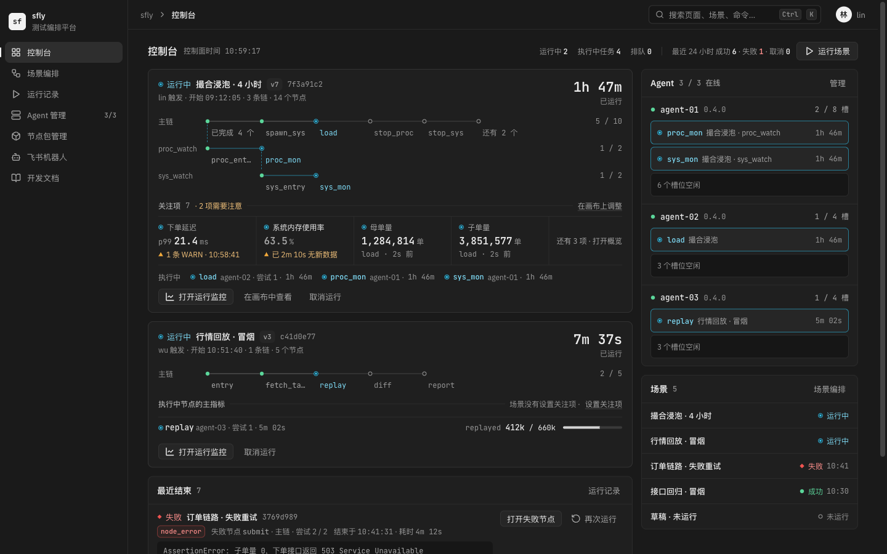
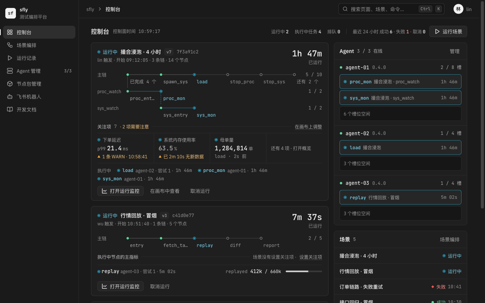
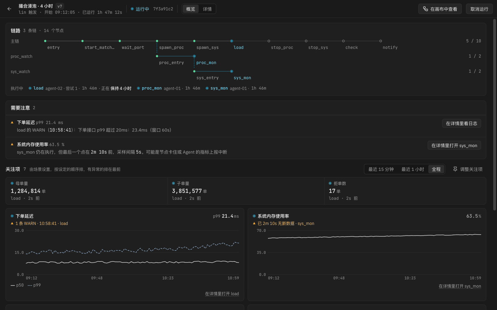
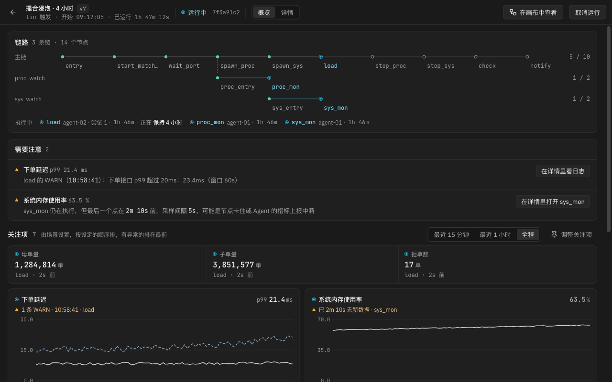
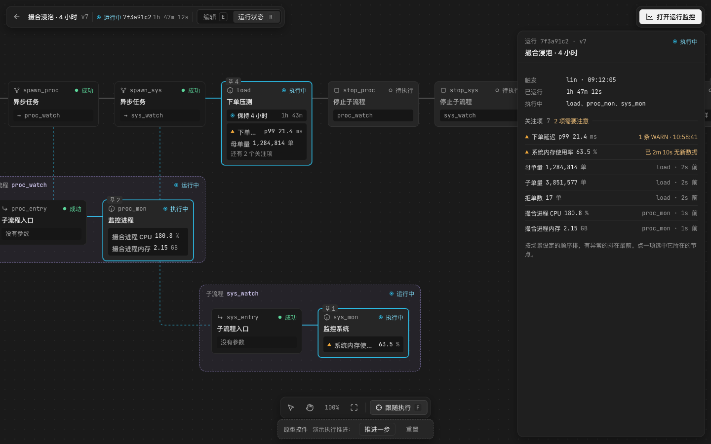
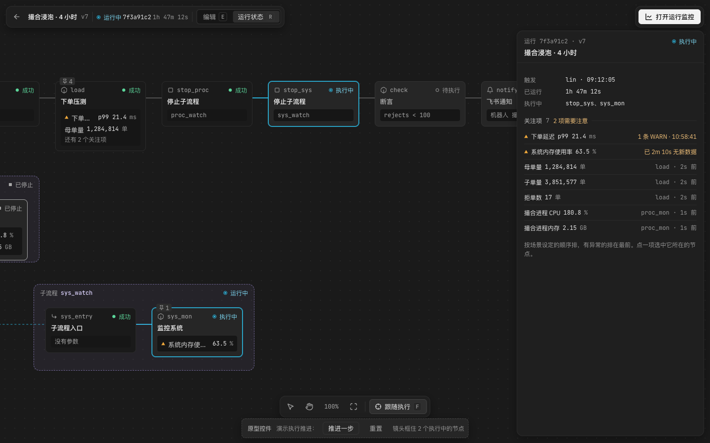
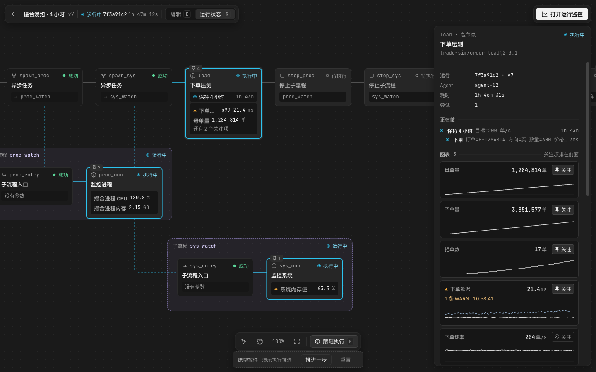
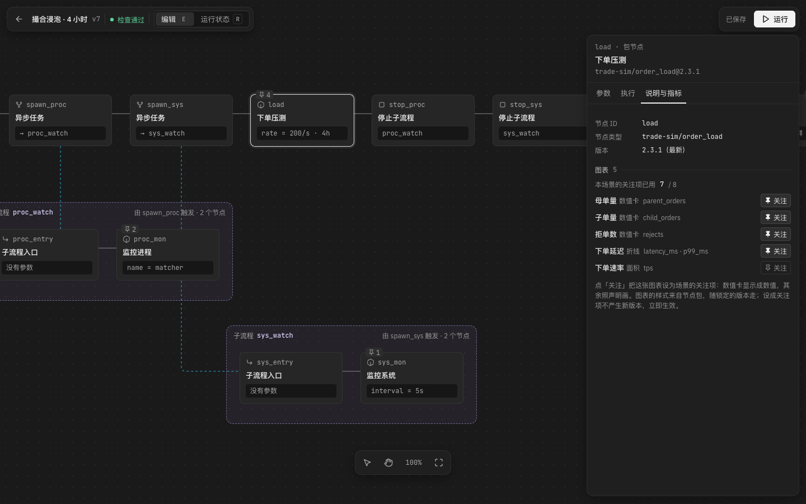
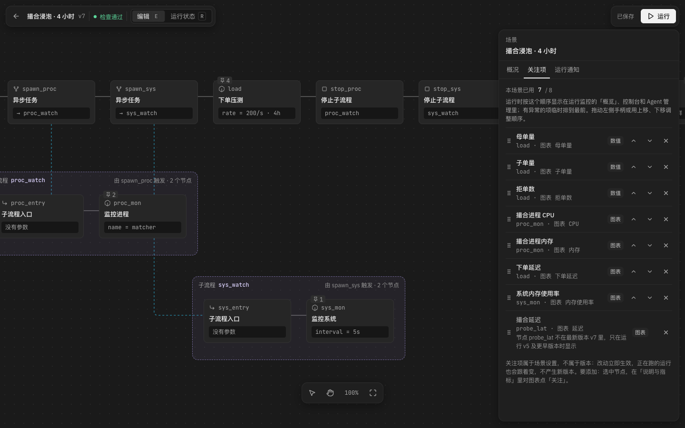
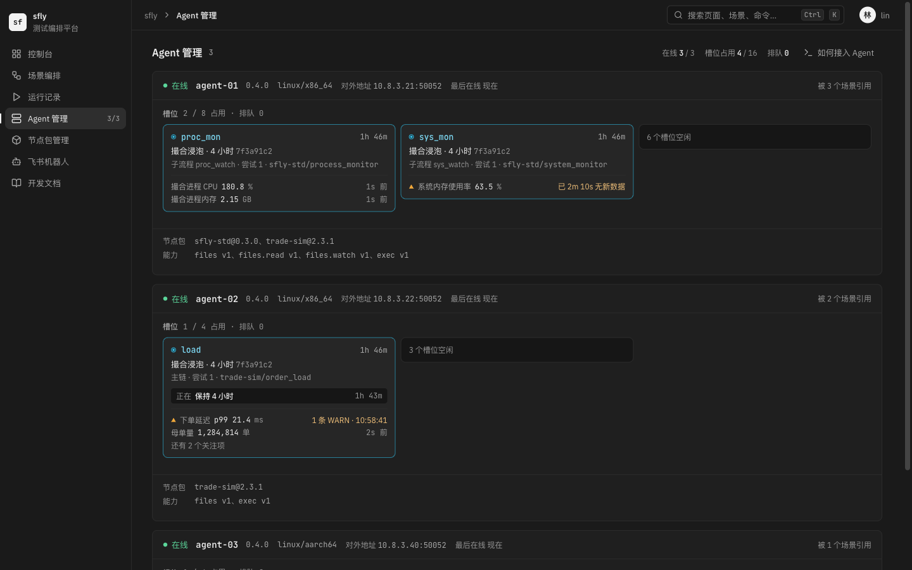

# 关注项：运行中重点展示场景关心的数值与图表

状态：原型第三版。第二版是 2026-11-14 按设计评审修改的；2026-11-15 用户确认了第 4 节的规则和第 7 节的问题，按第 9 节的顺序实现。第三版加上了节点记录的[动作](node-actions.md)。只加了本文和 `focus-items/` 下的原型，没有改 `apps/` 下的代码。外壳页的版面沿用 [外壳页方案](shell-control-wall.md) 的方向 B。

## 1. 为什么

控制台、运行监控页和 Agent 管理页把能显示的都铺了出来：运行监控页按节点分组列出全部图表，一个监控进程节点就有 10 张，盯一个浸泡运行的人要在几十张图里找自己关心的那三四条线。用户想让**场景**声明「这次运行里我最关心什么」，例如被测进程的 CPU 和内存、系统内存、母单量和子单量，三个页面把这些放在最显眼的位置。原来的详细视图保留。

## 2. 已经定下的

| 问题 | 决定 |
|---|---|
| 范围 | 控制台、运行监控页、Agent 管理页，加上编排画布的运行状态。运行记录页不动 |
| 版面骨架 | 外壳页方案的方向 B（实况墙），方向 A 不做 |
| 谁来声明 | 场景作者从**本场景节点已经声明的**图表里挑选；没有挑选时回退到执行中节点的主指标。数据只能来自节点声明过的指标，平台照样不懂业务 |
| 重点由谁决定 | 作者挑选的顺序为准；**有异常的项自动排到第一位**并标出原因（见 4.1）。不另设阈值或正常范围 |
| 运行监控页 | 新增「概览」作为默认视图，现在的版面原样保留为「详情」 |
| Agent 页 | 只展示正在这台 Agent 上执行的任务的关注项；Agent 不新增常驻的机器监控（要看机器资源，就在场景里放「监控系统」节点） |
| 画布运行状态 | 进入执行中节点的连线跟着实际执行推进；节点卡片和检查器显示节点的关注项与图表 |
| 名称 | 「关注项」，已写进术语表 |
| 属于哪里 | 场景的设置，不属于场景版本（和运行通知一样） |
| 改动记录 | 不做历史和恢复；只记最后一次修改的昵称和时间，写在场景检查器「关注项」页顶部 |
| 最终值 | 控制台「最近结束」里失败的运行带关注项的最终值；飞书运行通知加一段「关注项」，列出每一项的最终值。运行记录页不动 |
| SDK 推荐关注 | 不加；没设关注项时用执行中节点的主指标 |
| 画布检查器的时间范围 | 固定显示当前尝试的全程，要缩放就在运行监控里打开 |
| 跟随执行 | 第一次默认打开，之后记住这个浏览器里上次的选择 |
| 交付 | PR #257 只有原型和文档；实现按第 9 节另开 PR |

## 3. 原型

[`focus-items/prototype.html`](focus-items/prototype.html)，浏览器直接打开，地址后加 `#console`、`#run`、`#run-detail`、`#canvas-run`、`#canvas-edit`、`#canvas-scene`、`#agents` 切换页面。`#run-detail` 和检查器、节点卡片、Agent 槽位格里的动作见[动作方案](node-actions.md)第 5 节。演示数据是编的：场景「撮合浸泡 · 4 小时」，主链启动被测进程 `matcher`、开 4 小时压测 `load`（用户的节点包 `trade-sim/order_load`），两个子流程分别用标准节点「监控进程」「监控系统」采集，最后停止子流程、断言、发飞书通知。场景设了 7 个关注项：母单量、子单量、拒单数（数值），撮合进程 CPU、撮合进程内存、下单延迟、系统内存使用率（图表）。其中两项有异常：`load` 有一条「p99 超过 20ms」的 WARN，`sys_mon` 已经 2 分 10 秒没有新数据（采样间隔 5 秒）。

### 3.1 控制台

| 1440×900 | 1280×800 |
|---|---|
|  |  |

- 方向 B 运行块里的「执行中节点表」换成一条**关注项读数**：每格写来源节点的状态形状、名称、最新值，最后一行是「节点 · 多久前」，有异常时换成琥珀三角和原因（「1 条 WARN · 10:58:41」「已 2m 10s 无新数据」，无新数据的值退成次要文字色）。读数之间用 1px 分隔，不套卡片。
- 按运行块的宽度放 3 或 4 格（1440 下 4 格，1280 下 3 格），有异常的项总在里面，其余写「还有 N 项 · 打开概览」。点一格进入运行监控，定位到它所在的节点。
- 标题旁写「2 项需要注意」。没设关注项的运行显示执行中节点的主指标，并给出「设置关注项」的入口。
- 「最近结束」里失败的运行带上关注项的最终值（例子里「子单量 0」直接说明了问题）。
- 右栏 Agent 的槽位**不再重复**关注项的数值，关注项只在运行块里出现一次。

### 3.2 运行监控「概览」

| 1440×900 | 1280×800 |
|---|---|
|  |  |

页头加「概览 / 详情」两个标签页（方向键切换）。概览从上到下是：

1. **链路**：线路，下面一行写执行中的节点、所在 Agent、尝试号和时长（原来单独的「执行中」面板并了进来）。
2. **需要注意**（只在有异常时出现）：每项一行，写清哪个关注项、哪个节点、为什么（WARN 的原文，或「最后一个点在 2m 10s 前，采样间隔 5s」），右侧是「在详情里看日志」或「在详情里打开 sys_mon」。
3. **关注项**：数值一条读数（和控制台同一个组件），图表两列，各自按设定的顺序排、有异常的排前。图表按容器的实际尺寸画，纵轴从 0 开始，避免把正常波动画成大起大落。
4. **其他警告与错误**：不属于关注项的 WARN / ERROR。

失败、取消的运行总是先打开「详情」并定位到失败节点；其余运行记住上次停在哪个视图。

### 3.3 画布运行状态

| 运行到 `load`（没有选中节点） | 推进两步后 | 选中 `load` |
|---|---|---|
|  |  |  |

- **连线**：进入执行中节点的连线是静止的青色实线（和现在一样）。一段连线刚变成执行中时，青色虚线流动两遍后停下，所以动画只出现在执行推进的那一刻，不会在浸泡的几个小时里一直动。系统开启「减少动效」时不流动。
- **跟随执行**（底部工具条，快捷键 `F`；第一次默认打开，之后记住这个浏览器里上次的选择）只移动镜头，不改选中的节点。镜头框住所有执行中的节点（例子里主链的 `load` 和两个子流程里的监控节点），执行前沿停留 2 秒后才平移，0ms 的节点不会让镜头连跳。拖动画布就停止跟随；运行结束后自动关闭。按钮用中性的按下样式和准星图标。原型底部的「推进一步」是演示用的控件，产品里没有。
- **节点卡片**：有关注项的节点左上角标出数量；运行中先显示正在做的[动作](node-actions.md)（一行），再显示前两项（有异常的排前、带三角），多出的写「还有 N 个关注项」。卡片可以用 Tab 聚焦、方向键在节点之间移动、回车选中。
- **检查器**：没有选中节点时显示运行概况和全部关注项（异常在前），点一项选中它所在的节点。选中节点时，在现有摘要（运行、Agent、耗时、尝试）下面列出它声明的图表，关注项排在前面并带「关注」开关，在这里开关立即生效。这改变了现在「画布上只给状态与摘要，图表只在运行监控页里」的约定。

### 3.4 设置关注项（画布编辑模式）

| 节点检查器「说明与指标」 | 场景检查器「关注项」 |
|---|---|
|  |  |

- 关注项以**图表**为单位：节点检查器「说明与指标」里列出节点类型声明的图表，每张一个「关注」开关（读屏读作「把 母单量 设为关注项」，按下状态用 `aria-pressed`，文字不变）。数值卡图表显示成数值，其余照声明画。不再同时提供「钉指标」和「钉图表」两套重叠的开关。
- 区块里显示「本场景的关注项已用 7 / 8」，满 8 个时其余开关禁用并说明原因。
- 不选节点时，场景检查器的「关注项」页按显示顺序列出全部关注项：拖动手柄或用上移、下移按钮调整顺序（读屏会播报新位置），可以移除。引用的节点不在最新版本里时，这一项照样保留，写明「只在运行 v5 及更早版本时显示」。
- 关注项是场景的设置，**不属于场景版本**（和运行通知一样）：改了立即生效，不产生新版本，正在跑的运行也会跟着变。

### 3.5 Agent 管理

方向 B 的机架里，每个占用的槽位格下面是这个任务的前两个关注项（两行文字，有异常的排前），多出的写「还有 N 个关注项」。空闲槽位是一行矮条，不随旁边的格子拉伸。没设关注项的场景显示主指标并写明原因。

## 4. 规则（2026-11-15 确认）

### 4.1 什么算异常

关注项有下面任一情况就算异常，排到第一位并标出原因；不另设阈值：

1. 来源任务在最近 10 分钟内有 WARN 或 ERROR 日志。10 分钟内没有新的，这一项回到原来的位置，「需要注意」里也撤下；日志在「详情」里照样能看到。
2. 来源节点仍在执行，但超过采样间隔的 6 倍、且至少 30 秒没有新数据。采样间隔按这个序列最近 10 个点之间间隔的中位数估算；点不够时只按 30 秒判断。
3. 来源节点失败。
4. 来源节点在最近 10 分钟内开始了重试（上一次尝试失败）。

已停止、已成功的节点的关注项显示最终值，不算异常。

### 4.2 其余规则

1. **不属于版本**：改了立即生效，不产生新版本，正在跑的运行也跟着变；复制场景时一并复制。回看以前的运行时显示的是现在的关注项；引用的节点不在那个运行的版本里时，那次运行不显示这一项。
2. **以图表为单位**，只有一种「关注」开关；没有画进任何图表的指标不能设为关注项。
3. **多个序列**：数值卡和读数格只显示第一个序列（和运行监控现在的数值卡一样）；折线图照节点类型的声明画多条线，读数格显示最近更新的那条，并写出它的标签值。
4. **最多 8 个**。控制台按宽度放 3 或 4 格，概览全部显示，节点卡片和 Agent 槽位只显示属于该节点的前两个。
5. **重试时取最新一次尝试**的数据，趋势从新尝试开始画。
6. **平台不计算速率**：累计值显示当前累计。要看「每秒下单量」，由节点类型另外声明一个瞬时值指标（例子里的 `tps`）。
7. **按图表标题引用**，SDK 不给图表加 ID。节点包新版本改了标题时，这一项写明「这个版本的节点没有图表 X」，不悄悄消失。

## 5. 需要的数据与控制面改动（粗估，选定后再细化）

| 需要 | 现在有没有 | 改动 | 成本 |
|---|---|---|---|
| 存关注项 | 没有。场景表已经有不进版本的设置（名称、说明、运行通知） | `orchestrations` 加 `focus_items jsonb`（`[{ node_id, chart }]`）和最后修改的昵称、时间；读写走场景设置的接口；复制场景时一并复制 | 小 |
| 引用节点 | 节点 ID 跨版本稳定（引用 `${{ nodes.<id> }}` 就靠它） | 无 | 无 |
| 引用图表 | 图表在元信息里只有标题，没有 ID | 按标题引用（4.2 节第 7 条），SDK 不改 | 小 |
| 一次取到运行的全部关注项 | 有指标目录与序列查询，但每项要单独请求 | 新增 `GET /runs/:id/focus?points=N`：服务端把节点解析到最新一次尝试的任务，返回每项的最新值、最后一个点的时间、降采样后的序列。控制台、Agent 页取少量点，概览取更多 | 中 |
| 判断异常 | 指标序列有最后一个点的时间（`metric_series.last_at`）；日志只在日志文件里有级别，数据库没有条数；采样间隔节点没有上报 | 写日志时给任务记下 WARN / ERROR 的条数和最后一条的时间与正文；`/runs/:id/focus` 每项带 `last_at`、估算的采样间隔、这些计数和尝试号 | 中 |
| 控制台、Agent 页知道每个任务属于哪些关注项 | `running_tasks` 有 `run_id`、`node_id` | 前端按运行取一次 `/runs/:id/focus`，按 `node_id` 分给槽位；同一屏只读这一份数据 | 无 |
| 画布检查器显示图表并能开关 | 运行监控页已有按节点取序列的代码 | 复用；只取选中节点的。开关调用场景设置的接口 | 小 |
| 画布跟随执行与连线动画 | 运行叠加已经算出「进入执行中节点的连线」（`run-overlay.ts`） | 前端：新变成执行中的连线流动两遍、镜头框住执行中的节点 | 小 |
| 飞书运行通知带最终值 | 卡片现在只有场景、运行编号、触发人、开始时间、耗时、失败的节点 | 运行结束时按场景当前的关注项取最终值，卡片加一段「关注项」 | 小 |

控制台和 Agent 页的部分要和外壳页方案的方向 B 一起做（第 9 节第 5 步）。

## 6. 风险

- **和现有约定冲突**：`PRODUCT.md` 把「自定义指标面板」列为明确不做，术语表写着「场景里不配置图表」，画布代码约定「图表只在运行监控页里」。采纳后三处都要改：范围外改成「跨场景、跨运行的指标面板」，并写明关注项只能从本场景的节点里挑、不做聚合。
- **按图表标题引用**比较脆：节点包作者改个标题，关注项就失效。失效时要显示得清楚，而不是悄悄消失。
- **异常判断依赖日志和采样间隔**：节点打 WARN 打得很勤时，关注项会一直排在最前；采样间隔靠估算时，刚开始执行的几秒里可能误判为无新数据。
- **不进版本、谁都能改**：同事在运行中移除了一项，盯运行的人只会发现少了一格。场景检查器里能看到最后一次是谁改的，但没有历史，也不能恢复。
- **请求量**：控制台每个正在运行的运行多一个 `/runs/:id/focus` 轮询。正在运行的运行在 10 个以内时和运行记录页现在的负载同级；更多时控制台按外壳页方案 4.2 节折成紧凑行，只取最新值。
- 原型只画了一个设了关注项的运行和一个没设的；失败运行的关注项只在控制台「最近结束」里画了一处，失败运行的概览没有画（规则是直接进详情）。

## 7. 原来的待定问题（2026-11-15 已定）

1. 名称「关注项」和第 4 节的规则：采纳，异常的「最近」定为 10 分钟，并加上「最近 10 分钟内开始了重试」一条。术语表加了「关注项」，「图表」「主指标」两条和 `PRODUCT.md` 的范围外一并改了。
2. 改动记录：不做历史和恢复，只记最后一次修改的昵称和时间。完整历史要新表和界面，而且没有登录，昵称谁都能填，记录本身不太可信。
3. 最终值算「成绩单」：控制台「最近结束」里失败的运行带最终值，成功、取消的仍然一行；飞书运行通知加一段「关注项」。运行记录页不动。
4. SDK 不加「推荐关注」：主指标已经表达了「这个节点最该看什么」，再加一个会和它重叠。
5. 画布检查器的图表固定显示当前尝试的全程，不放时间范围控件。

## 8. 评审记录

2026-11-14 对第一版原型做了一次设计评审（设计评审与自动检测各自独立进行），23/40。按评审修改的问题：

| 问题 | 第二版的做法 |
|---|---|
| 关注项不带状态，「关注」不等于「需要关注」 | 读数带来源节点的状态形状和「多久前」；有异常的排前并写原因；概览加「需要注意」 |
| 密度挪了地方，还重复显示、数值不一致 | 控制台只放 3 或 4 格；右栏槽位不再重复；画布检查器把关注项并进图表列表；Agent 槽位只放前两项；读数不再套卡片 |
| 跟随执行抢选中、跟错对象，动画循环几个小时 | 跟随只移镜头、框住全部执行中节点、停留 2 秒后平移、运行结束自动关闭；连线只在刚变成执行中时流动两遍 |
| 状态形状退化，键盘和读屏走不通 | 状态改用 SVG 形状（执行中是点加外圈，强制颜色下可见）；线路连线改用边框；节点、读数、检查器里的行都能用键盘操作；排序有上移、下移；开关用 `aria-pressed`，每个按钮写明是哪一项；概览 / 详情是真正的标签页；图表有文字名称 |
| 钉选模型让人猜 | 以图表为单位，一种开关；显示 7 / 8 配额；运行状态检查器里也能开关 |
| 其他 | 1280 宽度不再横向滚动；图表文字不再被拉伸；画布缩放时节点文字按比例补偿；检查器背景不透明；执行中节点的耗时不再显示 0ms；副标题改为 12px |

## 9. 实现顺序

每一步单独开 PR，单独通过类型检查、单元测试和 e2e：

1. **关注项的数据**：场景设置里存关注项和最后修改人；写日志时给任务记 WARN / ERROR 的条数和最后一条；`GET /runs/:id/focus`（最新值、降采样序列、`last_at`、估算的采样间隔、异常判断需要的计数）。
2. **在画布编辑模式里设置关注项**：节点检查器「说明与指标」里的开关和配额，场景检查器「关注项」页的排序列表和最后修改人。
3. **运行监控「概览」**：概览 / 详情标签页、需要注意、关注项读数与图表、其他警告与错误。
4. **[动作](node-actions.md)**：SDK 的 `ctx.action` 与 `ctx.mark`、Agent 转发、控制面存储与上限、运行监控「详情」的「动作」标签页和时间线轨道。可能拆成 SDK 与 Agent、控制面、前端三个 PR。
5. **画布运行状态**：连线只在刚变成执行中时流动、跟随执行、节点卡片上的动作和关注项、检查器里的「正在做」「动作」、图表和「关注」开关。
6. **方向 B 的控制台和 Agent 页**（外壳页方案第 7 节）：运行块里直接放关注项读数，不再先做原方案的「执行中节点表」；Agent 槽位格带正在做的动作和前两个关注项。
7. **飞书运行通知带关注项的最终值**。

概览和画布不依赖方向 B，所以先做，盯运行的人最先用上；方向 B 放在后面，可以直接用关注项读数，控制台不用改两遍。
