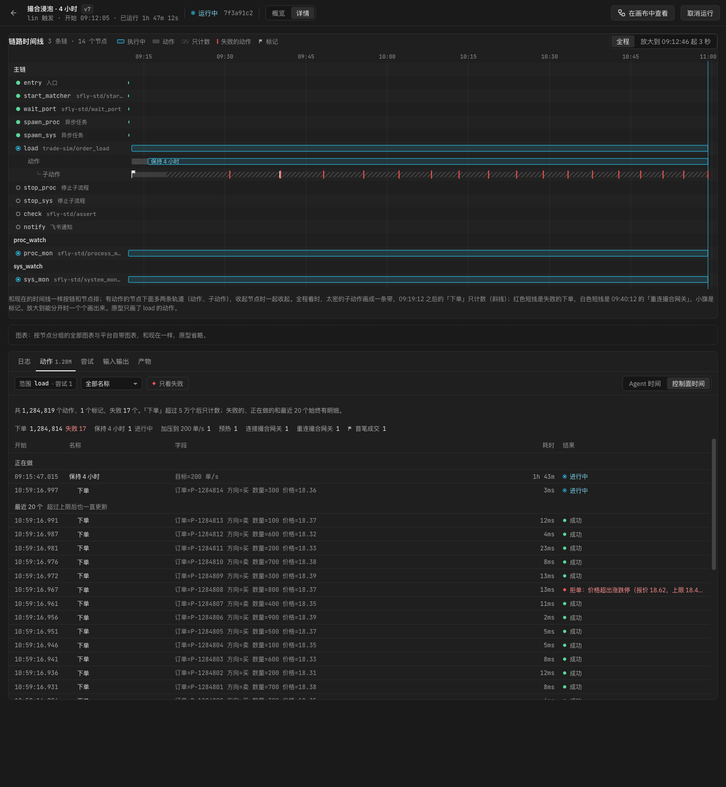
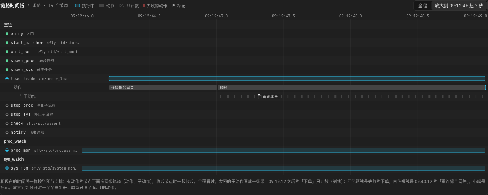
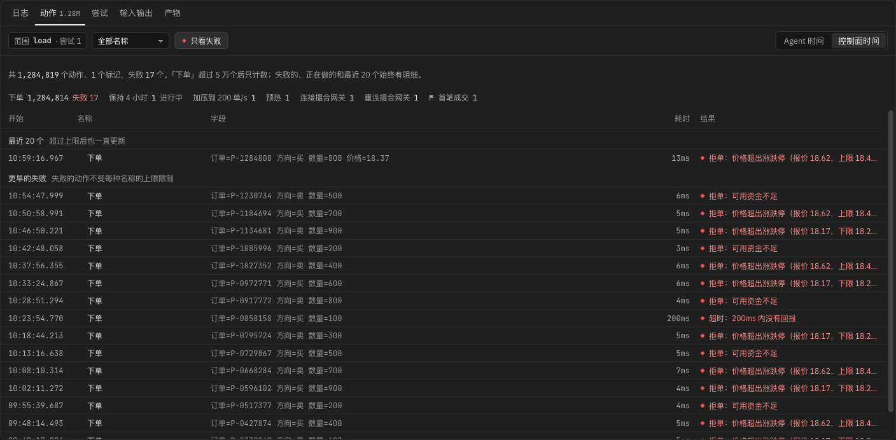
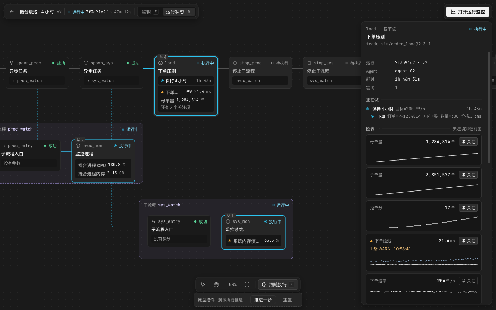
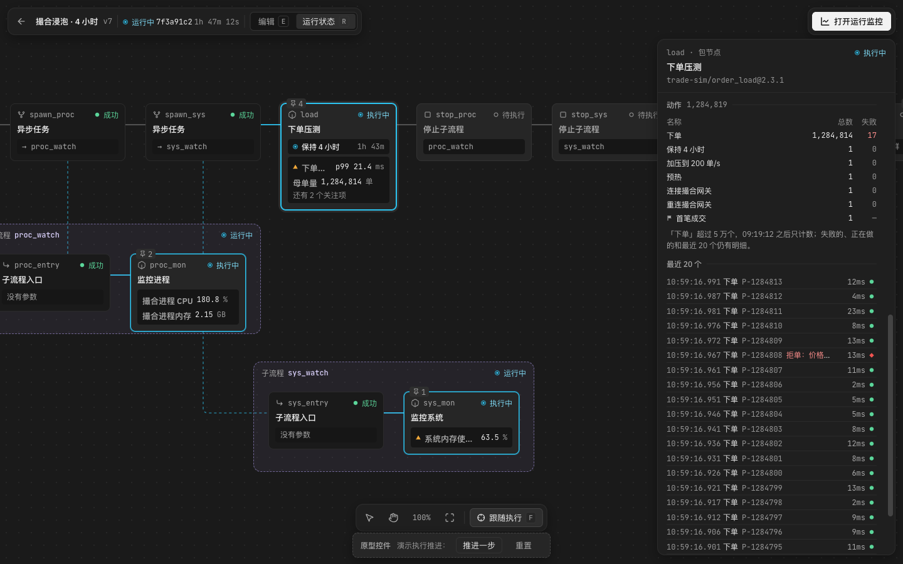

# 动作：让人知道节点运行中在做什么

状态：方案已定（2026-11-15 用户确认了第 2 节，看过原型后又确认了第 7 节）。界面画在[关注项原型](focus-items/prototype.html)第三版里（`#run-detail`、`#canvas-run` 选中 `load`、`#agents`）。实现顺序见关注项方案第 9 节第 4 步。没有改 `apps/`、`sdk/`、`agent/` 下的代码。

## 1. 为什么

用户的例子：下单节点下 n 个单，每次下单前记一笔，完成后结束，记下这个操作和对应的时间，让人知道节点运行中在做什么。

现在 SDK 有三种上报，都回答不了「第 37 单是几点开始的、花了多久、成没成」：

- **日志**：自由文本。时间和耗时要自己拼，界面也不会画成区间。
- **进度**（`ctx.progress`）：只保留最新一条，Agent 每秒最多上报一次。
- **指标**：随时间变化的数值，说明「多少、多快」，不说明「哪一件事」。

## 2. 已经定下的（2026-11-15）

| 问题 | 决定 |
|---|---|
| 名称 | 「动作」：有开始和结束的一件事；只有一个时刻、没有持续时间的叫「标记」。两条都已写进术语表。SDK 里写作 `ctx.action`、`ctx.mark` |
| 和指标的关系 | 平台不从动作计算指标：不画耗时曲线，不算每秒次数或 p99。要看曲线，由节点类型声明指标 |
| 和日志、节点状态的关系 | 动作不自动写日志。失败的动作不改变节点的状态，也不算关注项的异常；要引起注意，节点自己打 WARN |
| 和进度的关系 | 进度保留。显示「正在做什么」的地方优先显示动作，没有动作时显示进度的说明 |
| 数量很多时 | 有上限，超出后只计数；正在做的、最近 20 个、每种动作的总数与失败数始终准确（第 4 节） |
| 在哪里显示 | 画布的节点卡片和 Agent 槽位格多一行；画布检查器的「正在做」和「动作」区；运行监控「详情」的「动作」标签页和时间线；「概览」里「执行中」那一行。控制台不放 |
| 交付 | 先画原型第三版，界面细节看过后再定；实现排在关注项方案第 9 节第 3 步之后（见那一节） |

## 3. SDK 的写法

```python
with ctx.action("下单", 订单=oid, 价格=price) as a:
    resp = place(oid, price)
    a.note(回报=resp.status)            # 补充说明字段
    if resp.rejected:
        a.fail(f"拒单：{resp.reason}")   # 标成失败，不抛异常
# 代码抛异常离开 with 时自动记为失败（带异常类型和消息），异常照常往外抛

h = ctx.action.start("等待回报", 订单=oid)   # 开始和结束不在同一段代码里时
...
h.end()        # 或 h.fail("超时")

ctx.mark("收到第一笔成交", 订单=oid)
```

- **结果**：`with` 正常结束是成功；`a.fail()` 或抛异常是失败；任务结束时还没结束的记为「未结束」，包括因为取消抛出的 `Cancelled`。
- **嵌套**：同一个线程里，在一个动作内部开始的动作是它的子动作，界面上缩进显示，最多显示 3 层，更深的画在第 3 层。`ctx.action.start` 返回的句柄不跟线程走，要指定父动作时传 `parent=`。
- **并发**：多个线程同时进行的动作各自成行，可以重叠。
- **不用声明**：动作名称不需要像指标那样先声明。名称最多 64 个字符；说明字段最多 8 个，每个值最多 256 个字符，转成字符串。订单号这种取值很多的值放进字段，不要放进名称。不同名称超过 100 个时，SDK 警告一次。
- **同一个句柄结束两次**：第二次忽略，警告一次。
- **本地调试**：`sfly debug` 在终端里打印动作的开始、结束和耗时；`sfly.testing` 可以断言节点记录了哪些动作。

## 4. 记录规则

1. **上限**：
   - 每种名称最多完整记录 5 万个，全部名称合计最多 10 万个（动作和标记一起算）。按开始的先后计；已经记录的动作，结束时照样记下结束。
   - 失败的动作不受每种名称上限的限制，只受合计 10 万个的限制。

   每种名称各自有上限，是画原型时补的：下单每秒 200 次，开始后大约 6 分钟就能占满 10 万个；之后才发生的「重连撮合网关」、拒单这些少见但重要的动作，就都没有明细了。
2. **超出上限后**：不再记录新动作的明细，SDK 警告一次，并建议按批或按阶段记录、用指标看每一笔的延迟。下面这些始终准确：正在做的动作、最近 20 个结束的动作、每种名称的总数与失败数。
3. **时间**：开始和结束按控制面时间显示，和日志一样用 Agent 的单调时钟换算（ADR 0018）；Agent 时间在「动作」页里切换显示。耗时用单调时钟算，测试改了 Agent 的系统时间也不受影响。
4. **重试**：每次尝试各自记录，和日志一样按尝试分开看。
5. **保留期**跟日志相同，运行被清理时一起删掉。
6. **开发文档里的建议**：功能测试里下几十单，可以每单记一个动作；高频压测按批或按阶段记（「加压到 2000 单/s」「保持 4 小时」），每一笔的延迟用指标。

## 5. 原型

演示数据是编的：`load`（`trade-sim/order_load`）先「连接撮合网关」，再按阶段记「预热」「加压到 200 单/s」「保持 4 小时」，阶段里每下一单记一个子动作「下单」，收到第一笔成交时记一个标记。运行了 1 小时 47 分，下了 128 万单，其中 17 单被拒；09:40:12 有一次「重连撮合网关」。

### 5.1 运行监控「详情」



- **时间线**：有动作的节点下面多两条轨道，「动作」和「子动作」，收起节点时一起收起。
  - 全程看时，太密的子动作画成一条带；超出上限、只计数的那一段画成斜线。
  - 失败的动作是红色短线，少见的动作（重连）是白色短线，标记是小旗。
  - 放大到能分开时，一个一个画出来：

  

- **底部面板**在「日志」旁边加一个「动作」标签页：
  - 工具条：范围（节点与尝试）、按名称筛选、「只看失败」、Agent 时间 / 控制面时间。
  - 一行总数，加每种名称的总数和失败数。
  - 表格按开始时间从新到旧，分成「正在做」「最近 20 个」「更早：已记录的明细」三组，只计数的那一段写明有多少个、为什么没有明细。
  - 点开始时间，日志跳到那个时刻。

  「只看失败」：

  

### 5.2 画布运行状态

| 节点卡片与检查器的「正在做」 | 检查器的「动作」区 |
|---|---|
|  |  |

- **节点卡片**多一行：执行中的形状、最外层开始得最早的那个动作、已持续多久。卡片只有 184px 宽，所以用形状代替「正在」两个字。
- **检查器**：
  - 摘要下面是「正在做」，按层级缩进，列出名称、字段、已持续多久。
  - 图表后面是「动作」区：每种名称的总数和失败数、上限说明、最近 20 个。

### 5.3 Agent 管理与运行监控「概览」

Agent 槽位格在关注项上面多一行「正在 保持 4 小时 · 1h 43m」（见[关注项方案 3.5 节的截图](focus-items/agents-1440.png)）。「概览」里「执行中」那一行，在节点后面写「正在 保持 4 小时」（见[关注项方案 3.2 节](focus-items/run-1440.png)）。

## 6. 需要的改动（粗估）

| 部分 | 改动 | 成本 |
|---|---|---|
| SDK | `ctx.action`（`with`、`start` / `end` / `fail` / `note`）和 `ctx.mark`；事件文件里新增动作开始、动作结束、标记三种事件，带单调时钟读数；上限、超出后每秒一次的摘要（正在做的、最近 20 个、计数）也在 SDK 里做 | 中 |
| Agent | 和日志一样约每 100 毫秒一批转发新事件；proto 加一种批量消息。要先确认旧版本 Agent 遇到不认识的事件类型会怎样，再定 SDK 需要的最低 Agent 版本 | 中 |
| 控制面 | 按任务存动作（新表，按任务和开始时间建索引），按同样的上限兜底；任务上存正在做的、最近 20 个和计数；`GET /tasks/:id/actions`（分页、按名称、只看失败、时间范围）和实时推送 | 中 |
| 前端 | 运行监控「详情」的「动作」标签页和时间线轨道；画布检查器的「正在做」和「动作」区；节点卡片、Agent 槽位格、「概览」里的那一行 | 中 |
| 文档 | 开发文档的 SDK 章节加动作，写清什么时候用动作、日志、进度、指标，以及高频时的建议 | 小 |

## 7. 看过原型后定下的（2026-11-15）

1. **上限补两条**（第 4 节第 1 条）：每种名称最多完整记录 5 万个，全部合计最多 10 万个；失败的动作不受每种名称上限的限制。
2. **节点卡片和 Agent 槽位格**显示最外层、开始得最早的那个动作（「保持 4 小时 · 1h 43m」）。最里层的（「下单 P-1284814 · 3ms」）每秒都在变，在检查器的「正在做」里看。
3. **时间线**：有动作的节点下面多两条轨道（动作、子动作），收起节点时一起收起。画在节点那一行里会和尝试的条重叠。
4. **标准节点**这一轮不记录动作：它们各自只做一件事，节点的状态和耗时已经说明在做什么。以后有具体需要（例如等待端口时记下每次重试）再单独加。
5. **点一个动作**时日志跳到它开始的时刻，高亮最接近的一行，前后的日志照常能看到。只显示这段时间的日志的话，「保持 4 小时」这样的长动作会筛出几个小时的日志，起不到筛选的作用。

## 8. 风险

- **高频时的开销**：每次 `ctx.action` 往事件管道写两行。每秒上万次时，管道和 Agent 的转发量和现在的指标差不多（指标也是每调用一次写一行）；超出上限后改成每秒一次摘要。
- **名称取值很多**：把订单号写进名称时，「每种名称的计数」会变成一张很长的表，每种名称的上限也失去意义。SDK 在不同名称超过 100 个时警告一次。
- **和日志重复**：有的节点已经在日志里写「开始下单」「下单完成」。动作不替代日志，开发文档里写清什么时候用哪个。
- **超出上限后的明细缺口**：只计数的那一段，只能看到失败的和最近 20 个。界面上写明缺口的时间段和原因，不让人以为那段时间没有动作。
