# 外壳页方案：控制台与 Agent 管理

状态：2026-11-14 用户选定方向 B，方向 A 不做；在方向 B 上重点展示场景关心的内容，见 [关注项](focus-items.md)。以下为原方案。

原状态：方案，等用户决定改不改。这个分支只加了本文和 `shell-control-wall/` 下的原型，没有改 `apps/` 下的任何代码。

设计评审的结论是：控制台和 Agent 管理页现在是通用的开发者后台模板（6 张统计卡、几乎全空的柱状图、单行宽表），把产品名换掉就能给任何系统用。评审建议往 DESIGN.md 里写的「夜班控制室」方向改：控制台以此刻在跑的运行为主，Agent 页显示每个槽位正在执行哪个运行的哪个节点。本文给出两个方向和推荐，供决定。

`docs/` 下没有放方案的惯例目录（`docs/prototype/` 放的是已经定稿的原型，`docs/research/` 放调研），所以新建了 `docs/proposals/`。

## 1. 现状

现状截图都是同一套数据拍的，不在仓库里，路径是 `/home/x7yue/.local/state/sfly-design-pass/before/`：`04-dashboard.png`（控制台）、`07-agents.png`（Agent 管理）、`06-runs.png`（运行记录）、`01-monitor-running.png`（运行监控）。仓库里的金图 `apps/web/e2e/__screenshots__/visual.spec.ts/dashboard.png`、`dashboard-empty.png`、`agents.png`、`agents-empty.png` 是另一套测试数据，问题相同。

| 控制台（现状） | Agent 管理（现状） |
|---|---|
|  |  |

全新环境的控制台（仓库金图）：

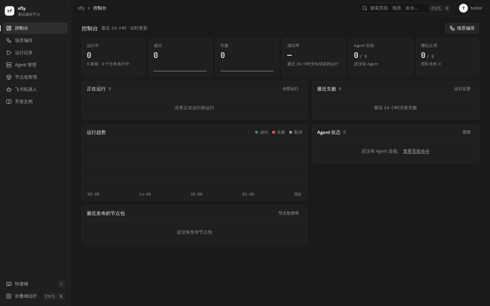

### 1.1 控制台

1. **6 张同尺寸统计卡占据首屏最显眼的一行**，是「大数字、小标签、迷你趋势」的通用模板。其中「运行中 1」与下方「正在运行」面板重复，「Agent 在线 1/1」「槽位占用 2/4」与右下「Agent 状态」面板重复。
2. **成功、失败卡的迷你趋势是 24 个小时桶**，只有最后一个桶有值，画出来是一条平线加末端一个尖。它不传达任何趋势。
3. **成功率 50.0% 建立在 2 个运行上**，副标题「前 24 小时没有结束的运行」读起来像是在否定上面的数字。测试平台上成功率随触发的场景剧烈波动，作为首屏第二大的数字没有意义。
4. **「运行趋势」柱状图占 220px 高，23 个桶为空。** 截图里它比「正在运行」面板大三倍。
5. **「正在运行」只有一行**，信息比运行记录页的运行卡片（`06-runs.png`）还少：没有主指标、没有进度、没有节点在哪台 Agent 上。产品原则第 1 条要求「正在跑什么、跑到哪、为什么失败」一眼可见，现在要点进运行监控才知道。
6. **「最近发布的节点包」放在控制台上**，和盯运行、排查失败、搭场景三个场景都无关，节点包管理页已经有这份信息。
7. **全新环境里控制台是 4 个写着「没有」的面板**（`dashboard-empty.png`），没有白色主操作，也没有说下一步是什么。新用户需要知道的顺序（接入 Agent、发布节点包、新建场景、触发运行）只在开发文档里。

### 1.2 Agent 管理

1. **11 列的单行宽表**，变化最快的事实（槽位里在跑什么）只是一个 4 格的槽位条和「2/4」，而静态信息（系统、地址、能力、节点包）占了大半宽度，能力一列折成 3 行。
2. **看不到 Agent 和运行的关系**。接口其实已经返回了每个占用槽位的任务（`AgentView.running_tasks` 里有 `run_id`、`node_id`、`attempt`、`started_at`），页面只用了它的长度。
3. **看不到排队**。任务排队等某台 Agent 时（不在线或没有空闲槽位，最多等 `queue_timeout`），Agent 页和控制台都只有一个全局的「排队任务 0」，不知道在等谁。

## 2. 三种场景下打开这两页最想知道什么

| 场景 | 打开控制台时 | 打开 Agent 管理时 |
|---|---|---|
| 长时间盯运行（浸泡、压测跑几小时） | 我的运行还在跑吗，跑了多久；跑到哪个节点；主指标在不在动；子流程有没有失败；有没有任务卡在排队 | 我的节点在哪台 Agent 上、占了几个槽；这台 Agent 还在线吗；排队的任务在等谁 |
| 失败后排查 | 刚才哪个运行失败了，哪个节点、哪种错误、第几次尝试、错误信息；一步进到失败节点；改好后再次运行 | 失败是不是 Agent 的问题：是否离线过、是否在更新、节点包是否装上、时钟是否偏差 |
| 搭场景 | 我正在改的场景上次运行结果如何；目标 Agent 是否在线、是否空闲；从这里直接运行或回到画布 | 场景要用的 Agent 在不在、有没有空槽、装了哪个版本的节点包 |
| 全新环境 | 还差哪一步才能跑起第一个运行，现在该做什么 | 怎么接入第一台 Agent（现有的空状态已经回答了） |

这张表决定了两页的信息层级：此刻在跑的运行与槽位第一，刚结束、需要处理的运行第二，静态配置第三。

## 3. 方向 A：在现有结构上调整

原型：[`shell-control-wall/a-adjust.html`](shell-control-wall/a-adjust.html)（`#console`、`#agents`、`#empty`）。

| 控制台 1440×900 | 控制台 1280×800 |
|---|---|
| 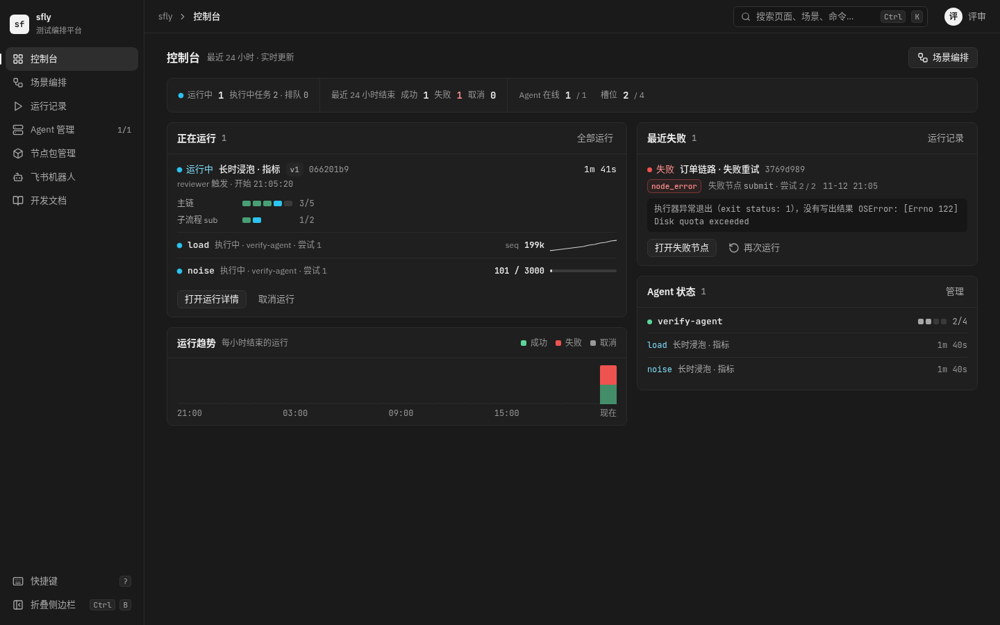 | 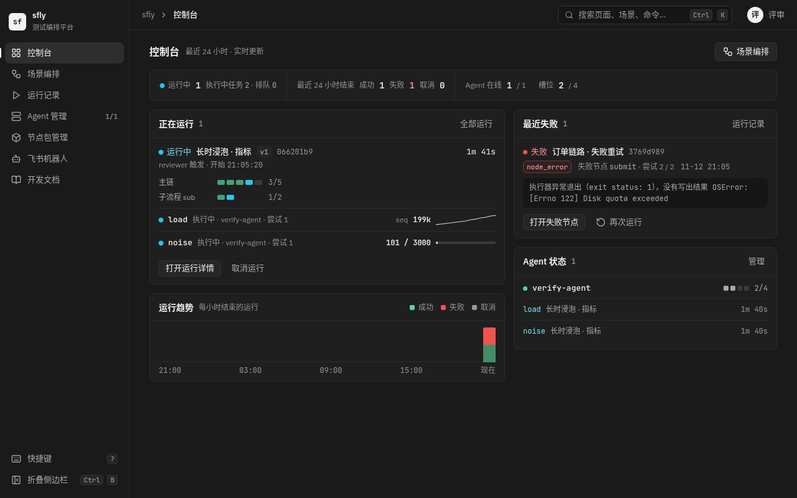 |

| Agent 管理 1440×900 | Agent 管理 1280×800 |
|---|---|
| 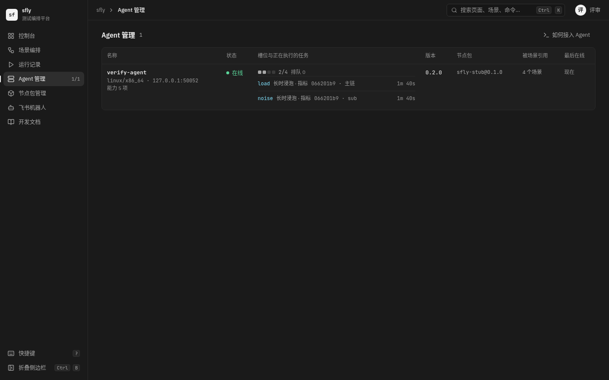 | 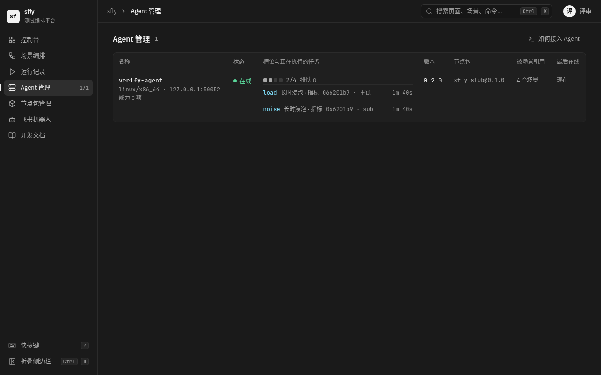 |

### 3.1 版面与信息层级

- 页头、两栏网格、面板都保留。
- 6 张统计卡合并成一条 52px 高的状态条：运行中、执行中任务、排队；最近 24 小时结束的成功、失败、取消；Agent 在线、槽位。去掉迷你趋势和成功率。数值不再用 22px，降到 14px 等宽。
- 「正在运行」换成运行记录页运行卡片的内容：各链进度、当前节点、主指标或进度、所在 Agent 与尝试号。
- 「运行趋势」压到 56px 高。
- 「最近失败」加尝试号、完整的错误信息（最多两行）、「打开失败节点」「再次运行」。
- 「Agent 状态」在槽位条下列出占用槽位的任务（节点、场景、已执行时长）。
- 删除「最近发布的节点包」。
- Agent 管理仍是表格：11 列减到 7 列，系统、地址、能力合并到名称下的第二行，「槽位」列改成「槽位与正在执行的任务」。

### 3.2 空态与首次引导

和方向 B 相同，见第 5 节。

### 3.3 需要的数据与控制面改动

| 需要 | 现在有没有 | 改动 | 成本 |
|---|---|---|---|
| 运行卡片的链进度、当前节点、进度 | 有，`GET /runs?status=running`（`RunListItem.active_nodes`） | 控制台改用这个接口，或在 `DashboardRunningRun` 上加同样的字段 | 无（前者）/ 小 |
| 当前节点的主指标 | 有，`/runs/:id/metrics` 目录与序列（运行记录页 `RunCard` 已在用） | 无 | 无 |
| 当前节点在哪台 Agent、第几次尝试 | 没有 | `RunListActiveNode` 加 `agent`、`attempt`、`started_at`（`tasks` 表已有这些列） | 小 |
| 槽位里的任务属于哪个场景 | 部分：`running_tasks` 有 `orchestration_id`，没有名称 | `RunningTaskView` 加 `orchestration_name`（`agent-hub.ts` 的查询多连一张 `orchestrations`） | 小 |
| 失败的尝试号 | 没有 | `DashboardFailure` 加 `attempt` | 小 |

删除：`DashboardView.recent_packages` 与它的查询，`success_rate`、`previous_success_rate`。

### 3.4 风险

- 骨架没变。状态条仍是统计卡换了个排法，「运行趋势」在大多数时间仍然几乎是空的，评审说的「换个产品名就能用」只改善了一半。
- 正在运行的运行一多，左栏的运行卡片会把运行趋势推出首屏；没有给出多运行时的退化规则。
- Agent 表格在 Agent 有 8 个以上槽位时，「槽位与正在执行的任务」一格会很高，表格行高失控。

## 4. 方向 B：墙

原型：[`shell-control-wall/b-wall.html`](shell-control-wall/b-wall.html)（`#console`、`#agents`、`#empty`）。

| 控制台 1440×900 | 控制台 1280×800 |
|---|---|
| 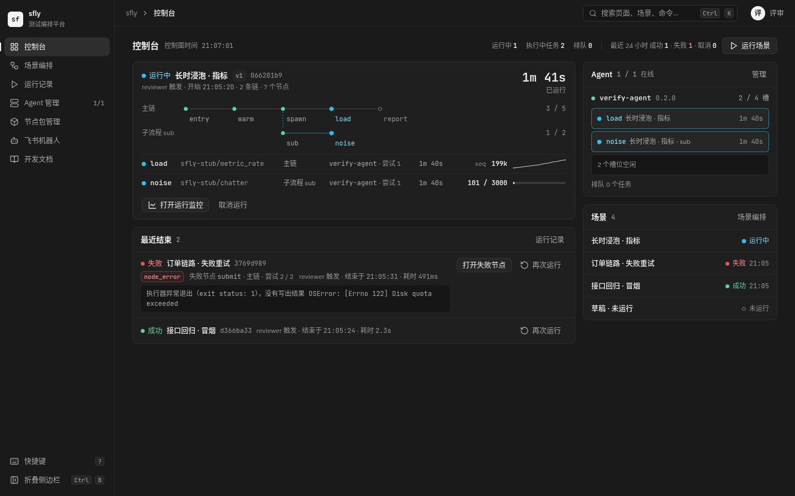 | 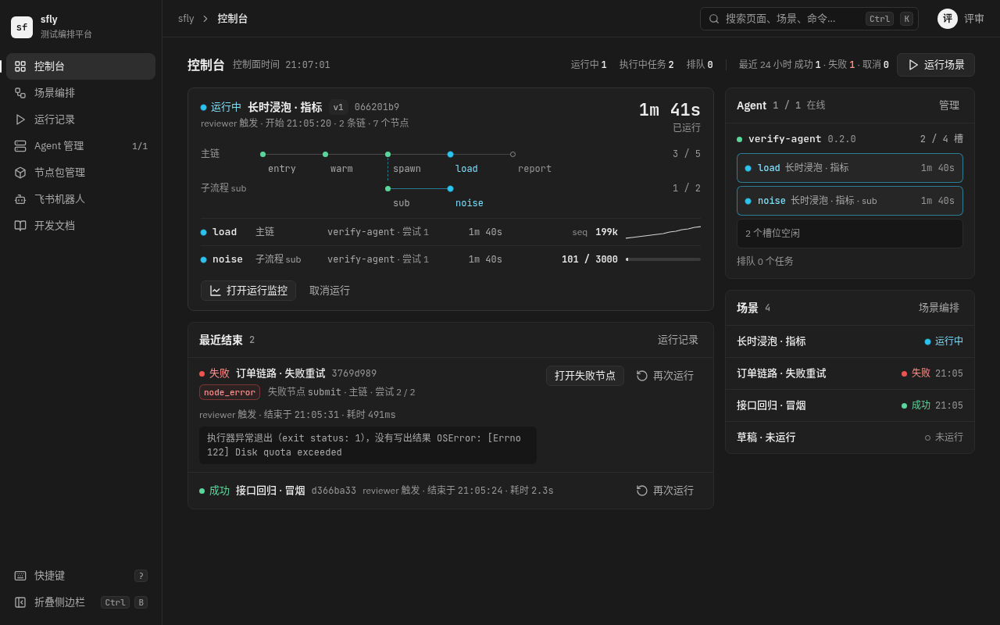 |

| Agent 管理 1440×900 | Agent 管理 1280×800 |
|---|---|
| 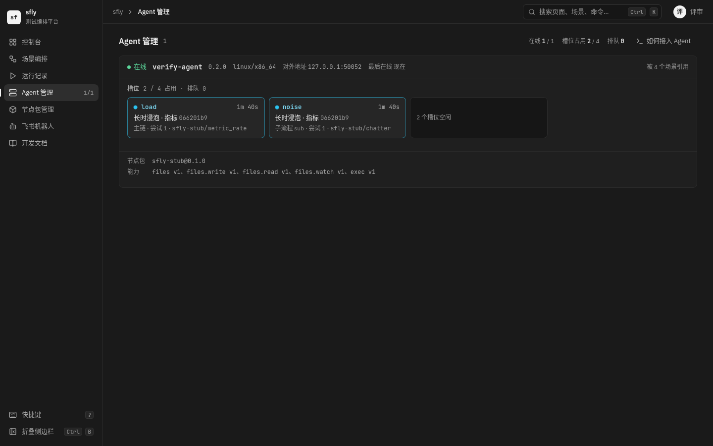 | 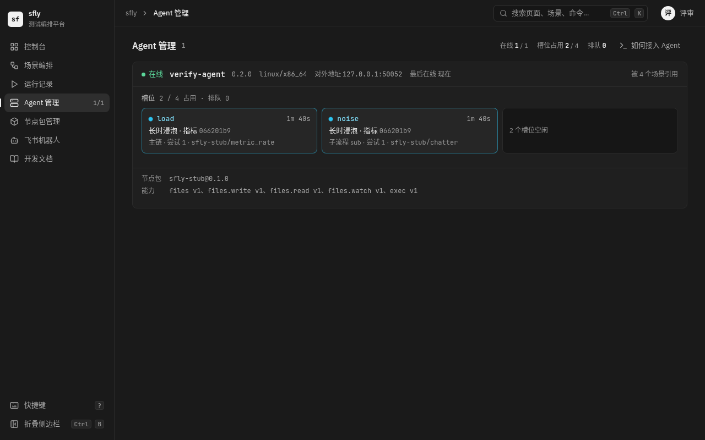 |

现状与方向 B 对比（控制台）：

| 现状 | 方向 B |
|---|---|
|  |  |

### 4.1 版面与信息层级

控制台换成「此刻」的视图，没有统计卡，也没有图表。

- **页头一行**：「控制台」、控制面时间（`generated_at`），右侧是一行等宽的计数（运行中、执行中任务、排队；最近 24 小时成功、失败、取消）和「运行场景」（默认按钮，打开命令面板的「运行场景」组）。原来页头的「场景编排」按钮和侧栏重复，删掉。
- **左栏：正在运行**。每个运行一块：场景、版本、运行编号、触发人与开始时间；右上角是已运行时长，用全站唯一的 22px 统计字号（「已运行」是盯运行的人最先看的数字）。下面是**线路**：每条链画成一条线，节点是站，状态点沿用状态语法（成功绿实心、执行中青色脉冲、待执行灰空心圈），进入执行中节点的那一段线是青色；子流程从触发它的异步任务节点下方分出，分支线用画布上「调度连线」同样的青色虚线。再下面是执行中节点的表：节点、节点类型、所在链、Agent 与尝试号、已执行时长、主指标的最新值与趋势（没有主指标时是进度）。最后是「打开运行监控」「取消运行」。
- **左栏：最近结束**。最近 24 小时结束的运行按结束时间从新到旧，失败的带错误类型、失败节点、所在链、尝试号和最多两行的错误信息，操作是「打开失败节点」「再次运行」（打开运行抽屉，参数取自这次运行）。成功和取消的运行只占一行。
- **右栏：Agent**。每台 Agent 的槽位按派发顺序列出正在执行的任务（节点、场景、子流程名、已执行时长），连续的空闲槽合并成一行「N 个槽位空闲」，下面是这台 Agent 的排队数。离线、更新中、版本不一致的 Agent 在名称行上用现有的状态文字。
- **右栏：场景**。按最近一次运行的时间列出场景与上次运行结果，从没运行过的场景显示「未运行」（空心圈）。点行进入画布。这是给搭场景的人用的入口。

**签名元素**是两处共用的「线路」和「槽位格」：运行块里的线路回答「跑到哪」，Agent 列和 Agent 页的槽位格回答「谁在占用这台机器」。两处都只用已有的状态色和画布的连线语言，没有新颜色。

Agent 管理页每台 Agent 是一个「机架」面板：

- 头部一行：状态、名称、版本、系统、对外地址、最后在线，右侧「被 N 个场景引用」。
- 主体是槽位格网格：占用的格子是青色描边（与画布上执行中节点的描边一致），写节点、场景、运行编号、所在链、尝试号、节点类型、已执行时长；空闲槽合并成一格。排队的任务列在网格下方，写排队了多久、多久后 `queue_timeout`。
- 底部是节点包与能力，`fg-3` 小字。
- 现在状态列里的更新状态（更新中、更新失败、需要手动升级）、时钟偏差提示、能力不能被其它 Agent 调用的原因、节点包安装失败，都放在头部行的状态之后；「立即更新」按钮放在头部行右侧。原型只画了在线、无告警的一台，这几种状态没有画。

### 4.2 数量变多时的规则

原型的数据只有 1 个运行、7 个节点、1 台 Agent，下面这些规则没有在原型里验证，实现时要先用测试数据画出来。

| 情况 | 规则 |
|---|---|
| 2 个以上正在运行 | 运行块按开始时间从新到旧纵向排列；3 个以上时执行中节点表只列前 2 行加「还有 N 个」 |
| 6 个以上正在运行 | 运行块换成一行一个的紧凑行（场景、线路缩略、当前节点、已运行），点开展开 |
| 链上节点很多（例如 30 个） | 线路只画已完成的最后 1 站、执行中的站、之后 2 站，其余折成「已完成 N 个」「还有 M 个」 |
| Agent 很多 | 控制台右栏只列忙碌、离线、更新中的 Agent，其余合并成「N 台空闲」；完整列表在 Agent 管理页 |
| 等待节点（定时、Sleep） | 在线路上用等待琥珀点，执行中节点表里写唤醒时间；不占槽位，所以不出现在 Agent 列 |
| 此刻没有运行 | 左栏顶部一行「此刻没有运行」，最近结束上移；不放白色按钮 |

### 4.3 需要的数据与控制面改动

| 版面元素 | 来源 | 现在有没有 | 改动 | 成本 |
|---|---|---|---|---|
| 运行块的链、节点状态、当前节点、进度 | `GET /runs?status=running` 或 `GET /dashboard` 的 `running_runs` | 有 | 无 | 无 |
| 当前节点的 Agent、尝试号、开始时间 | `RunListActiveNode` | 没有 | 加 `agent`、`attempt`、`started_at`、`wake_at`（`tasks` 表已有这些列） | 小 |
| 节点类型、主指标 | `/runs/:id/metrics` 目录与序列 | 有（运行记录页在用） | 无 | 无；每个正在运行的运行多 1 个目录请求和每个当前节点 1 个序列请求，运行记录页已经承担同样的负载 |
| 最近结束（含成功与取消，失败带节点、错误、尝试号） | `GET /dashboard` | 部分：`recent_failures` 只有失败，没有尝试号 | 用 `recent_ended`（窗口内最近结束的 10 个运行，失败的带第一个失败的链与节点、错误、尝试号）替换 `recent_failures` | 中：改写 `dashboard-stats.ts` 的 `failedChains` 查询与测试 |
| 最近 24 小时计数 | `DashboardRunStats` | 有 | 无 | 无 |
| 槽位里的任务属于哪个场景、哪条链 | `GET /agents` 的 `running_tasks` | 部分：有 `run_id`、`orchestration_id`、`node_id`、`attempt`、`started_at` | 加 `orchestration_name`、`chain_instance_id`、`chain_name`（子流程名，主链为 null）；`agent-hub.ts` 的查询多连 `orchestrations` 与 `chain_instances` | 小 |
| 每台 Agent 的排队任务 | 没有 | 没有；但排队的任务在库里已经有 `agent_name` 和 `queue_expires_at` | `AgentView` 加 `queued_tasks`（同一查询把 `queued` 状态也取出来，带 `queued_at`、`queue_expires_at`） | 小 |
| 场景列 | `GET /orchestrations`（`last_run`、`updated_at`） | 有 | 无 | 无 |
| 首次引导的四步是否完成 | `GET /agents`、`GET /packages`、`GET /orchestrations` | 有 | 无（也可以在 `/dashboard` 加一个 `setup` 摘要省掉三个请求） | 无 / 小 |
| 再次运行 | 运行抽屉 + `GET /runs/:id` 取参数 | 有（运行监控的「再次运行」） | 无 | 无 |

删除：`DashboardView` 的 `hourly`、`success_rate`、`previous_success_rate`、`recent_packages`、`agents.list`（控制台的 Agent 列改用 `GET /agents`，和 Agent 管理页共用缓存）；前端的 `Stats`、`StatCard`、`TrendChart`、`TrendLegend`、`PackagesPanel`。

**不做的：槽位编号。** 原型里槽位格没有「槽 1」「槽 2」。系统里没有槽位身份，`running_tasks` 只是按派发顺序排列，一个任务结束后后面的任务会「换号」，编号会误导。要真正的槽位编号，需要 Agent 在 `TaskStarted` 里上报槽位序号（proto、Rust Agent、控制面三处改动），收益不值这个成本。

### 4.4 风险

- **改动面比 A 大**：控制台和 Agent 管理页的组件基本重写，`dashboard.spec.ts`、`agents.spec.ts` 和金图 `dashboard.png`、`dashboard-empty.png`、`agents.png`、`agents-update.png`、`agents-update-now.png` 都要重写或重新生成。
- **4.2 节的规则没有在原型里验证**。多运行、长链是浸泡和压测的常见情况，规则不对，墙会比现在更乱。
- **去掉了 24 小时趋势和成功率**。如果有人靠它看「今天整体好不好」，这个信息只剩页头的三个计数和运行记录页。按 PRODUCT.md 的用户（写节点、跑场景、排查失败的工程师），推断没有人依赖它，但没有证据。
- **请求变多**：控制台从 1 个轮询请求（`/dashboard`，2 秒）变成 `/dashboard`、`/agents`（5 秒）、`/orchestrations`，加上每个正在运行的运行的指标目录与序列。正在运行的运行在 10 个以内时，和运行记录页现在的负载同级；更多时按 4.2 节的紧凑行只取目录里的最新值，不取序列。
- **Agent 页的告警状态没有画**。更新、时钟偏差、能力不可用、安装失败这几种状态都要放进机架头部那一行，可能挤不下，需要单独画一遍。

## 5. 两个方向共用：全新环境的「开始使用」

| 1440×900 | 1280×800 |
|---|---|
| 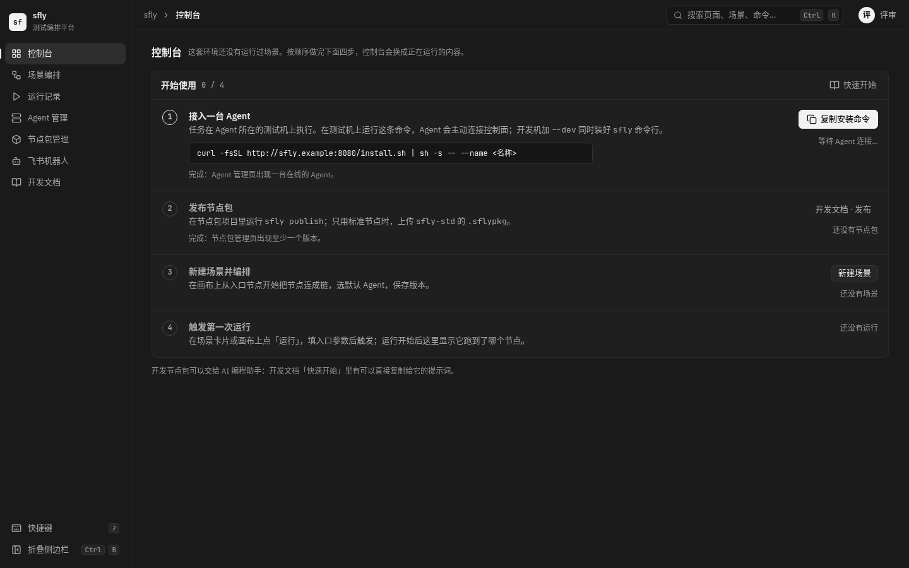 | 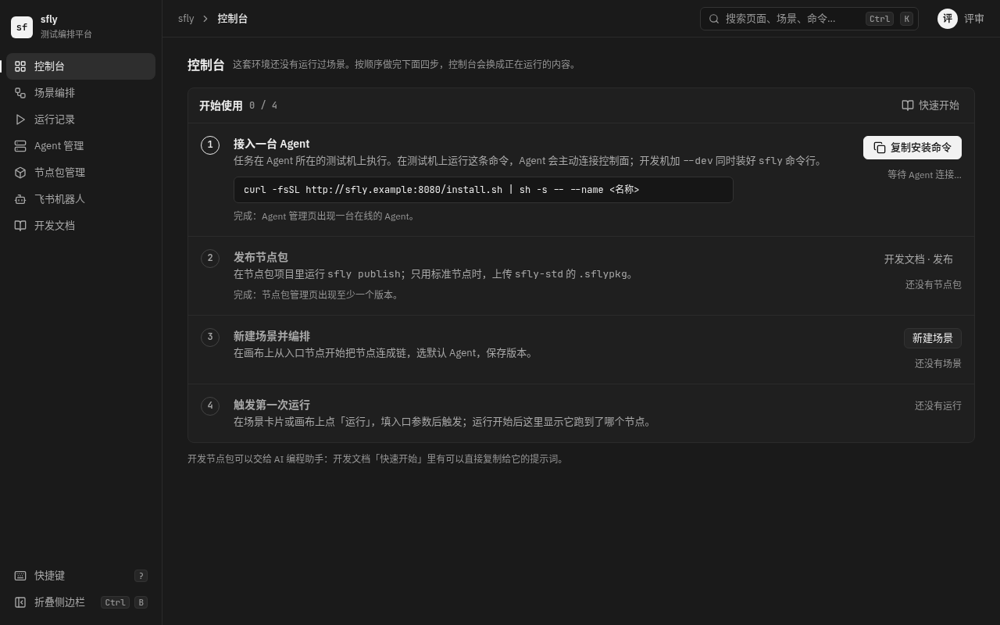 |

环境还没有运行过任何场景时，控制台只显示「开始使用」面板，四步按顺序排：

1. **接入一台 Agent**：安装命令（地址取 `install_script_url`）、完成条件「Agent 管理页出现一台在线的 Agent」。
2. **发布节点包**：`sfly publish`，或上传 `sfly-std` 的 `.sflypkg`；链接到开发文档「发布」。
3. **新建场景并编排**：「新建场景」按钮。
4. **触发第一次运行**：说明在哪里点「运行」。

**白色主操作是第一个没完成的那一步的动作**：没有 Agent 时是「复制安装命令」，有 Agent 没有节点包时没有白色按钮（发布在命令行里完成，按钮是开发文档链接），有节点包没有场景时是「新建场景」，有场景没运行过时是「运行场景」。每屏最多一个白色按钮的规则不变。已完成的步骤显示绿色对勾和事实（例如「verify-agent 在线」）。四步都完成、出现第一个运行之后，面板不再出现。面板底部一行提示开发文档「快速开始」里有给 AI 编程助手的提示词。

每一步是否完成都能从现有接口判断（见 4.3 节表格），不需要新数据。Agent 管理页的空状态（安装命令）已经合格，不改。

## 6. 推荐

推荐方向 B。

- 产品原则第 1 条和 DESIGN.md 的北极星说的就是「此刻在跑什么、跑到哪」。方向 A 把这条信息挪到了更好的位置，但首屏仍是统计条和一张多数时间为空的柱状图；方向 B 让控制台只剩回答第 2 节那张表的内容。
- 方向 B 需要的控制面改动大多是在已有查询里多连一两张表、多带几个已有的列（4.3 节），唯一中等成本的是把 `recent_failures` 改成 `recent_ended`。它同时删掉了按小时分桶、成功率对比、最近节点包三段服务端计算和对应的前端组件，代码总量预计不增加（推断，没有数过）。
- 方向 A 的每一项改动都是方向 B 的子集，先做 A 再做 B 等于把控制台改两遍。

如果只想先拿到一部分收益，方向 B 的第 1、2 个提交（见第 7 节）单独上线也成立：删掉统计卡和趋势图，Agent 接口带上场景名和排队。

## 7. 采纳后的提交拆分

每个提交单独通过类型检查、单元测试和 e2e（含金图），按这个顺序：

1. **控制台减法**：删除统计卡、运行趋势、最近发布的节点包；页头换成一行计数。同时删掉 `DashboardView` 的 `hourly`、`success_rate`、`previous_success_rate`、`recent_packages` 和服务端的计算与测试。更新 `dashboard.png`。
2. **Agent 任务带上场景、链和排队**：`RunningTaskView` 加 `orchestration_name`、`chain_instance_id`、`chain_name`，`AgentView` 加 `queued_tasks`；`RunListActiveNode` 加 `agent`、`attempt`、`started_at`、`wake_at`。只改 schema、服务端和测试，界面不变。
3. **Agent 管理页改成机架**：槽位格组件（`components/status` 里，和 `SlotBar` 放在一起），告警状态放进头部行。更新 `agents.png`、`agents-update.png`、`agents-update-now.png`。
4. **控制台运行墙**：线路组件、执行中节点表、最近结束（服务端 `recent_ended` 替换 `recent_failures`）、Agent 列（改用 `GET /agents`，删掉 `DashboardView.agents.list`）、场景列，含 4.2 节的退化规则与测试数据。更新 `dashboard.png`，`dashboard.spec.ts` 重写。
5. **开始使用**：全新环境的四步面板。更新 `dashboard-empty.png`。
6. **文档**：DESIGN.md 与 `docs/DESIGN-SYSTEM.md` 里「Stat 字号用于控制台统计数字」改成「用于运行的已运行时长」，组件清单加线路与槽位格。

## 8. 原型说明

- 两份原型都是自包含的单文件 HTML，直接用浏览器打开，地址后加 `#console`、`#agents`、`#empty` 切换页面。颜色只用 `apps/web/src/styles/tokens.css` 里的值，字号、圆角只用 DESIGN.md 的档位。
- IBM Plex Sans 与 JetBrains Mono 的拉丁子集以 data URI 内联在文件里，中文回退到系统字体（和产品一样）。重新内联用 `shell-control-wall/inline-fonts.py`（`python3 -I inline-fonts.py <含 @fontsource 的 node_modules 目录> a-adjust.html b-wall.html`）。
- 截图用 agent-browser 在 1440×900 与 1280×800 下拍，文件名是 `<方向>-<页面>-<宽度>.png`。全新环境两个方向相同，只拍了方向 B 的。
- 数据与现状截图同一套：场景「接口回归 · 冒烟」（成功，2.3s）、「订单链路 · 失败重试」（失败，`submit` 节点 `node_error`）、「长时浸泡 · 指标」（运行中）、「草稿 · 未运行」，Agent `verify-agent` 4 个槽位占用 2 个。下面几个值是为了展示新字段编的，不来自截图：失败的「尝试 2 / 2」、各运行精确到秒的结束时间、执行中节点的「已执行 1m 40s」。

## 9. 未决问题

- 控制台是否保留任何跨时间的统计（例如最近 24 小时的计数之外的趋势）。本方案认为不需要，需要用户确认没有人依赖成功率。
- 「场景」列的排序：按最近一次运行时间，还是按最近一次保存版本的时间。搭场景的人更关心后者，盯运行的人更关心前者；原型按前者。
- 线路在节点很多时的折叠规则（4.2 节）是否足够，需要用 30 个节点的场景（`docs/prototype/frontend-v2.html` 里的 `b7e2a91c`）画一遍再定。
